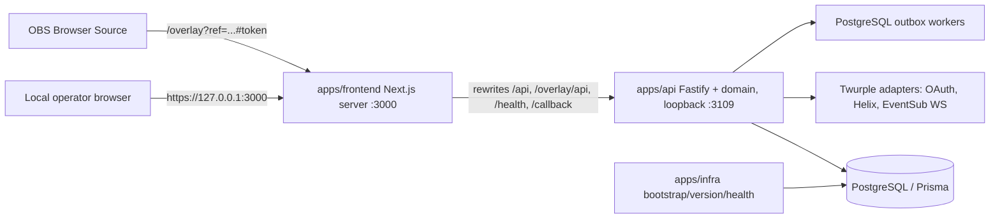

# Runtime topology
[Português brasileiro](../pt-BR/fullstack-architecture/runtime-topology.md)

Root `Dockerfile` and pull-only `compose.yaml` define product runtime; `compose.build.yaml` explicitly adds source build contexts for CI/maintainers. The installer embeds runtime configuration only and pulls a prebuilt image. Under OPS-15, Next.js App Router uses the production Node server over HTTPS and owns the local panel/overlay origin; Fastify remains domain/API authority on loopback port 3109 behind the same-origin rewrites. Since OPS-15 cutover Wave 1, Next serves `/` (the Overview) and Fastify serves no browser file; Fastify receives only `/api/*`, `/overlay/api/*`, `/health` and `/callback` (`apps/frontend/scripts/dev-proxy-config.mjs:41-46`). OBS loads the Next `/overlay` route through the widget link `/overlay?ref=...#token` (`apps/api/src/domain/overlay-widget-service.mjs:41`); the legacy `/overlay.html` alias was removed in cutover Wave 3 and `/overlay.html` now gets a Next 404 (`tests/integration/compose-runtime.test.js:376`). Compose services: one-shot `bootstrap`; persistent healthy `db`; one-shot `migrate` after DB health; non-root `bot` only after migrations complete. Host publishes only `127.0.0.1:3000:3000`; API and database ports are not published. Volumes persist DB and operational secrets. The bot mounts first-party catalogs from the image and the host community catalog directory read-only; installers create the host directory. Developers use `npm ci` then `npm run dev` for local HTTPS/HMR and isolated PostgreSQL. Test installer/runtime in isolated Compose with disposable data; never use active product volumes for migrations or recovery tests. Recovery is a forward fix or redeploying a previous image digest; `legacy` is not a rollback target.
