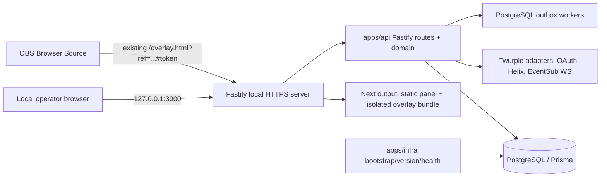

# Runtime topology
[Português brasileiro](../pt-BR/fullstack-architecture/runtime-topology.md)

Root `Dockerfile` and `compose.yaml` are product entrypoints. Under OPS-15, Next.js App Router uses `output: 'export'` and `trailingSlash: true`; the panel exports route directories with `index.html`, and the overlay HTML is copied to the exact `out/overlay.html` path. Fastify serves only `out/` and remains the only runtime HTTP server. OAuth callback and API routes stay explicit Fastify routes before static serving. Compose services remain: one-shot `bootstrap`; persistent healthy `db`; one-shot `migrate` after DB health; non-root `bot` only after migrations complete. Host publishes only `127.0.0.1:3000:3000`; Fastify binds `0.0.0.0` in its container. Database has no host port. Volumes persist DB and operational secrets. The bot mounts first-party catalogs from the image and the host community catalog directory at `/app/.local/community-catalogs` read-only; installers create the host directory. Test generated installer Compose on each supported OS. Test exported serving in isolated Compose with disposable PostgreSQL; do not use active product volumes for migration or rollback rehearsal.
