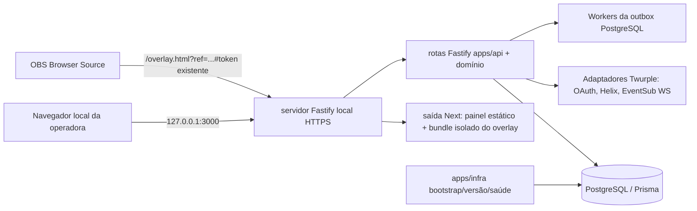

# Topologia de runtime
[English](../../fullstack-architecture/runtime-topology.md)

Sob a OPS-15, Next.js App Router usa `output: 'export'` e `trailingSlash: true`; o painel exporta diretórios de rotas com `index.html`, e o HTML do overlay é copiado para o caminho exato `out/overlay.html`. Fastify serve somente `out/` e continua como único servidor HTTP runtime. Callback OAuth e rotas da API permanecem explícitas no Fastify antes do serving estático. `Dockerfile` e `compose.yaml` na raiz continuam como entrypoints do produto. Serviços Compose: `bootstrap` de execução única; `db` persistente e saudável; `migrate` de execução única após a saúde do banco; `bot` sem root e iniciado só após migrations concluídas. O host publica somente `127.0.0.1:3000:3000`; Fastify escuta `0.0.0.0` no contêiner. Banco sem porta publicada. Volumes mantêm banco e segredos operacionais. O bot monta os catálogos first-party da imagem e o diretório comunitário do host em `/app/.local/community-catalogs` somente para leitura; instaladores criam esse diretório. Teste o Compose gerado pelos instaladores em cada SO suportado. Valide o serving exportado em Compose isolado com PostgreSQL descartável; não use volumes ativos do produto em ensaios de migração ou rollback.
