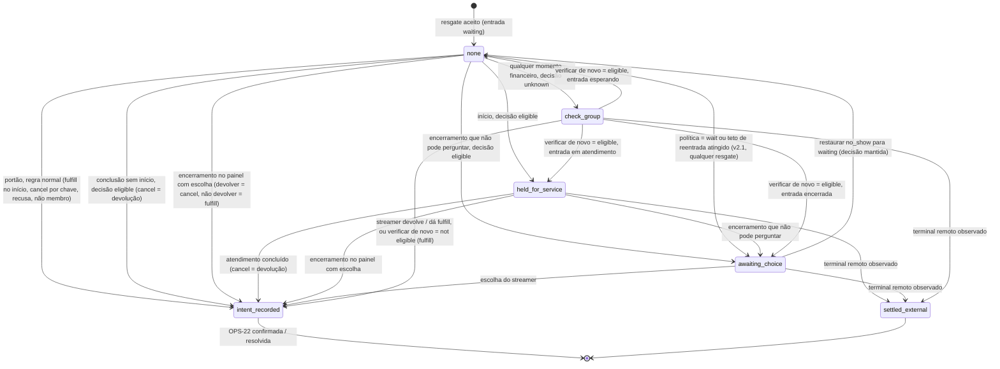

# OPS-31 — Desenho de arquitetura v2: fila natural e devolução de pontos por grupo

[English](../../../stories/OPS-31/architect-design-v2.md)

**Autora:** `@architect` (Aria) — **Data:** 2026-11-15 — **Modelo:** Opus 5.5 (autorizado pelo proprietário para este desenho: dinheiro, estados de resgate, migração). **Modo:** YOLO; escolhas de produto e de dinheiro **não** são decididas aqui, ficam em [decisions-for-owner](decisions-for-owner.md).
**Revisão 2026-11-15 (v2.1, `@architect`, Sonnet 5.5):** incorpora as respostas do proprietário O-1..O-10 (todas DECIDIDAS, ver [decisions-for-owner](decisions-for-owner.md)); acrescenta a **política de liquidação** por fila (seção 3.10), o contador do teto de reentrada (3.11), a migração M3 (seção 10) e o pacote P5b (seção 14). Os trechos alterados levam "(v2.1)".
**Revisão 2026-11-15 (v2.2, `@architect`, Sonnet 5.5):** incorpora as respostas do proprietário Q-1, Q-2 e a resposta sobre fusão (todas DECIDIDAS, ver [decisions-for-owner](decisions-for-owner.md)) e a [pesquisa EventSub `stream.online`](../../research/2026-11-15-eventsub-stream-online/README.md): o teto de reentrada conta **por live** por meio de uma sessão de live (seções 3.11 e 3.12), migração M4 (seção 10) e pacote P6b (seção 14). Regra do proprietário: **o fim da live não altera filas, entradas nem resgates** (invariante LIVE-1). Os trechos alterados levam "(v2.2)".
**Revisão 2026-11-15 (v2.3, `@architect`, Sonnet 5.5):** aplica as correções DB-1..DB-11 da [revisão do `@data-engineer`, seção 9](data-engineer-review.md) e registra as decisões do proprietário Q-3, Q-4 e DB-5 (todas DECIDIDAS, ver [decisions-for-owner](decisions-for-owner.md)): o `CHECK` de `awaiting_choice` (DB-1), as migrações M2a/M2b (DB-2), o padrão `legacy` do S1 até o P7 (DB-3), a janela de fusão numa linha de `settings` para a M4 ser uma tabela só (DB-4), o teto contado na intenção (DB-5), `rollback.sql`, proteções e ordem estritamente inversa (DB-6), o lock por canal, o nome da tabela nos testes e a ordem fechar-depois-inserir (DB-7), a regra do `online` tardio (DB-8), a chave composta e a limpeza por sessão inteira (DB-9), cinco colunas na M1 (DB-10) e timeouts por migração (DB-11). Os trechos alterados levam "(v2.3)".
**Revisão 2026-11-15 (v2.4, `@architect`, Sonnet 5.5):** fecha N-1 e N-2 da [reavaliação do DE, 9.7](data-engineer-review.md) (o `CHECK` opcional de `refunded_at` ganha a sua própria migração de validação M3a; a troca do padrão no P7 se chama M3b e entra na ordem de aplicação e reversão) e responde às pendências do [plano de UX v2](ux-plan-v2.md) na nova seção 3.13 (lista de causas, API, horário da leitura remota em `conflict`, resposta do `concluir` do moderador). Dois pontos de produto continuam abertos para `@po`/dono (3.13 E). Os trechos alterados levam "(v2.4)".
**Revisão 2026-11-15 (v2.5, `@architect`, Sonnet 5.5):** fecha G-B1, G-B2, G-B4 e G-B5 do [plano do `@qa`, 24.1](qa-test-plan.md) e DB-12, DB-13, DB-14 e N-5 da [revisão do DE, 9.7 e 9.8](data-engineer-review.md), e dá recomendações técnicas (sem decisão de produto) para G-B3, G-B6 e G-B8, tudo na nova seção 3.14. DB-15..DB-17 só são registradas como trabalho do P7. Pontos de produto para `@po`/dono: a sexta causa de "decidir uma a uma", o texto da evidência do AC 39 e a igualdade no teto (3.14 C, E). Os trechos alterados levam "(v2.5)".
**Revisão 2026-11-15 (v2.6, `@architect`, Sonnet 5.5):** registra duas decisões do proprietário: G-B6 (o streamer escolhe como o teto de reentrada se comporta: duas configurações por fila, `reentry_cap_hold` e `reentry_cap_counts_manual`, com padrões seguros, mais `redemptions.refund_origin`; impacto na M3 e na M3a) e o sexto código de causa `batch_deferred` (lista da DB-12, 3.13, 3.14, M2a), tudo na nova seção 3.15. O item 4 de 3.14 C e a 3.14 E.2 ficam fechados ou superados no próprio lugar. Os trechos alterados levam "(v2.6)".
**Revisão 2026-11-15 (v2.7, `@architect`, Sonnet 5.5):** fecha DB-18..DB-21 da [revisão do DE, 9.9](data-engineer-review.md) (a criação de índices em `redemptions` passa para os arquivos de validação; `CHECK`s simples em `queues`; o `CHECK` de estado lista seis estados; `refund_origin` sem `INCLUDE` e um gatilho de guarda separado), confirma as linhas C16/C17 do [plano do `@qa`, 24.1](qa-test-plan.md) (G-B15), decide que o bloco da política **não é exibido** antes do P7 (ponto aberto 10 do [plano de UX v2](ux-plan-v2.md)) e deu uma recomendação técnica sobre G-B13 (substituída na v2.8 pela decisão do dono), tudo na nova seção 3.16. Os trechos alterados levam "(v2.7)".

**Revisão 2026-11-15 (v2.8, `@architect`, Sonnet 5.5):** o dono decidiu que salvar `at_n` com limite exatamente 1 **pede um diálogo de confirmação** antes de salvar (decisão U-20 do [plano de UX v2](ux-plan-v2.md), fecha o G-B13), o que substitui a recomendação da v2.7 de não ter diálogo na 3.16 E; o bloco da política continua oculto antes do P7 (3.16 D, sem mudança). A confirmação é **somente do cliente: a API, o modelo de dados, as migrações e os códigos de erro não mudam** (o `PUT` já aceita o par e o diálogo envia a mesma requisição que o Salvar enviaria). Os trechos alterados levam "(v2.8)".
**Substitui:** [architect-design.md](architect-design.md) (v1, 2026-11-11). O v1 fica como histórico; onde divergirem, vale o v2. O v2 fecha as lacunas G-1..G-15 da [auditoria de 2026-11-13](../../audits/audit-2026-11-13.md) (seção 7) e incorpora a [revisão do `@data-engineer`](data-engineer-review.md), o [plano de UX](ux-plan.md) e o [plano do `@qa`](qa-test-plan.md).
**Story:** [story.md](story.md) (ACs 1-33). **Pesquisa:** [nota queue-group-refund](../../research/2026-11-06-queue-group-refund/README.md), linha 27 do índice, veredito SUFICIENTE; nenhuma pesquisa nova foi feita ([research-gaps](research-gaps.md)).
**Classe de evidência:** leitura estática da `main` `af6d6a2` na worktree `.local/ops31-wt`. Nada foi executado (sem PostgreSQL, Twitch, navegador ou OBS). Os números de linha são os da `af6d6a2`. O que não foi lido no código está marcado como **HIPÓTESE** ou listado na seção 15.

## 0. Resumo em dez linhas

1. Os pontos pertencem à Twitch. O produto **não** cria saldo, livro de pontos nem entidade "membro". Ele registra, **por resgate**, uma decisão de grupo e um estado de liquidação, e emite exatamente uma das duas operações da Twitch: `CANCELED` (devolução) ou `FULFILLED` (pontos mantidos).
2. O único dado persistente novo de "pertencimento" é a lista própria do streamer (ids numéricos). Inscritos, moderadores e VIPs são consultados no momento da decisão e nunca guardados.
3. Hoje sete caminhos de código gravam uma tarefa financeira por regra e ignoram qualquer retenção (seção 2). O v2 põe todos atrás de **um portão financeiro único** (D2-1), entregue **antes** de qualquer restrição de esquema, e proíbe chave `financial:` montada à mão com uma regra estática.
4. Um membro fica `UNFULFILLED` do início ao fim do atendimento; o fim emite a devolução. Qualquer outro encerramento de um membro pergunta ao streamer (painel) ou espera o streamer (`awaiting_choice`) quando ninguém pode ser perguntado. (v2.1) Cinco encerramentos que o proprietário deixou ao streamer (chave desligada, conclusão direta, conclusão de moderador, limpeza pelo chat, teto de reentrada) são governados por uma **política de liquidação por fila** cujo padrão seguro é "esperar a decisão do streamer" (seção 3.10); o produto nunca devolve nem dá fulfill em silêncio.
5. Um sexto estado de liquidação, `settled_external`, cobre o resgate retido que a Twitch finalizou fora do produto (G-4).
6. As correções de dinheiro pré-requisito (W3-1..W3-5) entram primeiro; duas dependem de decisões do proprietário (D-06, D-17).
7. Os avisos de chat passam por um limitador único que também cobre as respostas a comandos, que hoje não passam por fila nenhuma (`chat-handler.mjs:139-143`).
8. O "próximo" do widget é uma fonte nova, por fila, com projeção em lista de permissão (só o nome de exibição).
9. (v2.3, v2.4) Quatro migrações aditivas (M1 avisos, M2 liquidação dividida em M2a/M2b, M3 política, M4 sessões de live) mais a M3a (validação dos `CHECK`s de `redemptions`: o de `refund_origin` desde a v2.6 e o `CHECK` opcional de `refunded_at`) e a M3b (a troca do padrão no P7), cada uma com `rollback.sql` protegido onde há dado a proteger; aplicadas na ordem M1, M2, M3, M3a, M4, M3b (com o P7) e revertidas na ordem estritamente inversa M3b, M4, M3a, M3, M2, M1; depois do primeiro uso real, só para frente.
10. Dez pacotes (P0..P8 mais o P5b da política) com testes próprios; três gates do `@qa` mais as duas execuções em canal real. (v2.2) Mais o P6b (sessão de live).
11. (v2.1) O teto de reentrada não precisa de novo armazém de dado pessoal: as devoluções são contadas a partir de linhas de `redemptions` que já guardam o id da pessoa (seção 3.11).
12. (v2.2) O teto conta por live: uma sessão de live por canal, alimentada pelo EventSub `stream.online`/`stream.offline` e por uma reconciliação com Get Streams; uma nova live dentro da janela de fusão (padrão 10 min, configurável) é a mesma sessão. **O fim da live não altera filas, entradas nem resgates**: só fecha a sessão de contagem do teto S5 (invariante LIVE-1).
13. (v2.3) O teto conta na intenção: uma devolução que depois falha não devolve orçamento, o worker financeiro não faz nenhuma escrita extra para o teto e, acima do teto, a devolução espera o streamer (DB-5, decidido pelo proprietário).
14. (v2.6) O teto de reentrada é configurável por fila pelo streamer, com duas configurações mínimas: onde ele segura (`after_n`, padrão, ou `at_n`) e se as devoluções do próprio streamer contam para o orçamento automático (padrão: sim), guardadas com `redemptions.refund_origin`; o sexto código de causa `batch_deferred` fecha a lista (seção 3.15).

## 1. Objetivos e não objetivos

**Objetivos.**
- G1. O chat conversa: entrada com posição, fim de atendimento, fila fechada, ausência, adiamento, reordenação, resultado dos pontos (ACs 1-7, 33).
- G2. Ausência, adiamento, restauração e reordenação são visíveis e reversíveis onde a regra permite (ACs 6, 7, 29).
- G3. O widget mostra o "próximo" sem vazar dado interno (AC 8).
- G4. Devolução por grupo num momento único, o fim do atendimento, com o streamer decidindo todos os outros encerramentos (ACs 9-21, 26, 31-33).
- G5. Os invariantes de dinheiro valem no pior caso: queda entre passos, entrega dupla, Twitch fora do ar, reinício, dois operadores (seção 6).
- G6. As filas existentes se comportam exatamente como hoje depois da atualização (ACs 9, 30).

**Não objetivos (fora do escopo, pela story e pela auditoria).**
- Sem saldo, carteira, livro de pontos, tabela de inscritos/moderadores/VIPs, lista por EventSub ou cache persistente de papéis.
- Sem Send Chat Announcement; sem restrição de tier; sem devolução para recompensas não criadas pelo produto ou que pulam a fila de solicitações.
- Sem agrupar chamadas financeiras (uma tarefa por resgate continua, verificação da OPS-22 inalterada).
- Sem punição automática para reentrada (AC 27); sem política de 7 dias (OPS-32).
- Sem mudança no algoritmo do worker financeiro (`financial-worker.mjs:43-159`); só as gravações do repositório são estendidas (aviso na confirmação, testemunha de liquidação).
- Sem CLI nova de produto: não existe CLI de fila (`package.json:10-65` não tem nenhuma). A superfície operável continua a API HTTP (scriptável) e os comandos de chat, depois observabilidade, depois o painel. **Não lido:** `.aiox-core/constitution.md`; essa leitura de "CLI First" precisa ser confirmada pelo `@po`.
- (v2.2) Nenhuma ação de qualquer tipo quando a live termina: sem limpar, devolver, expirar nem mudar o estado de nenhuma fila, entrada ou resgate. As filas continuam como estão até o streamer resetá-las (regra do proprietário 2026-11-15, LIVE-1).

## 2. Estado atual que o v2 muda (verificado, `af6d6a2`)

| # | Fato | Evidência |
|---|---|---|
| C1 | Transições de entrada: nenhum caminho volta a `waiting` | `apps/api/src/domain/entry-transitions.mjs:4-13` |
| C2 | **Qualquer** `→completed` de um resgate pede fulfill, inclusive `called→completed` | `entry-transitions.mjs:25-27` |
| C3 | Os motivos `queue_cleared` / `queue_deleted` forçam cancel acima da política, de qualquer estado ativo | `entry-transitions.mjs:48-52` |
| C4 | A rota de transições aceita qualquer motivo que case com `^[a-z][a-z0-9_]{1,47}$`, então o painel pode mandar `queue_cleared` (G-14) | `apps/api/src/http/queue-routes.mjs:594-601` |
| C5 | `INVALID_ENTRY_TRANSITION` não é mapeado e vira 500 (W3-4) | `queue-routes.mjs:24-30` |
| C6 | Quem grava `financial:{redemptionId}`: `createCancellationIntent` (`queue-repository.mjs:377-393`) chamado na reentrada da exclusão `:845` (protegido `:843-844`), na primeira passada da exclusão `:915` (**sem proteção**), na limpeza `:1617` (**sem proteção**), na recusa da importação `:2789`; `recordQueueDeletionRedemptions` `:1880-1883` e `:1900-1903`; `applyEntryTransition` `:2367-2377` (protegido `:2303-2308`); `recordRejectedRedemption` `:2556-2563` | arquivo:linha |
| C7 | Limpeza e primeira passada da exclusão com entrada `in_progress` (fulfill já existe) batem na chave `UNIQUE` e desfazem a operação inteira (W3-1) | `:1612-1619`, `:910-919`, `schema.prisma:116` |
| C8 | O worker de exclusão cancela **todo** resgate `UNFULFILLED` da recompensa na Twitch que não tem tarefa, sem ler política nem estado da entrada | `reward-worker.mjs:292-298`, `queue-repository.mjs:1897-1904` |
| C9 | Sem tratamento de exceção na gravação da exclusão; reclamação sem fim (W3-3) | `reward-worker.mjs:298-299, 312-313` |
| C10 | Tarefas financeiras `conflict` / `failed` só podem ser repetidas, nunca resolvidas; uma delas trava a exclusão para sempre (W3-2) | `:2573-2590` (repetir), `:2619-2623` (resolução só para `unknown`), `:1916-1931` |
| C11 | `retryOutboxManually` trava a linha da outbox primeiro e depois atualiza a fila sem o lock consultivo (W3-5) | `:2576-2614` |
| C12 | A `version` da entrada é incrementada, nunca comparada (G-8) | `:2311-2326` |
| C13 | Status terminal externo: `applyEntryTransition` com `origin=external` grava `remoteStatus` e `expectedStatus=null` (`:2345-2357`); `recordExternalRedemptionState` grava `remoteStatus` e move a tarefa existente para `confirmed`/`conflict` (`:2695-2741`) | arquivo:linha |
| C14 | A confirmação de limpeza é um mapa em memória com TTL de 15 s; some no reinício | `apps/api/src/domain/clear-confirmation.mjs:78-108` |
| C15 | Chat: outbox `chat.call` com repetição sem limite (`outbox/chat-worker.mjs:1-6, 33-51`); respostas a comandos chamam `sendChatMessage` direto, sem esperar, fora de qualquer fila | `commands/chat-handler.mjs:139-143` |
| C16 | Motivos de recusa na importação: `queue_mode_transition`, `channel_points_disabled`, `queue_unavailable`, `queue_closed`, `invalid_uid`, `duplicate_active_entry`. Não existe estado "pausada" separado: fechar a fila pausa a recompensa (`reward.set_open`) | `:2755-2773`, `:650-676` |
| C17 | Fontes do widget: `queue_name`, `queue_state`, `queue_waiting_count` (por fila); `account_label`, `called_viewer_display_name`, `called_viewer_position` (canal) | `domain/overlay-widget-policy.mjs:1-3`, `queue-repository.mjs:523-554` |
| C18 | OAuth: `requiredScopes` fixos; `optionalScopes = ['moderator:read:followers']`; escopo opcional desconhecido é recusado | `twitch/oauth.mjs:40-41, 61-64` |
| C19 | As chamadas do adaptador Helix não têm timeout (G-15) | `twitch/helix-adapter.mjs:155-191` (nenhum timeout visto) |
| C20 | Nenhum conceito de membro, ponto ou saldo em `apps/api/src` ou no esquema | `prisma/schema.prisma:1-207`; auditoria seção 6.2 |

## 3. Modelo de dinheiro

### 3.1 O que existe na Twitch e o que o produto registra

| Status Twitch | Significado para quem resgatou | Pode ir para | Registro no produto |
|---|---|---|---|
| `UNFULFILLED` | Pontos gastos, ainda devolvíveis | só `CANCELED` ou `FULFILLED` | `redemptions.remote_status = UNFULFILLED`; o estado de liquidação diz por que ainda está aberto |
| `FULFILLED` | Pontos mantidos de vez; **nunca devolvíveis** (nota §3) | nada | terminal; qualquer pedido de devolução depois é recusado (`SETTLEMENT_ALREADY_DECIDED`) |
| `CANCELED` | Pontos devolvidos | nada | terminal; um segundo cancel responde 404 e a leitura mostra `CANCELED` = confirmado (AC 19, `financial-worker.mjs:126-127`) |

Excluir uma recompensa com resgates `UNFULFILLED` faz a Twitch dar fulfill neles (linha 20 do índice). Então nenhum resgate retido pode chegar a uma exclusão de recompensa (seção 3.7).

### 3.2 Estado de liquidação por resgate (D2-2)

Guardado em `redemptions` (DE Q2). Seis valores; o v1 tinha cinco.

| Estado | Significado | Tarefa financeira | Remoto |
|---|---|---|---|
| `none` | Caminho normal, ou ainda sem decisão | segue as regras de hoje | qualquer |
| `held_for_service` | Membro, atendimento em curso; o fim devolve | nenhuma | `UNFULFILLED` |
| `awaiting_choice` | Encerrado sem atendimento concluído e ninguém pôde ser perguntado, **ou** a política da fila manda `wait` (v2.1: qualquer resgate, membro ou não; também uma devolução segurada pelo teto de reentrada) | nenhuma | `UNFULFILLED` |
| `check_group` | A consulta respondeu `unknown`; o streamer precisa agir (AC 21) | nenhuma | `UNFULFILLED` |
| `intent_recorded` | A intenção terminal única existe; a OPS-22 cuida do resto | exatamente uma | `UNFULFILLED` até confirmar |
| `settled_external` **(novo)** | A Twitch chegou a status terminal por ação fora do produto enquanto o resgate estava retido, esperando ou em verificação | nenhuma, nunca | `FULFILLED` ou `CANCELED` |



Regras.
1. `intent_recorded` e `settled_external` são **absorventes** (gatilho de guarda, DE Q2, estendido ao estado novo).
2. Cada seta é uma transação PostgreSQL: lock consultivo da fila, depois `SELECT ... FOR UPDATE` da(s) linha(s) do resgate em ordem de id, depois gravações protegidas, depois a inserção na outbox (seção 6.3).
3. `awaiting_choice` e `check_group` nunca expiram e nunca são resolvidos por temporizador, nova tentativa em segundo plano ou conclusão do atendimento (AC 21). Quanto tempo podem durar: **sem limite na OPS-31** (O-7 DECIDIDA A, 2026-11-15); a contagem é visível no cartão da fila e na navegação, e a OPS-32 traz a política de 7 dias.
4. `none` com decisão guardada é válido: é uma entrada esperando cuja decisão foi tomada num momento anterior (restauração, preparo de lote abandonado). A decisão é reaproveitada, nunca consultada de novo (AC 13).
5. (v2.3, DB-1) Formato no banco: `held_for_service` exige `group_decision = 'eligible'`, `expected_status IS NULL` e `remote_status = 'UNFULFILLED'`; `awaiting_choice` exige apenas `expected_status IS NULL` e `remote_status = 'UNFULFILLED'` (qualquer decisão, inclusive NULL ou `not_eligible`, para que S1 `wait`, `legacy_residue`, o teto e S2..S4 nunca falhem com `23514`). Texto completo na seção 10.

### 3.3 Decisão de grupo (igual em substância ao v1 D-31-5; momentos corrigidos)

- Resultado `eligible | not_eligible | unknown`, gravado uma vez por resgate com `matched_group`, o retrato `settlement_mode`, `group_checked_at`, `group_unknown_reason` (AC 13). Resultados conclusivos são imutáveis; `unknown` só pode ser trocado por "verificar de novo" enquanto não existe intenção.
- Ordem (AC 14): streamer por regra (`user_id == broadcaster_id`, sem chamada), lista própria (banco), depois moderador, VIP, inscrito pela Helix, só para os grupos ligados. Elegibilidade é a união; uma falha mais um positivo é `eligible`; falhas sem positivo é `unknown` com o código da primeira falha (AC 15).
- **Momento (fecha G-1).** A consulta roda no **primeiro momento financeiro** de uma entrada de resgate numa fila `refund_on_end` com pelo menos um grupo ligado. Momento financeiro é qualquer transição cujo destino seja `in_progress`, `completed`, `removed` ou `no_show`, mais o preparo do lote de limpeza e de exclusão. Nunca roda em `called`, no adiamento, na reordenação, na chegada, na recusa, em entradas manuais, nem quando já existe decisão guardada.
- A consulta roda **fora** de qualquer transação, com timeout por chamada e um limite total (seção 9). A transação relê; se uma decisão foi gravada no meio tempo, o resultado novo é descartado.
- **Escritor da decisão (P6; emenda E5 do `@data-engineer`, aplicada no X2).** O escritor da decisão (`recordGroupDecision`) toma só a trava da linha e nunca a de fila; só grava as cinco colunas da decisão. Não serve ao "verificar de novo" de uma linha `check_group`: o CHECK do estado exige `group_decision = 'unknown'` ali, então a troca de decisão e a de estado são um único `UPDATE` (função própria do P7, sob trava de fila + linha, `WHERE settlement_state = 'check_group' AND expected_status IS NULL`). O escritor não deve ser chamado dentro da transação que já segura a trava da mesma linha.

### 3.4 Tabela de gatilhos (substitui o v1 D-31-4; fila em `refund_on_end`, pelo menos um grupo, recompensa criada pelo produto)

"Perguntar" = a API responde `SETTLEMENT_CHOICE_REQUIRED` e o painel repete o pedido com `settlementChoice` (`refund` ou `no_refund`). Devolver = `redemption.cancel`; não devolver = `redemption.fulfill` (v1 D-31-4, AC 20).

| Gatilho (caminho no código) | Não membro | Membro | `unknown` |
|---|---|---|---|
| Início `called→in_progress` (painel `queue-routes.mjs:601`, chat `atender` `chat-handler.mjs:225`) | Fulfill (hoje) | `held_for_service`, sem chamada | `check_group`, sem chamada; o atendimento começa |
| Conclusão `in_progress→completed` (painel, chat `concluir`) | Nada (fulfill já existe) | **Cancel = devolução** (causa `group_refund_on_end`) | Fica `check_group` (AC 21) |
| **Conclusão direta `called→completed`** (painel, chat `concluir` `chat-handler.mjs:219-225`) (G-1) | Fulfill (hoje, C2) | Política S2 (v2.1, O-3): `wait` (padrão) / `refund` (conta como fim do atendimento) / `fulfill`. Moderador pelo chat: S3 também vale (3.10) | `check_group` |
| **`concluir` de moderador pelo chat em `in_progress`** (v2.1, O-4) (`chat-handler.mjs:212-225`; o papel é conhecido: `authorized.role`, `chat-handler.mjs:356`) | Nada (o fulfill já existe) | Política S3: `wait` (padrão) / `refund`. O `concluir` do próprio streamer pelo chat = fim de atendimento do painel (Q-1) | `check_group` |
| Remover / cancelar no painel a partir de `waiting`, `called`, `in_progress` | Hoje (waiting: devolve; called: chave; em atendimento: nada) | Perguntar | `check_group` |
| Ausência no painel `called→no_show` | Chave `refundOnNoShow` (hoje); com a chave desligada: política S1 (v2.1, O-2) | Perguntar | `check_group` |
| Ausência por temporizador (`outbox/timeout-loop.mjs:22`) | Chave (hoje); chave desligada: política S1 | `awaiting_choice` | `check_group` |
| `sair` da pessoa (`chat-handler.mjs:198`) | Hoje; chave desligada enquanto chamado: política S1 | `awaiting_choice` | `check_group` |
| `remover` de moderador (`chat-handler.mjs:253`) | Hoje; chave desligada enquanto chamado: política S1 | `awaiting_choice` | `check_group` |
| Limpar no painel (dois passos, seção 3.6) | Devolve (hoje) | Escolha em lote | `check_group` |
| Limpar pelo chat `limpar` (`chat-handler.mjs:262-275`) | Devolve (hoje) | Política S4 (v2.1, O-8): `wait` (padrão, `awaiting_choice`) / `refund` / `fulfill` | `check_group` |
| Excluir fila (painel) | Devolve (hoje) | Escolha em lote; a exclusão espera as decisões | `check_group`; a exclusão espera |
| Nova listagem do worker de exclusão (`reward-worker.mjs:292-316`) | Cancel de hoje para linhas sem estado de liquidação **só numa fila `legacy`** (S1). Em qualquer outra fila a linha vira `awaiting_choice` (causa `legacy_residue`, sem mover dinheiro) e bloqueia (casos de borda de 3.10) | **Nunca** grava; conta como bloqueio `decision_pending` | Igual |
| Adiar `called→waiting` (novo) | Nada | Nada, sem pergunta | Nada |
| Restaurar `no_show→waiting` (novo) | Só sem intenção (AC 29) | `awaiting_choice→none`, decisão mantida | Fica `check_group` |
| Recusa na importação (fechada, duplicada, ...) | Cancel (hoje; AC 28) | Cancel, **sem consulta** | n/a |
| Terminal remoto observado em retido/esperando/verificação (EventSub, reconciliação) | Hoje | `settled_external` (G-4) | `settled_external` |

Teto de reentrada (S5, v2.1): toda devolução que esta tabela produz automaticamente (fim do atendimento, política `refund`) vira `awaiting_choice` quando a pessoa já atingiu o teto na janela (3.11). A escolha do streamer no painel nunca é bloqueada pelo teto; o painel só mostra a contagem. (v2.2) A janela é a **sessão de live** quando há uma conhecida; a coluna em horas é só o plano alternativo (3.11).

Entradas em fila `fulfill_on_start`, entradas manuais e filas sem grupo ligado seguem exatamente as regras de hoje, pelo mesmo portão.

### 3.5 O que o fim do atendimento faz, passo a passo (AC 17, 33)

1. Painel ou chat pede `in_progress→completed` para um resgate `held_for_service`.
2. Transação: lock da fila; lock do resgate; relê `settlement_state = held_for_service` e a `version` da entrada; o portão grava `settlement_state = intent_recorded`, `expected_status = CANCELED`, outbox `redemption.cancel` com payload `{ settlementCause: 'group_refund_on_end' }`; entrada `completed`; auditoria `settlement.choice_recorded` (causa, código do grupo). Commit.
3. Worker (sem mudança): lê, `UNFULFILLED`, grava `CANCELED`, relê, `repository.confirm` (`queue-repository.mjs:2416-2449`).
4. Na **mesma** transação de confirmação, quando `settlementCause` é causa de pontos e a fila tem o aviso de pontos ligado, insere `chat.notice` com chave `chat.notice:points:{redemptionId}` (única, uma vez). Resposta ausente nunca chega ao `confirm`, então nunca produz o aviso (AC 33).
5. O texto do painel diz "devolução pedida" até o resgate aparecer `CANCELED` confirmado (UX 2.3 item 8).

### 3.6 Encerramentos em lote: limpar e excluir (AC 26, 32; fecha G-7)

1. **Preparar** (painel). Junta as entradas ativas de resgate sem decisão guardada. Consulta os grupos em blocos de até 100 ids por grupo ligado, fora de qualquer transação (nota §4.2). Uma transação curta por bloco grava as decisões (protegida). Um 429 espera uma vez pelo `Ratelimit-Reset` dentro de um limite (configuração, proposta 5 s); depois o bloco fica `unknown` (`rate_limited`). A limpeza nunca falha por causa da consulta.
2. **Retrato depois das consultas.** O retrato de confirmação é tirado **depois** do passo 1, então o TTL não corre durante as consultas. O TTL vira configuração: 15 s sem membros (hoje, `clear-confirmation.mjs:78`), 60 s com membros (UX 2.3 item 6).
3. **Confirmar.** Uma transação: lock da fila; comparação do retrato (existe); atualizações por conjunto em cada grupo de pessoas; inserções na outbox com `ON CONFLICT DO NOTHING RETURNING`; entradas encerradas; auditoria com contagens. Membros recebem a ação escolhida (cancel, fulfill, ou `awaiting_choice` para "decidir um a um", causa `batch_deferred`, v2.6). `check_group` nunca é decidido pelo lote (AC 32). Não membros seguem a regra de hoje. Um não membro `in_progress` que já teve fulfill é pulado pelo portão em vez de estourar (corrige C7 para todos os chamadores).
4. **Preparo abandonado.** As decisões ficam (imutáveis, tomadas num pedido real de momento financeiro). Se as entradas forem atendidas depois, a decisão guardada é reaproveitada. O **reinício** perde o retrato em memória (C14); o streamer só prepara de novo. Aceito: o preparo não move dinheiro.
5. **Limpar pelo chat** (`limpar`) não tem diálogo: a limpeza roda (O-8 DECIDIDA, renova o ciclo da fila); não membros seguem a regra de hoje; membros vão para onde a política S4 manda (padrão `awaiting_choice`), com as contagens na resposta. A família de texto muda de "devoluções pedidas" para "devoluções pedidas, decisões pendentes" (chaves `chat.queue.clear_confirm` / `clear_done`, `apps/shared/localization/catalogs/chat/en.tsv:80-81`).
6. **Texto do resultado** diz "pedida" ou "pendente", nunca "devolvida", até a Twitch confirmar.

### 3.7 Exclusão com decisões pendentes (fecha G-5, G-6, parte de G-12)

- A exclusão mantém a fila em `deleting` enquanto algum resgate dela estiver em `held_for_service`, `awaiting_choice` ou `check_group`. O bloqueio ganha código próprio `queue_deletion_blocked_by_decision`, diferente de `QUEUE_DELETION_BLOCKED_BY_REVIEW` (OPS-22).
- `recordQueueDeletionRedemptions` (`queue-repository.mjs:1863-1914`) passa pelo portão: um resgate num dos três estados é **pulado e contado como bloqueado**, nunca cancelado. `getQueueDeletionBlockers` (`:1916-1931`) conta os três estados como `blocked`.
- As decisões pendentes são listadas por `redemptions.queue_id` pelo índice parcial (DE seção 2.2), então ficam visíveis em filas arquivadas e em `deleting` (seção Decisões pendentes, UX 2.4). A consulta do painel não pode filtrar por `lifecycleStatus = active`.
- Um resgate retido que a Twitch expira ou finaliza antes (item 1 do teste real) é observado como `settled_external` e o bloqueio some.

### 3.8 Liquidação externa durante a retenção (fecha G-4)

- Caminhos: `applyEntryTransition` com `origin=external` (`:2345-2357`), `recordExternalRedemptionState` (`:2695-2741`) e a reconciliação que os chama (`twitch/reconciliation.mjs:138-197`).
- Quando o resgate está em `held_for_service`, `awaiting_choice` ou `check_group`, a mesma instrução que grava `remote_status` grava `settlement_state = settled_external` (senão o `CHECK` do DE "retido exige `UNFULFILLED`" falharia, DE R5). Nenhuma linha de outbox é criada. Auditoria `settlement.settled_external` com o status remoto.
- Um pedido local depois (fim do atendimento, escolha) encontra `settled_external` e responde `SETTLEMENT_ALREADY_DECIDED` com o resultado remoto; nada é gravado.
- Aviso (O-6 DECIDIDA A): o painel mostra "liquidado na Twitch" na entrada e no histórico das Decisões pendentes; **nenhuma mensagem no chat** é criada para isso (sem linha `chat.notice`, sem chave de catálogo).

### 3.9 Resumo de idempotência e reconciliação

| Coisa | Chave / proteção | Repetição |
|---|---|---|
| Operação terminal | `financial:{redemptionId}` `UNIQUE` (`schema.prisma:116`) + único parcial por `redemption_id` (DE Q3) + `ON CONFLICT DO NOTHING` | Mesmo resultado: "já feito". Oposto: `SETTLEMENT_ALREADY_DECIDED` + auditoria `settlement.contradictory_request` |
| Decisão de grupo | `UPDATE ... WHERE group_decision IS NULL OR (group_decision='unknown' AND settlement_state IN ('check_group','none'))` + gatilho | vale a decisão guardada |
| Escolha no painel | chave `beginPanelOperation` + impressão (`queue-repository.mjs:425-445`) + **`expectedVersion` da entrada** (G-8) | repetição devolve a resposta guardada; versão velha → `ENTRY_VERSION_STALE` |
| Lote | retrato de confirmação (`clear-confirmation.mjs:104-105`, `queue-repository.mjs:1606-1609`) | velho → nova prévia |
| Aviso de resultado | `chat.notice:points:{redemptionId}` gravado na transação de confirmação | uma vez |
| Reconciliação com a Twitch | worker lê antes de gravar (`financial-worker.mjs:111-127`); EventSub + reconciliação de 5 min; listagem dupla da exclusão (`reward-worker.mjs:292-316`) | vale a verdade remota; remoto oposto = `conflict` (OPS-22) ou `settled_external` (sem tarefa) |

Falha parcial: cada resgate tem a sua tarefa. Num lote de N, alguns podem terminar `unknown`/`conflict`/`failed` na OPS-22 enquanto os outros confirmam; o resultado do lote são contagens por desfecho, as falhas aparecem na tela de Operações (OPS-22), nunca misturadas com "verificar grupo".

### 3.10 Política de liquidação por fila (v2.1; O-2, O-3, O-4, O-5, O-8)

O proprietário deixou cinco encerramentos ao que o streamer configura por fila. Regra de desenho: **todo valor da política é uma ação escolhida pelo streamer ou `wait`; o padrão seguro é `wait` (estado `awaiting_choice`, nada enviado à Twitch); o produto nunca devolve nem dá fulfill em silêncio por iniciativa própria.**

**Configurações (um ponto de decisão cada).**

| Id | Evento que governa | Vale para | Valores | Padrão fila nova | Fila existente |
|---|---|---|---|---|---|
| S1 (O-2) | Uma entrada encerra (ausência, remoção enquanto chamado, `sair` enquanto chamado, temporizador) com a chave de devolução correspondente **desligada** e o resgate ainda `UNFULFILLED` | (v2.5, G-B2) resgates de **não membros** (o encerramento de um membro segue a coluna Membro da 3.4 e nunca lê o S1; 3.14 B) | `wait`, `fulfill`, `refund`, `legacy` | `legacy` até o P7, depois `wait` (v2.3, DB-3) | `legacy` |
| S2 (O-3) | Conclusão direta `called→completed` (painel ou chat) | membros de fila `refund_on_end` (não membros mantêm o fulfill de hoje, C2) | `wait`, `refund`, `fulfill` | `wait` | `wait` |
| S3 (O-4) | `concluir` de moderador pelo chat para um membro | membros | `wait`, `refund` | `wait` | `wait` |
| S4 (O-8) | `limpar` pelo chat, destino dos **membros** (não membros: devolução, hoje) | membros | `wait`, `refund`, `fulfill` | `wait` | `wait` |
| S5 (O-5) | Teto de reentrada: máximo de devoluções automáticas por pessoa numa janela | devoluções que o produto emitiria sozinho | `reentry_refund_cap` inteiro 1-20 ou `NULL` (sem teto); `reentry_window_hours` 1-72; (v2.6) `reentry_cap_hold` `after_n` ou `at_n`; `reentry_cap_counts_manual` verdadeiro ou falso (3.15) | `NULL`, 12, `after_n`, verdadeiro | `NULL`, 12, `after_n`, verdadeiro |

Significado dos valores. `refund` = `redemption.cancel`; `fulfill` = `redemption.fulfill`; `wait` = estado `awaiting_choice` e uma decisão pendente no painel (o streamer escolhe depois, pelo mesmo caminho do "Perguntar" de 3.4); `legacy` (só S1) = exatamente o comportamento de hoje (nada pedido no encerramento; a nova listagem da exclusão pode devolver a linha, C8). S2..S4 não têm `legacy`: um membro só existe depois que a FT-74/FT-76 tira a recusa do AC 30, então não há comportamento existente a preservar. Quando duas configurações aplicáveis divergem (a conclusão direta de um moderador aplica S2 e S3), o resultado é **`wait`** (o mais cauteloso, nunca o mais generoso). Acima do teto (S5): a devolução vira `wait`, causa `reentry_cap`; o teto nunca vira fulfill.

Janela do S5 (v2.2, Q-2 DECIDIDA): o teto conta devoluções **por live** (a sessão de live da 3.11, fundida entre quedas curtas). `reentry_window_hours` (1-72, padrão 12) passa a ser só o **plano alternativo** usado quando nenhuma sessão é conhecida (nunca vista, assinatura revogada, sessão obsoleta); não é um segundo modo que o streamer precise escolher. O fim da live não reseta nem limpa nada (LIVE-1); só encerra a sessão, e uma devolução feita offline conta contra a **última** sessão (Q-3 DECIDIDA em 2026-11-15).

**Por que as filas existentes não são tocadas.** A M3 acrescenta as colunas com padrão constante e sem preenchimento retroativo. Os padrões de S2..S5 (`wait`, sem teto) são inertes até o P7 porque membros e grupos não existem antes disso. Só o S1 tem efeito visível, então as linhas existentes recebem `legacy` (= hoje). (v2.3, DB-3) **O padrão do banco e o valor que o código de criação grava nas filas novas também ficam `legacy` durante o P5b e até o P7**: `wait` precisa de `awaiting_choice` e do serviço de liquidação, que só o P7 entrega; uma fila criada entre a M3 e o P7 com rótulo `wait` se comportaria como `legacy` e mudaria de comportamento quando o P7 ligasse a aplicação (quebraria a G6, comportamento existente inalterado). O P7 entrega uma migração de um comando `ALTER COLUMN settlement_on_close_switch_off SET DEFAULT 'wait'` (constante, só catálogo, linhas existentes intocadas) e o código de criação passa a gravar `wait` na mesma versão. Clonar ou reiniciar uma fila nunca copia `legacy` para uma fila nova (grava o padrão vigente). Dar `wait` às filas antigas também seria seguro para o dinheiro, mas mudaria o que a exclusão faz (hoje devolve o resíduo legado; com `wait` passaria a bloquear), e o proprietário pediu para não tocar nas filas existentes. `legacy` não pode ser escolhido de novo depois de abandonado (**o UX decide**). Ligar `refund_on_end` com grupos numa fila `legacy` converte o S1 para `wait` no mesmo salvamento, auditado e mostrado no diálogo.

**Onde fica gravado.** Colunas em `queues` (não uma tabela nova: uma linha por fila, lida sob o lock da fila que toda transação de liquidação já tem, 6.3):
`settlement_on_close_switch_off`, `settlement_on_direct_conclusion`, `settlement_on_moderator_conclude`, `settlement_on_chat_clear` (texto, conjunto fechado por `CHECK`), `reentry_refund_cap` (smallint NULL, `CHECK` 1-20), `reentry_window_hours` (smallint, `CHECK` 1-72), `settlement_policy_rev` (inteiro NOT NULL DEFAULT 0, incrementado a cada mudança); (v2.6) `reentry_cap_hold` (texto NOT NULL DEFAULT 'after_n', `CHECK` em ('after_n','at_n')) e `reentry_cap_counts_manual` (booleano NOT NULL DEFAULT true), ver 3.15. Migração M3 (seção 10). Nenhum dado pessoal.

**Como o portão lê.** Uma única função `loadSettlementPolicy(tx, queueId)` dentro do módulo do portão (seção 4) é a única leitora dessas colunas (regra OpenGrep, como a chave `financial:`). É chamada **depois** do lock consultivo da fila e devolve um objeto congelado com `rev`. Uma função pura `resolveSettlementAction(event, redemptionContext, policy, capState)` devolve `{ action: 'refund' | 'fulfill' | 'wait' | 'rule', source: 'policy' | 'rule', policyRev }`; o chamador entrega a ação ao portão, que grava a intenção ou move a linha para `awaiting_choice`. `rule` significa "nenhuma política vale, regra de hoje" (não membros, outros eventos). A linha de auditoria (`settlement.choice_recorded` / `settlement.transition`) leva `source`, o id da configuração (S1..S5) e `policyRev`, nunca um identificador de pessoa. No P1 (antes da M3) o carregador devolve o objeto constante `legacy`/`wait` e não muda comportamento.

**Qual valor vale: o em vigor no evento, lido dentro do lock (não um retrato por resgate).** Motivo: o streamer muda uma configuração de propósito para mudar o que acontece a seguir; um retrato por resgate exige uma coluna por configuração em `redemptions` e impede corrigir uma configuração errada para linhas já esperando. Custo: um resgate feito sob `wait` e encerrado depois de o streamer definir `refund` é devolvido, que é o que o streamer configurou naquele momento (auditado com `policyRev`). Proteção contra a surpresa oposta: uma mudança de política nunca age sozinha sobre linhas já em `awaiting_choice`, `held_for_service` ou `check_group`.

**Editar a política.** `PUT` nas configurações da fila (só a sessão do painel, G-13): o corpo leva `expectedPolicyRev`; a transação toma o lock da fila, compara a revisão (velha: `SETTLEMENT_POLICY_STALE` 409 com a revisão atual), valida os conjuntos fechados, aplica, incrementa `settlement_policy_rev`, grava a auditoria `queue.settlement_policy_changed` com valores antes/depois (só valores de conjunto fechado e números) e a origem do ator. Até o P7 entrar, a API recusa valores do S1 diferentes de `legacy` com `SETTLEMENT_MODE_UNAVAILABLE` (motivo `policy_not_active`), como a recusa do AC 30, para uma configuração nunca parecer ativa estando inerte. Leitura: `GET` devolve as cinco configurações, a `rev` e a contagem de resgates esperando decisão. Texto, agrupamento e apresentação padrão no painel são do `@ux-design-expert` (não decididos aqui).

**Linhas já retidas quando a política muda.** Nada acontece com elas. O painel oferece "aplicar às N pendentes": é a decisão em lote existente (3.6) **sem nenhuma opção pré-selecionada**: a API recebe um `choice` explícito e o botão de confirmar fica desabilitado até o streamer escolher (decisão do proprietário 2026-11-15, AC 36; v2.5, G-B1); cada aplicação é uma ação do streamer (`settlement.choice_recorded`, origem `streamer_bulk`) e o teto não a bloqueia. Sem temporizador, sem reescrita em segundo plano (O-7). (v2.5) O texto antigo "pré-selecionado" está retirado e o ponto aberto da 3.13 E.1 está fechado (3.14 A).

**Casos de borda.**
- *Política mudada entre o resgate e o encerramento:* vale o valor lido no encerramento (acima); duas auditorias deixam rastreável.
- *Política mudada com um retrato de confirmação de limpeza/exclusão aberto:* o retrato inclui `settlement_policy_rev`; revisão diferente na confirmação = velho, nova prévia (3.6).
- *Fila em `deleting` ou arquivada:* edições de política são recusadas; eventos que ainda ocorrem leem a última revisão congelada; o worker de exclusão nunca usa a política (só conta bloqueios, 3.7). Uma linha de resíduo de fila `legacy` é cancelada pela nova listagem como hoje; em qualquer outra fila a nova listagem grava `awaiting_choice` (causa `legacy_residue`, sem dinheiro) e a exclusão espera.
- *Fila excluída:* as decisões pendentes continuam listadas por `redemptions.queue_id`; a política não tem mais papel porque todo caso restante é decisão manual.
- *Dois operadores:* o `expectedPolicyRev` otimista e o lock da fila serializam duas edições; a segunda recebe `SETTLEMENT_POLICY_STALE`. Um evento no mesmo instante vê a revisão antiga ou a nova inteira, nunca uma mistura.
- *Só recompensa do produto:* a política age em resgates de recompensas criadas pelo produto (regra existente); as demais não têm tarefa.
- *Streamer no chat vs moderador:* distinguidos por `authorized.role` (`chat-handler.mjs:356`, `:369`).

### 3.11 Sessão de live e contador do teto de reentrada (v2.2; O-5, Q-2) — ponto para `@data-engineer`, `@ux-design-expert`, `@po`, `@qa`

Objetivo: impedir que uma pessoa reentre várias vezes para ser devolvida a cada vez (AC 27). Proprietário: configurável pelo streamer por fila (S5) e contado **por live** (Q-2 DECIDIDA 2026-11-15: usar o EventSub `stream.online` / `stream.offline`, não a janela deslizante). Pesquisa: [nota EventSub stream.online](../../research/2026-11-15-eventsub-stream-online/README.md), veredito SUFICIENTE; o comportamento numa transmissão real (atraso, reinícios, custo da assinatura) é NÃO VERIFICADO e fecha na execução ao vivo do P8.

**Invariante LIVE-1 (regra do proprietário, 2026-11-15).** O fim da live não altera filas, entradas nem resgates. O produto não limpa, não reseta, não devolve, não cumpre, não expira nem move para outro estado nenhuma fila, entrada ou resgate porque uma live terminou (ou começou). As filas continuam como estão até o streamer resetá-las. O tratador de `stream.offline`, a reconciliação e o código da sessão gravam **somente** a tabela da sessão de live (abaixo); não têm acesso ao repositório de filas. O único efeito do fim da live é que a sessão de contagem do teto S5 é fechada.

**A. Modelo de dados mínimo (M4).** Uma linha por transmissão da Twitch, por canal. Sem dado de espectador, sem título, sem login.

| Campo | Tipo | Significado |
|---|---|---|
| `stream_session_id` | uuid | Id interno da sessão de contagem; compartilhado por todas as transmissões da Twitch fundidas na mesma sessão |
| `twitch_stream_id` | text | `id` da transmissão vindo de `stream.online` / Get Streams; **único por canal** (a chave de deduplicação) |
| `broadcaster_id` | text | O canal; o mesmo `broadcasterId` que o runtime do EventSub já usa (`eventsub-runtime.mjs:20`) |
| `started_at` | timestamptz | `started_at` da Twitch (UTC, do evento ou do Get Streams) |
| `ended_at` | timestamptz NULL | NULL enquanto aberta. Gravado no instante de recebimento de `stream.offline` (o evento não tem data), ou no instante da primeira checagem negativa num fechamento por reconciliação |
| `source` | text, `CHECK IN ('event','reconciled')` | `event` quando aberta e fechada pelo EventSub; `reconciled` quando a abertura ou o fechamento foi inferido do Get Streams (permanente) |

(v2.3, DB-9) Chaves e checagens: **chave primária `(broadcaster_id, twitch_stream_id)`** (a chave de deduplicação; sem id substituto), `created_at timestamptz(3) NOT NULL DEFAULT now()`, `CHECK (ended_at IS NULL OR ended_at >= started_at)`, `CHECK (char_length(...) BETWEEN 1 AND 64)` nos dois ids (não presumir dígitos: **HIPÓTESE**), nenhuma chave estrangeira para outra tabela.

A sessão é o conjunto de linhas com o mesmo `stream_session_id`: o início é o menor `started_at`, está aberta enquanto uma linha tem `ended_at IS NULL`, o fim é o maior `ended_at`. Configuração (v2.3, DB-4): uma linha de `settings` chamada `live_session_policy` = `{ schemaVersion: 1, revision, mergeMinutes }`, JSON versionado como `chat_command_policies` (`queue-repository.mjs:96-98`, `:315-338`: `lockScopedOperation`, auditoria); linha ausente significa 10 minutos; faixa 1-60 (uma **HIPÓTESE**, `@ux`/`@po` confirmam). O esquema não tem tabela de configurações do canal (`Setting`, `schema.prisma:154`, é um armazém chave/`JSONB`), então a M4 cria **somente a tabela nova**: nenhum `ALTER` de tabela existente, nenhuma migração nem backfill para a configuração. Uma mudança vale só para eventos recebidos depois dela. Defesa em profundidade opcional: um `CHECK` em `settings` com `CASE WHEN key = 'live_session_policy' THEN ... ELSE true END` (um `CASE`, porque o SQL não garante curto-circuito no `AND`). `reentry_window_hours` continua por fila em `queues` (M3). O atraso de confirmação (30 s), as horas de obsolescência (48) e a retenção (90 dias) são constantes de código, não colunas.

**B. Regras.**
1. **Só `type = live` abre sessão** (Q-4 DECIDIDA em 2026-11-15). `rerun`, `premiere`, `playlist`, `watch_party` são registrados como ignorados e não gravam nada. Um `offline` de id sem linha não grava nada e pede uma reconciliação.
2. **Deduplicação pelo id da transmissão** (a entrega é ao-menos-uma-vez). Abrir: `INSERT ... ON CONFLICT (broadcaster_id, twitch_stream_id) DO NOTHING`. Fechar: `UPDATE ... SET ended_at = ... WHERE twitch_stream_id = $id AND ended_at IS NULL`. Uma entrega repetida não muda nada. O tratador do Twurple não expõe o id da mensagem (pesquisa, seção 4), então não se deduplica por id de mensagem.
3. **A ordem nunca é a de chegada.** As linhas são ordenadas por `started_at` e depois por `twitch_stream_id`. O `stream.offline` traz o id da transmissão; um `offline` da transmissão X que chega depois do `online` da Y fecha só a X, com `ended_at = GREATEST(started_at de X, LEAST(instante de recebimento, started_at da próxima linha da mesma sessão))`. (v2.3, DB-8) **Um `online` tardio de uma transmissão mais antiga** (seu `started_at` é anterior ao de uma linha já gravada do canal) é **ignorado e registrado em log** (`live_session.late_online_ignored`): não grava nada e nunca muda o `stream_session_id` de linhas posteriores, de modo que os ids gravados ficam estáveis e uma sessão nunca é dividida nem refundida depois do fato; a próxima reconciliação cobre qualquer lacuna real. Isso erra para o lado rigoroso do teto.
4. **Fusão (resposta do proprietário 2026-11-15).** Uma nova live que começa logo depois da anterior (queda de conexão) é a **mesma** sessão. No `online` de Y com início T, toma-se a sessão mais recente do canal: se a última linha dela terminou e `T - ended_at <= janela de fusão` (limite inclusivo), ou se essa linha ainda está aberta com outro id (o `offline` dela se perdeu; a linha antiga é fechada em T com `source = reconciled`), Y entra nesse `stream_session_id`; senão cria-se um novo `stream_session_id`. A fusão erra para o lado rigoroso: mantém o orçamento e, acima do teto, a devolução só espera o streamer (3.10).
5. **No máximo uma linha aberta por canal**: índice único parcial em `(broadcaster_id) WHERE ended_at IS NULL`. Abrir/fundir/fechar roda numa transação curta sob um lock consultivo por canal, de modo que dois eventos quase simultâneos não passem os dois. (v2.3, DB-7) O lock é `pg_advisory_xact_lock(<classe>, hashtext(broadcaster_id))` na forma de **dois inteiros**, que o PostgreSQL mantém separada do espaço de chaves de um bigint do `lockQueue` (`hashtextextended(queueId, 0)`, `queue-repository.mjs:36-38`); a classe é uma **constante nova diferente de `1868787013`** (o lock da conta, `:80-82`), porque `hashtext` poderia devolver esse valor. Uma colisão entre canais apenas os serializa. A transação da sessão não toma lock de fila e nenhuma transação de fila toma o lock do canal, então não há aresta de lock. **Ordem fixa dentro da transação: fechar primeiro qualquer outra linha aberta, depois inserir**: `ON CONFLICT (broadcaster_id, twitch_stream_id) DO NOTHING` nomeia um só árbitro e não absorve a violação do índice único parcial (`23505`).
6. **A reconciliação** está na 3.12 (ao iniciar e em cada `onReconnected`). Uma sessão só é fechada por reconciliação após **duas checagens negativas seguidas** separadas por um atraso curto (configuração, proposto 30 s), nunca por um único `null`; erro ou timeout é `unknown` e nunca fecha. Um `null` logo após um `stream.online` é tratado como possivelmente defasado (o Twurple avisa que o Helix pode estar atrás por cache).

**C. Como o teto usa a sessão, e `refunded_at`.** `redemptions.refunded_at` (M3, gravado pelo portão na mesma instrução da intenção de devolução) continua como desenhado e **não** precisa de coluna de sessão. A janela do teto começa no **início da sessão atual** (aberta, ou senão a mais recente): contagem = `COUNT(*) WHERE queue_id = $q AND user_id = $u AND refunded_at >= início_da_sessão` (v2.6: e, quando `reentry_cap_counts_manual` da fila é falso, `refund_origin = 'automatic'`; a decisão compara esta contagem com o orçamento da 3.15 B), dentro do lock da fila (uma devolução concorrente não passa pelo teto). O portão consulta uma porta, `capWindowStart(tx, broadcasterId, now)`, que devolve `{ kind: 'session', start }` ou `{ kind: 'fallback', start: now - reentry_window_hours, reason }`; a porta é um `fallback` constante até o P6b (a interface da política do P1 já tem o formato final). Uma devolução feita numa lacuna de fusão ou depois do fim da live conta contra a mesma sessão; só uma **nova live fora da janela de fusão** dá orçamento novo.

**C2. O que conta, e quando (v2.3, DB-5, decidido pelo proprietário em 2026-11-15).** (1) O teto conta na **intenção**, não na confirmação da Twitch: `refunded_at` é gravado pela mesma instrução que registra a intenção `redemption.cancel`, só para uma devolução com causa visível à pessoa (`group_refund_on_end`, política `refund`, escolha `refund` do streamer), nunca para um cancel de recusa (nenhuma entrada foi atendida). (2) Uma devolução que depois termina `failed` ou `resolved_manual` (mesmo com `remoteConfirmed:false`) **não devolve orçamento**. (3) **Nenhuma escrita extra do worker financeiro**: esse caminho trava primeiro a linha da outbox e não toma lock de fila (`queue-repository.mjs:69-75`, `confirm` em `:2416`, `:2454`), então uma escrita em `redemptions` a partir dele seria uma aresta de lock nova (a inversão TS-20); `refunded_at` é gravado só dentro da transação de liquidação, sob o lock da fila. (4) Acima do teto uma devolução automática **não** vira fulfill: o resgate vai para `awaiting_choice` (causa `reentry_cap`) e **espera o streamer**, que ainda pode devolvê-lo por uma escolha no painel (nunca bloqueada; se essa escolha conta para devoluções automáticas futuras é uma configuração por fila, padrão sim, 3.15). O lado conservador não custa dinheiro.

**D. Quando não há live.** (a) A live terminou e ainda não há nova: a última sessão continua sendo a janela (uma devolução depois do fim conta contra ela; o teto não reseta sozinho e ninguém é bloqueado: acima do teto a devolução espera, 3.10). (Q-3 DECIDIDA em 2026-11-15: uma devolução feita sem live conta contra a última sessão de live.) (b) Nenhuma sessão conhecida (nunca vista, instalação nova antes da primeira reconciliação), a assinatura de `stream.online`/`stream.offline` foi revogada, ou a sessão aberta está obsoleta (aberta há mais de `live_session_stale_hours`, proposto 48, **HIPÓTESE**; sem confirmação do Get Streams): o portão usa a janela em horas de plano alternativo, com o código do motivo na auditoria/log. O teto nunca fica ilimitado porque os eventos falharam.

**E. Migração, retenção, privacidade.**

| Aspecto | Posição |
|---|---|
| Migração | **M4** (tabela nova `stream_sessions` somente; a janela de fusão é uma linha de `settings`, DB-4), aditiva, sem backfill; independente da M3 (a M3 continua sobre a política e o `refunded_at`). Reversão (`rollback.sql`): apagar a tabela (a chave inerte de `settings` pode ficar); o único efeito é o teto voltar à janela em horas. Não é preciso "só roll-forward" depois do primeiro uso (nenhum estado de dinheiro depende dela) |
| Retenção | Sessões inteiras cujo último `ended_at` tem mais de 90 dias são apagadas (configuração, **HIPÓTESE**; DB-9): nunca uma linha de uma sessão que mantém outras linhas (moveria o início da sessão), nunca a sessão mais recente e nunca uma com linha aberta; mesmo temporizador da anulação de `refunded_at`. O job que anula `refunded_at` (72 h) não pode anular um valor ainda dentro da janela da última sessão: anula só valores mais antigos que `LEAST(now - 72 h, início da última sessão)` |
| Dado pessoal | Nenhum. Ids de canal e de transmissão da Twitch não são dados de espectador. Nenhum título, jogo, login, nome de exibição ou id de espectador é guardado ou registrado em log |
| Quem vê | Só o painel/API autenticado (live sim/não/desconhecido, hora de início, origem); nunca chat nem widget |
| Logs | Seção 3.12; sem título da transmissão, sem login, só o id interno da sessão |
| Riscos | Uma sessão nova **aberta** por engano zera o orçamento (teto mais frouxo: mais devoluções automáticas, ainda auditadas e visíveis ao streamer); uma sessão **fundida** por engano mantém o orçamento (mais rigoroso: devoluções esperam o streamer). Nenhuma move dinheiro sozinha; o teto é antiabuso, não integridade. A declaração de privacidade do produto deve citar `refunded_at` (`@po`) |
| Direito ao apagamento | Apagar uma linha de resgate apaga seu `refunded_at`; as linhas de sessão não guardam pessoa |

**Para o `@data-engineer`:** a tabela, os índices único/parcial, onde mora a coluna da janela de fusão, o lock consultivo por canal em READ COMMITTED, a limpeza e o horizonte de anulação, o custo da contagem sob o lock da fila. (v2.3) Respondido na [revisão do DE, seção 9](data-engineer-review.md); uma devolução `failed` não devolve orçamento (DB-5 DECIDIDA). **Para o `@ux-design-expert`:** a configuração da janela de fusão (lugar, texto, faixa), como "por live" e as horas de plano alternativo são explicados, como o estado live/offline/desconhecido aparece, o texto quando o teto segura uma devolução fora de uma live.

### 3.12 A sessão de live no worker e no EventSub (v2.2)

Verificado em `af6d6a2` (esta worktree), lido na v2.2: `apps/api/src/twitch/eventsub-runtime.mjs` (inteiro) e `integration.mjs:205-258`.

**Onde assinar: o mesmo `EventSubWsListener`, a mesma conexão.** O listener é criado uma vez em `eventsub-runtime.mjs:28-29` (`listenerFactory ?? new EventSubWsListener(config)`; a fábrica é injetável, o que os testes já usam) e hoje recebe `onChannelRedemptionAdd` (`:40`), `onChannelRedemptionUpdate` (`:54`) e `onChannelChatMessage` (`:67`), depois `onUserSocketDisconnect/Ready` (`:83-99`), `onRevoke` (`:100-102`) e `start()` (`:103`). Acrescentar, depois de `:82`, `listener.onStreamOnline(broadcasterId, ...)` e `listener.onStreamOffline(broadcasterId, ...)` (Twurple 8.2.0 `EventSubBase.d.ts:246,253`, segundo a pesquisa). Elas **não** dependem de `redemptionsEnabled` (`:40`, `:54`): o teto precisa da live quer o canal seja elegível a resgates ou não. Novos callbacks `onStreamOnline` / `onStreamOffline` entram na entrada (`:19-23`, padrões sem efeito), passam pelo `dispatch` existente (`:33-39`, erros isolados) e mantêm a guarda `event.broadcasterId !== broadcasterId` (`:41`, `:55`, `:68`). O conteúdo mapeado é só `{ streamId, type, startedAt, broadcasterId }` no online e `{ streamId, broadcasterId, receivedAt }` no offline (UTC do servidor). O runtime é montado em `integration.mjs:211-212` por `eventSubRuntimeFactory` (`:45`), o único ponto de ligação.

**Custo.** Hoje 3 assinaturas de chat/resgate numa conexão; com as duas novas: 5. Pior caso 5 de `max_total_cost` 10 por token de usuário (supondo custo 1 para todo tipo; tipos que exigem autorização da pessoa custam 0, pesquisa seção 2); muito abaixo de 300 assinaturas por conexão e 3 conexões. O custo real é NÃO VERIFICADO: o P8 lê a resposta da Twitch e registra.

**Reconexão.** Uma desconexão real marca as assinaturas como perdidas e o Twurple reassina no próximo welcome; eventos durante a lacuna não são reenviados; `session_reconnect` não perde nada (pesquisa seções 3-4). No código, `onReconnected` só dispara após uma desconexão **estabelecida** seguida de um socket pronto (`eventsub-runtime.mjs:89-99`) e é ligado a `reconcile('reconnect')` só se `channelEligibility.eligible` (`integration.mjs:227-231`); o primeiro ready roda `reconcile('startup')` também só se elegível (`:216-226`, `return` antecipado em `:222`). **A reconciliação da live não pode ficar atrás dessas checagens de elegibilidade**: é um `reconcileLiveSession(trigger)` separado, chamado ao iniciar, em cada `onReconnected` e (recomendado) num tique periódico com a cadência do temporizador de 5 minutos existente (`:223`), de modo que um `offline` perdido seja achado em cerca de uma cadência mais o atraso de confirmação.

**Procedimento de reconciliação.** Novo método de adaptador `getCurrentStream(broadcasterId)` em `helix-adapter.mjs` (hoje não há chamada `streams` ali) sobre `apiClient.streams.getStreamByUserId` do Twurple (`HelixStreamApi.d.ts:69`, segundo a pesquisa; token de usuário ou de app, sem escopo), com o timeout da G-15, devolvendo `live { id, type, startedAt } | offline | unknown`. Compara com a sessão aberta: live e nenhuma sessão aberta: abre uma (`source = reconciled`) com o `id`/`started_at` do Helix e aplica a regra de fusão; live com outro id: fecha a linha antiga e abre a nova; offline e há sessão aberta: espera o atraso de confirmação e checa de novo, fecha só se offline duas vezes; `unknown`: não muda nada. Só `type = live` conta.

**Revogação.** O `onRevoke` está ligado em `eventsub-runtime.mjs:100-102` e tratado em `integration.mjs:241-255`; hoje qualquer `authorization_revoked` de tipo que não seja chat põe `rewardStatus = 'reconnect_required'` (`:250-251`). Os tipos de transmissão não exigem autorização, então uma revogação de `stream.online`/`stream.offline` (qualquer status) deve seguir um **desvio antecipado antes** desse código: não mexe no estado de chat nem de resgate, liga a marca "eventos de live indisponíveis" para que `capWindowStart` devolva `fallback` com motivo `revoked`, e publica um detalhe `degraded` com um código novo numa lista fechada (a lista de `integration.mjs:18` precisa ser estendida; sem texto livre). A marca se desfaz após a próxima assinatura bem-sucedida e uma reconciliação bem-sucedida.

**Observabilidade (sem dado pessoal).** Eventos de log (JSON, só o id interno da sessão): `live_session.opened {source, merged}`, `live_session.closed {source, durationBucket}`, `live_session.duplicate_ignored`, `live_session.ignored_type {type}`, `live_session.late_online_ignored`, `live_session.reconcile {trigger, result: live|offline|unknown|opened|closed|unchanged}`, `live_session.cap_fallback {reason: none_known|revoked|stale}`. Nunca em log/auditoria: título da transmissão, jogo, login/nome do canal, qualquer id de espectador. `GET /api/state` ganha `liveSession { state: live|offline|unknown, startedAt, source }` para o painel (API antes da interface). Auditoria: `settlement.reentry_cap_hit` também leva `windowKind: session|fallback`.

**Testes.**
- **FX** (redutor puro `applyLiveEvent(state, event, now, mergeWindow)` e a ligação do runtime com o `listenerFactory` injetável): `online` duplicado; `offline` duplicado; `offline` antes do `online` (id desconhecido: nada gravado, uma reconciliação); `offline` do id antigo depois do `online` do id novo; dois `online` de ids diferentes; tipo `rerun`; limite da janela de fusão (igual, mais/menos 1 s); `online` tardio de uma transmissão mais antiga (ignorado, registrado, nenhum `stream_session_id` gravado muda); online com outra linha aberta; o redutor não importa o repositório de filas (teste estático do LIVE-1); desconexão falsa seguida de ready dispara `reconcileLiveSession('reconnect')` mesmo com o canal não elegível; a revogação segue o desvio antecipado e não põe `reconnect_required`.
- **TW** (falso mais as classes reais do Twurple onde o projeto já faz): `getCurrentStream` live, null, 401, 429, 5xx, timeout (`unknown`, nunca fecha); um `null` logo após `online` não fecha; dois negativos fecham.
- **PG** (PostgreSQL 18 isolado, migrations reais): único `(broadcaster_id, twitch_stream_id)` sob dois inserts idênticos concorrentes; linha aberta única por canal sob dois `online` diferentes concorrentes; casos de fusão e reconciliação (queda e volta dentro e fora da janela; lacuna maior que a janela cria sessão nova); o início da janela do teto segue a sessão; **teste de mutação do LIVE-1**: contagens de linhas, um checksum e os contadores de escrita (`n_tup_ins/upd/del` após `pg_stat_force_next_flush()`, **HIPÓTESE** sobre o momento dos contadores no PostgreSQL 18; um checksum não vê um `UPDATE` sem efeito) de `entries` (v2.3, DB-7: a tabela é `entries`, não `queue_entries`), `redemptions`, `queues`, da outbox financeira e de `audit_logs` são idênticos antes e depois de um `offline`, de um fechamento por reconciliação e de um novo `online`; M4 sobe/desce num banco com linhas existentes.
- **Twitch real (P8, execução C, ação do proprietário):** abrir uma live no canal de teste, parar, reiniciar dentro e fora da janela de fusão, derrubar a conexão durante a live, ler o custo real da assinatura e confirmar que nenhuma fila/entrada/resgate mudou quando a live terminou.

### 3.13 Respostas às pendências do plano de UX v2 (v2.4; `@architect`)

Origem: [ux-plan-v2.md](ux-plan-v2.md) seções 6 e 9. Somente design; nenhum código ou DDL foi escrito ou aplicado. Os pontos A a D são técnicos e decididos aqui; o ponto E é de produto e só é listado (v2.5: E.1 agora está DECIDIDO pelo proprietário, 3.14 A).

**A. Causas de `awaiting_choice` (fecha UX 6.1).** Uma lista fechada de seis códigos (v2.6: `batch_deferred` acrescentado, 3.15 G), **gravada** em `redemptions.settlement_cause` (seção 10, M2a). O portão a grava no comando que leva a linha a `awaiting_choice` e a limpa quando a linha sai; a linha de auditoria `settlement.transition` também a carrega. Sem texto livre.

| Código | Quando é gravado | Chave do catálogo de UX |
|---|---|---|
| `policy_wait` | Um valor de política produziu a espera: S1 (encerramento com a chave desligada), S2 (conclusão direta), S3 (`concluir` do moderador), ou S2 e S3 discordando (3.10) | `panel.pending.cause.policy_wait` |
| `cannot_ask` | O produto não tem política para o caso e não há a quem perguntar (3.4): no-show por temporizador, `sair` da própria pessoa, `remover` de moderador sobre membro elegível, e `check_group` reverificado como `eligible` com a entrada já encerrada | `panel.pending.cause.cannot_ask` |
| `chat_clear` | `limpar` pelo chat de um membro com S4 `wait` | `panel.pending.cause.chat_clear` |
| `legacy_residue` | A releitura da exclusão achou uma linha `UNFULFILLED` sem estado de liquidação numa fila que não é `legacy` (3.4, 3.10) | `panel.pending.cause.legacy_residue` |
| `reentry_cap` | Uma **devolução** automática (fim do atendimento, ou política `refund`) passou do teto (3.11 C2) | `panel.pending.cause.reentry_cap.*` |
| `batch_deferred` (v2.6) | Na caixa de limpeza ou exclusão o streamer escolheu "decidir uma a uma" e o resgate do membro ficou para depois (3.6 passo 3) | `panel.pending.cause.batch_deferred` |

Precedência: o teto só é consultado quando a ação já é uma devolução; se a política dizia `wait` o código é `policy_wait` e o teto nem é lido. Uma escolha no painel, um restaurar ou um pular nunca cria `awaiting_choice`. (v2.6) O adiamento de um lote pelo painel é `batch_deferred`, nunca `policy_wait`: nenhuma política o produziu e o S4 não é lido (o S4 governa só o `limpar` pelo chat). Os números da linha do teto (`{count}`, tipo de janela, `{time}`, `{hours}`) **não são gravados**: a leitura os calcula para aquela pessoa a partir de `refunded_at` e `capWindowStart` (3.11 C), então mostram a situação no momento da leitura. Uma causa nova é um código novo no `CHECK` mais uma chave de catálogo.

**B. API (fecha UX 6.4 e 6.6; API antes da UI).**
1. *`legacy` é de mão única.* O `PUT` da 3.10 recusa um corpo com S1 `legacy` quando o S1 gravado não é `legacy`: erro `SETTLEMENT_MODE_UNAVAILABLE`, motivo `legacy_not_selectable` (mesma família de `policy_not_active`), verificado dentro da transação depois da comparação de `expectedPolicyRev`, então nenhuma corrida reabre a porta. Um corpo que mantém `legacy` numa fila `legacy` é aceito. O `GET` da política devolve `legacySelectable` (verdadeiro só enquanto o S1 ainda é `legacy`) para o painel não oferecer a opção. Criação, clone e reinício nunca gravam `legacy` depois do P7 (3.10). O gatilho opcional da M3 é defesa em profundidade, não o mecanismo.
2. *Contagem de pendências.* `GET /api/state` ganha, por fila, `pendingDecisions { awaitingChoice, checkGroup, total }`, em que `total` é o número do selo (UX U-11); `held_for_service` não é decisão e não entra. Mantém também `settledExternalLast24h` (seção 11). Campo ausente significa **desconhecido**: o painel não mostra nada, nunca 0. Uma fila em `deleting` informa seus bloqueios pelo mesmo campo (3.7).
3. *Sessão ao vivo.* `GET /api/state` ganha, no nível do canal, `liveSession { state: live | offline | unknown, startedAt, endedAt, source, capWindow: session | fallback, fallbackReason: none_known | revoked | stale | null }` (3.12 mais `endedAt` e a janela que o teto está usando, que as linhas de teto do plano de UX precisam). Ausente antes do P6b.
4. *Linhas e histórico de liquidados.* Uma rota de leitura nova, uma por fila, `GET /api/queues/:queueId/pending-decisions` (caminho a alinhar com `queue-routes.mjs` pelo `@dev`; só sessão do painel): `items` (estado `awaiting_choice` ou `check_group`, mais antigos primeiro, no máximo 200) com `redemptionId`, `entryId`, `displayName` (tirado da entrada exatamente como a tela da fila já mostra), `settlementState`, `cause`, `redeemedAt`, `isGroupMember` e, para `reentry_cap`, `capDetail { count, windowKind: session | last_session | hours, endedAt, hours }`; e `history`: as **últimas 20** linhas em estado `settled_external` daquela fila, ordenadas por `settled_external_at DESC, redemption_id DESC` (v2.5, DB-14: o desempate torna determinísticas as últimas 20), com `displayName`, `settledAt` e `outcome` (`FULFILLED` | `CANCELED`). O limite é fixo (sem paginação); as mais antigas ficam no banco e na auditoria. Lê o índice de pendências e o índice parcial acrescentado na M2a. Nenhum dado pessoal novo além do que a tela da fila já mostra.

**C. Horário da última leitura remota em `conflict` (fecha UX 6.2).** **Existe, sem coluna nova.** O worker financeiro começa toda tentativa com uma leitura do resgate na Twitch e classifica `conflict` logo depois (`financial-worker.mjs:95-112`, `settle('conflict', ...)` em `:106`); `repository.conflict` (`queue-repository.mjs:2482`) então grava a linha da outbox, cujo `updated_at` (`@updatedAt`, `schema.prisma:121`) é, portanto, o momento em que o conflito foi achado. A linha é terminal até uma resolução manual, então nada mais deveria tocá-la (**HIPÓTESE**: o `@dev` confirma que `conflict()` grava só status, código de erro e lease, e que nenhum varredor atualiza uma linha `conflict`). A leitura de Operações o expõe como `conflictDetectedAt`, só para o status `conflict`. O status mostrado à pessoa é `redemptions.remote_status`, que um evento ou reconciliação posterior pode atualizar; por isso o texto honesto é "Conflito encontrado em {time}", não "Última leitura na Twitch em {time}" (o `@ux-design-expert` ajusta a chave; se mantiverem o texto, a linha é omitida sempre que `remote_status` foi atualizado depois de `conflictDetectedAt`, o que a API pode sinalizar). `unknown` e `failed` não expõem horário.

**D. Resposta do `concluir` do moderador sob S3 `wait` (fecha UX 6.8).** **Existe resposta em todos os casos:** depois de `transitionEntry` o tratador sempre chama `reply(...)` (`chat-handler.mjs:224-228`): `chat.queue.complete_pending` só quando `financialDecision === 'request_fulfill'`, senão `chat.queue.service_completed` ("Atendimento concluído.", que não diz nada sobre pontos). Sob S3 `wait` ou `refund` o P7 deve devolver um `financialDecision` diferente de `request_fulfill` (por exemplo `awaiting_choice` ou `request_refund`), de modo que a resposta existente seja usada e continue neutra para o grupo (O-6). **Decisão: descartar a chave proposta `chat.queue.points_waiting`.** O aviso à pessoa `chat.notice.points.waiting_decision` é outra mensagem (outbox da FT-71) e não muda. Teste para a seção 13: moderador que conclui um membro sob S3 `wait` recebe `service_completed`, nunca `complete_pending` e nunca uma mensagem sobre pontos.

**E. Fica para `@po` / dono (não decidido aqui; só recomendação técnica).**
1. *(v2.5: DECIDIDO pelo proprietário, sem pré-marcação, ver 3.14 A; a recomendação abaixo foi adotada.) Pré-marcação em "Decidir pelas N em espera" (UX 6.5, U-6).* O texto da 3.10 dizia que o novo valor da política é a opção pré-marcada; o plano de UX diz que nenhum radio vem marcado e a opção igual à configuração leva a etiqueta "Igual à sua configuração". Recomendação: **sem pré-marcação**. A API recebe um `choice` explícito sem padrão e o botão fica desabilitado até haver escolha; uma opção de dinheiro pré-marcada e confirmada com uma tecla é o escorregão que não se desfaz (a intenção `refund` ou `fulfill` é absorvente). O custo é um clique. Escolha de produto: `@po`/dono.
2. *Faixa de 1 a 60 minutos para a janela de junção (UX 6.3).* Sem dependência técnica dos limites. Abaixo de cerca de 1 minuto o valor é inútil (o atraso de confirmação de offline é 30 s, 3.11 B 6); acima de 60 enfraquece o teto (uma pausa longa ainda contaria como a mesma live). Recomendação: manter 1-60 com padrão 10; é uma constante de validação, não uma coluna. Escolha de produto: `@po`/dono.

**F. Onde cai.** P5 (M2a: `settlement_cause`, `settled_external_at` e seu índice; a M2b valida o `CHECK`); P5b (M3, M3a opcional, `legacy_not_selectable`, `pendingDecisions` em `GET /api/state`, `legacySelectable`); P6b (`liveSession`); P7 (a rota de decisões pendentes e o histórico, gravações de `settlement_cause`, `conflictDetectedAt` em Operações, valores de `financialDecision` para S3, M3b). Pede-se ao `@data-engineer` que confirme as duas colunas da M2a e o índice (o DDL da seção 2.2 do DE é regenerado a partir deste design quando o P5 começar, N-4).

### 3.14 Respostas às lacunas do `@qa` e do `@data-engineer` (v2.5; `@architect`)

Fontes: [qa-test-plan.md](qa-test-plan.md) 24.1 (G-B1..G-B8) e seção 12; [data-engineer-review.md](data-engineer-review.md) 9.7 (N-5) e 9.8 (DB-12..DB-17); [story.md](story.md) ACs 34-41. Somente design; o SQL abaixo é texto de referência, **NÃO APLICADO**. A a D são técnicas e decididas aqui; E dá uma recomendação e não decide matéria de produto; F só registra.

**A. G-B1: a decisão em lote não pré-seleciona nada (decisão do proprietário, AC 36).** O texto "pré-selecionado" está retirado na 3.10 ("Linhas já retidas"), no teste de política da seção 13, na 3.13 E.1 (fechado) e na seção 18 (`@ux`). Contrato: a chamada em lote recebe um `choice` explícito (`refund` ou `no_refund`) **sem padrão**; `choice` ausente ou inválido é recusado com o erro de validação existente (400, campo `choice`; o `@dev` alinha o código exato com a tabela da seção 5, nenhum código novo é criado aqui) e não grava nada; o painel abre sem opção marcada e com o botão de confirmar desabilitado até haver escolha (a opção igual à configuração guardada pode levar a etiqueta "Igual à sua configuração", que é texto de UX e não pré-seleção). O teto não bloqueia a chamada (3.10).

**B. G-B2: o S1 governa só não membros.** A 3.10 dizia que o S1 vale para "qualquer resgate", a 3.4 dá ao membro `Perguntar` ou `awaiting_choice`. **Decisão: vale a coluna Membro da 3.4.** O S1 é definido por "a chave de devolução correspondente está desligada e o resgate ainda está `UNFULFILLED`"; as chaves (`refundOnNoShow` e parentes) decidem só os não membros, e o dinheiro de um membro é a regra do grupo mais a escolha do streamer, nunca uma chave. Assim, para um membro o S1 e a chave **não são lidos**:

| Evento | Membro (decisão `eligible`) | Linhas da tabela-verdade do QA |
|---|---|---|
| Ausência pelo painel `called→no_show` | `Perguntar`: `SETTLEMENT_CHOICE_REQUIRED` | 7 confirmada |
| Ausência por temporizador, `sair` da pessoa, `remover` de moderador | `awaiting_choice`, causa `cannot_ask` | 8 confirmada |
| Qualquer um dos acima com decisão `unknown` | `check_group` | acrescentar como linha 8b |

As linhas 1-6 (não membros) valem como escritas. Consequência para as causas: `policy_wait` vindo do S1 aparece só para não membros; o encerramento de um membro sem ninguém a quem perguntar é `cannot_ask` (3.13 A não muda). As duas marcas de HIPÓTESE das linhas 7-8 podem ser removidas.

**C. DB-12, DB-13, DB-14 (restrições da M2a; SQL de referência, NÃO APLICADO).**

```sql
ALTER TABLE "redemptions" ADD CONSTRAINT "redemptions_settlement_cause_check" CHECK (
  ("settlement_cause" IS NULL OR "settlement_cause" IN
     ('policy_wait','cannot_ask','chat_clear','legacy_residue','reentry_cap','batch_deferred'))
  AND (("settlement_state" = 'awaiting_choice') = ("settlement_cause" IS NOT NULL))
) NOT VALID;
ALTER TABLE "redemptions" ADD CONSTRAINT "redemptions_settled_external_check" CHECK (
  ("settlement_state" = 'settled_external') = ("settled_external_at" IS NOT NULL)
) NOT VALID;
CREATE INDEX "redemptions_settled_external_idx"
  ON "redemptions" ("queue_id", "settled_external_at" DESC, "redemption_id" DESC)
  WHERE "settlement_state" = 'settled_external';
-- M2b: VALIDATE CONSTRAINT para as duas (transação própria). settlement_state é NOT NULL.
```

1. *DB-12, lista fechada e "só em `awaiting_choice`".* A restrição acima. **Decisão sobre a forma NOT NULL: adotar a forma estrita (causa obrigatória em `awaiting_choice`) desde a M2a, não depois do P7.** Motivo: `awaiting_choice` é inalcançável antes do P7 (só o serviço de liquidação, as políticas e a nova listagem da exclusão entram nele, e todos chegam no P7), então não existe escritor do P1-P6 e a forma estrita não custa nada; acrescentá-la no P7 pediria mais um par `NOT VALID` e `VALIDATE` e mais uma entrada na ordem de aplicação e reversão. Efeito: um escritor do P7 que esqueça a causa falha com `23514` dentro da transição, que desfaz e não move dinheiro; a linha de causa do painel nunca fica vazia (o plano B do DE "a API mapeia NULL para uma linha genérica" não é necessário). **Plano B** se o `@dev` achar antes do P7 um escritor que entre em `awaiting_choice` sem causa: tirar o segundo termo da M2a e acrescentá-lo no P7 como migração própria (`NOT VALID`, depois `VALIDATE` em arquivo separado), listada na ordem da seção 10. Toda saída (escolha, restauração, `settled_external`) limpa a causa no mesmo comando ou a `CHECK` falha (uma qualidade).
2. *DB-13, `settled_external_at`.* A biimplicação acima. Os dois escritores externos (`recordExternalRedemptionState`, `applyEntryTransition` externo) gravam estado, `remote_status`, `expected_status = NULL`, `settled_external_at = now()` e limpam a causa em **um comando**. O valor é o instante em que o produto **observou** a liquidação (não um horário da Twitch); o histórico o mostra como "liquidado em". O gatilho de guarda põe `settled_external_at` na lista `UPDATE OF` e recusa alteração depois que o valor existe.
3. *DB-14, ordem do histórico.* O índice acima e a rota com `ORDER BY settled_external_at DESC, redemption_id DESC` (3.13 B.4 atualizado), de modo que as últimas 20 sejam determinísticas.
4. **(v2.6, DECIDIDO pelo proprietário em 2026-11-15: sexto código `batch_deferred`, agora na lista acima e na 3.13 A; o texto a seguir é o raciocínio que levou a ele.) Achado ao fechar a DB-12: o lote "decidir uma a uma" não tem causa.** O passo 3 da 3.6 manda membros para `awaiting_choice` quando o streamer escolhe "decidir uma a uma" na caixa de limpeza ou exclusão, mas nenhum dos cinco códigos descreve um streamer que escolheu adiar (`chat_clear` é o comando de chat, `policy_wait` é uma política). Com a `CHECK` estrita este caso precisa de um código. Recomendação: um sexto código `batch_deferred` (chave de catálogo de UX `panel.pending.cause.batch_deferred`); a alternativa é mapear para `cannot_ask`, que é um texto errado ("ninguém pôde ser consultado": o streamer foi consultado). Decidir antes de o `@data-engineer` regenerar o DDL da M2a (N-4); o AC 37 lista hoje os cinco códigos.

**D. N-5: S2..S5 antes do P7 são recusados, não guardados com sinalização.** Decisão: até o P7, um `PUT` da política que **muda** S2, S3, S4, S5 (`reentry_refund_cap`), `reentry_window_hours`, (v2.6) `reentry_cap_hold` ou `reentry_cap_counts_manual` em relação ao valor guardado é recusado com `SETTLEMENT_MODE_UNAVAILABLE`, motivo `policy_not_active` (a família que o AC 35 já usa para o S1), dentro da transação, depois da comparação de `expectedPolicyRev` e da validação dos conjuntos fechados. Um corpo cujos valores são iguais aos guardados é aceito e não grava nada, não mexe na revisão e não gera auditoria, então o painel sempre pode enviar o formulário inteiro. Um campo recusado recusa a chamada toda (atômico). O `GET` devolve `enforcementActive` (falso antes do P7), e o painel não exibe o bloco S2..S5 enquanto for falso (UX U-1; v2.7, 3.16 D). A recusa da API continua como proteção para chamadas diretas. A bandeira é uma **constante no código ligada na versão do P7**, não uma configuração de banco, de modo que nenhum ambiente liga a aplicação sem o serviço de liquidação.

| | Recusar (decidido) | Aceitar e marcar como inerte |
|---|---|---|
| Uma configuração nunca parece ativa estando inerte | Sim, mesma regra do S1 | Não: depende de uma marca na UI |
| Dia em que o P7 sai | Todo valor é escolhido pelo streamer depois de ver o comportamento real | Valores guardados semanas antes viram **comportamento real com dinheiro** sem nova confirmação |
| Custo | O bloco S2..S5 não é exibido até o P7 (UX U-1) | Menos estado de UI, mais auditoria de intenções antigas |
| Efeito em dinheiro antes do P7 | Nenhum | Nenhum |

A segunda linha decide: um `refund` ou `fulfill` guardado que passa a agir no dia da versão sem confirmação nova quebra a regra de que o produto nunca liquida dinheiro em silêncio (3.10). Os padrões (`wait`, sem teto, janela 12) são os valores guardados, então a regra do corpo igual mantém salvável um formulário padrão.

**E. Recomendações técnicas para pontos que são do `@po` (nenhuma decisão de produto aqui).**
1. *G-B3, a corrida real do AC 39.* Duas devoluções **automáticas** simultâneas da mesma pessoa não podem vir de duas entradas: o índice único de entrada ativa permite uma entrada ativa por pessoa, e a devolução automática é gravada na transação que encerra essa entrada. O que pode correr para uma pessoa é uma devolução automática (fim de atendimento da entrada E2) contra uma devolução **manual** do streamer (`refund`) de um resgate mais antigo R0 da mesma pessoa esperando em `awaiting_choice`. Ambas tomam o lock da fila e se serializam; a invariante é: a devolução automática passa se e somente se a contagem lida dentro do lock, que inclui qualquer devolução manual já confirmada, está abaixo do teto; a devolução manual nunca é bloqueada e conta por padrão (v2.6: se ela conta é a configuração da fila `reentry_cap_counts_manual`, 3.15). Redação recomendada da evidência: "devolução automática contra devolução manual da mesma pessoa, com barreira, nas duas ordens" (manual primeiro: a automática espera quando a contagem chega ao teto; automática primeiro: as duas passam e a contagem pode passar de `N` pela manual), mais "uma segunda pessoa no mesmo instante não é afetada" (o lock serializa, não bloqueia cruzado). Reescrever a evidência do AC 39 assim (`@po`).
2. *G-B6, igualdade no teto.* (v2.6: DECIDIDO pelo proprietário como escolha por fila; a recomendação abaixo é o **padrão** `after_n`, e a alternativa `at_n` está na 3.15.) Recomendação: o teto `N` deixa passar **`N` devoluções** e segura a seguinte; a regra é `contagem < N` permite, `contagem >= N` espera, com a `contagem` lida antes da decisão (a devolução em decisão não entra nela). Teto 1 significa que a primeira devolução passa e a segunda espera; `N = 0` não existe (faixa 1-20); "nenhuma devolução automática" é S1/S2 `wait`. Como as devoluções manuais contam (AC 39), elas podem consumir o orçamento automático. Linhas de teste: teto 1 com contagem 0 (passa) e 1 (espera); teto 20 com 19 (passa) e 20 (espera); teto `NULL` nunca segura. O produto confirma o texto "no máximo N devoluções por pessoa por live" (`@po`).
3. *G-B8, a sonda TS-20 e o `lock_timeout` no P0.* (a) *Sonda:* um teste de integração em PostgreSQL com duas sessões e uma barreira: a sessão A é o caminho `retryOutboxManually` (trava a linha do outbox, depois pede o lock consultivo da fila), a sessão B é uma transação de liquidação/limpeza (lock da fila, depois a mesma linha do outbox). Ela deve estar **vermelha antes** da W3-5 (deadlock `40P01` ou inversão visível) e verde depois da correção (lock da fila primeiro); a mutação prova que a sonda enxerga o defeito. (b) *Onde mora o `lock_timeout`:* `SET LOCAL` (por exemplo `set_config('lock_timeout', '2s', true)`) como primeiro comando de cada transação interativa, em **um** invólucro das transações do repositório (o `@dev` acha o ponto de entrada existente; o código do repositório não foi relido para esta resposta; se houver vários pontos de entrada, introduzir um). Nunca no nível de papel ou de banco: atingiria também migrações, dumps e workers com esperas longas legítimas (as migrações levam o próprio `SET LOCAL`, DB-11). (c) *Ordem dos três limites:* `lock_timeout` < `statement_timeout` < o timeout da transação interativa do Prisma (padrão 5 s, N-3; definir explicitamente e maior para o lote da 3.6), de modo que o PostgreSQL falhe primeiro e a aplicação veja um erro de banco, não um timeout do cliente sobre um comando que ainda roda. Os valores são propostas (por exemplo 2 s, 4 s, 10 s) medidas no ensaio. (d) *Mapeamento:* `55P03` e `57014` viram um 503 repetível com texto genérico localizado e `referenceId`, nada gravado; a chave de operação do painel torna a repetição segura. (e) **HIPÓTESE a provar na sonda:** o `lock_timeout` também limita a espera em `pg_advisory_xact_lock`; a sonda segura o lock da fila na sessão B e espera `55P03` na sessão A em torno do tempo configurado.

**F. Registradas para o P7 (não desenhadas aqui): DB-15, DB-16, DB-17.** DB-15: contagens de todas as filas na resposta de estado em **uma** consulta agrupada; `EXPLAIN (ANALYZE, BUFFERS)` numa tabela sintética de 1 milhão de linhas; um segundo índice parcial só nos dois estados de decisão se o plano mostrar desperdício. DB-16: `total` é uma contagem real e a rota ganha um sinal `truncated` (o formato do AC 38 ganha um campo opcional). DB-17: o `settlementCause` no payload das linhas financeiras do outbox, se mantido, usa a mesma lista fechada; ou é retirado (a linha de auditoria já leva a causa). `@data-engineer` e `@dev` fecham com o pacote.

### 3.15 Comportamento do teto escolhido pelo streamer, e a sexta causa (v2.6; `@architect`)

Decisões do proprietário (2026-11-15): (1) G-B6: "vamos deixar mais flexível; o streamer deve poder escolher como ele quer a live dele", então o comportamento do teto de reentrada é configurável por fila; (2) o sexto código de causa é `batch_deferred`. Somente design; o SQL abaixo é texto de referência, **NÃO APLICADO**.

**A. Escopo: duas configurações, nenhuma a mais.** O teto tem dois pontos em que streamers razoáveis divergem e em que a v2.5 precisou escolher uma regra: onde o teto segura (G-B6) e se as devoluções do próprio streamer gastam o orçamento automático (AC 39). Cada um vira uma configuração por fila ao lado do S5. Nada mais é acrescentado. Consideradas e não oferecidas: uma lista de exceção por pessoa (exige um armazém de pessoas, que a 3.11 evita); tetos por papel (exige a consulta ao grupo a cada decisão); uma escolha do que acontece acima do teto (continua "esperar o streamer", nunca um fulfill, a invariante da 3.10); um segundo modo de janela (a 3.11 já conta por live com o plano alternativo em horas); um número separado para as devoluções do streamer (o streamer nunca é segurado, então não teria efeito). As duas configurações ficam inertes enquanto `reentry_refund_cap` é `NULL`.

**B. As configurações e a regra.**

| Id | Coluna em `queues` | Valores | Padrão | Significado |
|---|---|---|---|---|
| S5a | `reentry_cap_hold` | `after_n`, `at_n` | `after_n` | `after_n`: N devoluções automáticas passam e a seguinte espera. `at_n`: a N-ésima espera (N-1 passam) |
| S5b | `reentry_cap_counts_manual` | `true`, `false` | `true` | Se as devoluções que o streamer escolheu à mão no painel contam para o orçamento que segura as devoluções automáticas |

Regra, avaliada dentro do lock da fila, com a `contagem` lida antes da decisão (a devolução em decisão não entra nela): `orçamento = N` com `after_n`, `N - 1` com `at_n`; uma devolução automática passa se e somente se `contagem < orçamento`, senão o resgate vai para `awaiting_choice` (causa `reentry_cap`). `contagem` = devoluções daquela pessoa na janela atual (3.11 C) que têm `refunded_at` e, quando `reentry_cap_counts_manual` é falso, `refund_origin = 'automatic'`. Teto `NULL` nunca segura. Uma devolução que o streamer escolhe nunca é segurada, em nenhuma combinação.

Exemplos (N = 3): `after_n` passa nas contagens 0, 1, 2 e segura em 3; `at_n` passa em 0 e 1 e segura em 2. `at_n` com N = 1 dá orçamento 0: toda devolução automática espera o streamer. É uma escolha legítima ("nenhuma devolução automática", nada mais muda) e a API a aceita; o UX deve dizê-lo com clareza e (v2.8, decisão do dono) pedir um diálogo de confirmação antes de salvar (3.16 E). A API devolve o orçamento efetivo (0-20) para nenhum cliente recalculá-lo. Os padrões são exatamente a recomendação da v2.5 (3.14 E.2) e o texto do AC 39 ("devoluções manuais contam"), então uma fila que nunca mexe nas configurações se comporta como desenhado antes.

**C. Por que `refund_origin` é gravado.** A segunda configuração pode mudar a qualquer momento e precisa valer para devoluções que já aconteceram, nos dois sentidos; isso só funciona se cada devolução guarda a sua origem. Coluna nova `redemptions.refund_origin` (conjunto fechado `automatic`, `streamer`), gravada pelo portão no mesmo comando de `refunded_at`, nunca separada. `automatic` = devolução de grupo no fim do atendimento e devolução produzida por uma política S1-S4 (inclusive uma conclusão de moderador ou uma limpeza pelo chat que a política transformou em devolução); `streamer` = uma escolha feita por uma pessoa no painel (decisão avulsa, "decidir as N pendentes", a caixa da ausência no painel). Um cancel de recusa não grava nenhuma das duas colunas (inalterado, 3.11 C2). Alternativas: (a) derivar "manual" das linhas de auditoria: rejeitada (a auditoria tem retenção própria e nenhum índice para uma contagem sob o lock da fila); (b) um booleano: equivalente hoje, mas um conjunto fechado de texto cresce sem coluna nova se surgir outra origem; texto escolhido. Nenhum dado pessoal novo: é um rótulo numa linha que já guarda o id do espectador. O job de anulação (72 h) anula `refunded_at` e `refund_origin` no mesmo comando (a `CHECK` abaixo obriga).

**D. Impacto nas migrações (DDL de referência, NÃO APLICADO).**

```sql
-- M3, dentro do único ALTER TABLE "queues" ... ADD COLUMN existente (só metadados):
--   ADD COLUMN "reentry_cap_hold" text NOT NULL DEFAULT 'after_n',
--   ADD COLUMN "reentry_cap_counts_manual" boolean NOT NULL DEFAULT true
-- com os demais CHECKs de queues (ADD CONSTRAINT simples, DB-19; poucas linhas):
ALTER TABLE "queues" ADD CONSTRAINT "queues_reentry_cap_hold_check"
  CHECK ("reentry_cap_hold" IN ('after_n','at_n'));
-- M3, em redemptions:
ALTER TABLE "redemptions" ADD COLUMN "refund_origin" text NULL;
ALTER TABLE "redemptions" ADD CONSTRAINT "redemptions_refund_origin_check" CHECK (
  ("refund_origin" IS NULL) = ("refunded_at" IS NULL)
  AND ("refund_origin" IS NULL OR "refund_origin" IN ('automatic','streamer'))
) NOT VALID;
-- M3a: VALIDATE CONSTRAINT "redemptions_refund_origin_check" (transação própria).
```

Impacto: continua só aditivo e só metadados; padrões constantes, sem reescrita, sem preenchimento retroativo (nenhuma linha tem `refunded_at` antes da M3, então a restrição é verdadeira por construção e a varredura da validação só custa tempo, registrado no ensaio). **A M3a agora sempre existe** (era opcional na v2.4 e na v2.5); o `CHECK` opcional de `refunded_at`/`expected_status` continua nela só se for adotado. A ordem de aplicação e reversão não muda (a M3a já estava nela; a reversão continua vazia). A M3-down remove as três colunas junto com as demais e a proteção não muda (recusa quando algum `refunded_at` existe, e `refund_origin` só existe junto com ele). O índice parcial de `refunded_at` não muda; o filtro de origem vale para as poucas linhas de uma pessoa numa janela (o `@data-engineer` confirmou, DB-21: sem `INCLUDE`; um gatilho separado congela `refunded_at` e `refund_origin`, 3.16 B). A M3b (P7) não muda.

**E. API (API antes da UI).**
- O `GET` da política acrescenta `reentryCapHold`, `reentryCapCountsManual` e `effectiveBudget` (inteiro 0-20, ou `null` quando o teto é `NULL`). O `capDetail` da rota de pendências (3.13 B.4) acrescenta `budget` (o orçamento efetivo no momento da leitura); o seu `count` usa o mesmo filtro da decisão e é calculado na leitura, então o streamer que muda uma configuração vê os números reais do momento.
- O `PUT` aceita os dois campos. Campo ausente significa inalterado (clientes antigos continuam válidos). Um `reentryCapHold` fora do conjunto fechado, ou um `reentryCapCountsManual` que não seja booleano (sem coerção de texto ou número), é erro de validação (400, campo nomeado, nada gravado). Sem regra entre campos: ambos são aceitos e guardados enquanto o teto é `NULL` (inertes), então o formulário nunca falha pela ordem dos campos; o painel os mostra desabilitados até o teto ser ligado.
- Mesmas regras de transação da 3.10 e da 3.14 D: lock da fila, comparação de `expectedPolicyRev` (`SETTLEMENT_POLICY_STALE` se divergir), um incremento de revisão por chamada, auditoria `queue.settlement_policy_changed` com antes/depois dos dois campos (só valor fechado e booleano). Até o P7, uma chamada que **muda** qualquer um dos campos em relação ao valor guardado é recusada com `SETTLEMENT_MODE_UNAVAILABLE`, motivo `policy_not_active`, de forma atômica com os demais campos (N-5, 3.14 D); um corpo igual é aceito e não grava nada. Somente sessão do painel (G-13); recusada em filas `deleting` ou arquivadas como as demais configurações.

**F. Comportamento e casos de borda.**
- A configuração em vigor na decisão é a lida dentro do lock (3.10); uma mudança nunca age sobre linhas já em `awaiting_choice`. Uma linha segurada pelo teto antes de um afrouxamento continua segurada; na leitura a sua linha pode mostrar uma contagem abaixo do orçamento, e o UX não deve chamá-la de "acima do limite" (3.15 H). O streamer a decide como qualquer decisão pendente.
- `true` para `false`: as devoluções manuais anteriores deixam de contar (a contagem pode cair); `false` para `true`: voltam a contar. Exato nos dois sentidos porque a origem é guardada em toda devolução, qualquer que fosse a configuração na época.
- Uma devolução manual é gravada com origem `streamer` contando ou não a configuração, e nunca é segurada.
- Corrida do AC 39 (3.14 E.1): com `true`, como desenhado (manual primeiro: a automática espera quando a contagem chega ao orçamento; automática primeiro: as duas passam). Com `false`, a confirmação da manual não muda a contagem que a decisão automática lê, em qualquer ordem.
- A janela de plano alternativo em horas e a janela da sessão de live valem igualmente para as duas configurações (3.11 C, D).
- Filas existentes e filas criadas antes do P7: padrões, inertes (sem teto, nenhum caminho de dinheiro antes do P7), nada a migrar; nenhum comportamento de fila existente muda.
- A revisão no retrato de limpeza/exclusão (3.6, 3.10) já cobre qualquer mudança desses dois campos.

**G. A sexta causa `batch_deferred` (DECIDIDA pelo proprietário).** Gravada pelo portão quando, na caixa de limpeza ou exclusão (painel), o streamer escolhe "decidir uma a uma" e o resgate de um membro vai para `awaiting_choice` (3.6 passo 3). A lista fechada tem seis códigos: `policy_wait`, `cannot_ask`, `chat_clear`, `legacy_residue`, `reentry_cap`, `batch_deferred`. Atualizados nesta versão: a `CHECK` da DB-12 (3.14 C), a 3.13 A (tabela, "seis códigos", precedência), as linhas de diferença da M2a (seção 10), os testes (seção 13) e a chave de catálogo de UX `panel.pending.cause.batch_deferred`. Precedência: o adiamento de um lote não é `policy_wait` (nenhuma política o produziu), não lê o S4 (só `limpar` pelo chat) e não consulta o teto (nada está sendo devolvido). Uma exclusão que espera essas linhas as informa como qualquer outra decisão pendente (3.7). A M2a continua sem ser aplicada, então só o texto da restrição muda.

**H. O que cada agente muda.** `@po`: AC 35 (mais dois campos, recusa antes do P7), AC 37 (seis códigos), AC 39 e AC 27 (a regra passa a ser configurável; "no máximo N por live" vale só para `after_n`; evidência), itens 19 e 21-23 da seção 17. `@qa`: o item v2.6 da seção 13. `@ux`: dois controles, texto do orçamento efetivo, o aviso de `at_n` com N = 1, a linha "o limite mudou depois de segurar", a linha da sexta causa, não exibido antes do P7 (U-1). `@data-engineer`: a lista da M2a, as colunas e a `CHECK` da M3, a M3a sempre presente, as perguntas do gatilho e do `INCLUDE` (seção 18). `@dev`: P5b (armazenamento, API) e P7 (aplicação, `refund_origin`).

### 3.16 Posição dos índices, formas das restrições, gatilho de guarda, exibição antes do P7 (v2.7; `@architect`)

Fecha DB-18..DB-21 ([revisão do DE, 9.9](data-engineer-review.md)), G-B12, G-B15 e o ponto aberto 10 do plano de UX; a recomendação sobre o G-B13 foi substituída pela decisão do dono (v2.8, 3.16 E). Só desenho; o SQL fica na revisão do DE (referência, NÃO APLICADO).

**A. DB-18 (G-B12), DECIDIDO: a criação de índices em `redemptions` passa para os arquivos de validação.** O `ACCESS EXCLUSIVE` do `ALTER TABLE` dura até o fim do arquivo, e o `CREATE INDEX` toma `SHARE` (bloqueia escritas); no mesmo arquivo bloquearia também as leituras. Portanto: `redemptions_settled_external_idx` e o índice parcial da lista de pendências da M2a são criados na **M2b** (o arquivo passa a ser "validar e indexar"); `redemptions_refunded_idx` é criado na **M3a** (mesma leitura). Nada lê esses índices antes do P7 (a lista de pendências e a contagem do teto são código do P7), então a mudança não custa nada. `CREATE INDEX CONCURRENTLY` não é usado (aplicação parada; sob o Prisma é uma **HIPÓTESE**). Não mudam de lugar: qualquer índice único que garanta integridade (a sonda de duplicidade e o índice único parcial do DE Q3 ficam na M2a, onde a sonda os precede) e índices de outras tabelas. O ensaio continua registrando a contagem de linhas de `redemptions` e todos os tempos de bloqueio. Reversão: M2b-down e M3a-down continuam vazias porque M2-down e M3-down já removem os índices com `IF EXISTS`; a ordem de aplicação e reversão não muda. Teste: o `MG-16` segue este ramo (nenhuma migração segura `ACCESS EXCLUSIVE` em `redemptions` enquanto um índice é criado; a criação roda num arquivo que segura só `SHARE`).

**B. DB-19, DB-20, DB-21 (registros para a seção 10).**
- *DB-19:* os `CHECK`s de conjunto fechado e faixa em `queues` são `ADD CONSTRAINT` simples (poucas linhas, mesma transação, `NOT VALID` mais `VALIDATE` não ganha nada ali). `NOT VALID` e depois `VALIDATE` em arquivo separado fica só para `redemptions` e `outbox`.
- *DB-20:* a regeneração da M2a lista **seis** estados no `CHECK` de valores de estado: `redemptions_settlement_values_check` = `settlement_state IN ('none','held_for_service','awaiting_choice','check_group','intent_recorded','settled_external')` (o texto do DE 2.2 tinha cinco), montado com as formas da DB-1. Teste: gravar `settled_external` (`PG37-09`, `MG-17 b`). O DE 2.2 continua superado e não é seguro copiar.
- *DB-21:* `refund_origin` **não** é coluna `INCLUDE` (uma pessoa tem poucas linhas por janela; o mapa de visibilidade raramente permitiria varredura só de índice). Um gatilho separado `redemptions_refund_guard` (na M3, depois das colunas e do `CHECK`) congela `refunded_at` e `refund_origin` depois de gravados; a única exceção é os dois voltarem a `NULL` juntos no job de anulação de 72 h (o `CHECK` já os obriga a ser conjuntos). Fica separado para que a M3 nunca redefina a função de guarda da M2. Rever o `INCLUDE` só se o `EXPLAIN (ANALYZE, BUFFERS)` da contagem mostrar `Heap Fetches` dominando (uma nova migração de índice, não uma edição da M3). A M3-down remove o gatilho e a função antes das colunas.

**C. G-B15, confirmado.** As linhas C16 e C17 (`at_n`, N = 20, contagens 18 e 19) decorrem da regra declarada: o orçamento é N - 1 = 19, e uma devolução automática passa se e somente se `count < 19`, então a contagem 18 passa e a 19 é segurada. São linhas derivadas, não comportamento novo.

**D. Ponto aberto 10 do plano de UX, DECIDIDO: o bloco da política (S1..S5, S5a, S5b) não é exibido antes do P7.** O painel o exibe quando `enforcementActive` é verdadeiro (3.14 D) e não exibe nada caso contrário; é o U-1 do plano de UX, e a 3.14 D e a 3.15 H foram alinhadas a ele. Motivos: entre o P5b e o P7 nenhuma configuração age, então valores guardados mostrados como texto parecem ativos; menos estados de UI para testar e traduzir; a recusa da API (`policy_not_active`) continua como proteção para chamadas diretas, então esconder não é o controle. Troca: o streamer não pode ver as configurações antes da versão; aceito, porque a versão entrega o formulário e o motor juntos. Consequência para o `@qa`: nenhum caso de exibição somente leitura antes do P7 (o ramo "se o bloco for exibido" da lista de UX cai).

**E. G-B13 (confirmação para `at_n` com N = 1): DECIDIDO pelo dono em 2026-11-15 (v2.8): um diálogo de confirmação antes de salvar.** O texto da v2.7 deste item recomendava não ter diálogo (o efeito é do lado seguro e reversível); essa recomendação está **substituída**, porque o dono quer um ato deliberado para uma escolha que muda o comportamento de toda devolução automática. A decisão U-20 do [plano de UX v2](ux-plan-v2.md) guarda o comportamento (abre só ao Salvar, quando o formulário salvaria `at_n` com limite exatamente 1 e isso difere do par salvo; foco inicial em "Voltar"; cancelar não perde nada). **Impacto na arquitetura: nenhum no servidor.** A confirmação é uma etapa somente do cliente: o `PUT` da política, a validação, o `enforcementActive`, a recusa `policy_not_active`, o `effectiveBudget`, o modelo, a M3 e os códigos de erro não mudam, e o diálogo envia a mesma requisição que o Salvar enviaria; assim uma chamada direta à API nunca precisa confirmar (o diálogo é uma proteção de UX, não um controle). O gatilho compara dois valores literais do formulário (`at_n`, 1) e nunca calcula um orçamento, então a regra de que o cliente não calcula o orçamento (3.15; U-17) continua valendo. O bloco fica oculto antes do P7 (D), então o diálogo também não pode aparecer antes do P7. A nota permanente sob os botões (U-19a) e a linha de orçamento efetivo vinda da API depois de salvar continuam. Consequência para os testes: o `K39-02` verifica o diálogo (abre, foco em Voltar, Esc cancela e não envia nada, confirmar envia uma requisição, nenhum diálogo para outros pares ou valores iguais) em vez da sua ausência.

**F. O que cada agente muda.** `@po`: registrar a decisão do dono sobre o G-B13 (v2.8) no CA 39 e na story. `@ux`: alinhar o texto de U-1 e U-18 (feito no plano), confirmar D. `@data-engineer`: conteúdo da M2b/M3a ("validar e indexar"), o `CHECK` de seis estados, o gatilho de guarda; confirmar que o índice do DE Q3 fica na M2a. `@qa`: ramo do `MG-16`, `MG-17`, retirar o caso somente leitura antes do P7; (v2.8) o `K39-02` verifica o diálogo de confirmação (não mais a sua ausência) e o G-B13 é fechado no plano. `@dev`: exibir o bloco só quando `enforcementActive`; (v2.8) o diálogo é só código de cliente, sem mudança de endpoint, esquema ou código de erro.

## 4. O portão financeiro único (fecha G-2, G-3; D2-1)

**Contrato (desenho, não código).** Uma função interna do repositório, o único lugar que pode gravar uma linha financeira na outbox ou `expected_status`:

`recordFinancialIntent(tx, { redemptionId, operation: 'cancel' | 'fulfill', cause, entryId?, origin, actorId?, allowFrom })`

- Pré-condições: quem chama já tem o lock consultivo da fila; a função toma `FOR UPDATE` na linha do resgate.
- Lê `settlement_state`, `expected_status`, `remote_status` e a tarefa existente (só leitura, sem lock nela, DE 4.3).
- Recusa gravar quando `settlement_state` é `held_for_service`, `awaiting_choice` ou `check_group`, **a menos que** `cause` seja causa de liquidação e o estado esteja em `allowFrom` (só o serviço de liquidação passa isso).
- Estados absorventes (`intent_recorded`, `settled_external`) e remoto diferente de `UNFULFILLED`: devolve `already_same` ou `contradictory` (sem gravar; auditoria quando é contraditório e a origem é uma pessoa).
- Senão: uma instrução grava `expected_status` (e, a partir do P5, quando a coluna da M2 existe, `settlement_state = intent_recorded`), um `INSERT ... ON CONFLICT ("idempotency_key") DO NOTHING RETURNING id`. Devolve `created | already_same | contradictory | held_blocked`. No P1 a coluna ainda não existe, então o portão grava só `expected_status`, que é exatamente o formato de hoje.
- Nunca lança erro por duplicidade (corrige C7 para todos os chamadores).
- (v2.1) O módulo do portão também é dono de `loadSettlementPolicy` e `resolveSettlementAction` (3.10) e da contagem de reentrada (3.11): nenhum outro módulo lê as colunas da política nem `refunded_at`. Para uma ação de devolução ele confere o teto na mesma transação; acima do teto grava `awaiting_choice` em vez de uma intenção. Os valores de retorno ganham `waiting` (movido para `awaiting_choice`). (v2.3, DB-5) Para uma intenção de devolução com causa visível à pessoa o portão grava `refunded_at` na mesma instrução; nenhum outro módulo o grava.

**Chamadores depois da refatoração (os sete de C6):**

| Hoje | Depois |
|---|---|
| `createCancellationIntent` `:377-393` | removida; os chamadores usam o portão |
| Reentrada da exclusão `:842-848`, primeira passada `:914-917` | portão (`cause: queue_deleted`) |
| Limpeza `:1616-1619` | portão (`cause: queue_cleared`) |
| Recusa na importação `:2788-2789` | portão (`cause: refusal_<motivo>`) |
| `recordQueueDeletionRedemptions` `:1880-1883`, `:1898-1904` | portão (`cause: queue_deleting_relist`); retido → pulado e contado |
| `applyEntryTransition` `:2358-2378` | portão (`cause` vinda da decisão de liquidação ou da regra da transição) |
| `recordRejectedRedemption` `:2556-2563` (sem chamador em produção, W3-7) | portão, ou removida (`@dev` confirma que não há chamador) |

**Proteções que o mantêm como único gravador.**
- Regra OpenGrep (`.opengrep/rules.yml`, rodada por `npm run review:static`): o literal `financial:` e `operationType: 'redemption.cancel' | 'redemption.fulfill'` dentro de um `outbox.create` só são permitidos no módulo do portão. Um teste garante que a regra dispara num exemplo.
- Teste de contrato unitário: toda função do repositório que pode criar linha financeira é exercitada com um resgate retido e precisa devolver `held_blocked` ou pular.
- Ordem: o P1 entrega o portão **sem mudança de comportamento** para os dados de hoje (todas as linhas `none`) antes de a M2 trazer os `CHECK`s e o gatilho (G-3). Aí as restrições são rede de segurança, não a primeira linha.

## 5. Transições de entrada v2 (FT-72; fecha G-9, G-14 nas transições)

| Transição | Nova? | Regra |
|---|---|---|
| `called→waiting` (adiar) | sim | Posição 2 (depois da primeira entrada esperando, UX Q8); limpa `calledAt`, `callNotifiedAt`, `callDeadlineAt`, `callAcknowledgedAt` (DE Q4); sem efeito financeiro; aviso `skipped` |
| `no_show→waiting` (restaurar) | sim | Só enquanto `settlement_state` não é `intent_recorded`/`settled_external` e `expected_status IS NULL` (AC 29); o índice único de entrada ativa recusa uma segunda entrada ativa (DE Q4), mapeado para `ENTRY_RESTORE_NOT_ALLOWED`; posição 2; `awaiting_choice→none` |
| Reordenar | existe (`moveWaitingEntry` `:2257-2284`) | Aviso agregado; o painel manda `expectedVersion` |
| Outras | existem | Como hoje, mais a camada de liquidação da seção 3.4 |

- **Gatilho tipado em vez de motivo livre** (G-14): a função de domínio recebe `trigger` (`panel_action`, `queue_cleared`, `queue_deleted`, `timer`, `viewer`, `moderator_chat`, `external`). Só os caminhos de limpeza/exclusão podem passar `queue_cleared`/`queue_deleted`; a rota de transições mantém `reason` como rótulo de auditoria de uma lista permitida por status de destino e nunca consegue forçar um cancel.
- **Versão otimista** (G-8): transições do painel mandam `expectedVersion`; a transação compara depois do lock. Caminhos de chat e temporizador releem e não mandam versão (o alvo é resolvido dentro do lock).
- **Contrato de erros** (G-9). Mapeamento HTTP acrescentado ao `routeError` (`queue-routes.mjs:24-30`):

| Código | HTTP | Corpo (sem dado interno) |
|---|---|---|
| `INVALID_ENTRY_TRANSITION` | 409 | `code`, texto localizado |
| `ENTRY_VERSION_STALE` | 409 | `code`, `version` atual |
| `SETTLEMENT_CHOICE_REQUIRED` | 409 | `code`, `entryId`, `version`, `matchedGroup` (só código) |
| `SETTLEMENT_ALREADY_DECIDED` | 409 | `code`, `recordedOutcome` (`refund` / `no_refund` / `external_refund` / `external_fulfilled`) |
| `SETTLEMENT_MODE_UNAVAILABLE` | 409 | `code`, `reason` de lista fechada (AC 12, AC 30) |
| `ENTRY_RESTORE_NOT_ALLOWED` | 409 | `code`, `reason` (`intent_recorded`, `other_active_entry`) |
| `REFUND_LIST_FULL` / `REFUND_LIST_DUPLICATE` / `TWITCH_USER_NOT_FOUND` | 409 / 409 / 404 | `code` |
| `QUEUE_DELETION_BLOCKED_BY_DECISION` | 409 | `code`, `pendingCount` |
| `SETTLEMENT_POLICY_STALE` (v2.1) | 409 | `code`, `settlementPolicyRev` atual |
| `SETTLEMENT_POLICY_INVALID` (v2.1) | 400 | `code`, `field` de uma lista fechada |
| qualquer coisa inesperada | 500/503 | texto genérico localizado + `referenceId` (`sendDiagnosedFailure` existente, `queue-routes.mjs:33-37`) |

Campos e códigos existentes não mudam; clientes que não mandam escolha continuam funcionando para não membros.

## 6. Pior caso primeiro (dinheiro e corridas)

### 6.1 Matriz de falhas

| Caso | O que acontece | Por que é seguro |
|---|---|---|
| Queda depois da consulta, antes da transação | Nada gravado; o próximo pedido consulta de novo | Sem decisão, sem intenção |
| Queda dentro da transação | Desfeita | Transação única para estado + intenção + auditoria |
| Queda depois do commit, antes da chamada à Twitch | O worker reclama a tarefa no reinício | Outbox durável; expiração do arrendamento (`:2393-2414`) |
| Queda depois da gravação na Twitch, antes do `confirm` | A próxima tentativa lê `CANCELED`/`FULFILLED` = confirmado | Ler antes de gravar (`financial-worker.mjs:111-127`) |
| Twitch fora do ar no início do atendimento | Consulta estoura o tempo → `unknown` → `check_group`; o atendimento começa; nada recebe fulfill | AC 15, 21 |
| Twitch fora do ar no fim do atendimento | Intenção gravada; o worker tenta 6 vezes por ciclo, depois `unknown` (OPS-22) | OPS-22 sem mudança |
| Clique duplo / duas abas, mesma escolha | A chave do painel repete, ou o portão devolve `already_same` | Chave + único |
| Duas abas, escolhas opostas | A segunda recebe `SETTLEMENT_ALREADY_DECIDED`, auditoria `settlement.contradictory_request` | Lock + estado absorvente + único |
| Escolha no painel x ausência por temporizador | O lock da fila serializa; o perdedor relê status novo ou versão velha | Lock + versão |
| Painel x moderador no chat na mesma entrada | Igual | Igual |
| Fim do atendimento x nova listagem do worker de exclusão | O portão pula linhas retidas no worker; a conclusão grava o cancel; o worker vê a tarefa na próxima passada | Portão + lock da fila na gravação do worker (`:1867`) |
| Fim do atendimento x ação externa no painel da Twitch | Quem fizer commit primeiro: intenção (aí o worker vê o remoto oposto = `conflict`) ou `settled_external` (aí o fim responde já decidido) | Verdade remota; saída manual da OPS-22 conforme O-1 |
| Reinício com retratos em memória | Retratos de limpeza perdidos (preparar de novo); janela do limitador zerada (seção 7.3) | Nenhum dos dois move dinheiro |
| Dois operadores (uma sessão do painel em dois aparelhos, moderadores no chat) | Só a sessão do painel pode escolher; o chat nunca leva escolha (G-13) | Autenticação da rota + caminhos de chat viram `awaiting_choice` |
| Lock consultivo pulado por um caminho futuro | Índice único parcial e gatilho recusam a segunda intenção | DE Q3, Q2 |
| (v2.1) Política editada enquanto um evento roda | Ambos tomam o lock da fila; o evento vê a revisão antiga ou a nova inteira; a auditoria guarda a revisão | Lock + `settlement_policy_rev` |
| (v2.1) A política diz `refund`/`fulfill` e a chamada à Twitch falha | A intenção existe (OPS-22 cuida do resto); a política não repete nada | Igual a qualquer intenção |
| (v2.1) Duas devoluções simultâneas da mesma pessoa no limite do teto | A contagem é lida sob o lock da fila: uma passa, a outra vira `awaiting_choice` | Lock |
| (v2.2) `stream.offline` chega (ou uma reconciliação fecha a sessão) com pessoas nas filas e resgates retidos | Só a linha da sessão fecha; nenhuma fila, entrada ou resgate é lido ou gravado; as filas continuam como estão até o streamer resetá-las (LIVE-1) | O código da sessão não tem acesso ao repositório de filas; teste de mutação em PG |
| (v2.2) `stream.online`/`offline` duplicado, fora de ordem, perdido ou muito atrasado; queda e volta da conexão | Idempotente pelo id da transmissão; ordem por `started_at`/id; reconciliação ao iniciar e a cada reconexão; fecha só em `offline` ou duas checagens negativas; horas de plano alternativo quando nenhuma sessão é conhecida | Chave única, linha aberta única, reconciliação, plano alternativo |

### 6.2 Contradições são ruidosas

Pedido oposto tardio vindo de uma pessoa: recusado com `SETTLEMENT_ALREADY_DECIDED`, auditado, o painel mostra o resultado gravado. Vindo de regra automática (chave, temporizador, nova listagem): mantém-se o rebaixamento silencioso de hoje com linha de auditoria (v1 D-31-3, AC 18).

### 6.3 Ordem dos locks (fecha G-10)

Toda transação de liquidação: **lock consultivo da fila → linhas do resgate `FOR UPDATE` em ordem de `redemption_id` → inserção na outbox**; nunca `FOR UPDATE` numa linha financeira já existente da outbox; `SET LOCAL lock_timeout` (DE 4.3). (v2.3, DB-11) Hoje não existe `lock_timeout` nem `statement_timeout` em `queue-repository.mjs`: o P0 os introduz nas transações do repositório, com a sonda TS-20 e teste próprio, antes da M2. Pré-requisito: W3-5 corrigido (`retryOutboxManually` toma o lock da fila primeiro) e a sonda de deadlock escrita (ela ainda não existe, auditoria W3-5). READ COMMITTED continua (DE 4.1).

## 7. Avisos no chat (FT-71)

### 7.1 Catálogo (en, es, pt-BR; os textos são do `@ux-design-expert`, plano de UX seção 7.1)

Famílias separadas para as duas devoluções nunca se misturarem (AC 28):

| Família | Chaves (do v1 + UX) | Prioridade |
|---|---|---|
| Vez | `chat.call` (existe) | 0 |
| Respostas a comandos | respostas `chat.*` existentes | 0 |
| Entrada | `chat.notice.joined`, `chat.notice.joined_many` | 1 |
| Recusa | `chat.notice.refused.<motivo>` para os seis motivos de C16, agrupados pelo `@ux` em no máximo quatro textos (fecha a parte "quatro motivos vs duas chaves" do W4-3) | 1 |
| Atendimento | `chat.notice.service_ended`, `no_show`, `skipped`, `restored` | 1 |
| Pontos | `chat.notice.points.refunded`, `.not_refunded`, `.pending_decision` (só depois da confirmação; `.refund_requested` sai: AC 33) | 1 |
| Estado da fila | `chat.notice.queue_closed`, `queue_reopened`, `cleared` | 2 |
| Reordenação | `chat.notice.reordered` | 2 |
| Sufixo | `chat.notice.more_suffix` | n/a |

"Pausada" e "fechada" são um estado só no produto (C16): a família de estado tem só `closed` e `reopened`, (O-9 DECIDIDA A, 2026-11-15: um estado, "fechada").

### 7.2 Limites e anti-spam

- 500 caracteres por composição (nomes listados até o limite, depois "e mais N"); nunca corte cego. Hoje `chat-worker.mjs:192` corta com `slice(0, 500)`: o compositor novo substitui isso nos avisos.
- Teto da Twitch com o streamer como remetente: 100 mensagens / 30 s (nota §6). O teto do limitador é configuração, proposta 80 / 30 s com 20 reservadas para a prioridade 0.
- Chaves agregadas levam janela de fusão: `chat.notice:{kind}:{queueId}:{windowStart}` (DE F2), janela em configuração (proposta 15 s).
- Chaves individuais: `chat.notice:{kind}:{entryId}:{entryVersion}`; pontos: `chat.notice:points:{redemptionId}`.
- Prioridades 1 e 2: poucas tentativas e validade curta, depois status `expired` (M1). `is_sent != true` não é entrega (AC 4). Nenhum aviso é condição para transição de fila ou de dinheiro.
- Chaves por fila: **cinco** (UX 7.2: entrada, atendimento, estado, reordenação, pontos), não quatro (fecha W4-2). Filas existentes migram com todas desligadas (DE F5); filas novas recebem os padrões de UX (O-10 DECIDIDA A): entrada, atendimento, estado da fila e pontos ligados, reordenação desligada. O padrão do banco continua `false`; o código de criação de fila grava os valores das filas novas, então nenhuma linha existente muda.
- Montado na hora do envio no idioma do produto; os logs nunca levam o texto, o login nem o nome de exibição.

### 7.3 Um limitador para toda mensagem (fecha o desvio de C15)

- O limitador envolve o `sendChatMessage` do adaptador (`helix-adapter.mjs:189-192`), então o worker de chat, o worker de avisos e as respostas a comandos (`chat-handler.mjs:139-143`) contam todos.
- As respostas a comandos mantêm prioridade 0 e não vão para a outbox (sem mudar a semântica delas); com a janela cheia, esperam em memória até um limite curto e depois são descartadas com contador.
- **Reinício:** a janela em memória se perde. Regra de aquecimento: nos primeiros 30 s depois de subir, o limitador usa metade do teto (configuração). **HIPÓTESE:** um reinício leva segundos, então 80 + 40 em 30 s só passa do limite da Twitch se as duas janelas estiverem cheias; o aquecimento mantém o pior caso em 120 → o `@qa` mede, e o teto pode baixar.

## 8. "Próximo" no widget (FT-73)

- Fonte nova por fila `next_waiting_viewer_display_name`, acrescentada a `queueScopedSources` (`overlay-widget-policy.mjs:1`).
- Valor: o `displayName` da primeira entrada `waiting` daquela fila na ordem canônica (`priorityClass`, `position`, `createdAt`, `id`, como `queue-repository.mjs:146-151`). Devolve `null` quando ninguém espera; o widget não renderiza nada (UX 2.5).
- **Lista de permissão:** só `displayName` sai do servidor; nunca `twitchUserId`, `userLogin`, `uid`, `redemptionId`, estado de liquidação ou posição de outras pessoas. O caminho da projeção (`overlay-projection-service.mjs:16-24`) já devolve só `value` + estilo; o v2 mantém.
- Atualização: a consulta periódica de hoje do widget; a OPS-23 (SSE) só melhora a latência. A evidência em OBS nativo é classe separada (método da OPS-25).
- As marcas de liquidação são só do painel; o widget nunca mostra "retido" nem "verificar grupo".

## 9. Adaptador de consulta de grupo e escopos (FT-75)

- Métodos do adaptador sobre as chamadas do Twurple 8.2.0 da nota §4.2 (inscrições por usuários, moderadores com `userId`, VIPs por usuários), em blocos de 100.
- **Timeout (G-15):** cada chamada de consulta com timeout (configuração, proposta 3 s) e um limite total por pedido (proposta 8 s). **HIPÓTESE:** se o `@twurple/api` 8.2.0 aceita sinal de cancelamento por chamada; o `@dev` lê o fonte instalado (`node_modules/@twurple/api`), verificação local, não pesquisa na internet. Se não aceitar, o invólucro corre contra a promessa e descarta o resultado atrasado: seguro porque consultas são só leitura. As gravações financeiras mantêm o comportamento de hoje (fora desta story; o W3-7 registra a falta de timeout lá).
- Verificação de escopo antes da chamada (`scope_missing`, sem chamada). Mapeamento de erros para os nove códigos do v1 D-31-5.
- OAuth: os três escopos de leitura entram em `optionalScopes` (`oauth.mjs:41`); o pedido leva os obrigatórios + os concedidos + o novo; o `/validate` confirma (`oauth.mjs:96-99`). Escopos obrigatórios sem mudança (conexões existentes continuam funcionando).
- Nenhum resultado de consulta, id ou login nos logs; só código do grupo, desfecho, código do motivo, faixa de latência.

## 10. Modelo de dados e migrações (para o `@data-engineer`; o DDL da revisão do DE vale, com estas diferenças)

| Diferença em relação à revisão do DE, seção 2 | Motivo |
|---|---|
| `settlement_state` ganha `settled_external`; `CHECK`: `settled_external` exige `expected_status IS NULL` e `remote_status IN ('FULFILLED','CANCELED')`; o gatilho de guarda o trata como absorvente | G-4 |
| Chaves de aviso: cinco colunas (`notice_joined`, `notice_service`, `notice_state`, `notice_reordered`, `notice_points`), padrão `false` (cinco colunas na M1; o DDL de quatro colunas do DE 2.1 fica superado, DB-10) | W4-2, UX 7.2 |
| Depois da M2 o portão grava `settlement_state = 'intent_recorded'` em toda intenção nova; linhas criadas antes da M2 com `expected_status` preenchido ficam `none` (permitido pelo `CHECK` do DE, `none` não tem restrição) | Sem preenchimento retroativo; uma regra só para linhas novas |
| Predicado do índice de pendências sem mudança (três estados de espera) | `settled_external` é terminal |
| Código `settlementCause` no payload das linhas financeiras da outbox (sem coluna) | Auditoria e aviso |
| (v2.1) `awaiting_choice` válido também para não membros e com `group_decision` NULL; **o `redemptions_settlement_state_check` do DE amarrava sim a `eligible` (DB-1); a M2 final é escrita sem esse vínculo: `held_for_service` exige `group_decision = 'eligible'`, `expected_status IS NULL` e `remote_status = 'UNFULFILLED'`; `awaiting_choice` exige apenas `expected_status IS NULL` e `remote_status = 'UNFULFILLED'`** (a M2 ainda não foi aplicada, então nenhum objeto aplicado muda) | S1 `wait`, resíduo legado, teto |
| (v2.1) `redemptions.refunded_at timestamptz(3) NULL` + índice parcial `(queue_id, user_id, refunded_at) WHERE refunded_at IS NOT NULL` (3.11); `CHECK (refunded_at IS NULL OR expected_status = 'CANCELED')` opcional (`NOT VALID` e depois `VALIDATE`; o gravador externo que põe `expected_status` em nulo é protegido para linhas com intenção, `queue-repository.mjs:2303-2307`) | Teto de reentrada |
| (v2.2, v2.3) Tabela nova `stream_sessions` (3.11 A) com chave primária composta; a janela de fusão é uma linha de `settings`, não uma coluna (DB-4, DB-9) | Teto por live (Q-2) |
| (v2.4) `redemptions.settlement_cause text NULL` (conjunto fechado de seis códigos desde a v2.6, 3.13 A; `CHECK` `NOT VALID` na M2a, `VALIDATE` na M2b; gravada pelo portão no comando que leva a linha a `awaiting_choice`, limpa quando ela sai) e `redemptions.settled_external_at timestamptz(3) NULL` (gravada pelo comando que escreve `settled_external`) com o índice parcial `(queue_id, settled_external_at DESC) WHERE settlement_state = 'settled_external'`; tudo na **M2a** (a M2 não foi aplicada; anuláveis, sem padrão, só metadados; o índice varre uma vez como os demais índices da M2a) | Linha de causa pendente e histórico de liquidados (3.13 A, B); sinalizado ao `@data-engineer` |
| (v2.5, DB-12, DB-13, DB-14) Restrições da M2a (`NOT VALID`; `VALIDATE` na M2b): `redemptions_settlement_cause_check` = a causa é NULL ou um dos códigos fechados **e** `(settlement_state = 'awaiting_choice') = (settlement_cause IS NOT NULL)` (causa exatamente enquanto a linha está em `awaiting_choice`; forma estrita desde a M2a, 3.14 C); `redemptions_settled_external_check` = `(settlement_state = 'settled_external') = (settled_external_at IS NOT NULL)`; o gatilho de guarda põe `settled_external_at` na lista `UPDATE OF` e recusa alterá-la depois de gravada; o índice do histórico passa a ser `(queue_id, settled_external_at DESC, redemption_id DESC) WHERE settlement_state = 'settled_external'`; a M2-down remove gatilho, índices e restrições (as não validadas também) antes das colunas | Coerência da causa e do histórico; "últimas 20" determinísticas |
| (v2.6) A lista de `redemptions_settlement_cause_check` ganha `batch_deferred` (seis códigos; mesma restrição, ainda `NOT VALID` na M2a e validada na M2b) | Decisão do proprietário sobre a sexta causa (3.15 G) |
| (v2.6) M3 em `queues`: `reentry_cap_hold text NOT NULL DEFAULT 'after_n'` com `CHECK IN ('after_n','at_n')` e `reentry_cap_counts_manual boolean NOT NULL DEFAULT true`; em `redemptions`: `refund_origin text NULL` com `redemptions_refund_origin_check` = `(refund_origin IS NULL) = (refunded_at IS NULL) AND (refund_origin IS NULL OR refund_origin IN ('automatic','streamer'))`, `NOT VALID` na M3 e validada na M3a (3.15 D) | Comportamento do teto escolhido pelo streamer (G-B6, AC 39) |
| (v2.7, DB-18..DB-21) A criação de índices em `redemptions` (`redemptions_settled_external_idx`, o índice parcial da lista de pendências, `redemptions_refunded_idx`) passa para a M2b e a M3a; os `CHECK`s de conjunto fechado e faixa de `queues` são `ADD CONSTRAINT` simples; o `CHECK` de valores de estado lista seis estados (acrescenta `settled_external`); `refund_origin` não tem `INCLUDE` e `redemptions_refund_guard` (gatilho separado na M3) congela `refunded_at` e `refund_origin` depois de gravados, exceto os dois voltarem a `NULL` no job de 72 h (3.16) | Tempo de bloqueio em `redemptions`; coerência do `CHECK` de estado; imutabilidade relevante para dinheiro |

**Migrações.**
- **M1 (P2, FT-71):** cinco booleanos de aviso em `queues` (`notice_joined`, `notice_service`, `notice_state`, `notice_reordered`, `notice_points`; DB-10: o DDL de quatro colunas do DE 2.1 fica superado e é regenerado a partir deste desenho); o `CHECK` de status da outbox acrescenta `expired`, recriado a partir da lista **atual** (inclui `resolved_manual` e `cancel_verification`). Reversão (`rollback.sql`, DB-10): converte as linhas `expired` em `cancelled` com `last_error = 'notice_expired_rolled_back'` e cancela as linhas `chat.notice` pendentes/em retentativa/em processamento, para um worker antigo nunca encontrar um tipo de operação desconhecido (são avisos de chat, nunca dinheiro); isso substitui o antigo "recusa se alguma linha estiver `expired`".
- **M2a e M2b (P5, FT-74; v2.3, DB-2):** M2a = DE seção 2.2 mais as diferenças abaixo: colunas, `CHECK`s adicionados `NOT VALID`, sonda de duplicidade antes do índice único parcial (DE Q3), gatilho de guarda por último. M2b = uma **migração separada** que roda `VALIDATE CONSTRAINT` para cada uma e (v2.7, DB-18) cria os índices não únicos de `redemptions` da M2a. Motivo: dentro de uma migração o `ACCESS EXCLUSIVE` do `ADD CONSTRAINT` é mantido até o fim da transação, `VALIDATE` incluído, então a varredura bloquearia toda leitura e escrita em `outbox` e `redemptions`; `NOT VALID` e depois `VALIDATE` só ajuda quando o `VALIDATE` é a sua própria transação (toma `SHARE UPDATE EXCLUSIVE`, que não bloqueia escritas). A afirmação anterior de que `NOT VALID` + `VALIDATE` num arquivo só não bloqueia escritas estava errada. Decisão: **dividir**, ao custo de mais um arquivo. A alternativa (um arquivo, aplicação parada, contagens de linhas medidas) só é aceitável no beta se o ensaio registrar as contagens e os tempos de lock. **HIPÓTESE:** um arquivo de migração do Prisma roda como uma transação implícita (confirmar com `log_lock_waits` no ensaio).
- **M3 (P5b, v2.1; v2.3 DB-3, DB-6):** em `queues`, num único `ALTER TABLE ... ADD COLUMN` (um `ACCESS EXCLUSIVE` curto, só metadados): `settlement_on_close_switch_off text NOT NULL DEFAULT 'legacy'` (**o padrão fica `legacy` durante o P5b; a migração de um comando `SET DEFAULT 'wait'` sai com o P7**); `settlement_on_direct_conclusion`, `settlement_on_moderator_conclude`, `settlement_on_chat_clear` (`text NOT NULL DEFAULT 'wait'`); `reentry_refund_cap smallint NULL`; `reentry_window_hours smallint NOT NULL DEFAULT 12`; `settlement_policy_rev integer NOT NULL DEFAULT 0`; `CHECK`s de conjunto fechado e faixa como `ADD CONSTRAINT` simples (v2.7, DB-19: `queues` tem poucas linhas); em `redemptions`: `refunded_at timestamptz(3) NULL` e o índice parcial `(queue_id, user_id, refunded_at) WHERE refunded_at IS NOT NULL` (v2.7, DB-18: criado na M3a, não aqui, para o bloqueio do `ALTER` não se estender pela varredura do índice; registrar a contagem de linhas de `redemptions` no ensaio). (v2.6) O mesmo `ALTER TABLE queues` também acrescenta `reentry_cap_hold` e `reentry_cap_counts_manual` (padrões constantes, só metadados), e `redemptions` ganha `refund_origin text NULL` com o seu `CHECK` `NOT VALID` (3.15 D); a M3-down as remove junto com as demais colunas da M3 e a proteção não muda (já recusa quando algum `refunded_at` existe, e `refund_origin` só existe junto com ele). O DDL da M3 não referencia coluna da M2 (o acoplamento é só semântico: `wait` precisa de `awaiting_choice`). Padrões constantes (sem reescrita), sem preenchimento retroativo; as linhas existentes leem `legacy`. Reversão (`rollback.sql`) com uma **proteção** (DB-6): recusa quando algum resgate tem `refunded_at IS NOT NULL`, ou está em `awaiting_choice`/`held_for_service`/`check_group`, ou alguma fila tem `settlement = 'refund_on_end'`; sem ela, apagar as colunas faria em silêncio toda fila `wait` voltar a `legacy` enquanto os estados da M2 permanecem. Opcional: um gatilho em `queues` recusando S1 voltar de um valor não `legacy` para `legacy` (a porta de mão única); o mecanismo principal é o compare-and-set em `settlement_policy_rev`. O portão só lê a política quando a coluna existe (o P1 usa o objeto constante).
- **M3a (P5b, v2.4, N-1; v2.6: o arquivo sempre existe):** (v2.6) A M3 acrescenta `redemptions_refund_origin_check` como `NOT VALID` e a M3a o valida, junto com o `CHECK` opcional de `refunded_at` descrito abaixo se ele for adotado; onde o texto abaixo diz que o `CHECK` é descartado e a M3a não existe, isso vale só para o `CHECK` opcional, e a M3a passa a validar só o de origem. O `CHECK (refunded_at IS NULL OR expected_status = 'CANCELED')` opcional da tabela de diferenças. **Onde fica:** `ADD CONSTRAINT ... NOT VALID` é o último comando da **M3** (só metadados, um `ACCESS EXCLUSIVE` curto; as linhas novas são checadas desde esse momento); o `VALIDATE CONSTRAINT` é a **M3a, um arquivo separado em transação própria** (`SHARE UPDATE EXCLUSIVE`, não bloqueia leituras nem escritas), aplicada logo depois da M3. Motivo: a lição do DB-2 (dentro de uma migração o `ACCESS EXCLUSIVE` do `ADD CONSTRAINT` é mantido até o fim do arquivo, então um `VALIDATE` no mesmo arquivo bloquearia `redemptions`). A varredura não pode falhar (a coluna é nova, toda linha existente tem `refunded_at NULL`), então a M3a só custa a varredura: o ensaio registra a contagem de linhas de `redemptions` (e a de `outbox` para a M2a) e o tempo do `VALIDATE`. Se o dono ou o `@data-engineer` preferirem não carregar uma migração a mais por uma regra de defesa em profundidade, o `CHECK` é **descartado** e a M3a não existe (o portão e o gatilho de proteção já impõem a regra). Reversão da M3a: vazia (a restrição some com a reversão da M3). Os demais `CHECK`s da M3 ficam em `queues`, tabela com poucas linhas, na M3.
- **M3b (P7, v2.4, N-2):** a migração de um comando `ALTER TABLE queues ALTER COLUMN settlement_on_close_switch_off SET DEFAULT 'wait'` (padrão constante, só catálogo, linhas existentes intactas, sem reescrita), entregue na mesma versão em que o código de criação passa a gravar `wait` (3.10, DB-3). `rollback.sql`: `ALTER TABLE queues ALTER COLUMN settlement_on_close_switch_off SET DEFAULT 'legacy'`; não precisa de proteção porque muda só o padrão de inserções futuras e não perde dado (as linhas já criadas mantêm o valor recebido). É a **primeira** reversão na ordem estritamente inversa (depois do P7 roda antes da reversão da M4), para manter `_prisma_migrations` linear.
- **M4 (P6b, v2.2; v2.3 DB-4, DB-9):** **uma tabela nova `stream_sessions` e nenhum `ALTER` de tabela existente**: `broadcaster_id text NOT NULL`, `twitch_stream_id text NOT NULL`, `stream_session_id uuid NOT NULL`, `started_at timestamptz(3) NOT NULL`, `ended_at timestamptz(3) NULL`, `source text NOT NULL` com `CHECK IN ('event','reconciled')`, `created_at timestamptz(3) NOT NULL DEFAULT now()`; **chave primária `(broadcaster_id, twitch_stream_id)`**; `CHECK (ended_at IS NULL OR ended_at >= started_at)`; `CHECK (char_length(...) BETWEEN 1 AND 64)` nos dois ids; único parcial `(broadcaster_id) WHERE ended_at IS NULL`; índice `(broadcaster_id, started_at DESC, twitch_stream_id DESC)`; sem chave estrangeira, gatilho, regra nem visão. A janela de fusão é a linha de `settings` `live_session_policy` (3.11 A; ausente = 10), então não há coluna, backfill nem migração para a configuração. Aditiva, linhas existentes intocadas. Reversão (`rollback.sql`): `DROP TABLE` (independente da reversão da M3 e da M2; o único efeito é o teto usar a janela em horas de plano alternativo). Nunca no volume do banco de desenvolvimento.
- **Segurança com dados reais.** Só acréscimos; padrões constantes (sem reescrita no PostgreSQL 18, notas do DE 2.2); sem preenchimento retroativo; as linhas existentes satisfazem toda restrição por construção (estado `none`, colunas novas `NULL`). Antes da M2 em qualquer instalação real: `pg_dump` feito pelo fluxo de instalação/atualização (o `@devops` confirma onde). Nunca no volume do banco de desenvolvimento (regra do projeto: ele é descartável).
- **Timeouts por migração (v2.3, DB-11).** Toda migração começa com `SET LOCAL lock_timeout` e `SET LOCAL statement_timeout` (valores são propostas de configuração, por exemplo 5 s e 60 s, medidos no ensaio), roda com a aplicação parada e falha rápido em vez de ficar na fila atrás de uma transação aberta. O repositório não tem esses timeouts hoje: o P0 os introduz nas transações de liquidação (6.3).
- **Reversibilidade (v2.3, DB-6).** O Prisma Migrate não tem reversão automática; cada migração mantém um **`rollback.sql`** escrito à mão na sua pasta (o nome já usado por `20261014230000_outbox_deletion_cancel_verification/rollback.sql`; o `down.sql` dos rascunhos anteriores fica retirado), gerado com `prisma migrate diff`, revisado, aplicado com `prisma db execute --file`, depois `prisma migrate resolve --rolled-back` (**HIPÓTESE** sobre o fluxo exato de comandos do Prisma 6.19.3: o `@data-engineer` confirma contra a CLI instalada). **Ordem de aplicação M1, M2a, M2b, M3, M3a (desde a v2.6 sempre: valida o `CHECK` de `refund_origin`), M4 e, com o P7, M3b; reversão na ordem estritamente inversa M3b, M4, M3a, M3, M2, M1** (as reversões da M2b e da M3a são vazias; a da M3b é a primeira depois do P7; a da M3 roda antes da da M2). (v2.4, N-2) Toda migração que existe no sistema aparece nesta lista, então `_prisma_migrations` fica linear., para manter `_prisma_migrations` linear mesmo com M1 e M4 independentes. Cada reversão tem sua proteção (M2: DE Q7, recusa depois do primeiro uso; M3: acima) e perde só dados criados pela funcionalidade. Depois do primeiro uso real: só para frente (a M4 é exceção). **Emenda E2 (`@data-engineer`, aplicada no X2):** com qualquer `group_decision` gravada, o M2a-down recusa por desenho e o gatilho de decisão conclusiva impede zerá-la à mão. O caminho é: parar o aplicativo, restaurar o `pg_dump` anterior à migração (o backup é obrigatório antes de cada migração) e só então repetir o rollback. Executar cada `rollback.sql` dentro de uma única transação (`psql -1 -v ON_ERROR_STOP=1 -f <arquivo>`) ou provar que o comando usado envolve o arquivo em transação, pois `SET LOCAL` e a guarda `DO $$` dependem disso (item A5 do P7).
- **Ordem com o portão (G-3):** P1 (portão) → P5 (restrições da M2). Nunca ao contrário.
- **R2 na migração (G-12):** linhas legadas `UNFULFILLED` sem tarefa ficam `none`; o que a nova listagem da exclusão faz com elas é a política S1 (fila `legacy`: o cancel de hoje; outras filas: `awaiting_choice`, seção 3.10).

## 11. Observabilidade

- Eventos de log (JSON, no estilo do `logEvent` existente, `financial-worker.mjs:52-66`): `settlement.decision` {queueId, desfecho, matchedGroup, reasonCode, faixa de lookupMs}, `settlement.transition` {from, to, cause}, `settlement.contradictory_request`, `settlement.settled_external`, `chat.notice` {kind, desfecho: enviado/fundido/expirado/descartado}, `chat.limiter` {windowUsed, droppedCount}, `group_lookup` {group, desfecho, httpStatus, durationMs}.
- (v2.2) Eventos da sessão de live e o modelo de leitura `liveSession`: seção 3.12 (só o id interno da sessão; sem título, login, nome de exibição nem id de espectador).
- **Nunca** em logs ou auditoria: id de usuário, login, nome de exibição, rótulo da lista própria, texto do chat, `userInput` do resgate, token, cabeçalho. UUIDs internos e ids de resgate são permitidos como hoje (a auditoria já guarda `redemptionId`, `schema.prisma:138`). Nota: `audit_logs.actor_id` guarda hoje o id Twitch da pessoa em ações de origem do espectador (W3-7); as auditorias novas de liquidação usam `origin` e ator nulo para origens de espectador e temporizador.
- Modelo de leitura para operação: `GET /api/state` (existe, `queue-routes.mjs:185`) ganha contagens por fila dos três estados de espera e de `settled_external` nas últimas 24 h; Operações (OPS-22) sem mudança. Esta é a superfície de API antes do painel (leitura de CLI First da seção 1). (v2.4) O formato das contagens pendentes, de `liveSession`, da rota de decisões pendentes e do histórico de liquidados está em 3.13 B.
- Erros: texto genérico localizado + `referenceId` para tudo o que for inesperado.

## 12. Segurança e permissões

- Os escopos novos são só leitura; `moderation:read` é amplo (leitura de banimentos, timeouts, AutoMod): o painel diz por quê (UX 2.7). Menor privilégio: um escopo por grupo ligado, nunca as variantes `manage` (nota §4.2).
- **Quem pode escolher (G-13):** só a sessão autenticada do painel (`localSession`, `queue-routes.mjs:601`). Existe um papel só no painel; os "moderadores com acesso ao painel" do v1 saem. Caminhos de chat nunca levam escolha; `remover`/`limpar` de moderador sobre um membro produz `awaiting_choice`.
- Os endpoints novos (escolha, verificar de novo, lista de pendências, decisão em lote, lista própria) usam a mesma autenticação do painel, a verificação de origem e a chave de operação do painel de hoje.
- A lista própria guarda ids numéricos e um rótulo opcional (máx. 40 pela UX 2.6; o DE aceita 60: alinhar em 40); mostrada só ao painel autenticado; removida pelo streamer ou junto com os dados do canal. Retenção de dado pessoal: a lista fica até ser removida (risco aceito no v1, residual).
- Lista de permissão do widget (seção 8). Nenhum segredo novo. Nenhuma entrada de usuário chega ao SQL fora dos parâmetros do Prisma.
- Abuso (AC 27): entrada ativa duplicada recusada com devolução (`:2768-2773`); os limites por pessoa/live da recompensa valem; se um cancel devolve o limite é o item 2 do teste real. Sem punição automática; o streamer pode definir um teto de devoluções por fila (S5, O-5 DECIDIDA, seções 3.10-3.11), cujo excedente espera a decisão do streamer.

## 13. Plano de testes por classe (o plano do `@qa` vale; o v2 acrescenta os casos abaixo)

**FX (unitário, regras puras, simulações).**
- Tabela-verdade de `decideSettlement`: cada linha da seção 3.4 x três colunas, inclusive `called→completed` (G-1) e `limpar` pelo chat.
- Contrato do portão: cada um dos sete chamadores com um resgate retido devolve `held_blocked` / pula; o caminho `ON CONFLICT` devolve `already_same`; o contraditório devolve o código.
- A regra OpenGrep dispara num exemplo com chave `financial:` montada à mão.
- Limitador com relógio injetado: teto nunca passado, prioridade 0 nunca esfomeada, respostas a comandos contadas, aquecimento depois do reinício.
- Tabela de mapeamento de erros da seção 5 (um teste por código); nenhum motivo livre força cancel (G-14).

**TW (Twurple simulado + as classes reais do Twurple onde o projeto já usa).**
- Consulta: 401, 403, 429 com reset, 5xx, timeout (G-15), corpo malformado, escopo ausente (sem chamada); blocos de 100.
- Cancel duplo com a classe real de resgate do Twurple (AC 19).
- Aviso com `is_sent=false`, 422, 429.

**PG (PostgreSQL 18 isolado, migrações reais, instância descartável; arquivos da seção 6 do DE mais):**
- **Estilo mutação:** a nova listagem da exclusão com resgate retido nunca cria cancel (C8); `in_progress→completed` de membro retido cria cancel, não fulfill (armadilha de C2: sem a camada de liquidação a regra atual dá fulfill).
- Limpeza e exclusão com entrada `in_progress` funcionam (regressão do W3-1).
- Terminal externo em linhas retidas / esperando / em verificação grava `settled_external` numa instrução; o `CHECK` recusa gravação parcial.
- Saída manual auditada de `conflict`/`failed` (O-1): grava `remoteConfirmed:false`, mostra o status remoto gravado no `conflict`, exige uma pessoa (nenhum caminho automático); a exclusão retoma depois dela.
- Comparação de versão: `expectedVersion` velha recusada sob a barreira.
- Corridas com barreira da seção 6 do DE mais: fim do atendimento x nova listagem da exclusão; fim do atendimento x `CANCELED` externo; `limpar` pelo chat x escolha no painel.
- Sonda de ordem de locks com `retryOutboxManually` corrigido (W3-5).
- Scripts de reversão: M1-down, proteção da M2-down recusa depois do uso, passa antes; a M3-down roda antes da M2-down e não muda o comportamento das linhas existentes.
- (v2.1) **Política:** tabela-verdade de `resolveSettlementAction` para S1..S5 x evento x membro/não membro x ator (painel, chat do streamer, chat de moderador, temporizador, pessoa); S2/S3 em desacordo dão `wait`; a migração deixa as filas existentes com S1 `legacy` e uma fila criada depois da M3 recebe `wait`; a nova listagem da exclusão numa fila `legacy` ainda cancela o resíduo, numa fila não `legacy` vira `awaiting_choice` e nunca cancela (teste de mutação); edição de política com `expectedPolicyRev` velho é recusada; duas edições simultâneas se serializam; um evento durante uma edição vê uma revisão inteira; o retrato de limpeza com revisão mudada fica velho; edições recusadas em filas `deleting`/arquivadas; a auditoria da mudança não tem id de usuário nem rótulo; mudar a política não toca linhas já esperando; "aplicar às pendentes" não pré-seleciona nada (nenhuma opção marcada; a chamada sem `choice` é recusada e não grava nada) e cada aplicação é auditada como `streamer_bulk`.
- (v2.1) **Teto:** devoluções simultâneas da mesma pessoa no limite (teste com barreira): uma intenção, um `awaiting_choice`; teto `NULL` nunca bloqueia; a escolha do painel não é bloqueada; borda da janela (dentro/fora); `refunded_at` é gravado pela mesma instrução da intenção; o job de anulação (se adotado) não muda a decisão do teto dentro da janela; os logs não levam id de usuário.
- (v2.1) `settled_external` não cria linha `chat.notice` (O-6).
- Logs e `audit_logs.safe_detail` capturados: sem id de usuário, login, nome de exibição, rótulo.
- (v2.2) **Sessão de live** (detalhes na 3.12): FX para duplicados, fora de ordem, `offline` perdido, tipos ignorados, limite da fusão e o teste de não importação; TW para erros do Get Streams e a regra do `null` único; PG para a chave única, a linha aberta única, fusão/reconciliação e o **teste de mutação do LIVE-1** (filas, entradas, resgates e a outbox financeira inalterados por um `offline`, um fechamento por reconciliação ou um novo `online`); M4 sobe/desce.
- (v2.2) **Teto por live:** a janela do teto começa no início da sessão; uma devolução dentro de uma lacuna de fusão conta; uma nova live fora da janela zera o orçamento; sem sessão ou com assinatura revogada usa as horas de plano alternativo e registra o motivo; o job que anula `refunded_at` preserva valores dentro da última sessão.
- (v2.3) **Migrações (DB-1..DB-3, DB-6, DB-10, DB-11)**, arquivo `tests/integration/ops31-migrations-postgres.test.js` conforme DE 9.4: `awaiting_choice` aceito com decisões NULL e `not_eligible` e recusado com remoto diferente de `UNFULFILLED` (regressão da DB-1), `held_for_service` recusado sem `eligible`; M2a e depois M2b com `log_lock_waits` registrando níveis e tempos de lock contra a variante de um arquivo só; a M3 deixa toda fila existente `legacy` e uma fila inserida depois da M3 também lê `legacy` (até a migração do P7, depois da qual lê `wait`); `relfilenode` de `queues`, `redemptions` e `outbox` inalterado e `atthasmissing` verdadeiro; a proteção da M3-down recusa depois de uso simulado (linhas devolvidas, estados pendentes, fila `refund_on_end`) e passa antes; ordem estritamente inversa M4, M3, M2, M1 em dados semeados com checksums iguais aos originais; a M1 tem cinco colunas e a M1-down não deixa linha `expired` nem `chat.notice` pendente; toda migração roda com `lock_timeout`/`statement_timeout` definidos e um gravador concorrente não a leva a deadlock.
- (v2.3) **Teto na intenção (DB-5):** uma devolução cuja tarefa termina `failed` ou `resolved_manual` continua contando; o caminho do worker não grava nada em `redemptions` para o teto (contadores de instrução numa execução do worker); acima do teto o resgate fica `awaiting_choice` (`reentry_cap`) e nunca vira fulfill; uma devolução do streamer no painel acima do teto funciona e conta; um cancel de recusa não grava `refunded_at`.
- (v2.3) **Sessão de live (DB-7..DB-9):** o lock de canal de dois inteiros nunca bloqueia o `lockQueue` nem o lock da conta (`pg_locks` mostra espaços de chave distintos; a classe difere de `1868787013`); teste de catálogo: nenhuma chave estrangeira, gatilho, regra ou visão em `stream_sessions` (os jobs de anulação de `refunded_at` e de limpeza ficam desligados no teste do LIVE-1); um `online` tardio de uma transmissão mais antiga é ignorado, registrado e não muda nenhum `stream_session_id` gravado; a chave composta, `ended_at >= started_at` e a limpeza por sessão inteira (mantém a última e qualquer aberta) são testadas; um `online` duplicado e um segundo `online` diferente ao mesmo tempo nunca deixam duas linhas abertas nem um `23505` sem tratamento (ordem fechar-depois-inserir).
- (v2.5, G-B1, G-B2, N-5, DB-12..DB-14) **Política antes do P7, causas e histórico:** linhas 7 e 8 da tabela-verdade como escritas na 3.14 B (um membro nunca lê o S1, para todo valor do S1 e com qualquer chave: ausência pelo painel responde `SETTLEMENT_CHOICE_REQUIRED`; temporizador, `sair` e `remover` de moderador dão `awaiting_choice` com `cannot_ask`; `unknown` dá `check_group`); antes do P7 um `PUT` que muda S2..S5 ou a janela é recusado com `SETTLEMENT_MODE_UNAVAILABLE` (`policy_not_active`), não grava nada e não mexe na revisão, enquanto um corpo igual aos valores guardados é aceito, e o mesmo corpo passa a valer quando a bandeira do P7 liga; `awaiting_choice` com causa NULL, causa em qualquer outro estado e código desconhecido são todos recusados, e cada saída (escolha, restauração, `settled_external`) falha se a causa não for limpa no mesmo comando; `settled_external` sem `settled_external_at` (e o inverso) é recusado e alterá-la depois de gravada é recusado pelo gatilho; o histórico ordena por `settled_external_at DESC, redemption_id DESC` e duas linhas do mesmo milissegundo voltam em ordem fixa; a chamada em lote sem `choice` não grava nada.
- (v2.6) **Teto configurável e sexta causa:** tabela-verdade da decisão do teto sobre `reentry_cap_hold` x N x contagem x `reentry_cap_counts_manual` x origem das linhas contadas (N = 3: `after_n` passa em 2 e segura em 3; `at_n` passa em 1 e segura em 2; N = 1 com `at_n` segura em 0; N = 20 com `after_n` passa em 19 e segura em 20; teto `NULL` nunca segura em nenhuma combinação); com a contagem desligada, cinco linhas `streamer` e zero `automatic` deixam a devolução automática passar, e com a contagem ligada a seguram; virar a configuração muda só a próxima decisão e nunca move uma linha já em `awaiting_choice`; uma devolução do streamer nunca é segurada em nenhuma combinação e é gravada com origem `streamer`, uma automática com `automatic`, um cancel de recusa com nenhuma; `refund_origin` é gravada no mesmo comando de `refunded_at` (teste de comando), a `CHECK` recusa uma sem a outra e uma origem desconhecida, e o job de anulação limpa as duas; a corrida com barreira do AC 39 nas duas ordens com a contagem ligada, e com a contagem desligada a confirmação da manual não muda a decisão automática; `PUT` com valor de `hold` desconhecido ou não booleano é 400 e não grava nada, `expectedPolicyRev` velho é recusado, corpo igual é no-op, antes do P7 a mudança de qualquer um dos campos é recusada (`policy_not_active`) de forma atômica com os demais campos, e a linha de auditoria guarda os valores antes/depois e nenhum id de usuário; o `GET` devolve `effectiveBudget` (N, N-1 ou `null`); os padrões numa fila nova e numa existente depois da M3 são `after_n` e `true` e não mudam comportamento; o `capDetail` mostra o orçamento e uma contagem calculada com o mesmo filtro da decisão; M3 sobe/desce, a M3a valida, e a proteção da M3-down continua recusando depois de uma devolução com origem; a sexta causa: `batch_deferred` é aceito pela `CHECK` só em `awaiting_choice`, é gravado pelo lote "decidir uma a uma" para membros e nunca para não membros, e não é gravado pelo `limpar` do chat (`chat_clear`) nem por uma política (`policy_wait`).

**Navegador (painel, scripts Playwright do projeto).** Diálogo de decisão, diálogo de lote (60 s com membros, zera ao mudar o retrato), Decisões pendentes para filas ativas, arquivadas e em `deleting`, as três marcas mais a marca de `settled_external`, lista própria, fluxo de reconexão. Verificações visuais e de tecnologia assistiva são classes separadas (UX seção 9).

**OBS (nativo, método da OPS-25).** "Próximo" do widget presente / ausente.

**Canal real (FT-78, canal de teste autorizado pelo proprietário).** Execuções A (avisos) e B (dinheiro) do plano do `@qa`, mais: membro retido finalizado pelo painel da Twitch (`settled_external`); se uma recompensa pausada aceita resgates (W4-3; decide se "recusado porque fechada" pode acontecer fora de uma corrida); os seis itens da story. (v2.2) Execução C (sessão de live): live no canal de teste, parar, reiniciar dentro e fora da janela de fusão, queda de conexão durante a live, custo real da assinatura e a conferência de que o fim da live não mudou nenhuma fila, entrada ou resgate.

## 14. Pacotes (pequenos, em ordem; cada um com testes, gate e risco)

| Pacote | Conteúdo | Fecha | Testes (classes) | Gate | Depende de | Risco |
|---|---|---|---|---|---|---|
| **P0** | Base do dinheiro: W3-1 (limpeza/exclusão protegidas), W3-3 (estado seguro no worker de exclusão), W3-4 (mapeamento 409), W3-5 (ordem de locks), saída manual auditada de `conflict`/`failed` com `remoteConfirmed:false` e o status remoto mostrado (O-1 DECIDIDA A); (v2.3, DB-11) `lock_timeout` e `statement_timeout` nas transações do repositório, com a sonda TS-20 e teste próprio, antes da M2 (v2.5, G-B8: a sonda ainda não existe e é escrita no P0; formato na 3.14 E.3). **v2.1:** o item R2 (D-17) sai do P0: agora é a política S1 e entra no P7, então o P0 não muda o comportamento das chaves | C5, C7, C9, C10, C11 | PG, FX | **Gate A** | nenhuma (O-1 decidida) | Alto (dinheiro, caminhos compartilhados) |
| **P1** | Portão financeiro único, sem mudança de comportamento; regra OpenGrep; gatilho tipado (G-14). **v2.1:** interface da política com provedor constante (`legacy` no S1, `wait` nos demais) e a `resolveSettlementAction` pura, para o portão já ter a forma final e o P5b/P7 só trocarem o provedor | G-2, G-3, G-14 | FX, PG (todos os testes financeiros existentes verdes + contrato do portão) | **Gate A** (com o P0) | P0 | Alto (refatoração de todo gravador de dinheiro) |
| **P2** | FT-71: M1, limitador para toda mensagem, `chat.notice`, compositor, chaves do catálogo; filas novas começam com os avisos do UX ligados (O-10), as existentes desligadas; nenhuma chave de chat para `settled_external` (O-6) | AC 1-5, W4-2 | FX, TW, PG | Gate B | P1 | Médio |
| **P3** | FT-72: adiar, restaurar, aviso de reordenação, `expectedVersion`, códigos de erro | AC 6, 7, 29; G-8, G-9 | FX, PG, Navegador | Gate B | P2 | Médio-baixo |
| **P4** | FT-73: "próximo" do widget | AC 8 | FX, PG, OBS | Gate B | nenhum (pode correr ao lado de P2-P3 em faixa própria) | Baixo |
| **P5** | FT-74: M2a + M2b (DB-2), configurações, grupos, lista própria; a API recusa `refund_on_end` (AC 30) | AC 9-12, 30 | PG (migração, restrições, reversão), FX, Navegador | Gate C | P1, P3 | Médio |
| **P5b** (v2.1) | FT-74b: M3 (colunas da política + `settlement_policy_rev` + `redemptions.refunded_at`; padrão do S1 fica `legacy`, DB-3; proteção da M3-down e `rollback.sql`, DB-6), `GET/PUT` da política com `expectedPolicyRev`, validação, auditoria `queue.settlement_policy_changed`, `SETTLEMENT_POLICY_STALE`, recusa de valores do S1 diferentes de `legacy` e, (v2.5, N-5) de qualquer mudança de S2..S5, da janela ou (v2.6) das duas configurações de comportamento do teto, até o P7; a M3 também traz `refund_origin` e as duas colunas (3.15 D) e a M3a valida o seu `CHECK`; contagem de pendências em `GET /api/state` (O-7); tela de configurações no painel conforme o `@ux` | AC 9-12 (configurações), armazenamento de O-2..O-5, O-8 | PG (migração, `CHECK`s, reversão, revisão otimista, auditoria sem ids), FX, Navegador | Gate C | P5 (M2) | Médio-baixo (aditivo; inerte até o P7) |
| **P6** | FT-75: adaptador de consulta, timeouts, escopos, reconexão | AC 13-16; G-15 | TW, FX | Gate C | P5 | Médio |
| **P6b** (v2.2) | FT a atribuir pelo `@po`: M4 (`stream_sessions` somente; janela de fusão na linha de `settings` `live_session_policy`, DB-4; chave composta, regra do `online` tardio, ordem fechar-depois-inserir, lock de canal de dois inteiros, limpeza por sessão inteira, DB-7..DB-9), redutor puro da sessão, assinaturas `stream.online`/`stream.offline` no mesmo listener, método de adaptador `getCurrentStream`, reconciliação (início, cada `onReconnected`, periódica), plano alternativo na revogação, `liveSession` em `GET /api/state`, o provedor `capWindowStart` consumido pelo P7. **Nenhum comportamento de fila ou dinheiro; invariante LIVE-1** | Q-2; AC 27 (por live) | FX, TW, PG (mutação LIVE-1, concorrência, M4 sobe/desce) | Gate C | P5b (colunas do S5), P6 (ambos mexem em `helix-adapter.mjs`: serializar) | Médio (worker e Twitch; nenhum dinheiro se move; uma sessão errada só afrouxa ou aperta o teto) |
| **P7** | FT-76 + FT-77: serviço de liquidação, retenção, devolução no fim, escolhas, lote, `check_group`, `settled_external`, bloqueio da exclusão, lista de pendências, aviso de resultado; **aplicação da política S1-S5 e da contagem do teto na intenção (3.10-3.11, DB-5)**; a migração de um comando `SET DEFAULT 'wait'` do S1 com o código de criação gravando `wait` (DB-3); tratamento do resíduo legado na nova listagem da exclusão; tira a recusa do AC 30, a do S1 e (v2.5, N-5) a recusa de mudanças em S2..S5, com uma bandeira no código; (v2.6) o portão aplica o limite do teto e a configuração de contagem das manuais e grava `refund_origin` junto com `refunded_at`; DB-15..DB-17 (3.14 F) | AC 17-21, 26, 31-33; G-1, G-4..G-7, G-13 | FX, PG (corridas, mutações), TW, Navegador | Gate C (P5-P7 juntos) | P5, P5b, P6, P6b | **Muito alto** |
| **P8** | FT-78: execução A depois do Gate B, execução B depois do Gate C, depois G2 | AC 22, 27 (+ run C, live session) | Canal real | veredito por classe | Gates B, C; ações do proprietário | Alto (pontos reais) |

Posição do trabalho da política (v2.1): a interface entra no **P1** (mais barato: um portão, sem mudança de comportamento, testado com a suíte financeira existente); armazenamento e API no **P5b** (pacote próprio, pequeno, aditivo, antes do P7 para o P7 ser validado sobre uma base congelada); o comportamento só no **P7** (porque todo valor diferente de `legacy` precisa de `awaiting_choice`/do serviço de liquidação). Pôr o armazenamento no P5 aumentaria a migração M2 e a proteção de reversão; pôr a aplicação no P0 mudaria o comportamento do dinheiro antes de o portão existir. O P5b pode andar ao lado do P6 (arquivos disjuntos: repositório + rotas + painel vs adaptador + OAuth), mas `queue-repository.mjs` é arquivo quente: serialize se os dois precisarem dele.

Posição da sessão de live (v2.2): **o P6b é um pacote próprio, antes do P7**, porque o P7 aplica o teto e precisa ser validado numa base congelada que já conhece a janela (senão o P7 sairia só com o plano alternativo e seria revalidado depois). Ele fica depois do P5b (as colunas do S5 existem) e do P6 (mesmo arquivo de adaptador; `eventsub-runtime.mjs` e `integration.mjs` são compartilhados com o trabalho de EventSub, serializar se o P6 mexer neles). O P1 já define a porta `capWindowStart` com um `fallback` constante, então o P6b só troca o provedor. O P7 depende do P6b. Por que não dentro do P7 (o maior e mais arriscado) nem do P6 (adaptador de consulta com outra finalidade): o P6b não tem comportamento de dinheiro e tem outro modo de falha (eventos da Twitch), então testes e gate próprios mantêm o P7 pequeno.

Regra de gate: a regra do projeto é um gate do `@qa` por story (`AGENTS.md`); P0 e P1 mexem em caminhos de dinheiro compartilhados com tudo o que já foi creditado, então ganham gate próprio antes de qualquer código da OPS-31 (plano da auditoria, onda 3). Se o Gate B e o Gate C se fundem num só é decisão do orquestrador; este desenho recomenda três gates porque o P7 precisa ser validado sobre uma base P2-P6 congelada.

Modelo por pacote (D-18, orquestrador): Opus com advisor só para P1 e P7; Sonnet para o resto; gates sempre Sonnet.

## 15. O que foi lido e o que não foi

**Lido (`af6d6a2`):** `entry-transitions.mjs` (inteiro), `clear-confirmation.mjs` (inteiro), `queue-service.mjs` (inteiro), `schema.prisma` (inteiro), `financial-worker.mjs` (inteiro), `chat-worker.mjs` (inteiro), `redemption-processor.mjs` (inteiro), `overlay-projection-service.mjs` (inteiro); `queue-repository.mjs` linhas 1-16, 139-272, 377-395, 523-556, 650-677, 824-978, 1601-1625, 1863-1982, 2257-2452, 2482-2490, 2534-2660, 2654-2837 e um índice de funções; `reward-worker.mjs:280-330`; `helix-adapter.mjs:155-194`; `oauth.mjs` (linhas de escopo); `chat-handler.mjs:136-145, 188-275`; `queue-routes.mjs:20-37, 591-614, 660-688` e o índice de rotas; `overlay-widget-policy.mjs:1-4, 65-70`; `timeout-loop.mjs` (grep); `reconciliation.mjs` (grep das chamadas ao repositório); catálogo de chat `en.tsv` (grep). Documentos: story, desenho v1, revisão do DE seções 0-2 e 4-7, plano de UX seções 1-2 e 7.2, o sumário do plano do `@qa`, linhas 31-32 do ledger, índice de pesquisa, seções 3, 4, 6 e 11 da nota, seções 4-9 da auditoria.
**Lido na v2.1:** `apps/api/prisma/schema.prisma:91-109` (colunas de resgate), `chat-handler.mjs:205-232` (tratador de concluir/atender) e uma busca (nenhum tratamento de `stream.online`, nenhum HMAC/segredo de instalação, nenhuma rotina de retenção encontrada em `apps/`; as buscas são indicativas, não prova).
**Lido na v2.2:** `apps/api/src/twitch/eventsub-runtime.mjs` (inteiro, 111 linhas), `apps/api/src/twitch/integration.mjs:205-258` e uma busca no arquivo (nenhuma chamada `getStreams`/`streams.` em `helix-adapter.mjs`), a [pesquisa EventSub stream.online](../../research/2026-11-15-eventsub-stream-online/README.md). A linha "Não lido" abaixo fica superada para esses trechos; o resto de `integration.mjs` (publicação de status, retentativa, ligação do reconciliador) não foi lido. Os números de linha do Twurple (`EventSubBase.d.ts:246,253`, `HelixStreamApi.d.ts:69`) são os da pesquisa, não relidos. Nada foi executado.
**Lido na v2.3:** [data-engineer-review.md](data-engineer-review.md) seção 9 (inteira) e as respostas do proprietário Q-3, Q-4 e DB-5; nenhum código novo foi lido (os números de linha citados da revisão são os do `@data-engineer`, não relidos). Nada foi executado.
**Lido na v2.5:** [qa-test-plan.md](qa-test-plan.md) seção 12 (tabela-verdade do S1) e 24.1, [data-engineer-review.md](data-engineer-review.md) 9.7 (N-5) e 9.8, ACs 34-41 da story; nenhum código foi relido (os números de linha citados continuam os de versões anteriores). Nada foi executado.
**Lido na v2.6:** somente este documento (seções 3.10, 3.11, 3.13, 3.14, 10, 13, 14, 17, 18) e as duas decisões do proprietário como repassadas; nenhum código foi relido e nada foi executado.
**Não lido:** o resto de `queue-repository.mjs` (entradas manuais, arquivamento, criação/atualização de recompensa, lápides); `financial-retry-policy.mjs`; `reward-worker.mjs` fora de 280-330; `integration.mjs`, `auth-runtime.mjs`, `eventsub-runtime.mjs`; `reconciliation.mjs` linha a linha; o código do painel (`apps/frontend`); o SQL das migrações; os testes; o corpo do plano do `@qa`; as metades pt-BR dos documentos dos especialistas; `.aiox-core/constitution.md`; `AGENTS.md` (regras tiradas do `CLAUDE.md`).

## 16. Relatório final (11 itens, diretriz de engenharia)

1. **Objetivo:** desenho v2 da OPS-31 fechando G-1..G-15 sem código.
2. **Pesquisa:** linha 27 do índice SUFICIENTE; nenhuma pesquisa nova; verificação local deixada ao `@dev` (timeout do Twurple).
3. **Convenções:** outbox + leitura de verificação (OPS-22), migrações SQL do Prisma com reversão escrita à mão, READ COMMITTED + lock consultivo, erros genéricos com `referenceId`, OpenGrep como único revisor estático.
4. **Medição:** nenhuma feita; números do limitador, tamanho de lote e TTLs são propostas de configuração para o `@qa` medir.
5. **Decisões tomadas aqui:** portão único, sexto estado `settled_external`, gatilho tipado, comparação de versão, consulta no primeiro momento financeiro, cinco chaves de aviso, um limitador para toda mensagem, três gates; (v2.1) política de liquidação por fila S1-S5 com `wait` como padrão seguro, política lida em vigor no evento, teto derivado de `redemptions`, política guardada como colunas de `queues` (M3), pacote P5b. (v2.2: Q-1, Q-2 e a fusão DECIDIDAS; o teto é por live com uma sessão de live; invariante LIVE-1.) (v2.3: DB-1..DB-11 da revisão do DE aplicadas, ver o cabeçalho.)
6. **Decisões deixadas ao proprietário:** O-1..O-10 todas DECIDIDAS em 2026-11-15; abertas: Q-1 (`concluir` do streamer pelo chat) e Q-2 (janela do teto em horas) ([decisions-for-owner](decisions-for-owner.md)). (v2.2: Q-1, Q-2, a janela de fusão e a regra "o fim da live não reseta as filas" DECIDIDAS em 2026-11-15; Q-3, Q-4 e DB-5 DECIDIDAS na v2.3; nenhuma decisão do proprietário está aberta.) (v2.6: G-B6 e a sexta causa DECIDIDAS pelo proprietário; continua nenhuma aberta.)
7. **Riscos:** P7 muito alto, P0/P1 alto (seção 14); residual: mudanças externas são detectadas, não impedidas; pontos retidos enquanto o streamer não decide.
8. **Compatibilidade:** filas existentes sem mudança (padrões, sem preenchimento retroativo); o contrato público só ganha códigos e campos opcionais.
9. **Segurança:** escopos só leitura, escolhas só no painel, lista de permissão do widget, sem ids nos logs.
10. **Evidência:** só leitura estática, com arquivo:linha; nada executado.
11. **Próximos agentes:** `@data-engineer` (diferenças da seção 10, nova nota), `@ux-design-expert` (marca de `settled_external`, textos de recusa, texto da limpeza pelo chat), `@po` (reconciliação da story G-11, redação de ACs da seção 17), `@qa` (acréscimos ao plano da seção 13), depois o `@dev` por pacote. Listas de revisão por agente: seção 18. (v2.2: o `@data-engineer` também a M4, o `@ux` a janela de fusão, o `@po` os novos ACs 13-16 da seção 17, o `@qa` os casos da sessão de live.)

## 17. Redação proposta ao `@po` (story; não aplicada aqui)

1. AC 3 e AC 28: "fechada" cobre pausada (um estado só no produto; O-9 DECIDIDA A).
2. AC 4: "no máximo um resumo por tipo de evento **por janela de fusão**".
3. AC 5: cinco chaves de aviso.
4. AC 17: acrescentar "uma conclusão direta sem início conta como fim do atendimento" (trocar por: "…conforme a configuração de conclusão direta da fila", O-3 DECIDIDA: configurável pelo streamer, padrão esperar).
5. AC 20: tirar "adia" dos casos que perguntam (já no v1 seção 9, aplicado só em parte).
6. Novo: "um resgate retido finalizado na Twitch por outra ferramenta é registrado como liquidado fora do produto e nunca recebe uma segunda operação".
7. Novo: "o worker de exclusão nunca devolve nem dá fulfill num resgate que espera a decisão do streamer".
8. AC 30: "a migração da FT-74" fica; a migração dos avisos pertence à FT-71 (DE F1).
9. (v2.1) Novo: "cada fila tem uma política de liquidação (encerrar com a chave desligada, conclusão direta, conclusão de moderador pelo chat, limpeza para membros, teto de reentrada); o padrão é esperar a decisão do streamer e o produto nunca devolve nem dá fulfill em silêncio".
10. (v2.1) Novo: "mudar a política não muda resgates já esperando" e "a mudança de política é auditada".
11. (v2.1) Novo: "a contagem de decisões pendentes é visível no cartão da fila e na navegação" (O-7).
12. (v2.1) Novo: "a liquidação externa aparece só no painel; o chat não é avisado" (O-6).
13. (v2.2) Novo: "o fim da live não altera filas, entradas nem resgates": nenhum limpar, devolução, cumprimento, expiração ou mudança de estado acontece porque uma live terminou ou começou; as filas continuam como estão até o streamer resetá-las.
14. (v2.2) Novo (AC 27): "o teto de reentrada conta por live; uma nova live que começa dentro da janela de fusão (padrão 10 minutos, configurável) depois da anterior conta como a mesma live".
15. (v2.2) Novo: "quando nenhuma live é conhecida, ou a notificação de live foi revogada, o teto usa a janela em horas da fila e o produto avisa; o teto nunca fica ilimitado".
16. (v2.2) Novo: "a sessão de live não guarda dado de espectador, título nem login, e uma notificação repetida, atrasada ou fora de ordem não a altera".
17. (v2.3) Novo (AC 27): "uma devolução que o produto emite conta para o teto de reentrada quando é solicitada, não quando a Twitch confirma; uma devolução que depois falha não devolve o orçamento; acima do teto a devolução espera o streamer, que ainda pode devolver à mão".
18. (v2.5, N-5) AC 35: "até o P7 uma mudança de S2..S5 ou da janela é recusada como a do S1 (`policy_not_active`); um corpo igual aos valores guardados é aceito e não grava nada".
19. (v2.5, 3.14 C) AC 37: a lista fechada de causas cobre o lote "decidir uma a uma" (v2.6, DECIDIDO pelo proprietário: um sexto código, `batch_deferred`; o AC 37 lista seis códigos); a causa existe exatamente enquanto a linha está em `awaiting_choice`.
20. (v2.5, 3.14 E) AC 39: reescrever a evidência "duas devoluções simultâneas no limite" para uma devolução automática contra uma devolução manual da mesma pessoa (G-B3) e declarar que o teto `N` deixa passar `N` devoluções e segura a seguinte (G-B6; v2.6: isso agora é o padrão `after_n` de uma regra configurável, ver o item 21).
21. (v2.6, G-B6) AC 39 e AC 27: o comportamento do teto é escolha do streamer por fila. Declarar as duas configurações (onde o teto segura, padrão `after_n`: N devoluções passam e a seguinte espera; e se as devoluções do próprio streamer contam para o orçamento automático, padrão sim) e que uma devolução que o streamer escolhe nunca é segurada. O texto "no máximo N devoluções por pessoa por live" vale só para `after_n`; com `at_n` a N-ésima espera. Trocar a evidência do item 20 por um teste sobre as duas configurações.
22. (v2.6) AC 35: o `PUT` da política também leva `reentryCapHold` e `reentryCapCountsManual`; antes do P7 a mudança de qualquer um é recusada como a de S2..S5 (`policy_not_active`).
23. (v2.6) A linha de limite que o streamer vê usa o orçamento efetivo devolvido pela API (N, ou N-1 com `at_n`), nunca um N recalculado pelo cliente.

## 18. O que cada próximo agente precisa revisar (v2.1; v2.8: o G-B13 está decidido, o diálogo de confirmação da U-20 entra no escopo do `@ux` e do `@qa` abaixo e nenhum agente tem mudança de API para revisar por causa dele)

**`@data-engineer`** (modelo da política e do contador):
1. Colunas em `queues` vs tabela 1:1; `DEFAULT 'legacy'` e depois `SET DEFAULT 'wait'` no PostgreSQL 18 sem reescrita (v2.3: o segundo comando passa para o P7); conjuntos e faixas de `CHECK`; `NOT VALID` e depois `VALIDATE`.
2. `redemptions.refunded_at` + índice parcial; custo da contagem sob o lock da fila; derivar-vs-guardar (3.11); job de anulação após 72 h; comportamento quando a tarefa de devolução termina `failed`.
3. Se `awaiting_choice` (agora também para não membros, `group_decision` NULL) conflita com algum `CHECK`/gatilho da revisão do DE; o predicado do índice de pendências.
4. Ordem de reversão M3 antes da M2; texto da proteção; auditoria de mudanças de política sem dado pessoal; retenção de `redemptions` (nenhuma encontrada, confirmar).
5. Se a hora da leitura do status remoto é gravada para a tela da O-1.
6. (v2.2) `stream_sessions` (3.11 A): tipos, único `(broadcaster_id, twitch_stream_id)`, único parcial da linha aberta, índice de busca da última sessão; (v2.3) a janela de fusão mora na linha de `settings` `live_session_policy`, não numa coluna; lock consultivo por canal em READ COMMITTED; limpeza (90 dias, manter a última) e o horizonte de anulação de `refunded_at` (3.11 E); reversão da M4 independente da M3/M2.
7. (v2.5) As restrições, a coluna do gatilho e o índice da 3.14 C (biimplicação estrita da causa desde a M2a, biimplicação e imutabilidade de `settled_external_at`, o índice com desempate); DB-15..DB-17 no P7 (3.14 F).
8. (v2.6) O sexto código na `CHECK` da DB-12; na M3: `reentry_cap_hold`, `reentry_cap_counts_manual`, `queues_reentry_cap_hold_check`, `redemptions.refund_origin` e `redemptions_refund_origin_check` como `NOT VALID`; M3a sempre presente; se `refund_origin` é coluna `INCLUDE` do índice de devolvidas e se o gatilho de guarda a congela depois de gravada (3.15 D).

**`@ux-design-expert`** (nenhum UX é decidido neste desenho):
1. As cinco configurações S1..S5: agrupamento, texto, apresentação padrão, como `legacy` aparece e é abandonado, como o diálogo explica "esperar" (nada é enviado à Twitch), o S1 convertido ao ligar `refund_on_end`.
2. "Aplicar às N pendentes" com **nenhuma opção pré-selecionada** (AC 36; a etiqueta "Igual à sua configuração" continua); se e como a contagem do teto aparece ao lado de uma decisão ("segurada pelo teto"); a apresentação do S5 (desligado por padrão). (v2.6) Os dois controles novos do S5 (rótulos em linguagem simples para `after_n` e `at_n`, o orçamento efetivo mostrado a partir da API, o aviso de que `at_n` com N = 1 segura toda devolução automática e (v2.8, decisão do dono, U-20) o diálogo de confirmação antes de salvar, desabilitados enquanto o teto está desligado e não exibidos antes do P7 (U-1), a explicação de que contar as devoluções do próprio streamer é opcional), a linha de pendência quando a configuração foi afrouxada depois de segurar (contagem abaixo do orçamento) e a chave de catálogo de `batch_deferred` (3.15 H).
3. Contagem de pendências no cartão da fila e na navegação (O-7); a marca "liquidado na Twitch" (O-6, sem chat); o diálogo de resolução da O-1 mostrando o status remoto; texto da resposta da limpeza no chat com as contagens de membros (O-8); padrões de avisos das filas novas (O-10). Nota >= 9,0 antes de implementar.
4. (v2.2) A configuração da janela de fusão (lugar, texto, faixa 1-60 proposta), como "por live" e as horas de plano alternativo são explicados, como live / offline / desconhecido aparece, o texto quando o teto segura uma devolução fora de uma live ou porque a notificação foi revogada, e a declaração (mostrada ao streamer) de que encerrar a live não limpa nem altera as filas.

**`@po`** (ACs): itens 1-12 da seção 17; confirmar Q-1 (`concluir` do próprio streamer pelo chat); declaração de privacidade para o dado do teto; uma devolução `failed` não devolve orçamento do teto (DB-5 DECIDIDA; confirmar o texto); a mudança de escopo do P0 (R2 sai do P0); reconciliar os ACs 9, 17, 20, 27, 30 da story com a política. (v2.2) Itens 13-16 da seção 17; registrar Q-3 (uma devolução offline conta contra a última sessão) e Q-4 (só `live` abre sessão) como DECIDIDAS; a declaração de privacidade para `refunded_at` e a tabela de sessões; confirmar que o `concluir` do próprio streamer pelo chat segue o fim de atendimento do painel e o S2 numa conclusão direta (Q-1 como repassada). (v2.5) Itens 18-20 da seção 17 e os três pontos de produto de 3.14 C e E. (v2.6) Itens 21-23; a sexta causa e a G-B6 estão fechadas pelo proprietário; texto dos AC 27, 35, 37 e 39 (3.15 H).

**`@qa`** (plano de testes): acréscimos da seção 13 (tabela-verdade da política, invariantes da migração, teste de mutação na nova listagem, corrida com barreira no teto, verificações de privacidade em logs); decidir Gate A/B/C e se o P5b vai com o Gate C; itens do canal real para S1..S5 (uma execução por valor que move dinheiro). (v2.2) Casos da sessão de live da 3.12 (duplicados, fora de ordem, queda e volta, reinício durante a live, `null` único defasado, Helix fora, revogação, tipo `rerun`, limite da fusão, instalação nova sem sessão, devolução offline) e o teste de mutação do LIVE-1; execução C do canal real (precisa do proprietário transmitindo). (v2.6) O item de teto configurável e sexta causa da seção 13; uma verificação em canal real de cada limite do teto se o proprietário quiser (execução B, opcional).

**Lacunas de pesquisa:** nenhuma na web. Verificações locais: se o `@twurple/api` aceita timeout por chamada (`@dev`); se a Twitch devolve o limite por pessoa depois de um cancel (item 2 do teste real, agora também informa o padrão do S5); se um resgate `UNFULFILLED` expira (item 1 do teste real, informa a O-7 e a OPS-32). (v2.2) Fechada pela pesquisa EventSub: eventos de transmissão (a linha #6 do índice não os cobria). Continuam verificações locais: custo real da assinatura e atraso de entrega (P8 execução C).
