# OPS-31 — Desenho de arquitetura: fila natural e devolução de pontos por grupo

[English](../../../stories/OPS-31/architect-design.md)

**Autora:** `@architect` (Aria) — **Data:** 2026-11-11 — **Modo:** YOLO (dono ausente; decisões marcadas com `[AUTO-DECISION]`).
**Story:** [story.md](story.md) (ACs 1-28) — **Validação:** [po-validation.md](po-validation.md) — **Pesquisa:** [nota queue-group-refund](../../research/2026-11-06-queue-group-refund/README.md) (SUFICIENTE; nenhuma pesquisa nova foi feita, regra de ouro de 2026-10-22).
**Escopo deste documento:** só desenho. Sem código, sem DDL, sem Git, sem GitHub. O esquema detalhado é do `@data-engineer`; as telas são do `@ux-design-expert`.
**Classe de evidência:** leitura estática do código na `main` `dcfe3da` e dos documentos. Nada aqui foi executado contra PostgreSQL, Twitch, navegador ou OBS.

## 1. Estado atual (lido no código)

| Fato | Onde |
|---|---|
| Transições da entrada: `waiting→called`, `waiting→removed`, `called→in_progress`, `called→completed`, `called→removed`, `called→no_show`, `in_progress→completed`, `in_progress→removed`. **Não** existe volta para `waiting`. | `apps/api/src/domain/entry-transitions.mjs` |
| O cumprimento é pedido em `called→in_progress` (e em `→completed` se nada foi pedido antes). O cancelamento é pedido na remoção de quem espera (sempre), ao limpar e ao excluir a fila (sempre) e nas três chaves por gatilho. | mesmo arquivo |
| Um `called→no_show` ou `called→removed` com a chave desligada **não pede nada**: o resgate fica `UNFULFILLED` na Twitch. | mesmo arquivo (`financialDecision: 'no_operation'`) |
| Uma tarefa financeira por resgate já existe como restrição rígida: `outbox.idempotency_key = financial:{redemptionId}` é `UNIQUE`. | `apps/api/prisma/schema.prisma`, `queue-repository.mjs` (`applyEntryTransition`, `createCancellationIntent`) |
| Um segundo pedido financeiro para o mesmo resgate vira `no_operation` **em silêncio** (só a linha de auditoria mostra). | `queue-repository.mjs` `applyEntryTransition` |
| Toda escrita de fila roda sob uma trava consultiva do PostgreSQL por fila (`pg_advisory_xact_lock`). | `withQueueTransaction`, `lockQueue` |
| O worker financeiro lê o estado remoto antes de cada escrita e trata o estado terminal oposto como `conflict`; 6 tentativas por ciclo; `unknown` ao esgotar; resolução manual. | `apps/api/src/outbox/financial-worker.mjs`, `financial-retry-policy.mjs` (OPS-22) |
| Envio de chat hoje: um tipo de outbox, `chat.call`, com nova tentativa sem limite (espera de até 1 h) e sem limitador compartilhado. Os comandos de chat respondem pela mesma conta do streamer. | `apps/api/src/outbox/chat-worker.mjs`, `apps/shared/localization/catalogs/chat/` |
| OAuth: `requiredScopes` fixos; `optionalScopes = ['moderator:read:followers']`; escopo opcional desconhecido é recusado. | `apps/api/src/twitch/oauth.mjs` |
| Um resgate em fila fechada ou uma entrada ativa duplicada já é recusado com intenção de cancelamento (`queue_closed`, `duplicate_active_entry`). | `queue-repository.mjs` `importRedemption` |

Consequência: o invariante "uma operação terminal por resgate" já tem a sua restrição. Falta (a) a decisão de grupo, (b) segurar o resgate durante o atendimento, (c) a escolha do streamer, (d) tornar visível um pedido contraditório em vez de silencioso.

## 2. Decisões

### D-31-1 — Um estado de liquidação por resgate, separado do estado da entrada e do estado da outbox

O resgate ganha um **estado de liquidação**. O estado da entrada continua descrevendo a fila; o estado da outbox continua descrevendo a chamada à Twitch (OPS-22).

| Estado de liquidação | Significado | Existe tarefa financeira? |
|---|---|---|
| `none` | Caminho normal (fila em `fulfill_on_start`, entrada manual ou decisão ainda não tomada). | Segue as regras de hoje |
| `held_for_service` | Pessoa de um grupo ativado, atendimento em curso: o resgate fica `UNFULFILLED`. | Não |
| `awaiting_choice` | Pessoa do grupo cuja entrada foi encerrada sem atendimento concluído e ainda sem escolha: o streamer precisa escolher. | Não |
| `check_group` | A consulta respondeu `unknown`: o streamer precisa agir (AC 21). | Não |
| `intent_recorded` | A intenção terminal única foi gravada; a OPS-22 cuida do resto. | Sim (exatamente uma) |

```mermaid
stateDiagram-v2
    [*] --> none: resgate aceito
    none --> intent_recorded: regras normais (cumprir ao iniciar, cancelar pela chave, recusa)
    none --> held_for_service: início, decisão = eligible
    none --> check_group: decisão = unknown (em qualquer momento de decisão)
    none --> awaiting_choice: encerrada sem atendimento, decisão = eligible, sem escolha
    held_for_service --> intent_recorded: atendimento concluído -> cancelar (devolver)
    held_for_service --> intent_recorded: atendimento cancelado + escolha (devolver = cancelar, não devolver = cumprir)
    held_for_service --> awaiting_choice: atendimento cancelado por um caminho que não pode perguntar (comando de chat, temporizador)
    awaiting_choice --> intent_recorded: o streamer escolhe devolver (cancelar) ou não devolver (cumprir)
    check_group --> held_for_service: tentar agora = eligible, entrada ainda em atendimento
    check_group --> awaiting_choice: tentar agora = eligible, entrada já encerrada
    check_group --> intent_recorded: o streamer escolhe devolver ou cumprir; ou tentar agora = not eligible (cumprir)
    check_group --> check_group: manter / nova tentativa ainda unknown
    intent_recorded --> [*]: outbox confirmada (OPS-22)
```

Regras:

1. `intent_recorded` é **absorvente**: nenhum caminho sai dele. O tipo de operação de uma tarefa financeira nunca é atualizado.
2. Cada seta é uma transação do PostgreSQL sob a trava consultiva da fila; a transação grava o estado de liquidação, a linha de auditoria e, quando for o caso, a tarefa financeira.
3. `awaiting_choice` e `check_group` nunca expiram e nunca são resolvidos por temporizador, laço de novas tentativas ou pela conclusão do atendimento (AC 21).

### D-31-2 — Uma operação terminal por resgate; a decisão é gravada antes de qualquer chamada à Twitch

1. **Intenção terminal = a linha financeira da outbox** `financial:{redemptionId}` mais `redemptions.expected_status`. Nada novo é inventado: o `UNIQUE` existente em `idempotency_key` é a restrição que o AC 18 pede. As duas coisas são gravadas na mesma transação que grava o estado de liquidação.
2. **Ordem dentro da requisição:** (a) ler a configuração; (b) consultar o grupo na Twitch, **fora** de qualquer transação do banco; (c) uma transação: travar a fila, reler a entrada e o resgate, gravar a decisão se não houver uma, aplicar a transição, gravar a intenção se as regras produzirem uma. A chamada à Twitch que altera o resgate só acontece depois, no worker.
3. **Chaves de idempotência:**

| Item | Chave | Efeito da repetição |
|---|---|---|
| Operação terminal | `financial:{redemptionId}` (existe) | Mesmo estado esperado: responde como já feito. Oposto: D-31-3 |
| Decisão de grupo | a própria linha do resgate (escrita protegida: só quando não há decisão gravada) | A decisão gravada vence; o novo resultado da consulta é descartado |
| Escolha do streamer no painel | a chave de operação do painel que já existe (`beginPanelOperation`) mais a `version` da entrada | A repetição devolve a resposta gravada |
| Escolha em lote | o retrato de confirmação de limpar/excluir (existe) | Retrato desatualizado é recusado como hoje |

4. **A decisão conclusiva é imutável.** `eligible` e `not_eligible` nunca são regravados. `unknown` só pode ser substituído pela ação explícita "tentar agora" e só enquanto não existir intenção terminal (AC 13: uma nova tentativa da outbox nunca consulta de novo).
5. **A configuração é copiada** junto com a decisão (`settlement_mode`, os grupos ativados). Uma mudança posterior na configuração da fila não toca em resgates já decididos.

### D-31-3 — Corrida cumprir x cancelar: três camadas, e o pedido contraditório é recusado às claras

| Camada | Mecanismo | O que impede |
|---|---|---|
| 1. Serialização | Trava consultiva por fila, já usada por toda transição | Duas abas do painel, painel x temporizador, painel x comando de chat na mesma fila |
| 2. Restrição | `UNIQUE (idempotency_key)`; adição recomendada ao `@data-engineer`: índice único parcial das tarefas financeiras por `redemption_id` (a chave é uma convenção de nome; o índice é uma garantia) | Um caminho de código que esqueça a trava ou monte outra chave |
| 3. Verdade remota | O worker lê antes de escrever e classifica o estado terminal oposto como `conflict` (OPS-22) | Mudanças feitas no painel da Twitch, por outra ferramenta, ou resposta perdida |

Pedido contraditório tardio (concluir x remover, duas abas com escolhas opostas):

1. A segunda transação encontra a intenção terminal e **não** grava, troca nem enfileira nada.
2. Se o resultado pedido é igual ao gravado, a resposta é "já feito".
3. Se é o oposto e veio de uma escolha explícita do streamer, a API responde com um código estável de conflito e o desfecho gravado, grava o evento de auditoria `settlement.contradictory_request` e o painel mostra "já decidido: devolver / não devolver". Se a tarefa gravada está em revisão da OPS-22 (`unknown`, `conflict`, `failed`), o item já está em resolução manual e continua lá.
4. Se é o oposto e veio de uma regra automática (uma chave, o temporizador), o rebaixamento silencioso de hoje é mantido, mas a linha de auditoria é gravada. Isso não contradiz o streamer: é "iniciou = cumpriu".

`[AUTO-DECISION]` O AC 18 diz que o pedido contraditório "vira resolução manual". Leitura adotada: ele é exposto e auditado e nunca troca a operação; um registro separado de resolução manual só é criado quando a própria tarefa gravada precisa de revisão. Redação proposta ao `@po` na seção 9.

Outra corrida coberta: dois "tentar agora" ou dois inícios ao mesmo tempo. A escrita da decisão é protegida (sem decisão gravada) e `called→in_progress` vale uma vez; quem perde recebe o resultado gravado.

### D-31-4 — "Não devolver" significa cumprir, no momento em que o streamer escolhe

1. **Mapeamento:** devolver = `redemption.cancel`; não devolver = `redemption.fulfill`. Não existe um terceiro desfecho terminal na Twitch (nota §3).
2. **Quando:** o cumprimento é gravado na mesma transação da escolha. É a decisão explícita, informada e irreversível do streamer, então não espera nada.
3. **Coerência com os resgates normais:** o resgate normal é cumprido quando o atendimento começa porque os pontos passam a ser devidos. O resgate de quem é do grupo fica retido porque os pontos podem voltar. "Não devolver" encerra a retenção com a mesma operação do caminho normal. Um resgate retido nunca fica `UNFULFILLED` depois de uma escolha.
4. **Por que não "deixar `UNFULFILLED`":** os pontos ficam gastos de qualquer forma, o item fica para sempre na fila de pedidos da Twitch, bloqueia a exclusão da recompensa e da fila (AC 12), e excluir a recompensa depois faz a Twitch marcá-lo como cumprido de todo jeito (nota §3).
5. **O texto do painel precisa dizer que é definitivo** (D-31-11).

Tabela de gatilhos (fila em `refund_on_end` com ao menos um grupo; resgate criado por este produto):

| Gatilho | Não é do grupo | Do grupo (`eligible`) | `unknown` |
|---|---|---|---|
| Atendimento começa | Cumprir (hoje) | Reter (`held_for_service`), sem chamada | `check_group`, sem chamada; o atendimento começa mesmo assim |
| Atendimento concluído | Nada (já cumprido) | **Cancelar = devolver** (a única devolução automática, AC 17) | Continua `check_group` (AC 21) |
| Streamer remove ou cancela no painel (esperando, chamado, em atendimento) | Regras de hoje (esperando: devolve; chamado: chave; em atendimento: já cumprido) | O painel pergunta: devolver / não devolver (AC 20) | Continua ou vira `check_group`; as quatro opções |
| Streamer marca não compareceu no painel | Chave `refundOnNoShow` (hoje) | O painel pergunta | `check_group` |
| Não compareceu por temporizador (prazo da chamada) | Chave (hoje) | `awaiting_choice` (não há a quem perguntar) | `check_group` |
| A pessoa sai por comando de chat | Regras de hoje | `awaiting_choice` | `check_group` |
| Remoção ou conclusão por comando de chat de moderador | Regras de hoje | Conclusão: cancelar = devolver. Remoção: `awaiting_choice` | `check_group` |
| Limpar fila / excluir fila | Devolve (hoje) | Uma escolha para o lote (D-31-6) | `check_group` |
| Pular (FT-72, a entrada volta para `waiting`) | Sem efeito financeiro | Sem efeito financeiro, **sem pergunta** | Sem efeito financeiro |
| Recusa (fila fechada ou pausada, duplicada) | Cancelar (hoje; AC 28) | Cancelar, **sem nenhuma consulta** (AC 28) | Não se aplica |

`[AUTO-DECISION]` Pular não pergunta sobre os pontos. O AC 20 lista "pular" entre os casos que perguntam, mas a entrada pulada continua na fila e ainda pode ser atendida e ter os pontos devolvidos no fim; perguntar forçaria uma resposta definitiva cedo demais. A pergunta só é feita quando a entrada sai da fila. Redação proposta ao `@po` na seção 9.

### D-31-5 — Consulta de grupo: no primeiro momento de liquidação, sem cache, `unknown` em qualquer dúvida

1. **Momento.** A consulta roda uma vez, no primeiro destes: início do atendimento, ou encerramento sem atendimento (remoção, não compareceu, a pessoa sai, limpar, excluir). **Não** roda quando o resgate chega.
   - Por que não na chegada: o papel estaria minutos ou horas velho na decisão; quem se inscreve enquanto espera ficaria de fora; e um resgate recusado não precisa de consulta. O texto do AC 11 ("verificado no momento da decisão") continua verdadeiro.
   - Por que não no fim: o início já precisa saber se cumpre (não é do grupo) ou retém (é do grupo).
2. **Dispensada por completo** quando: a fila está em `fulfill_on_start`; o conjunto de grupos está vazio; a entrada é manual; o resgate é uma recusa; já há decisão gravada.
3. **Ordem e resultado (AC 14).**
   - Sem chamada: `user_id == broadcaster_id` → `eligible`, grupo `broadcaster`. Depois a lista própria (banco) → `eligible`, grupo `own_list`.
   - Chamadas, só para os grupos ativados, na ordem moderador, VIP, inscrito. A primeira resposta positiva encerra a consulta (`eligible`, `matched_group`).
   - Todas as consultas ativadas responderam e nenhuma foi positiva → `not_eligible`.
   - Nenhuma resposta positiva e ao menos uma consulta falhou → `unknown`, com o código de motivo da primeira falha. A falha de um grupo não esconde a resposta positiva de outro (a elegibilidade é a união).
4. **Motivos de `unknown` (só códigos, AC 15):** `scope_missing`, `unauthorized` (401), `forbidden` (403), `rate_limited` (429), `twitch_unavailable` (5xx), `timeout`, `malformed_response`, `channel_not_eligible` (não é afiliado nem parceiro), `lookup_error`.
5. **Sem cache persistente e sem lista de membros.** Só a decisão é gravada. Em memória, uma requisição de lote compartilha os próprios resultados; nada sobrevive à requisição. `[AUTO-DECISION]` o cache de "poucos segundos" da nota não é construído: não há necessidade medida (sem otimização especulativa).
6. **Sem nova tentativa automática da consulta.** Uma tentativa em segundo plano que voltasse `not_eligible` cumpriria sozinha, contra "nada acontece sem o streamer" (AC 21). "Tentar agora" é uma ação do streamer.
7. **Resultado de "tentar agora":** `eligible` e entrada em atendimento → `held_for_service`; `eligible` e entrada encerrada → `awaiting_choice`; `not_eligible` → o cumprimento é gravado (o que o início teria feito), e o painel avisa antes do clique; ainda `unknown` → continua.
8. **Escopos e reautorização (AC 16).** Os três escopos entram na lista opcional; a lista obrigatória não muda. Ativar um grupo sem o escopo grava a configuração como "reconexão pendente" e oferece "Reconectar a Twitch"; o pedido de autorização leva os escopos obrigatórios, os já concedidos e o novo. A lista concedida é confirmada pelo `/validate`; o adaptador confere os escopos concedidos antes de cada chamada e responde `scope_missing` sem chamar a Twitch. Enquanto o escopo não existir, toda consulta desse grupo é uma falha (regra 3), então o resultado é `unknown`, a menos que outro grupo confirme.

### D-31-6 — Encerramentos em lote (AC 26): confirmado, em duas etapas

`[AUTO-DECISION]` A extensão que o `@po` fez da decisão do dono para os encerramentos em lote está **confirmada**: nada é devolvido automaticamente a quem é do grupo; uma escolha para o lote inteiro.

1. **Etapa 1, preparar.** A confirmação de limpar/excluir que já existe é estendida: o servidor reúne as entradas ativas de resgate sem decisão gravada, consulta os grupos em blocos de até 100 ids de usuário por chamada (no máximo uma chamada por grupo ativado por bloco), grava as decisões e devolve **só contagens**: fora do grupo, do grupo, verificar grupo.
2. **Etapa 2, confirmar.** O streamer escolhe para quem é do grupo: "devolver a todos", "não devolver" ou "decidir um por um". A escolha é aplicada na mesma transação que remove as entradas, protegida pelo retrato que já existe.
   - Fora do grupo: comportamento de hoje (devolve ao limpar e ao excluir).
   - Do grupo: cancelar, cumprir ou `awaiting_choice`, conforme a escolha.
   - `unknown`: sempre `check_group`. A escolha do lote não decide por quem não pôde ser verificado; a lista "verificar grupo" tem as próprias ações em lote.
3. **429 durante o lote:** espera o tempo que a Twitch informa, uma vez, dentro de um limite curto da requisição; se ainda falhar, o bloco afetado vira `unknown` (`rate_limited`). A limpeza em si nunca falha por causa da consulta.
4. **A exclusão da fila** fica em `deleting` enquanto algum resgate da fila estiver em `held_for_service`, `awaiting_choice` ou `check_group`, reaproveitando a espera "bloqueada por revisão" da OPS-22. A recompensa nunca é excluída com resgates pendentes.
5. **As chamadas financeiras continuam uma por resgate** no worker que já existe. `[AUTO-DECISION]` o agrupamento de até 50 ids por chamada não é construído: não há necessidade medida e isso mudaria a verificação por tarefa da OPS-22.
6. **O texto do resultado** informa contagens por desfecho como "solicitado" ou "pendente", nunca "devolvido", até a Twitch confirmar (OPS-20 AC 12).

### D-31-7 — Modelo de dados (esboço para o `@data-engineer`; sem DDL)

| Item | Proposta | Motivo |
|---|---|---|
| Fila: `settlement` | Texto com verificação, `fulfill_on_start` (padrão) ou `refund_on_end`; as linhas existentes migram para o padrão | AC 9; mesmo estilo das outras colunas de estado |
| Fila: grupos de devolução | Quatro booleanos (inscrito, moderador, VIP, lista própria), todos falsos por padrão | O conjunto é fixo e pequeno; sem verificação de vetor, cópia direta, mesmo estilo das três chaves de devolução que já existem. A API expõe como conjunto. Alternativa: vetor de texto com verificação de subconjunto |
| Fila: chaves dos avisos | Um booleano por tipo de aviso (D-31-10) | AC 5 |
| Lista própria | **Uma lista por canal**, tabela nova: id numérico da Twitch (único), rótulo opcional, quando foi incluído, por quem (ator do painel) | Ver abaixo |
| Resgate: decisão | `group_decision` (`eligible`, `not_eligible`, `unknown` ou vazio), `matched_group` (`broadcaster`, `own_list`, `moderator`, `vip`, `subscriber` ou vazio), `settlement_mode` (cópia), `group_checked_at`, `group_unknown_reason` (código) | AC 13; o resgate é a unidade do dinheiro |
| Resgate: estado de liquidação | `settlement_state` (os cinco valores da D-31-1), padrão `none` | As listas do painel, os bloqueios de exclusão e a marca "verificar grupo" leem uma coluna |
| Entrada | **Nenhuma coluna nova e nenhum estado novo.** Só transições novas (seção 4, regras da FT-72). A marca "verificar grupo" é lida do resgate | Menos lugares para divergir |
| Outbox | Nenhuma coluna nova. Novo tipo de operação `chat.notice`; `redemption.cancel` e `redemption.fulfill` sem mudança; o payload ganha um código não sensível `settlementCause` | D-31-8, D-31-10 |
| Auditoria | Eventos novos (abaixo), só com códigos e contagens | AC 23 |

**Lista própria por canal `[AUTO-DECISION]` (nota D-5, AC 10).**
- O produto tem um streamer por instalação; a lista descreve pessoas em quem o streamer confia, não uma fila.
- A OPS-32 reinicia a fila em uma nova, com a mesma configuração, a cada ciclo: uma lista por fila seria copiada a cada reinício e guardada dentro das filas arquivadas, multiplicando os ids de pessoas armazenados.
- Um lugar só para remover uma pessoa a pedido (nota §7).
- Cada fila apenas liga ou desliga o grupo `own_list`.
- Custo: não há listas diferentes por fila. Reabrir só com dois casos reais.
- Efeito no AC 10: a lista é apagada com os dados do canal; excluir uma fila remove só a chave daquela fila. Redação para o `@po` na seção 9.

**Restrições de que o desenho precisa (a forma é do `@data-engineer`):**
1. `matched_group` preenchido só quando a decisão é `eligible`; `group_unknown_reason` só quando é `unknown`; `group_checked_at` e `settlement_mode` preenchidos sempre que houver decisão.
2. `held_for_service` e `awaiting_choice` exigem `eligible`; `check_group` exige `unknown`.
3. `held_for_service`, `awaiting_choice` e `check_group` exigem que não exista tarefa financeira do resgate; `intent_recorded` exige que exista. Se uma verificação não conseguir expressar isso entre tabelas, um teste em PostgreSQL isolado precisa provar.
4. Uma tarefa financeira por resgate (índice único parcial recomendado, D-31-3).
5. Uma fila em `refund_on_end` com todos os grupos desligados é válida e não devolve a ninguém (AC 9).

**Índices com motivo:** um índice parcial dos resgates em `held_for_service`, `awaiting_choice` ou `check_group` por fila (a lista de pendências do painel, o bloqueio de exclusão, a contagem no cartão da fila; o conjunto é pequeno e a tabela cresce). Nenhum outro índice é proposto antes de uma medição.

**Privacidade.** Ids numéricos da Twitch só na lista própria, na entrada e no resgate (já estão lá). Logs e auditoria levam contagens, `matched_group`, códigos de motivo e ids internos; nunca id de usuário, login, rótulo ou token. O rótulo da lista própria só aparece no painel autenticado.

**Eventos novos de auditoria:** `settlement.decision_recorded`, `settlement.held`, `settlement.choice_recorded`, `settlement.awaiting_choice`, `settlement.check_group`, `settlement.recheck`, `settlement.contradictory_request`, `refund_list.member_added`, `refund_list.member_removed`, `refund_list.cleared`, `queue.settlement_changed`.

### D-31-8 — Outbox e OPS-22: reaproveitar, sem novo tipo financeiro

1. `redemption.cancel` e `redemption.fulfill` são reaproveitados **sem mudança**: mesma chave, mesmo worker, mesmas 6 tentativas, mesma leitura de verificação, mesmo `unknown` e mesma resolução manual. O worker não fica sabendo de grupos.
2. A causa viaja como código no payload (`group_refund_on_end`, `streamer_refund`, `streamer_no_refund`, `batch_refund`, `batch_no_refund`, `recheck_not_eligible`) para a auditoria e para o aviso de chat enviado depois da confirmação.
3. A consulta de grupo **não** é uma tarefa da outbox (D-31-5, regra 6).
4. **Dois "desconhecidos" diferentes, nunca misturados (story, relação com a OPS-22):**

| | "Verificar grupo" | `unknown` financeiro (OPS-22) |
|---|---|---|
| Pergunta | Esta pessoa é de algum grupo? | A Twitch aplicou a operação? |
| Onde | `redemptions.settlement_state = check_group` | `outbox.status = unknown` |
| Tarefa financeira | Não existe | Existe |
| Ações | Tentar agora, devolver, cumprir, manter | Tentar de novo, resolver manualmente (OPS-22) |
| Painel | Tela da fila, lista e rótulo próprios | Tela de Operações (OPS-22) |

São mutuamente exclusivos por construção (restrição 3 da D-31-7): um resgate sai de "verificar grupo" exatamente quando a sua tarefa financeira é criada.

5. **O aviso de chat do desfecho** ("seus pontos voltaram") só é enfileirado depois que o worker confirma o estado remoto, nunca na escolha. Resposta ausente nunca vira confirmação.
6. **Cancelamento duplo (AC 19):** já coberto pelo worker (a leitura mostra `CANCELED` = confirmado); o que falta é o teste com a classe real do Twurple.
7. **Mudança externa durante a retenção** (o streamer age no painel da Twitch): a reconciliação que já existe grava o estado terminal remoto; o estado de liquidação vai para `intent_recorded` com auditoria; um pedido local oposto depois disso segue a D-31-3.

### D-31-9 — União com a OPS-20: substituída; o que sobra

`[AUTO-DECISION]` A posição do `@po` está confirmada: **a OPS-20 não é implementada**; a issue #76 pode ser fechada como substituída pela #115 pelo `@po` e pelo `@devops` (só edição do corpo), depois que este registro for aceito.

| AC da OPS-20 | Destino |
|---|---|
| 1, 2, 9, 10 (regra, audiências, escopos) | Substituídos pelos ACs 9-16 da OPS-31 |
| 3 (opções de presenteada / tier mínimo) | **Fora.** Decisão do dono: paga, presenteada e Prime contam. Reabrir só a pedido do dono |
| 4 (regra em todo gatilho) | Substituído pela tabela de gatilhos da D-31-4 |
| 5, 6, 7, 14 (decisão única, auditoria, unknown, outbox) | Absorvidos (D-31-2, D-31-5, D-31-7, D-31-8) |
| 8 (ajuste manual) | Absorvido para quem é do grupo e para `unknown` (ACs 20-21). Resíduo R1 abaixo |
| 11, 12 (consulta em lote, contagens por desfecho) | Absorvidos (D-31-6) |
| 13 (resgate de quem não é elegível) | Decidido aqui para as filas com devolução: cumprir ao iniciar. Resíduo R2 abaixo |
| 15, 16, 17 (UX, migração, PostgreSQL) | Substituídos pelos gates da OPS-31 |

Resíduos, a registrar pelo `@po` como itens de backlog (**não** são escopo da OPS-31):
- **R1:** devolver à mão para quem não é do grupo antes do início já é possível removendo a entrada; depois do início é impossível na Twitch (cumprido). Sem trabalho.
- **R2:** hoje um não comparecimento ou uma remoção de chamado com a chave desligada deixa o resgate `UNFULFILLED` para sempre (seção 1). A OPS-31 não muda as entradas normais. Continuação recomendada: cumprir nesse caso.

### D-31-10 — Avisos de chat: um limitador, três prioridades, vida limitada

1. **Um remetente.** Toda mensagem de chat do produto (chamadas, avisos, respostas de comando) passa por um limitador na frente do `sendChatMessage`. Hoje nada limita o total.
2. **Orçamento.** A Twitch permite 100 mensagens a cada 30 s para o streamer (nota §6). O limitador usa um teto menor, com folga; o número exato é um valor de configuração do limitador, proposto em 80 a cada 30 s, com uma parte reservada à prioridade 0. O `@qa` prova o limite com relógio injetado.
3. **Novo tipo de outbox `chat.notice`**; `chat.call` mantém o tipo e o comportamento.

| Prioridade | Tipos | No estouro | Vida |
|---|---|---|---|
| 0 | Chamada "sua vez" (`chat.call`); respostas de comando | Nunca descartada; espera a próxima janela | Comportamento de hoje |
| 1 | Individuais: entrou com posição, recusa com motivo, desfecho dos pontos, não compareceu, pulou | Unidas na forma agregada quando há várias pendentes da mesma fila e tipo | Poucas tentativas e validade curta; depois `expired` |
| 2 | Agregadas: pausada, fechada, reaberta, resumo de reordenação, resumo de limpeza, fim de atendimento | A mais recente vence: um aviso pendente por fila e tipo; o pendente antigo é substituído | Uma validade curta; depois `expired` |

4. **União.** A chave de idempotência de um aviso agregado é `chat.notice:{kind}:{queueId}` enquanto ele está pendente, então uma rajada regrava a mesma linha em vez de criar linhas (AC 4: no máximo um resumo por tipo de evento). Os avisos individuais usam `chat.notice:{kind}:{entryId}:{versão da entrada}`.
5. **Entrega.** `is_sent != true` não foi entregue (AC 4). Avisos nunca são reenviados para sempre: passada a validade a linha termina como `expired`, com contagem nos logs. Nenhum aviso é condição para uma transição de fila ou de dinheiro.
6. **Texto.** Montado no envio, no idioma do canal, limitado a 500 caracteres por composição (lista os nomes até o limite, depois "e mais N"), nunca cortando um nome às cegas. Sem id de usuário no texto, salvo se a fila já mostra o UID do jogo nas chamadas; os logs nunca levam o texto.
7. **Chaves por fila** (AC 5): uma por grupo de tipos; ligadas por padrão para entrada, avisos ligados à vez e desfecho `[AUTO-DECISION]`, a confirmar no plano de UX.

**Chaves de catálogo a criar (pt-BR, en, es; os textos são do `@ux-design-expert`, nenhum é escrito aqui):**

| Chave | Quando |
|---|---|
| `chat.notice.joined` / `chat.notice.joined_many` | Entrada aceita (posição e instrução) / rajada |
| `chat.notice.refused.queue_closed`, `.queue_paused`, `.duplicate_entry` | Resgate recusado com devolução (AC 3, 28) |
| `chat.notice.queue_paused`, `.queue_closed`, `.queue_reopened` | Estado da fila |
| `chat.notice.service_ended` | Fim de um atendimento (AC 2) |
| `chat.notice.no_show`, `chat.notice.skipped`, `chat.notice.restored` | FT-72 |
| `chat.notice.reordered` | Reordenação agregada (AC 7) |
| `chat.notice.cleared` | Limpeza agregada, contagens por desfecho |
| `chat.notice.points.refund_requested`, `.refunded`, `.not_refunded`, `.pending_decision` | Desfecho para quem é do grupo (AC 20); `.refunded` só depois da confirmação |
| `chat.notice.more_suffix` | "e mais N" |

As chaves de recusa e as chaves de pontos são famílias separadas para que as duas devoluções nunca se misturem em um texto (AC 28).

### D-31-11 — Painel (insumo para o `@ux-design-expert`; nenhuma tela é desenhada aqui)

| Lugar | O quê | Restrição deste desenho |
|---|---|---|
| Configurações da fila, bloco "Pontos" | Momento (`fulfill_on_start` / `refund_on_end`), os quatro grupos, o aviso de retenção no próprio controle (AC 11) | Grupo sem o escopo mostra "Reconecte a Twitch para ativar este grupo"; o modo de devolução fica desativado, com motivo, quando falha uma pré-condição do AC 12 |
| Configurações (canal) | Lista própria: incluir por login (resolvido uma vez), rótulo, remover, limpar tudo | Uma lista para o canal (D-31-7) |
| Linha da entrada | Marcas: "pontos retidos até o fim", "verificar grupo", "aguardando sua decisão" | Três marcas diferentes; nenhuma usa a palavra do `unknown` da OPS-22 |
| Remover, cancelar e não compareceu de quem é do grupo | Uma pergunta com duas opções, "devolver os pontos" e "não devolver", com a consequência escrita; "não devolver" é definitivo | O servidor responde "escolha necessária" na primeira requisição; o painel pergunta e repete a requisição com a escolha. Nenhuma escolha é aplicada de antemão |
| Limpar e excluir | Contagens por desfecho e depois uma escolha de três para o lote (D-31-6) | Só contagens; os `unknown` sempre vão para "verificar grupo" |
| Decisões pendentes | Uma lista por fila com `awaiting_choice` e `check_group`, ações por pessoa e em lote; `check_group` tem quatro ações (AC 21) | Continua visível depois do fim do atendimento e depois de limpar a fila; sobrevive a um reinício da OPS-32 |
| Operações (OPS-22) | Sem mudança | Não se mistura com a lista acima |

Contrato do servidor: os endpoints de transição ganham um `settlementChoice` opcional (`refund`, `no_refund`) e uma resposta própria "escolha necessária", que leva só o id da entrada, a versão e o código do grupo encontrado. Os campos e os códigos de status que já existem no contrato público não mudam; clientes que não mandam escolha continuam funcionando para quem não é do grupo.

Moderadores com acesso ao painel podem tomar as mesmas decisões que o streamer `[AUTO-DECISION]` (o painel já deixa remover e concluir; toda escolha é auditada com o ator). Comandos de chat nunca levam escolha: a remoção por chat de alguém do grupo vai para `awaiting_choice`.

## 3. Mapa de componentes

| Componente | Mudança | Camada |
|---|---|---|
| Serviço de decisão de grupo (novo, domínio) | Regra pura: entradas (cópia da fila, acerto na lista própria, resultados das consultas) → decisão | `apps/api/src/domain` |
| Consulta de grupo (nova, Twitch) | Três leituras com conferência de escopo e mapeamento de erros para códigos | `apps/api/src/twitch` (adaptador) |
| Regra de transição da entrada | Novas entradas (decisão, escolha), novas saídas (reter, escolha necessária), novas transições da FT-72 | `entry-transitions.mjs` |
| Serviço de fila | Orquestra a consulta fora da transação e depois o repositório | `queue-service.mjs` |
| Repositório | Escrita protegida da decisão, estado de liquidação, lista de pendências, preparar/confirmar lote, lista própria | `queue-repository.mjs` |
| Worker financeiro | **Sem mudança** | `financial-worker.mjs` |
| Limitador de chat e worker de avisos | Novos | `apps/api/src/outbox` |
| OAuth | Três escopos opcionais, acúmulo | `oauth.mjs` |
| Painel, widget, catálogos, docs | D-31-10 e D-31-11 | `apps/frontend`, `apps/shared` |

## 4. Regras da FT-72 (não compareceu, pular, reordenar)

| Ação | Transição | Reversível? |
|---|---|---|
| Não compareceu | `called→no_show` (existe) | "Restaurar": `no_show→waiting`, **só enquanto o resgate não tiver intenção terminal** e a pessoa não tiver outra entrada ativa |
| Pular | `called→waiting` (nova): a entrada volta para a espera | É o próprio desfazer (chamar de novo) |
| Reordenar | `moveWaitingEntry` (existe) | Sim |

Invariante: **uma entrada só volta para a fila enquanto o seu resgate não tiver intenção terminal.** Depois que uma devolução ou um cumprimento foi gravado, a entrada é definitiva. `[AUTO-DECISION]` Posição de uma entrada pulada ou restaurada: logo depois da primeira que espera (a pessoa não vai para o fim, e quem é o próximo não é passado para trás duas vezes); o `@po` e o `@ux-design-expert` confirmam.

## 5. Riscos

| # | Risco | Mitigação | Resíduo |
|---|---|---|---|
| 1 | Corrida cumprir x cancelar | D-31-3 (trava, único, ler antes de escrever); teste em PostgreSQL com barreira | Mudança feita fora do produto só é detectada, não impedida |
| 2 | Consulta falha | `unknown` → "verificar grupo"; sem decisão nem nova tentativa automática | Pendências esperam o streamer |
| 3 | Papel desatualizado | Consulta no momento da decisão, sem cache; texto do painel | Uma inscrição que acaba entre o início e o fim ainda recebe a devolução (decidida no início) |
| 4 | Abuso por reentrada (AC 27) | Limites em vigor: uma entrada ativa por pessoa por fila (`duplicate_active_entry`, recusada com devolução) e os limites da própria recompensa por pessoa por live, por live e o intervalo. Nenhuma punição automática | Não se sabe se um resgate `CANCELED` devolve o limite da recompensa: item 2 do teste real. Se devolver, quem é do grupo pode entrar de novo depois de cada atendimento concluído; é a escolha do streamer de premiar o grupo |
| 5 | Pontos retidos | Texto no controle (AC 11); lista de pendências sempre visível; expiração do `UNFULFILLED` desconhecida (item 1 do teste real) | Um streamer que nunca decide retém pontos por tempo indeterminado; a OPS-32 traz a política de 7 dias |
| 6 | Limite de requisições (Helix e chat) | Blocos de 100, uma espera limitada e depois `unknown`; um limitador de chat com folga | Avisos podem expirar em uma rajada (por desenho) |
| 7 | Privacidade | Ids só onde é preciso; uma lista própria; logs com códigos e contagens; sem lista de membros | A lista própria é dado pessoal guardado até o streamer remover |
| 8 | A reautorização confunde o streamer | Um escopo por grupo, estado "reconexão pendente", resultado confirmado pelo `/validate` | O conteúdo de uma segunda autorização é desconhecido (item 6 do teste real) |
| 9 | Configuração alterada com resgates retidos | Cópia por resgate (D-31-2 regra 5) | Nenhum conhecido |
| 10 | Recompensa excluída com resgates pendentes (a Twitch os cumpre) | Exclusão bloqueada pelos três estados pendentes (D-31-6 regra 4) | Exclusão feita no painel da Twitch não pode ser bloqueada |

**Notas de segurança:** os escopos novos são só de leitura (`moderation:read` é amplo: o painel precisa dizer por que é pedido); nenhum segredo novo; os endpoints de escolha exigem a mesma autenticação do painel e a mesma chave de operação de hoje; uma escolha nunca é aceita pelo chat; as respostas de erro continuam genéricas, com `referenceId`.

**Compatibilidade:** as filas existentes migram para `fulfill_on_start` com todos os grupos desligados e se comportam exatamente como hoje. Nenhum campo do contrato público é removido ou muda de sentido. A OPS-32 não fica bloqueada: "Filas antigas" reaproveita a lista de pendências, as mesmas escolhas e as mesmas intenções; a política padrão dela (devolver, manter, cumprir no dia 7) é um novo **chamador** da mesma transição, com ator de sistema, e não precisa de outro modelo.

## 6. Ordem das fatias

| Ordem | Fatia | Depende de | Nota |
|---|---|---|---|
| 1 | FT-71 avisos | — | Traz o limitador e o `chat.notice` |
| 2 | FT-72 não compareceu, pular, reordenar | FT-71 | Transições novas; sem mudança de dinheiro |
| 3 | FT-73 "próximo" no widget | — (OPS-23 para a atualização) | Independente; pode correr ao lado de 1-2 |
| 4 | FT-74 configuração, grupos, lista própria | — | **Uma migração** com todas as colunas da D-31-7. A API recusa `refund_on_end` até a FT-76 ser entregue, para que nenhuma fila retenha pontos com a função pela metade |
| 5 | FT-75 consulta e escopos | FT-74 | Serviço de decisão e adaptador, testados sozinhos |
| 6 | FT-76 reter, devolver no fim, escolhas, lote | FT-72, FT-74, FT-75 | A fatia do dinheiro; fecha o AC 20 e o AC 26 |
| 7 | FT-77 "verificar grupo" | FT-76 | O estado é criado pela FT-76; esta fatia traz as quatro ações e a lista |
| 8 | FT-78 canal real | 1-3, depois 4-7 | Duas rodadas: avisos, depois dinheiro |

A ordem do `@po` está confirmada. Um gate do `@qa` ao fim da story (regra do projeto); a FT-76 e a FT-77 devem ser validadas juntas.

## 7. Plano de testes (para o `@qa`; classes separadas)

**Unitário (regras puras).**
- Serviço de decisão: cada grupo sozinho, união, ordem fixa, streamer, lista própria, cada motivo de `unknown`, "uma falha mais uma resposta positiva = eligible", "uma falha e nenhuma positiva = unknown".
- Regra de transição: a tabela de gatilhos inteira da D-31-4, três colunas.
- Limitador: nunca acima do teto com relógio injetado; a prioridade 0 nunca fica sem vez; união; validade.

**Twurple falso.**
- Mapeamento da consulta para 401, 403, 429, 5xx, tempo esgotado, corpo malformado, escopo ausente (nenhuma chamada feita).
- Blocos de 100; 429 com uma espera e depois `unknown`.
- Cancelamento duplo com a classe **real** de resgate do Twurple (AC 19).

**PostgreSQL isolado com migrations reais (instância descartável).**
- Migração: as filas existentes ficam em `fulfill_on_start`; cada restrição da D-31-7 recusa a linha inválida.
- **Corrida com barreira:** duas conexões, ambas paradas logo antes da escrita da intenção e liberadas juntas, para os pares concluir x remover-sem-devolver, duas escolhas opostas, iniciar x remover, dois "tentar agora", limpar x concluir. Esperado em cada um: exatamente uma tarefa financeira, quem perde responde "já decidido" ou conflito, um `settlement.contradictory_request` quando as escolhas diferem.
- Sem a trava consultiva (trava contornada no teste): o índice único sozinho ainda recusa a segunda tarefa.
- Decisão imutável: uma segunda escrita não muda `eligible` nem `not_eligible`.
- Lote: contagens por desfecho; os `unknown` vão para `check_group`; retrato desatualizado é recusado; a exclusão espera enquanto existir estado pendente.
- Os logs capturados nos testes não contêm id de usuário, login nem rótulo.

**Painel e widget.** Testes de componente e roteiros de navegador para a pergunta, a escolha do lote, a lista de pendências e as três marcas; "próximo" no widget pelo método da OPS-25 (OBS nativo), classe separada.

**Canal real (canal de testes autorizado; o `@qa` cria filas e recompensas, o Orion faz os resgates e as ações do painel pelo Chrome, o `@qa` registra o veredito).**
1. Os seis itens da story (expiração, limites depois do cancelamento, evento de atualização, Prime, streamer nas listas, segunda autorização).
2. Pessoa do grupo atendida até o fim: os pontos só voltam depois da conclusão.
3. Pessoa do grupo removida com "não devolver": resgate cumprido, sem pontos de volta.
4. Escopo revogado: "verificar grupo" e depois "tentar agora" após reconectar.
5. Limpar com pessoas do grupo: escolha do lote e resumo no chat.
6. Rajada de avisos: nenhuma mensagem de chamada perdida, total abaixo do teto.

Nenhum resultado é alegado para o que não foi executado.

## 8. Complexidade (confirmação)

| Dimensão | Nota | Motivo |
|---|---|---|
| Escopo | 5 | Domínio, repositório, dois workers, OAuth, adaptador, painel, widget, catálogos, docs |
| Integração | 4 | Três leituras novas da Helix, limites de chat, reautorização |
| Infraestrutura | 2 | Só migrations |
| Conhecimento | 3 | A outbox é conhecida; as regras de grupo e o limitador são novos |
| Risco | 5 | Operação irreversível sobre pontos de quem assiste |

**19 → COMPLEX** (a estimativa do `@sm` era 17; escopo e risco sobem um ponto cada). Modelo para a FT-76 e a FT-77: a faixa "muito complexa" da regra do projeto; as outras fatias são tarefas comuns.

## 9. ACs propostos ao `@po` (só redação; a story é do `@po`)

1. **AC 18, precisão:** "um pedido contraditório tardio é recusado com código estável, auditado e mostrado no painel com o desfecho gravado; nunca altera a operação gravada; quando a operação gravada precisa de revisão, ela continua na resolução manual da OPS-22."
2. **AC 20, precisão:** "pular mantém a entrada na fila e não pergunta sobre os pontos; a pergunta é feita quando a entrada sai da fila."
3. **AC 10, precisão:** "a lista própria é uma por canal; é apagada com os dados do canal; excluir uma fila remove só a chave daquela fila."
4. **Novo:** "uma entrada só volta para a fila (restaurar depois de não comparecer) enquanto o seu resgate não tiver operação terminal."
5. **Novo:** "`refund_on_end` não pode ser salvo antes da entrega da fatia de devolução ao fim."
6. **Novo:** "gatilhos que não podem perguntar (temporizador, comando de chat, a pessoa sai) nunca decidem por quem é do grupo: a entrada é encerrada e o resgate fica listado aguardando a decisão do streamer."
7. **Novo:** "a escolha do lote vale só para quem é do grupo; resgates em verificar grupo nunca são decididos pela escolha do lote de limpar ou excluir."
8. **Novo:** "o chat só diz a uma pessoa que os pontos voltaram depois que a Twitch confirma."

## 10. Perguntas

**Para o `@data-engineer`.**
1. Quatro booleanos ou um vetor de texto com verificação de subconjunto para os grupos?
2. `settlement_state` gravado (proposto) ou derivado por uma visão? Se gravado, como garantir a restrição 3 da D-31-7 entre `redemptions` e `outbox` (gatilho adiado, ou só teste)?
3. Índice único parcial das tarefas financeiras por `redemption_id`: é seguro com as linhas existentes (duplicatas impossíveis pela chave atual)?
4. `no_show→waiting` e `called→waiting` podem reaproveitar a renumeração de posições atual, sob a trava da fila, sem índice novo?
5. Lista própria: único só no id de usuário (um canal por instalação) ou em canal mais id de usuário, pensando no futuro?
6. Retenção das colunas de decisão quando a OPS-32 apagar os ids de usuário no dia 7: as colunas de decisão não levam id; confirmar que nada mais precisa ser apagado.
7. Plano de reversão da migração com filas já em `refund_on_end`.

**Para o `@ux-design-expert`.**
1. A pergunta "devolver / não devolver": modal ou na própria linha, e como deixar claro que "não devolver" é definitivo sem uma segunda confirmação que atrase a live.
2. As três marcas na linha da entrada e as palavras delas, diferentes do `unknown` da OPS-22.
3. Onde fica a lista de decisões pendentes para continuar visível depois de limpar a fila e depois da live.
4. A escolha de três do lote e as contagens por desfecho em limpar e excluir.
5. Chaves dos grupos com "reconexão pendente" e o texto do motivo para o consentimento amplo de `moderation:read`.
6. O aviso de retenção no controle (AC 11) e o texto de "verificado no momento da decisão".
7. Os textos de todas as chaves da D-31-10 em pt-BR, en e es, e quais avisos começam ligados.
8. A regra de posição de uma entrada pulada ou restaurada (seção 4).

## 11. O que depende do dono ou do `@analyst`

| Quem | Item | Bloqueia? |
|---|---|---|
| Dono | **OW-31-1.** Em uma fila com devolução, quem não é do grupo e é removido ou sai enquanto espera recebe a devolução automaticamente (regra de hoje), enquanto quem é do grupo espera a escolha do streamer. Padrão do desenho: manter "nada automático para quem é do grupo" (regra do dono de 2026-11-06). Alternativa: devolver automaticamente a quem é do grupo nos gatilhos em que quem não é já recebe | Não (padrão aplicado) |
| Dono | Tamanho máximo da lista própria (proposta: 500 pessoas) | Não |
| Dono | Reconectar o canal de testes com os escopos novos; resgates reais para a FT-78 | Sim, só para a FT-78 |
| `@analyst` | Nada novo. Os seis itens não verificados são fechados pelo teste real, não por pesquisa. REVISAR só se a Twitch mudar os endpoints ou escopos citados na nota | Não |
| `@po` | Seção 9; fechar a OPS-20 (#76) com o `@devops`; registrar R1 e R2 | Antes do `@dev` |

## 12. Limites deste desenho

- Só leitura estática; nenhum teste, consulta ou chamada à Twitch foi executado.
- O `queue-repository.mjs` foi lido nas funções de transição, limpeza, importação, reserva de chat e financeiras; a exclusão de fila (`requestQueueDeletion`, `prepareRewardDelete`) foi lida pelo nome e pela story da OPS-22, não linha a linha. O `@dev` precisa confirmar o reaproveitamento da espera "bloqueada por revisão" (D-31-6 regra 4) antes da FT-76.
- Os números do limitador (80 a cada 30 s) e da lista própria (500) são propostas, não medições.
- O código do painel não foi lido; a seção D-31-11 lista restrições, não uma tela.
