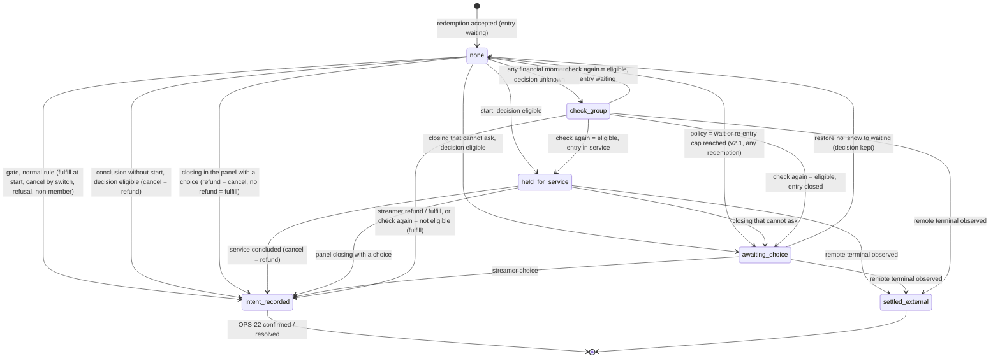

# OPS-31 — Architecture design v2: natural queue and refund of points by group

[Português (pt-BR)](../../pt-BR/stories/OPS-31/architect-design-v2.md)

**Author:** `@architect` (Aria) — **Date:** 2026-11-15 — **Model:** Opus 5.5 (authorized by the owner for this design: money, redemption states, migration). **Mode:** YOLO; product and money choices are **not** decided here, they are listed in [decisions-for-owner](decisions-for-owner.md).
**Revision 2026-11-15 (v2.1, `@architect`, Sonnet 5.5):** incorporates the owner's answers O-1..O-10 (all DECIDED, see [decisions-for-owner](decisions-for-owner.md)); adds the per-queue **settlement policy** (section 3.10), the re-entry cap counter (3.11), migration M3 (section 10) and package P5b (section 14). Changed places carry "(v2.1)".
**Revision 2026-11-15 (v2.2, `@architect`, Sonnet 5.5):** incorporates the owner's answers Q-1, Q-2 and the merge answer (all DECIDED, see [decisions-for-owner](decisions-for-owner.md)) and the [EventSub `stream.online` research](../../research/2026-11-15-eventsub-stream-online/README.md): the re-entry cap counts **per live** through a live session (sections 3.11 and 3.12), migration M4 (section 10) and package P6b (section 14). Owner rule: **the end of a live does not change queues, entries or redemptions** (invariant LIVE-1). Changed places carry "(v2.2)".
**Revision 2026-11-15 (v2.3, `@architect`, Sonnet 5.5):** applies the corrections DB-1..DB-11 of the [`@data-engineer` review, section 9](data-engineer-review.md) and records the owner decisions Q-3, Q-4 and DB-5 (all DECIDED, see [decisions-for-owner](decisions-for-owner.md)): the `awaiting_choice` `CHECK` (DB-1), migrations M2a/M2b (DB-2), the S1 default `legacy` until P7 (DB-3), the merge window in a `settings` row so M4 is one table (DB-4), the cap counted at the intent (DB-5), `rollback.sql`, guards and strict reverse order (DB-6), the per-channel lock, the test table name and the close-then-insert order (DB-7), the late `online` rule (DB-8), the composite key and whole-session purge (DB-9), five columns in M1 (DB-10) and per-migration timeouts (DB-11). Changed places carry "(v2.3)".
**Revision 2026-11-15 (v2.4, `@architect`, Sonnet 5.5):** closes N-1 and N-2 of the [DE re-evaluation, 9.7](data-engineer-review.md) (the optional `refunded_at` `CHECK` gets its own validation migration M3a; the P7 default change is named M3b and joins the apply/revert order) and answers the pending points of the [UX plan v2](ux-plan-v2.md) in the new section 3.13 (cause list, API, remote read time on `conflict`, moderator `concluir` reply). Two product points stay open for `@po`/owner (3.13 E). Changed places carry "(v2.4)".
**Revision 2026-11-15 (v2.5, `@architect`, Sonnet 5.5):** closes G-B1, G-B2, G-B4 and G-B5 of the [`@qa` plan, 24.1](qa-test-plan.md) and DB-12, DB-13, DB-14 and N-5 of the [DE review, 9.7 and 9.8](data-engineer-review.md), and gives technical recommendations (no product decision) for G-B3, G-B6 and G-B8, all in the new section 3.14. DB-15..DB-17 are only registered as P7 work. Product points left to `@po`/owner: the sixth cause for "decide one by one", the wording of AC 39 evidence and the equality at the cap (3.14 C, E). Changed places carry "(v2.5)".
**Revision 2026-11-15 (v2.6, `@architect`, Sonnet 5.5):** records two owner decisions: G-B6 (the streamer chooses how the re-entry cap behaves: two per-queue settings, `reentry_cap_hold` and `reentry_cap_counts_manual`, with safe defaults, plus `redemptions.refund_origin`; impact on M3 and M3a) and the sixth cause code `batch_deferred` (DB-12 list, 3.13, 3.14, M2a), all in the new section 3.15. 3.14 C item 4 and 3.14 E.2 are closed or superseded in place. Changed places carry "(v2.6)".
**Revision 2026-11-15 (v2.7, `@architect`, Sonnet 5.5):** closes DB-18..DB-21 of the [DE review, 9.9](data-engineer-review.md) (index builds on `redemptions` move to the validation files; plain `CHECK`s on `queues`; the state `CHECK` lists six states; `refund_origin` without `INCLUDE` and a separate guard trigger), confirms rows C16/C17 of the [`@qa` plan, 24.1](qa-test-plan.md) (G-B15), decides that the policy block is **not rendered** before P7 (open point 10 of the [UX plan v2](ux-plan-v2.md)) and gave a technical recommendation on G-B13 (superseded in v2.8 by the owner decision), all in the new section 3.16. Changed places carry "(v2.7)".

**Revision 2026-11-15 (v2.8, `@architect`, Sonnet 5.5):** the owner decided that saving `at_n` with a limit of exactly 1 **asks for a confirmation dialog** before it saves (decision U-20 of the [UX plan v2](ux-plan-v2.md), closes G-B13), which replaces the v2.7 recommendation of no dialog in 3.16 E; the policy block stays hidden before P7 (3.16 D, unchanged). The confirmation is **client-only: the API, the data model, the migrations and the error codes do not change** (the `PUT` already accepts the pair and the dialog sends the same request the Save would have sent). Changed places carry "(v2.8)".
**Supersedes:** [architect-design.md](architect-design.md) (v1, 2026-11-11). v1 stays as history; where they differ, v2 wins. v2 closes the gaps G-1..G-15 of the [2026-11-13 audit](../../audits/audit-2026-11-13.md) (section 7) and absorbs the [`@data-engineer` review](data-engineer-review.md), the [UX plan](ux-plan.md) and the [`@qa` plan](qa-test-plan.md).
**Story:** [story.md](story.md) (ACs 1-33). **Research:** [queue-group-refund note](../../research/2026-11-06-queue-group-refund/README.md), index row 27, verdict SUFFICIENT; no new research was run ([research-gaps](research-gaps.md)).
**Evidence class:** static reading of `main` `af6d6a2` in the worktree `.local/ops31-wt`. Nothing was executed (no PostgreSQL, Twitch, browser or OBS). Line numbers are those of `af6d6a2`. Anything not read in code is marked **HYPOTHESIS** or listed in section 15.

## 0. Summary in ten lines

1. The points belong to Twitch. The product does **not** create a balance, a points ledger or a "member" entity. It records, **per redemption**, one group decision and one settlement state, and issues exactly one of the two Twitch operations: `CANCELED` (refund) or `FULFILLED` (points kept).
2. The only new persistent "membership" data is the streamer's own list (numeric ids). Subscribers, moderators and VIPs are looked up at the decision moment and never stored.
3. Today seven code paths write a financial task by rule and ignore any held state (section 2). v2 puts them all behind **one financial gate** (D2-1), lands it **before** any schema constraint, and forbids a hand-built `financial:` key with a static rule.
4. A member is held `UNFULFILLED` from service start to service end; the end issues the refund. Every other closing of a member asks the streamer (panel) or waits for the streamer (`awaiting_choice`) when nobody can be asked. (v2.1) Five closings that the owner left to the streamer (switch off, direct conclusion, moderator conclusion, chat clear, re-entry cap) are governed by a **per-queue settlement policy** whose safe default is "wait for the streamer's decision" (section 3.10); the product never refunds or fulfills in silence.
5. A sixth settlement state, `settled_external`, covers a held redemption that Twitch finalized outside the product (G-4).
6. Prerequisite money fixes (W3-1..W3-5) land first; two of them need owner decisions (D-06, D-17).
7. Chat notices go through one limiter that also covers command replies, which today bypass every queue (`chat-handler.mjs:139-143`).
8. The widget "next" is a new queue-scoped source with an allow-listed projection (display name only).
9. (v2.3, v2.4) Four additive migrations (M1 notices, M2 settlement split into M2a/M2b, M3 policy, M4 live sessions) plus M3a (validation of the `CHECK`s of `redemptions`: the `refund_origin` one from v2.6 and the optional `refunded_at` one) and M3b (the P7 default change), each with a guarded `rollback.sql` where it has data to protect; applied in the order M1, M2, M3, M3a, M4, M3b (with P7) and reverted in the strict reverse order M3b, M4, M3a, M3, M2, M1; roll-forward only after the first real use.
10. Ten packages P0..P8 plus P5b (policy) with their own tests; three `@qa` gates plus the two real-channel runs. (v2.2) Plus P6b (live session).
11. (v2.1) The re-entry cap needs no new personal-data store: refunds are counted from `redemptions` rows that already hold the viewer id (section 3.11).
12. (v2.2) The cap counts per live: a per-channel live session fed by EventSub `stream.online`/`stream.offline` plus a Get Streams reconciliation; a new live within the merge window (default 10 min, configurable) is the same session. **The end of a live does not change queues, entries or redemptions**: it only closes the counting session of the S5 cap (invariant LIVE-1).
13. (v2.3) The cap counts at the intent: a refund that later fails returns no budget, the financial worker writes nothing extra for the cap, and over the cap the refund waits for the streamer (DB-5, owner DECIDED).
14. (v2.6) The re-entry cap is configurable per queue by the streamer with two minimal settings: where it holds (`after_n`, default, or `at_n`) and whether the streamer's own refunds count toward the automatic budget (default yes), stored with `redemptions.refund_origin`; the sixth cause code `batch_deferred` closes the list (section 3.15).

## 1. Goals and non-goals

**Goals.**
- G1. The chat talks: join with position, end of service, closed queue, no-show, skip, reorder, points outcome (ACs 1-7, 33).
- G2. No-show, skip, restore and reorder are visible and reversible where the rule allows (ACs 6, 7, 29).
- G3. The widget shows "next" without leaking internal data (AC 8).
- G4. Refund by group at a single moment, the end of the service, with the streamer deciding every other closing (ACs 9-21, 26, 31-33).
- G5. Money invariants hold under the worst case: crash between steps, double delivery, Twitch down, restart, two operators (section 6).
- G6. Existing queues behave exactly as today after the upgrade (ACs 9, 30).

**Non-goals (out of scope, from the story and the audit).**
- No balance, wallet, points ledger, roster table of subscribers/moderators/VIPs, EventSub-driven roster or persistent role cache.
- No Send Chat Announcement; no tier restriction; no refund for rewards not created by this product or that skip the request queue.
- No batching of financial calls (one task per redemption stays, OPS-22 verification unchanged).
- No automatic penalty for re-entry (AC 27); no day-7 policy (OPS-32).
- No change to the financial worker algorithm (`financial-worker.mjs:43-159`); only its repository writes are extended (notice on confirm, settlement witness).
- No new product CLI: no queue CLI exists (`package.json:10-65` has none). The operable surface stays the HTTP API (scriptable) and chat commands, then observability, then the panel. **Not read:** `.aiox-core/constitution.md`; this reading of "CLI First" must be confirmed by `@po`.
- (v2.2) No action of any kind when a live ends: no clear, refund, expiry or state change of any queue, entry or redemption. The queues stay as they are until the streamer resets them (owner rule 2026-11-15, LIVE-1).

## 2. Current state that v2 changes (verified, `af6d6a2`)

| # | Fact | Evidence |
|---|---|---|
| C1 | Entry transitions: no path back to `waiting` | `apps/api/src/domain/entry-transitions.mjs:4-13` |
| C2 | **Any** `→completed` of a redemption requests a fulfill, including `called→completed` | `entry-transitions.mjs:25-27` |
| C3 | Reasons `queue_cleared` / `queue_deleted` force a cancel over the policy, from any active state | `entry-transitions.mjs:48-52` |
| C4 | The transitions route accepts any reason matching `^[a-z][a-z0-9_]{1,47}$`, so the panel can send `queue_cleared` (G-14) | `apps/api/src/http/queue-routes.mjs:594-601` |
| C5 | `INVALID_ENTRY_TRANSITION` is not mapped and becomes 500 (W3-4) | `queue-routes.mjs:24-30` |
| C6 | Writers of `financial:{redemptionId}`: `createCancellationIntent` (`queue-repository.mjs:377-393`) called from deletion re-entry `:845` (guarded `:843-844`), deletion first pass `:915` (**unguarded**), clear `:1617` (**unguarded**), refusal on import `:2789`; `recordQueueDeletionRedemptions` `:1880-1883` and `:1900-1903`; `applyEntryTransition` `:2367-2377` (guarded `:2303-2308`); `recordRejectedRedemption` `:2556-2563` | file:line |
| C7 | Clear and the first deletion pass with an `in_progress` entry (fulfill already exists) hit the `UNIQUE` key and roll back the whole operation (W3-1) | `:1612-1619`, `:910-919`, `schema.prisma:116` |
| C8 | The deletion worker cancels **every** Twitch `UNFULFILLED` redemption of the reward that has no task, reading no policy or entry state | `reward-worker.mjs:292-298`, `queue-repository.mjs:1897-1904` |
| C9 | No exception handling around the deletion recording; endless re-claim (W3-3) | `reward-worker.mjs:298-299, 312-313` |
| C10 | `conflict` / `failed` financial tasks can only be retried, never resolved; one of them blocks deletion forever (W3-2) | `:2573-2590` (retry), `:2619-2623` (resolution only for `unknown`), `:1916-1931` |
| C11 | `retryOutboxManually` locks the outbox row first and then updates the queue without the advisory lock (W3-5) | `:2576-2614` |
| C12 | Entry `version` is incremented, never compared (G-8) | `:2311-2326` |
| C13 | External terminal status: `applyEntryTransition` with `origin=external` writes `remoteStatus` and `expectedStatus=null` (`:2345-2357`); `recordExternalRedemptionState` writes `remoteStatus` and moves an existing task to `confirmed`/`conflict` (`:2695-2741`) | file:line |
| C14 | Clear confirmation is an in-memory map with a 15 s TTL; lost on restart | `apps/api/src/domain/clear-confirmation.mjs:78-108` |
| C15 | Chat: `chat.call` outbox with unbounded retry (`outbox/chat-worker.mjs:1-6, 33-51`); command replies call `sendChatMessage` directly, fire-and-forget, outside any queue | `commands/chat-handler.mjs:139-143` |
| C16 | Refusal reasons on import: `queue_mode_transition`, `channel_points_disabled`, `queue_unavailable`, `queue_closed`, `invalid_uid`, `duplicate_active_entry`. No separate "paused" queue state exists: closing pauses the reward (`reward.set_open`) | `:2755-2773`, `:650-676` |
| C17 | Widget sources: `queue_name`, `queue_state`, `queue_waiting_count` (queue-scoped); `account_label`, `called_viewer_display_name`, `called_viewer_position` (channel) | `domain/overlay-widget-policy.mjs:1-3`, `queue-repository.mjs:523-554` |
| C18 | OAuth: `requiredScopes` fixed; `optionalScopes = ['moderator:read:followers']`; unknown optional scope refused | `twitch/oauth.mjs:40-41, 61-64` |
| C19 | Helix adapter calls have no timeout (G-15) | `twitch/helix-adapter.mjs:155-191` (no timeout seen) |
| C20 | No concept of member, points or balance anywhere in `apps/api/src` or the schema | `prisma/schema.prisma:1-207`; audit section 6.2 |

## 3. Money model

### 3.1 What exists on Twitch and what the product records

| Twitch status | Meaning for the viewer | Can change to | Product record |
|---|---|---|---|
| `UNFULFILLED` | Points spent, still returnable | `CANCELED` or `FULFILLED` only | `redemptions.remote_status = UNFULFILLED`; settlement state says why it is still open |
| `FULFILLED` | Points kept for good; **never refundable** (note §3) | nothing | terminal; any later refund request is refused (`SETTLEMENT_ALREADY_DECIDED`) |
| `CANCELED` | Points returned | nothing | terminal; a second cancel answers 404 and the read shows `CANCELED` = confirmed (AC 19, `financial-worker.mjs:126-127`) |

Deleting a reward with `UNFULFILLED` redemptions makes Twitch fulfill them (index row 20). So no held redemption may reach a reward delete (section 3.7).

### 3.2 Settlement state per redemption (D2-2)

Stored on `redemptions` (DE Q2). Six values; v1 had five.

| State | Meaning | Financial task | Remote |
|---|---|---|---|
| `none` | Normal path, or no decision yet | follows today's rules | any |
| `held_for_service` | Member, service running; the end refunds | none | `UNFULFILLED` |
| `awaiting_choice` | Closed without a concluded service and nobody could be asked, **or** the queue policy says `wait` (v2.1: any redemption, member or not; also a refund held back by the re-entry cap) | none | `UNFULFILLED` |
| `check_group` | Lookup answered `unknown`; streamer must act (AC 21) | none | `UNFULFILLED` |
| `intent_recorded` | The single terminal intent exists; OPS-22 owns the rest | exactly one | `UNFULFILLED` until confirmed |
| `settled_external` **(new)** | Twitch reached a terminal status by an action outside the product while the redemption was held, waiting or in check | none, ever | `FULFILLED` or `CANCELED` |



Rules.
1. `intent_recorded` and `settled_external` are **absorbing** (guard trigger, DE Q2, extended to the new state).
2. Every arrow is one PostgreSQL transaction: queue advisory lock, then `SELECT ... FOR UPDATE` of the redemption row(s) ordered by id, then guarded writes, then the outbox insert (section 6.3).
3. `awaiting_choice` and `check_group` never time out and are never resolved by a timer, a background retry or the conclusion of the service (AC 21). How long they may last: **no limit in OPS-31** (O-7 DECIDED A, 2026-11-15); the count is visible on the queue card and in the navigation, and OPS-32 brings the day-7 policy.
4. `none` with a stored decision is legal: it is a waiting entry whose decision was taken at an earlier moment (restore, batch prepare abandoned). The decision is reused, never re-queried (AC 13).
5. (v2.3, DB-1) Database shape: `held_for_service` requires `group_decision = 'eligible'`, `expected_status IS NULL` and `remote_status = 'UNFULFILLED'`; `awaiting_choice` requires only `expected_status IS NULL` and `remote_status = 'UNFULFILLED'` (any decision, including NULL or `not_eligible`, so S1 `wait`, `legacy_residue`, the cap and S2..S4 never fail with `23514`). Full text in section 10.

### 3.3 Group decision (unchanged in substance from v1 D-31-5; moments corrected)

- Result `eligible | not_eligible | unknown`, persisted once per redemption with `matched_group`, `settlement_mode` snapshot, `group_checked_at`, `group_unknown_reason` (AC 13). Conclusive results are immutable; `unknown` may be replaced only by "check again" while no intent exists.
- Order (AC 14): broadcaster by rule (`user_id == broadcaster_id`, no call), own list (database), then moderator, VIP, subscriber by Helix, only for enabled groups. Eligibility is the union; one failure plus one positive is `eligible`; failures and no positive is `unknown` with the first reason code (AC 15).
- **Moment (closes G-1).** The lookup runs at the **first financial moment** of a redemption entry in a `refund_on_end` queue with at least one group enabled. A financial moment is any transition whose target is `in_progress`, `completed`, `removed` or `no_show`, plus the batch prepare of clear and delete. It never runs on `called`, on skip, on reorder, on arrival, on refusal, for manual entries, or when a decision is stored.
- The lookup runs **outside** any transaction, with a per-call timeout and an overall bound (section 9). The transaction re-reads; if a decision was stored meanwhile, the new result is discarded.

### 3.4 Trigger table (replaces v1 D-31-4; queue in `refund_on_end`, at least one group, reward created by the product)

"Ask" = the API answers `SETTLEMENT_CHOICE_REQUIRED` and the panel repeats the request with `settlementChoice` (`refund` or `no_refund`). Refund = `redemption.cancel`; no refund = `redemption.fulfill` (v1 D-31-4, AC 20).

| Trigger (code path) | Not a member | Member | `unknown` |
|---|---|---|---|
| Start `called→in_progress` (panel `queue-routes.mjs:601`, chat `atender` `chat-handler.mjs:225`) | Fulfill (today) | `held_for_service`, no call | `check_group`, no call; the service starts |
| Conclusion `in_progress→completed` (panel, chat `concluir`) | Nothing (fulfill exists) | **Cancel = refund** (cause `group_refund_on_end`) | Stays `check_group` (AC 21) |
| **Direct conclusion `called→completed`** (panel, chat `concluir` `chat-handler.mjs:219-225`) (G-1) | Fulfill (today, C2) | Policy S2 (v2.1, O-3): `wait` (default) / `refund` (counts as the end of the service) / `fulfill`. Moderator by chat: S3 also applies (3.10) | `check_group` |
| **Moderator `concluir` by chat on `in_progress`** (v2.1, O-4) (`chat-handler.mjs:212-225`; role known: `authorized.role`, `chat-handler.mjs:356`) | Nothing (fulfill exists) | Policy S3: `wait` (default) / `refund`. The streamer's own chat `concluir` = panel end of service (Q-1) | `check_group` |
| Panel remove / cancel from `waiting`, `called`, `in_progress` | Today (waiting: refund; called: switch; in service: nothing) | Ask | `check_group` |
| Panel no-show `called→no_show` | Switch `refundOnNoShow` (today); with the switch off: policy S1 (v2.1, O-2) | Ask | `check_group` |
| Timer no-show (`outbox/timeout-loop.mjs:22`) | Switch (today); switch off: policy S1 | `awaiting_choice` | `check_group` |
| Viewer `sair` (`chat-handler.mjs:198`) | Today; switch off while called: policy S1 | `awaiting_choice` | `check_group` |
| Moderator `remover` (`chat-handler.mjs:253`) | Today; switch off while called: policy S1 | `awaiting_choice` | `check_group` |
| Clear in the panel (two steps, section 3.6) | Refund (today) | Batch choice | `check_group` |
| Clear by chat `limpar` (`chat-handler.mjs:262-275`) | Refund (today) | Policy S4 (v2.1, O-8): `wait` (default, `awaiting_choice`) / `refund` / `fulfill` | `check_group` |
| Queue delete (panel) | Refund (today) | Batch choice; deletion waits for decisions | `check_group`; deletion waits |
| Deletion worker re-list (`reward-worker.mjs:292-316`) | Today's cancel for rows with no settlement state **only in a `legacy` queue** (S1). In any other queue such a row becomes `awaiting_choice` (cause `legacy_residue`, no money moved) and blocks (3.10 edge cases) | **Never** writes; counts as blocker `decision_pending` | Same |
| Skip `called→waiting` (new) | Nothing | Nothing, no question | Nothing |
| Restore `no_show→waiting` (new) | Only while no intent (AC 29) | `awaiting_choice→none`, decision kept | Stays `check_group` |
| Refusal on import (closed, duplicate, ...) | Cancel (today; AC 28) | Cancel, **no lookup** | n/a |
| Remote terminal observed while held/waiting/check (EventSub, reconciliation) | Today | `settled_external` (G-4) | `settled_external` |

Re-entry cap (S5, v2.1): any refund this table produces automatically (end of service, policy `refund`) is turned into `awaiting_choice` when the person already reached the cap in the window (3.11). A panel choice by the streamer is never blocked by the cap; the panel only shows the count. (v2.2) The window is the **live session** when one is known; the hours column is only the fallback (3.11).

Entries in a `fulfill_on_start` queue, manual entries and queues with no group enabled follow today's rules exactly, through the same gate.

### 3.5 What the end of service does, step by step (AC 17, 33)

1. Panel or chat asks `in_progress→completed` for a `held_for_service` redemption.
2. Transaction: queue lock; lock redemption; re-read `settlement_state = held_for_service` and entry `version`; gate writes `settlement_state = intent_recorded`, `expected_status = CANCELED`, outbox `redemption.cancel` with payload `{ settlementCause: 'group_refund_on_end' }`; entry `completed`; audit `settlement.choice_recorded` (cause, matched group code). Commit.
3. Worker (unchanged): read, `UNFULFILLED`, write `CANCELED`, read-verify, `repository.confirm` (`queue-repository.mjs:2416-2449`).
4. In the **same** confirm transaction, when `settlementCause` is a points cause and the queue has the points notice on, insert `chat.notice` with key `chat.notice:points:{redemptionId}` (unique, once). A missing answer never reaches `confirm`, so never produces the notice (AC 33).
5. Panel copy says "refund requested" until the redemption shows `CANCELED` confirmed (UX 2.3 item 8).

### 3.6 Batch closings: clear and delete (AC 26, 32; closes G-7)

1. **Prepare** (panel). Collect the active redemption entries without a stored decision. Look groups up in chunks of up to 100 ids per enabled group, outside any transaction (note §4.2). One short transaction per chunk persists the decisions (guarded). A 429 waits once for `Ratelimit-Reset` within a bound (configuration, proposed 5 s); then the chunk is `unknown` (`rate_limited`). The clear never fails because of the lookup.
2. **Snapshot after the lookups.** The confirmation snapshot is taken **after** step 1, so its TTL does not run during the lookups. TTL becomes configuration: 15 s without members (today, `clear-confirmation.mjs:78`), 60 s with members (UX 2.3 item 6).
3. **Confirm.** One transaction: queue lock; snapshot compare (existing); set-based updates per bucket; outbox inserts with `ON CONFLICT DO NOTHING RETURNING`; entries closed; audit with counts. Members get the chosen action (cancel, fulfill, or `awaiting_choice` for "decide one by one", cause `batch_deferred`, v2.6). `check_group` is never decided by the batch (AC 32). Non-members follow today's rule. An `in_progress` non-member already fulfilled is skipped by the gate instead of raising (fixes C7 for every caller).
4. **Abandoned prepare.** Decisions stay (immutable, taken at a real financial moment request). If the entries are later served, the stored decision is reused. **Restart** loses the in-memory snapshot (C14); the streamer simply prepares again. Accepted: no money is moved by prepare.
5. **Chat clear** (`limpar`) has no dialog: it runs (O-8 DECIDED, it renews the queue cycle); non-members follow today's rule; members go where policy S4 says (default `awaiting_choice`), with the counts in the reply. The reply text family changes from "refunds requested" to "refunds requested, decisions pending" (catalog keys `chat.queue.clear_confirm` / `clear_done`, `apps/shared/localization/catalogs/chat/en.tsv:80-81`).
6. **Result text** says "requested" or "pending", never "refunded", until Twitch confirms.

### 3.7 Deletion with pending decisions (closes G-5, G-6, part of G-12)

- Deletion keeps the queue in `deleting` while any redemption of the queue is in `held_for_service`, `awaiting_choice` or `check_group`. The blocker gets its own reason code `queue_deletion_blocked_by_decision`, distinct from `QUEUE_DELETION_BLOCKED_BY_REVIEW` (OPS-22).
- `recordQueueDeletionRedemptions` (`queue-repository.mjs:1863-1914`) goes through the gate: a redemption in one of the three states is **skipped and counted as blocked**, never cancelled. `getQueueDeletionBlockers` (`:1916-1931`) counts the three states as `blocked`.
- Pending decisions are listed by `redemptions.queue_id` through the partial index (DE section 2.2), so they stay visible for archived and `deleting` queues (Pending decisions section, UX 2.4). The panel query must not filter by `lifecycleStatus = active`.
- A held redemption that Twitch expires or finalizes first (real test item 1) is observed as `settled_external` and the blocker clears.

### 3.8 External settlement during a hold (closes G-4)

- Paths: `applyEntryTransition` with `origin=external` (`:2345-2357`), `recordExternalRedemptionState` (`:2695-2741`), and the reconciliation that calls them (`twitch/reconciliation.mjs:138-197`).
- When the redemption is in `held_for_service`, `awaiting_choice` or `check_group`, the same statement that writes `remote_status` writes `settlement_state = settled_external` (the DE `CHECK` "held requires `UNFULFILLED`" would otherwise fail, DE R5). No outbox row is created. Audit `settlement.settled_external` with the remote status.
- A later local request (end of service, choice) finds `settled_external` and answers `SETTLEMENT_ALREADY_DECIDED` with the remote outcome; nothing is written.
- Notice (O-6 DECIDED A): the panel shows "settled on Twitch" on the entry and in the Pending decisions history; **no chat message** is created for it (no `chat.notice` row, no catalog key).

### 3.9 Idempotency and reconciliation summary

| Thing | Key / guard | Repeat |
|---|---|---|
| Terminal operation | `financial:{redemptionId}` `UNIQUE` (`schema.prisma:116`) + partial unique per `redemption_id` (DE Q3) + `ON CONFLICT DO NOTHING` | Same result: "already done". Opposite: `SETTLEMENT_ALREADY_DECIDED` + audit `settlement.contradictory_request` |
| Group decision | guarded `UPDATE ... WHERE group_decision IS NULL OR (group_decision='unknown' AND settlement_state IN ('check_group','none'))` + trigger | stored decision wins |
| Panel choice | `beginPanelOperation` key + fingerprint (`queue-repository.mjs:425-445`) + **`expectedVersion` of the entry** (G-8) | replay returns the stored answer; stale version → `ENTRY_VERSION_STALE` |
| Batch | confirmation snapshot (`clear-confirmation.mjs:104-105`, `queue-repository.mjs:1606-1609`) | stale → re-preview |
| Outcome notice | `chat.notice:points:{redemptionId}` written in the confirm transaction | once |
| Reconciliation with Twitch | worker read before write (`financial-worker.mjs:111-127`); EventSub + 5 min reconciliation; deletion double re-list (`reward-worker.mjs:292-316`) | remote truth wins; opposite remote = `conflict` (OPS-22) or `settled_external` (no task) |

Partial failure: each redemption has its own task. In a batch of N, some may end `unknown`/`conflict`/`failed` in OPS-22 while the others confirm; the batch result is counts per outcome, the failures appear on the Operations screen (OPS-22), never mixed with "check group".

### 3.10 Per-queue settlement policy (v2.1; O-2, O-3, O-4, O-5, O-8)

The owner left five closings to what the streamer configures per queue. Design rule: **every policy value is either a streamer-chosen action or `wait`; the safe default is `wait` (state `awaiting_choice`, nothing sent to Twitch); the product never refunds or fulfills in silence on its own initiative.**

**Settings (one decision point each).**

| Id | Event it governs | Applies to | Values | Default new queue | Existing queue |
|---|---|---|---|---|---|
| S1 (O-2) | An entry closes (no-show, removal while called, `sair` while called, timer) with the matching refund switch **off** and the redemption still `UNFULFILLED` | (v2.5, G-B2) redemptions of **non-members** (a member closing follows the member column of 3.4 and never reads S1; 3.14 B) | `wait`, `fulfill`, `refund`, `legacy` | `legacy` until P7, then `wait` (v2.3, DB-3) | `legacy` |
| S2 (O-3) | Direct conclusion `called→completed` (panel or chat) | members of a `refund_on_end` queue (non-members keep today's fulfill, C2) | `wait`, `refund`, `fulfill` | `wait` | `wait` |
| S3 (O-4) | Moderator `concluir` by chat on a member | members | `wait`, `refund` | `wait` | `wait` |
| S4 (O-8) | Chat `limpar`, destination of **members** (non-members: refund, today) | members | `wait`, `refund`, `fulfill` | `wait` | `wait` |
| S5 (O-5) | Re-entry cap: max automatic refunds per person in a window | refunds the product would issue by itself | `reentry_refund_cap` integer 1-20 or `NULL` (no cap); `reentry_window_hours` 1-72; (v2.6) `reentry_cap_hold` `after_n` or `at_n`; `reentry_cap_counts_manual` true or false (3.15) | `NULL`, 12, `after_n`, true | `NULL`, 12, `after_n`, true |

Meaning of the values. `refund` = `redemption.cancel`; `fulfill` = `redemption.fulfill`; `wait` = state `awaiting_choice` and a pending decision in the panel (the streamer then chooses, same path as 3.4 "Ask"); `legacy` (S1 only) = exactly today's behavior (nothing requested at closing; the deletion re-list may refund the row, C8). S2..S4 have no `legacy`: a member can only exist after FT-74/FT-76 lifts the AC 30 refusal, so there is no existing behavior to preserve. When two applicable settings disagree (a moderator's direct conclusion applies S2 and S3), the result is **`wait`** (most cautious, never the more generous). S5 over-cap: the refund becomes `wait`, cause `reentry_cap`; the cap never turns into a fulfill.

S5 window (v2.2, Q-2 DECIDED): the cap counts refunds **per live** (the live session of 3.11, merged across short drops). `reentry_window_hours` (1-72, default 12) is now only the **fallback** used when no session is known (never seen, subscription revoked, stale session); it is not a second mode the streamer must choose. The end of a live does not reset or clear anything (LIVE-1); it only stops the session, and a refund made while offline counts against the **last** session (Q-3 DECIDED 2026-11-15).

**Why existing queues are not touched.** M3 adds the columns with a constant default and no backfill. S2..S5 defaults (`wait`, no cap) are inert until P7 because members and groups do not exist before then. Only S1 has a visible effect, so existing rows get `legacy` (= today). (v2.3, DB-3) **The database default and the value the creation code writes for new queues also stay `legacy` through P5b and until P7**: `wait` needs `awaiting_choice` and the settlement service, which only P7 ships, so a queue created between M3 and P7 labelled `wait` would behave as `legacy` and then change behavior when P7 turns enforcement on (it would break G6, existing behavior unchanged). P7 ships a one-statement migration `ALTER COLUMN settlement_on_close_switch_off SET DEFAULT 'wait'` (constant, catalog-only, existing rows untouched) and the creation code starts writing `wait` in the same release. Cloning or restarting a queue never copies `legacy` into a new queue (it writes the then-current default). Choosing "wait" for old queues would also be safe for money but would change what a deletion does (today it refunds legacy residue; with `wait` it would block), and the owner asked not to touch existing queues. `legacy` is not selectable again once left (**UX decides**). Turning on `refund_on_end` with groups on a `legacy` queue converts S1 to `wait` in the same save, audited and shown in the dialog.

**Where it is stored.** Columns on `queues` (not a new table: one row per queue, read under the queue lock that every settlement transaction already holds, 6.3):
`settlement_on_close_switch_off`, `settlement_on_direct_conclusion`, `settlement_on_moderator_conclude`, `settlement_on_chat_clear` (text, closed set by `CHECK`), `reentry_refund_cap` (smallint NULL, `CHECK` 1-20), `reentry_window_hours` (smallint, `CHECK` 1-72), `settlement_policy_rev` (integer NOT NULL DEFAULT 0, incremented on every change); (v2.6) `reentry_cap_hold` (text NOT NULL DEFAULT 'after_n', `CHECK` in ('after_n','at_n')) and `reentry_cap_counts_manual` (boolean NOT NULL DEFAULT true), see 3.15. Migration M3 (section 10). No personal data.

**How the gate reads it.** A single function `loadSettlementPolicy(tx, queueId)` inside the gate module (section 4) is the only reader of these columns (OpenGrep rule, same as the `financial:` key). It is called **after** the queue advisory lock and returns a frozen object with `rev`. A pure function `resolveSettlementAction(event, redemptionContext, policy, capState)` returns `{ action: 'refund' | 'fulfill' | 'wait' | 'rule', source: 'policy' | 'rule', policyRev }`; the caller passes the action to the gate, which writes the intent or moves the row to `awaiting_choice`. `rule` means "no policy applies, today's rule" (non-members, other events). The audit row (`settlement.choice_recorded` / `settlement.transition`) carries `source`, the setting id (S1..S5) and `policyRev`, never a user identifier. In P1 (before M3) the loader returns the constant `legacy`/`wait` object and changes no behavior.

**Which policy value applies: the one in force at the event, read inside the lock (not a snapshot per redemption).** Reason: the streamer changes a setting on purpose to change what happens next; a per-redemption snapshot needs a column per setting on `redemptions` and makes a mistaken setting impossible to correct for rows already waiting. Cost: a redemption made under `wait` and closed after the streamer set `refund` is refunded, which is what the streamer configured at that time (audited with `policyRev`). Protection against the opposite surprise: a policy change never acts by itself on rows already in `awaiting_choice`, `held_for_service` or `check_group`.

**Editing the policy.** `PUT` on the queue settings (panel session only, G-13): body carries `expectedPolicyRev`; the transaction takes the queue lock, compares the rev (stale: `SETTLEMENT_POLICY_STALE` 409 with the current rev), validates the closed sets, applies, increments `settlement_policy_rev`, writes the audit row `queue.settlement_policy_changed` with before/after values (closed-set values and numbers only) and the actor origin. Until P7 ships, the API refuses S1 values other than `legacy` with `SETTLEMENT_MODE_UNAVAILABLE` (reason `policy_not_active`), like the AC 30 refusal, so a setting never looks active while inert. Reading: `GET` returns the five settings, `rev`, and the count of redemptions waiting for a decision. The panel text, grouping and the default presentation belong to `@ux-design-expert` (not decided here).

**Rows already held when the policy changes.** Nothing happens to them. The panel offers "apply to the N pending": it is the existing batch decision (3.6) with **no option preselected**: the API takes an explicit `choice` and the confirm button stays disabled until the streamer picks one (owner decision 2026-11-15, AC 36; v2.5, G-B1); each application is a streamer action (`settlement.choice_recorded`, source `streamer_bulk`) and the cap does not block it. No timer, no background rewrite (O-7). (v2.5) The earlier "preselected" wording is withdrawn and the open point of 3.13 E.1 is closed (3.14 A).

**Edge cases.**
- *Policy changed between redemption and closing:* the value read at the closing wins (above); two audits make it traceable.
- *Policy changed while a clear/delete confirmation snapshot is open:* the snapshot includes `settlement_policy_rev`; a different rev at confirm = stale, re-preview (3.6).
- *Queue in `deleting` or archived:* policy edits are refused; events that still occur read the frozen last rev; the deletion worker never uses the policy (it only counts blockers, 3.7). A `legacy`-queue residue row is cancelled by the re-list as today; in any other queue the re-list writes `awaiting_choice` (cause `legacy_residue`, no money) and the deletion waits.
- *Queue deleted:* pending decisions stay listed by `redemptions.queue_id`; the policy has no role left because every remaining case is a manual decision.
- *Two operators:* the optimistic `expectedPolicyRev` and the queue lock serialize two edits; the later gets `SETTLEMENT_POLICY_STALE`. An event running at the same moment sees either the old or the new rev completely, never a mix.
- *Product reward only:* the policy acts on redemptions of rewards created by the product (existing rule); others have no task.
- *Streamer-in-chat vs moderator:* distinguished by `authorized.role` (`chat-handler.mjs:356`, `:369`).

### 3.11 Live session and re-entry cap counter (v2.2; O-5, Q-2) — flag for `@data-engineer`, `@ux-design-expert`, `@po`, `@qa`

Goal: stop a person from re-entering again and again to be refunded each time (AC 27). Owner: configurable by the streamer per queue (S5) and counted **per live** (Q-2 DECIDED 2026-11-15: use EventSub `stream.online` / `stream.offline`, not the rolling window). Research: [EventSub stream.online note](../../research/2026-11-15-eventsub-stream-online/README.md), verdict SUFFICIENT; behavior on a real stream (delay, restarts, subscription cost) is UNVERIFIED and is closed by the P8 live run.

**Invariant LIVE-1 (owner rule, 2026-11-15).** The end of a live does not change queues, entries or redemptions. The product does not clear, reset, refund, fulfill, expire or move to another state any queue, entry or redemption because a live ended (or started). The queues stay as they are until the streamer resets them. The `stream.offline` handler, the reconciliation and the session code write **only** the live session table (below); they have no access to the queue repository. The only effect of the end of a live is that the counting session of the S5 cap is closed.

**A. Minimal data model (M4).** One row per Twitch stream, per channel. No viewer data, no title, no login.

| Field | Type | Meaning |
|---|---|---|
| `stream_session_id` | uuid | Internal id of the counting session; shared by every Twitch stream merged into the same session |
| `twitch_stream_id` | text | Stream `id` from `stream.online` / Get Streams; **unique per channel** (the deduplication key) |
| `broadcaster_id` | text | The channel; the same `broadcasterId` the EventSub runtime already uses (`eventsub-runtime.mjs:20`) |
| `started_at` | timestamptz | Twitch `started_at` (UTC, from the event or Get Streams) |
| `ended_at` | timestamptz NULL | NULL while open. Set at the receive time of `stream.offline` (the event has no timestamp), or at the time of the first negative check in a reconciliation close |
| `source` | text, `CHECK IN ('event','reconciled')` | `event` when opened and closed by EventSub; `reconciled` when the open or the close was inferred from Get Streams (sticky) |

(v2.3, DB-9) Keys and checks: **primary key `(broadcaster_id, twitch_stream_id)`** (the deduplication key; no surrogate id), `created_at timestamptz(3) NOT NULL DEFAULT now()`, `CHECK (ended_at IS NULL OR ended_at >= started_at)`, `CHECK (char_length(...) BETWEEN 1 AND 64)` on both ids (do not assume digits: **HYPOTHESIS**), no foreign key to any table.

The session is the set of rows that share `stream_session_id`: its start is the smallest `started_at`, it is open while one row has `ended_at IS NULL`, its end is the largest `ended_at`. Setting (v2.3, DB-4): a `settings` row `live_session_policy` = `{ schemaVersion: 1, revision, mergeMinutes }`, versioned JSON like `chat_command_policies` (`queue-repository.mjs:96-98`, `:315-338`: `lockScopedOperation`, audit); an absent row means 10 minutes; range 1-60 (a **HYPOTHESIS**, `@ux`/`@po` confirm). The schema has no channel-settings table (`Setting`, `schema.prisma:154`, is a key/`JSONB` store), so M4 creates **only the new table**: no `ALTER` of an existing table, no migration or backfill for the setting. A change applies only to events received after it. Optional defense in depth: a `CHECK` on `settings` using `CASE WHEN key = 'live_session_policy' THEN ... ELSE true END` (a `CASE`, because SQL does not guarantee short-circuit in `AND`). `reentry_window_hours` stays per queue on `queues` (M3). The confirm delay (30 s), the stale hours (48) and the retention (90 days) are code constants, not columns.

**B. Rules.**
1. **Only `type = live` opens a session** (Q-4 DECIDED 2026-11-15). `rerun`, `premiere`, `playlist`, `watch_party` are logged as ignored and write nothing. An `offline` for an id with no row writes nothing and asks for one reconciliation.
2. **Deduplication by stream id** (delivery is at least once). Open: `INSERT ... ON CONFLICT (broadcaster_id, twitch_stream_id) DO NOTHING`. Close: `UPDATE ... SET ended_at = ... WHERE twitch_stream_id = $id AND ended_at IS NULL`. A repeated delivery changes nothing. The Twurple handler does not expose the message id (research section 4), so message-id deduplication is not used.
3. **Order is never the order of arrival.** Rows are ordered by `started_at`, then by `twitch_stream_id`. `stream.offline` carries the stream id, so an `offline` of stream X that arrives after the `online` of stream Y closes only X, with `ended_at = GREATEST(started_at of X, LEAST(receive time, started_at of the next row of the same session))`. (v2.3, DB-8) **A late `online` of an older stream** (its `started_at` is earlier than a row already stored for the channel) is **ignored and logged** (`live_session.late_online_ignored`): it writes nothing and never changes the `stream_session_id` of later rows, so stored ids stay stable and a session is never split or re-joined after the fact; the next reconciliation covers any real gap. This errs on the strict side of the cap.
4. **Merge (owner answer 2026-11-15).** A new live that starts right after the previous one (connection drop) is the **same** session. On `online` of Y with start T, the latest session of the channel is taken: if its last row ended and `T - ended_at <= merge window` (boundary inclusive), or if that row is still open with another id (its `offline` was lost; the old row is closed at T with `source = reconciled`), Y joins that `stream_session_id`; otherwise a new `stream_session_id` is created. Merging errs on the strict side: it keeps the budget, and over the cap the refund only waits for the streamer (3.10).
5. **At most one open row per channel**: partial unique index on `(broadcaster_id) WHERE ended_at IS NULL`. Open/merge/close run in one short transaction under a per-channel advisory lock, so two near-simultaneous events cannot both pass. (v2.3, DB-7) The lock is `pg_advisory_xact_lock(<class>, hashtext(broadcaster_id))` in the **two-integer** form, which PostgreSQL keeps apart from the single-bigint key space of `lockQueue` (`hashtextextended(queueId, 0)`, `queue-repository.mjs:36-38`); the class is a **new constant different from `1868787013`** (the account lock, `:80-82`), because `hashtext` could return that value. A collision between channels only serializes them. The session transaction takes no queue lock and no queue transaction takes the channel lock, so there is no lock edge. **Fixed order inside the transaction: close any other open row first, then insert**: `ON CONFLICT (broadcaster_id, twitch_stream_id) DO NOTHING` names one arbiter and does not absorb a violation of the partial unique index (`23505`).
6. **Reconciliation** is described in 3.12 (start and every `onReconnected`). A session is closed by reconciliation only after **two consecutive negative checks** separated by a short delay (configuration, proposed 30 s), never on one `null`; an error or timeout is `unknown` and never closes. A `null` right after a `stream.online` is treated as possibly stale (Twurple warns Helix may be behind due to caching).

**C. How the cap uses the session, and `refunded_at`.** `redemptions.refunded_at` (M3, set by the gate in the same statement as the refund intent) stays as designed and needs **no** session column. The cap window starts at the **start of the current session** (open, or else the most recent one): count = `COUNT(*) WHERE queue_id = $q AND user_id = $u AND refunded_at >= session_start` (v2.6: and, when the queue's `reentry_cap_counts_manual` is false, `refund_origin = 'automatic'`; the decision compares this count with the budget of 3.15 B), inside the queue lock (a concurrent refund cannot pass the cap). The gate asks one port, `capWindowStart(tx, broadcasterId, now)`, that returns `{ kind: 'session', start }` or `{ kind: 'fallback', start: now - reentry_window_hours, reason }`; the port is a constant `fallback` until P6b (the policy interface of P1 already has the final shape). A refund made during a merge gap or after the live ended counts against the same session; only a **new live outside the merge window** gives a fresh budget.

**C2. What counts, and when (v2.3, DB-5, owner DECIDED 2026-11-15).** (1) The cap counts at the **intent**, not at Twitch's confirmation: `refunded_at` is written by the same statement that records the `redemption.cancel` intent, only for a refund with a person-visible cause (`group_refund_on_end`, policy `refund`, streamer choice `refund`), never for a refusal cancel (no entry was served). (2) A refund that later ends `failed` or `resolved_manual` (even with `remoteConfirmed:false`) **returns no budget**. (3) **No extra write by the financial worker**: that path locks the outbox row first and takes no queue lock (`queue-repository.mjs:69-75`, `confirm` at `:2416`, `:2454`), so a write to `redemptions` from there would be a new lock edge (the TS-20 inversion); `refunded_at` is written only inside the settlement transaction, under the queue lock. (4) Over the cap an automatic refund does **not** become a fulfill: the redemption goes to `awaiting_choice` (cause `reentry_cap`) and **waits for the streamer**, who can still refund it by a panel choice (never blocked; whether that choice counts toward later automatic refunds is a per-queue setting, default yes, 3.15). The conservative side costs no money.

**D. When there is no live.** (a) Live ended and no new live yet: the last session stays the window (a refund after the end counts against it; the cap does not reset by itself and no one is blocked: over the cap the refund waits, 3.10). (Q-3 DECIDED 2026-11-15: a refund made without a live counts against the last live session.) (b) No session known (never seen, fresh install before the first reconciliation), the `stream.online`/`stream.offline` subscription was revoked, or the open session is stale (open for more than `live_session_stale_hours`, proposed 48, **HYPOTHESIS**; no confirmation from Get Streams): the gate uses the fallback hours window with the reason code in the audit/log. The cap never becomes unlimited because the events failed.

**E. Migration, retention, privacy.**

| Aspect | Position |
|---|---|
| Migration | **M4** (new table `stream_sessions` only; the merge window is a `settings` row, DB-4), additive, no backfill; independent of M3 (M3 stays about the policy and `refunded_at`). Down (`rollback.sql`): drop the table (the inert `settings` key may stay); the only effect is that the cap goes back to the fallback hours window. Roll-forward only after first real use is not required (no money state depends on it) |
| Retention | Whole sessions whose last `ended_at` is older than 90 days are purged (configuration, **HYPOTHESIS**; DB-9): never one row of a session that keeps other rows (it would move the session start), never the most recent session and never one with an open row; same timer as the `refunded_at` nulling. The `refunded_at` nulling job (72 h) must not null a value that is still inside the window of the last session: it nulls only values older than `LEAST(now - 72 h, start of the last session)` |
| Personal data | None. Channel ids and Twitch stream ids are not viewer data. No title, game, login, display name or viewer id is stored or logged |
| Who sees it | The authenticated panel/API only (live yes/no/unknown, start time, source); never chat or widget |
| Logs | Section 3.12; no stream title, no login, internal session id only |
| Risks | A wrongly **opened** new session resets the budget (looser cap: more automatic refunds, still audited and the streamer can see them); a wrongly **merged** session keeps the budget (stricter: refunds wait for the streamer). Neither moves money by itself; the cap is anti-abuse, not integrity. A privacy statement of the product should mention `refunded_at` (`@po`) |
| Right to erasure | Deleting a redemption row deletes its `refunded_at`; session rows hold no person |

**For `@data-engineer`:** the table, the unique/partial indexes, where the merge-window column lives, the advisory lock per channel under READ COMMITTED, the purge and the nulling horizon, the cost of the count under the queue lock. (v2.3) Answered in the [DE review, section 9](data-engineer-review.md); a `failed` refund gives no budget back (DB-5 DECIDED). **For `@ux-design-expert`:** the merge-window setting (placement, wording, range), how "per live" and the fallback hours are explained, how the state live/offline/unknown is shown, the text when the cap holds a refund outside a live.

### 3.12 The live session in the worker and EventSub (v2.2)

Verified in `af6d6a2` (this worktree), read in v2.2: `apps/api/src/twitch/eventsub-runtime.mjs` (whole) and `integration.mjs:205-258`.

**Where to subscribe: the same `EventSubWsListener`, same connection.** The listener is created once at `eventsub-runtime.mjs:28-29` (`listenerFactory ?? new EventSubWsListener(config)`; the factory is injectable, which tests already use) and receives today `onChannelRedemptionAdd` (`:40`), `onChannelRedemptionUpdate` (`:54`) and `onChannelChatMessage` (`:67`), then `onUserSocketDisconnect/Ready` (`:83-99`), `onRevoke` (`:100-102`) and `start()` (`:103`). Add, after `:82`, `listener.onStreamOnline(broadcasterId, ...)` and `listener.onStreamOffline(broadcasterId, ...)` (Twurple 8.2.0 `EventSubBase.d.ts:246,253`, per the research). They are **not** gated by `redemptionsEnabled` (`:40`, `:54`): the cap needs the live whether or not the channel is eligible for redemptions. New callbacks `onStreamOnline` / `onStreamOffline` join the input (`:19-23`, no-op defaults), run through the existing `dispatch` wrapper (`:33-39`, errors isolated) and keep the guard `event.broadcasterId !== broadcasterId` (`:41`, `:55`, `:68`). The mapped payload is only `{ streamId, type, startedAt, broadcasterId }` for online and `{ streamId, broadcasterId, receivedAt }` for offline (server UTC). The runtime is built at `integration.mjs:211-212` through `eventSubRuntimeFactory` (`:45`), which is the only wiring point.

**Cost.** Today 3 chat/redemption subscriptions on one connection; with the two new ones: 5. Worst case 5 of the `max_total_cost` 10 per user token (assuming every type costs 1; types that need the user's authorization cost 0, research section 2); far below 300 subscriptions per connection and 3 connections. The real cost is UNVERIFIED: P8 reads the response of Twitch and records it.

**Reconnect.** A real disconnect marks subscriptions dropped and Twurple re-subscribes on the next welcome; events during the gap are not replayed; `session_reconnect` loses nothing (research sections 3-4). In the code, `onReconnected` fires only after an **established** disconnect followed by a ready socket (`eventsub-runtime.mjs:89-99`) and is mapped to `reconcile('reconnect')` only if `channelEligibility.eligible` (`integration.mjs:227-231`); the first ready runs `reconcile('startup')` also only if eligible (`:216-226`, early `return` at `:222`). **The live reconciliation must not sit behind those eligibility checks**: it is a separate `reconcileLiveSession(trigger)` called at startup, at every `onReconnected`, and (recommended) on a periodic tick of the same cadence as the existing 5-minute timer (`:223`), so a lost `offline` is found within about one cadence plus the confirmation delay.

**Reconciliation procedure.** New adapter method `getCurrentStream(broadcasterId)` in `helix-adapter.mjs` (no `streams` call exists there today) over Twurple `apiClient.streams.getStreamByUserId` (`HelixStreamApi.d.ts:69`, per the research; user or app token, no scope), wrapped with the timeout of G-15, returning `live { id, type, startedAt } | offline | unknown`. Compare with the open session: live and no open session: open one (`source = reconciled`) with the Helix `id`/`started_at` and apply the merge rule; live with another id: close the old row and open the new one; offline and an open session: wait the confirmation delay and check again, close only if offline twice; `unknown`: change nothing. Only `type = live` counts.

**Revocation.** `onRevoke` is wired at `eventsub-runtime.mjs:100-102` and handled at `integration.mjs:241-255`; today any `authorization_revoked` of a non-chat type sets `rewardStatus = 'reconnect_required'` (`:250-251`). The stream types need no authorization, so a revocation of `stream.online`/`stream.offline` (any status) must take an **early branch before** that code: it does not touch chat or reward status, it sets the "live events unavailable" flag so that `capWindowStart` returns `fallback` with reason `revoked`, and it publishes a `degraded` detail with a new closed-list code (the list at `integration.mjs:18` must be extended; no free text). The flag clears after the next successful subscription and one successful reconciliation.

**Observability (no personal data).** Log events (JSON, internal session id only): `live_session.opened {source, merged}`, `live_session.closed {source, durationBucket}`, `live_session.duplicate_ignored`, `live_session.ignored_type {type}`, `live_session.late_online_ignored`, `live_session.reconcile {trigger, result: live|offline|unknown|opened|closed|unchanged}`, `live_session.cap_fallback {reason: none_known|revoked|stale}`. Never in logs/audit: stream title, game, broadcaster login/name, any viewer id. `GET /api/state` gains `liveSession { state: live|offline|unknown, startedAt, source }` for the panel (API before UI). Audit: `settlement.reentry_cap_hit` also carries `windowKind: session|fallback`.

**Tests.**
- **FX** (pure reducer `applyLiveEvent(state, event, now, mergeWindow)` and the runtime wiring with the injectable `listenerFactory`): duplicate `online`; duplicate `offline`; `offline` before `online` (unknown id: no write, one reconcile); `offline` of the old id after the `online` of the new id; two `online` of different ids; type `rerun`; boundary of the merge window (equal, plus/minus 1 s); a late `online` of an older stream (ignored, logged, no stored `stream_session_id` changes); online while another row is open; the reducer has no import of the queue repository (static test for LIVE-1); fake disconnect then ready triggers `reconcileLiveSession('reconnect')` even when the channel is not eligible; revocation takes the early branch and does not set `reconnect_required`.
- **TW** (fake plus the real Twurple classes where the project does it): `getCurrentStream` live, null, 401, 429, 5xx, timeout (`unknown`, never closes); one `null` right after `online` does not close; two negatives do.
- **PG** (isolated PostgreSQL 18, real migrations): unique `(broadcaster_id, twitch_stream_id)` under two concurrent identical inserts; single open row per channel under two concurrent different `online`; merge and reconciliation cases (drop and return inside and outside the window; a live gap longer than the window creates a new session); the cap window start follows the session; **LIVE-1 mutation test**: row counts, a checksum and the write counters (`n_tup_ins/upd/del` after `pg_stat_force_next_flush()`, **HYPOTHESIS** on counter timing in PostgreSQL 18; a checksum misses a no-op `UPDATE`) of `entries` (v2.3, DB-7: the table is `entries`, not `queue_entries`), `redemptions`, `queues`, the financial outbox and `audit_logs` are identical before and after `offline`, reconciliation close and new `online`; M4 up/down on a database with existing rows.
- **Real Twitch (P8, run C, owner action):** start a live on the test channel, stop, restart within and outside the merge window, kill the connection during the live, read the real subscription cost, and confirm that no queue/entry/redemption changed when the live ended.

### 3.13 Answers to the pending points of the UX plan v2 (v2.4; `@architect`)

Source: [ux-plan-v2.md](ux-plan-v2.md) sections 6 and 9. Design only; no code or DDL was written or applied. Points A to D are technical and decided here; point E is product and is only listed (v2.5: E.1 is now DECIDED by the owner, 3.14 A).

**A. Causes of `awaiting_choice` (closes UX 6.1).** A closed list of six codes (v2.6: `batch_deferred` added, 3.15 G), **stored** in `redemptions.settlement_cause` (section 10, M2a). The gate writes it in the statement that moves the row into `awaiting_choice` and clears it when the row leaves; the audit row `settlement.transition` carries it too. No free text.

| Code | When it is written | UX catalog key |
|---|---|---|
| `policy_wait` | A policy value produced the wait: S1 (closing with the switch off), S2 (direct conclusion), S3 (moderator `concluir`), or S2 and S3 disagreeing (3.10) | `panel.pending.cause.policy_wait` |
| `cannot_ask` | The product holds no policy for the case and nobody can be asked (3.4): timer no-show, viewer `sair`, moderator `remover` of an eligible member, and `check_group` re-checked to `eligible` with the entry already closed | `panel.pending.cause.cannot_ask` |
| `chat_clear` | Chat `limpar` of a member with S4 `wait` | `panel.pending.cause.chat_clear` |
| `legacy_residue` | The deletion re-list found an `UNFULFILLED` row with no settlement state in a non-`legacy` queue (3.4, 3.10) | `panel.pending.cause.legacy_residue` |
| `reentry_cap` | An automatic **refund** (end of service, or policy `refund`) went over the cap (3.11 C2) | `panel.pending.cause.reentry_cap.*` |
| `batch_deferred` (v2.6) | In the clear or delete dialog the streamer chose "decide one by one" and the member's redemption was left for later (3.6 step 3) | `panel.pending.cause.batch_deferred` |

Precedence: the cap is consulted only when the action is already a refund; if the policy said `wait` the code is `policy_wait` and the cap is not read. A panel choice, a restore or a skip never creates `awaiting_choice`. (v2.6) A panel batch deferral is `batch_deferred`, never `policy_wait`: no policy produced it and S4 is not read (S4 governs only the chat `limpar`). The numbers in the cap line (`{count}`, window kind, `{time}`, `{hours}`) are **not stored**: the read computes them for that person from `refunded_at` and `capWindowStart` (3.11 C), so they show the situation at reading time. A new cause is a new code in the `CHECK` plus a catalog key.

**B. API (closes UX 6.4 and 6.6; API before UI).**
1. *`legacy` is one-way.* The `PUT` of 3.10 refuses a body with S1 `legacy` when the stored S1 is not `legacy`: error `SETTLEMENT_MODE_UNAVAILABLE`, reason `legacy_not_selectable` (same family as `policy_not_active`), checked inside the transaction after the `expectedPolicyRev` comparison, so no race can reopen the door. A body that keeps `legacy` on a `legacy` queue is accepted. `GET` of the policy returns `legacySelectable` (true only while S1 is still `legacy`) so the panel does not offer it. Creation, clone and restart never write `legacy` after P7 (3.10). The optional trigger of M3 is defense in depth, not the mechanism.
2. *Pending count.* `GET /api/state` gains, per queue, `pendingDecisions { awaitingChoice, checkGroup, total }` where `total` is the badge number (UX U-11); `held_for_service` is not a decision and is not counted. It also keeps `settledExternalLast24h` (section 11). A missing field means **unknown**: the panel shows nothing, never 0. A queue in `deleting` also reports its blockers through the same field (3.7).
3. *Live session.* `GET /api/state` gains a channel-level `liveSession { state: live | offline | unknown, startedAt, endedAt, source, capWindow: session | fallback, fallbackReason: none_known | revoked | stale | null }` (3.12 plus `endedAt` and the window the cap is using, which the cap lines of the UX plan need). Absent before P6b.
4. *Rows and settled history.* A new read route, one per queue, `GET /api/queues/:queueId/pending-decisions` (path to be aligned with `queue-routes.mjs` by `@dev`; panel session only): `items` (state `awaiting_choice` or `check_group`, oldest first, at most 200) with `redemptionId`, `entryId`, `displayName` (taken from the entry exactly as the queue screen already shows it), `settlementState`, `cause`, `redeemedAt`, `isGroupMember` and, for `reentry_cap`, `capDetail { count, windowKind: session | last_session | hours, endedAt, hours }`; and `history`: the **latest 20** rows in state `settled_external` of that queue, ordered by `settled_external_at DESC, redemption_id DESC` (v2.5, DB-14: the tie-break makes the latest 20 deterministic), with `displayName`, `settledAt` and `outcome` (`FULFILLED` | `CANCELED`). The limit is fixed (no paging); older rows stay in the database and the audit. It reads the pending index and the partial index added in M2a. No new personal data beyond what the queue screen already shows.

**C. Time of the last remote read on `conflict` (closes UX 6.2).** It **exists, with no new column**. The financial worker starts every attempt with a read of the redemption on Twitch and classifies `conflict` right after it (`financial-worker.mjs:95-112`, `settle('conflict', ...)` at `:106`); `repository.conflict` (`queue-repository.mjs:2482`) then writes the outbox row, whose `updated_at` (`@updatedAt`, `schema.prisma:121`) is therefore the moment the conflict was found. The row is terminal until a manual resolution, so nothing else should touch it (**HYPOTHESIS**: `@dev` confirms that `conflict()` writes only status, error code and lease, and that no sweeper updates a `conflict` row). The Operations read model exposes it as `conflictDetectedAt`, only for status `conflict`. The status shown to the person is `redemptions.remote_status`, which a later event or reconciliation can refresh, so the honest wording is "Conflict found at {time}", not "Last read from Twitch at {time}" (`@ux-design-expert` to adjust the key; if they keep the wording, the line is omitted whenever `remote_status` was refreshed after `conflictDetectedAt`, which the API can flag). `unknown` and `failed` expose no time.

**D. Moderator `concluir` reply under S3 `wait` (closes UX 6.8).** A reply **exists in every case**: after `transitionEntry` the handler always calls `reply(...)` (`chat-handler.mjs:224-228`): `chat.queue.complete_pending` only when `financialDecision === 'request_fulfill'`, otherwise `chat.queue.service_completed` ("Atendimento concluído.", which says nothing about points). Under S3 `wait` or `refund` P7 must return a `financialDecision` other than `request_fulfill` (for example `awaiting_choice` or `request_refund`), so the existing reply is used and stays neutral for the group (O-6). **Decision: discard the proposed key `chat.queue.points_waiting`.** The viewer notice `chat.notice.points.waiting_decision` is a different message (FT-71 outbox) and is unchanged. Test for section 13: a moderator concluding a member under S3 `wait` gets `service_completed`, never `complete_pending` and never a points message.

**E. Left to `@po` / owner (not decided here; technical recommendation only).**
1. *(v2.5: DECIDED by the owner, no preselection, see 3.14 A; the recommendation below was adopted.) Preselection in "Decide for the N waiting" (UX 6.5, U-6).* The design text of 3.10 said the new policy value is the preselected option; the UX plan says no radio is pre-checked and the matching option carries the tag "Matches your setting". Recommendation: **no preselection**. The API takes an explicit `choice` with no default, and the button stays disabled until one is chosen; a pre-checked money option confirmed with one key is the one slip that cannot be undone (a `refund` or `fulfill` intent is absorbing). The cost is one click. Product choice: `@po`/owner.
2. *Range 1 to 60 minutes for the merge window (UX 6.3).* No technical dependency on the bounds. Below about 1 minute the value is useless (the offline confirmation delay is 30 s, 3.11 B 6); above 60 it weakens the cap (a long gap would still count as the same live). Recommendation: keep 1-60 with default 10; it is a validation constant, not a column. Product choice: `@po`/owner.

**F. Where it lands.** P5 (M2a: `settlement_cause`, `settled_external_at` and its index; M2b validates the `CHECK`); P5b (M3, optional M3a, `legacy_not_selectable`, `pendingDecisions` in `GET /api/state`, `legacySelectable`); P6b (`liveSession`); P7 (the pending-decisions route and history, `settlement_cause` writes, `conflictDetectedAt` in Operations, `financialDecision` values for S3, M3b). `@data-engineer` is asked to confirm the two M2a columns and the index (the DE section 2.2 DDL is regenerated from this design when P5 starts, N-4).

### 3.14 Answers to the `@qa` and `@data-engineer` gaps (v2.5; `@architect`)

Sources: [qa-test-plan.md](qa-test-plan.md) 24.1 (G-B1..G-B8) and section 12; [data-engineer-review.md](data-engineer-review.md) 9.7 (N-5) and 9.8 (DB-12..DB-17); [story.md](story.md) AC 34-41. Design only; the SQL below is reference text, **NOT APPLIED**. A to D are technical and decided here; E gives a recommendation and decides no product matter; F only registers.

**A. G-B1: the batch decision preselects nothing (owner decision, AC 36).** The "preselected" wording is withdrawn in 3.10 ("Rows already held"), in the section 13 policy test, in 3.13 E.1 (closed) and in section 18 (`@ux`). Contract: the batch call takes an explicit `choice` (`refund` or `no_refund`) with **no default**; a missing or invalid `choice` is refused with the existing validation error (400, field `choice`; `@dev` aligns the exact code with the table of section 5, no new code is created here) and writes nothing; the panel opens with no option checked and the confirm button disabled until a choice is made (the option equal to the stored setting may carry the tag "Matches your setting", which is UX text and not a preselection). The cap does not block the call (3.10).

**B. G-B2: S1 governs non-members only.** 3.10 said S1 applies to "any redemption", 3.4 gives a member `Ask` or `awaiting_choice`. **Decision: the member column of 3.4 wins.** S1 is defined by "the matching refund switch is off and the redemption is still `UNFULFILLED`"; the switches (`refundOnNoShow` and kin) decide only non-members, and a member's money is the group rule plus the streamer's choice, never a switch. So for a member S1 and the switch are **not read**:

| Event | Member (decision `eligible`) | Rows of the QA truth table |
|---|---|---|
| Panel no-show `called→no_show` | `Ask`: `SETTLEMENT_CHOICE_REQUIRED` | 7 confirmed |
| Timer no-show, viewer `sair`, moderator `remover` | `awaiting_choice`, cause `cannot_ask` | 8 confirmed |
| Any of the above with decision `unknown` | `check_group` | add as row 8b |

Rows 1-6 (non-members) stand as written. Consequence for causes: `policy_wait` from S1 appears only for non-members; a member's closing without a person to ask is `cannot_ask` (3.13 A is unchanged). Both HYPOTHESIS marks of rows 7-8 can be removed.

**C. DB-12, DB-13, DB-14 (constraints of M2a; reference SQL, NOT APPLIED).**

```sql
ALTER TABLE "redemptions" ADD CONSTRAINT "redemptions_settlement_cause_check" CHECK (
  ("settlement_cause" IS NULL OR "settlement_cause" IN
     ('policy_wait','cannot_ask','chat_clear','legacy_residue','reentry_cap','batch_deferred'))
  AND (("settlement_state" = 'awaiting_choice') = ("settlement_cause" IS NOT NULL))
) NOT VALID;
ALTER TABLE "redemptions" ADD CONSTRAINT "redemptions_settled_external_check" CHECK (
  ("settlement_state" = 'settled_external') = ("settled_external_at" IS NOT NULL)
) NOT VALID;
CREATE INDEX "redemptions_settled_external_idx"
  ON "redemptions" ("queue_id", "settled_external_at" DESC, "redemption_id" DESC)
  WHERE "settlement_state" = 'settled_external';
-- M2b: VALIDATE CONSTRAINT for both (own transaction). settlement_state is NOT NULL.
```

1. *DB-12, closed list and "only in `awaiting_choice`".* The constraint above. **Decision on the NOT NULL form: adopt the strict form (cause required in `awaiting_choice`) from M2a, not after P7.** Reason: `awaiting_choice` is unreachable before P7 (only the settlement service, the policies and the deletion re-list enter it, and all of them ship in P7), so no writer of P1-P6 exists and the strict form costs nothing; adding it at P7 would need one more `NOT VALID` plus `VALIDATE` pair and another entry in the apply/revert order. Effect: a P7 writer that forgets the cause fails with `23514` inside the transition, which rolls back and moves no money; the cause line of the panel can then never be empty (the DE fallback "API maps NULL to a generic line" is not needed). **Fallback** if `@dev` finds a writer before P7 that enters `awaiting_choice` without a cause: drop the second conjunct from M2a and add it in P7 as its own migration (`NOT VALID`, then `VALIDATE` in a separate file), listed in the order of section 10. Every exit (choice, restore, `settled_external`) clears the cause in the same statement or the `CHECK` fails (a feature).
2. *DB-13, `settled_external_at`.* The biconditional above. The two external writers (`recordExternalRedemptionState`, `applyEntryTransition` external) write state, `remote_status`, `expected_status = NULL`, `settled_external_at = now()` and clear the cause in **one statement**. The value is the moment the product **observed** the settlement (not a Twitch timestamp); the history shows it as "settled at". The guard trigger adds `settled_external_at` to its `UPDATE OF` list and refuses a change once the value is set.
3. *DB-14, history order.* The index above and the route `ORDER BY settled_external_at DESC, redemption_id DESC` (3.13 B.4 updated), so the latest 20 are deterministic.
4. **(v2.6, DECIDED by the owner 2026-11-15: sixth code `batch_deferred`, now in the list above and in 3.13 A; the text that follows is the reasoning that led to it.) Found while closing DB-12: the batch "decide one by one" has no cause.** 3.6 step 3 sends members to `awaiting_choice` when the streamer picks "decide one by one" in the clear or delete dialog, but none of the five codes describes a streamer who chose to defer (`chat_clear` is the chat command, `policy_wait` is a policy). With the strict `CHECK` this case must have a code. Recommendation: a sixth code `batch_deferred` (UX catalog key `panel.pending.cause.batch_deferred`); the alternative is to map it to `cannot_ask`, which is wrong text ("nobody could be asked": the streamer was asked). Decide before `@data-engineer` regenerates the M2a DDL (N-4); AC 37 lists the five codes today.

**D. N-5: S2..S5 before P7 are refused, not stored and flagged.** Decision: until P7, a `PUT` of the policy that **changes** S2, S3, S4, S5 (`reentry_refund_cap`), `reentry_window_hours`, (v2.6) `reentry_cap_hold` or `reentry_cap_counts_manual` from the stored value is refused with `SETTLEMENT_MODE_UNAVAILABLE`, reason `policy_not_active` (the family AC 35 already uses for S1), inside the transaction after the `expectedPolicyRev` comparison and the closed-set validation. A body whose values equal the stored ones is accepted and writes nothing, does not move the rev and is not audited, so the panel can always send the whole form. One refused field refuses the whole call (atomic). `GET` returns `enforcementActive` (false before P7), so the panel does not render the S2..S5 block while it is false (UX U-1; v2.7, 3.16 D). The API refusal stays as the guard for direct calls. The flag is a **code constant switched in the P7 release**, not a database setting, so no environment can enable enforcement without the settlement service.

| | Refuse (decided) | Accept and mark inert |
|---|---|---|
| A setting never looks active while inert | Yes, same rule as S1 | No: depends on a UI mark |
| Day P7 ships | Every value is chosen by the streamer after seeing the real behavior | Values stored weeks earlier become **live money behavior** with no new confirmation |
| Cost | The S2..S5 block is not rendered until P7 (UX U-1) | Less UI state, more audit of stale intents |
| Money effect before P7 | None | None |

The second row decides it: a stored `refund` or `fulfill` that starts acting on the release day without a fresh confirmation breaks the rule that the product never settles money in silence (3.10). Defaults (`wait`, no cap, window 12) are the stored values, so the equal-body rule keeps a default form saveable.

**E. Technical recommendations for points that belong to `@po` (no product decision here).**
1. *G-B3, the real race of AC 39.* Two concurrent **automatic** refunds of the same person cannot come from two entries: the active-entry unique index allows one active entry per person, and an automatic refund is written in the transaction that closes that entry. What can race for one person is an automatic refund (end of service of entry E2) against a **manual** streamer `refund` of an older redemption R0 of the same person waiting in `awaiting_choice`. Both take the queue lock and serialize; the invariant is: the automatic refund passes if and only if the count read inside the lock, which includes any manual refund committed before it, is below the cap; a manual refund is never blocked and counts by default (v2.6: whether it counts is the queue setting `reentry_cap_counts_manual`, 3.15). Recommended evidence wording: "automatic refund against manual refund of the same person, with a barrier, both orders" (manual first: the automatic refund waits when the count reaches the cap; automatic first: both pass and the count may exceed `N` by the manual one), plus "a second person at the same moment is unaffected" (the lock serializes, it does not cross-block). Reword AC 39's evidence accordingly (`@po`).
2. *G-B6, equality at the cap.* (v2.6: DECIDED by the owner as a per-queue choice; the recommendation below is the **default** `after_n`, and the alternative `at_n` is in 3.15.) Recommend: cap `N` lets **`N` refunds through** and holds the next; the rule is `count < N` allows, `count >= N` waits, with `count` read before the decision (the refund being decided is not in it). Cap 1 means the first refund passes and the second waits; `N = 0` does not exist (range 1-20); "no automatic refund at all" is S1/S2 `wait`. Because manual refunds count (AC 39), they can use up the automatic budget. Test rows: cap 1 with count 0 (passes) and 1 (waits); cap 20 with 19 (passes) and 20 (waits); cap `NULL` never holds. Product confirms the wording "maximum N refunds per person per live" (`@po`).
3. *G-B8, the TS-20 probe and `lock_timeout` in P0.* (a) *Probe:* a PostgreSQL integration test with two sessions and a barrier: session A is the `retryOutboxManually` path (locks the outbox row, then asks for the queue advisory lock), session B is a settlement/clear transaction (queue lock, then the same outbox row). It must be **red before** W3-5 (deadlock `40P01` or inversion visible) and green after the fix (queue lock first); the mutation proves the probe sees the defect. (b) *Where `lock_timeout` lives:* `SET LOCAL` (for example `set_config('lock_timeout', '2s', true)`) as the first statement of each interactive transaction, in **one** wrapper around the repository transactions (`@dev` finds the existing entry point; the repository code was not re-read for this answer; if there are several entry points, introduce one). Never at role or database level: it would also hit migrations, dumps and workers with legitimate long waits (migrations carry their own `SET LOCAL`, DB-11). (c) *Order of the three limits:* `lock_timeout` < `statement_timeout` < the Prisma interactive-transaction timeout (default 5 s, N-3; set explicitly and larger for the batch of 3.6), so PostgreSQL fails first and the application sees a database error, not a client-side timeout over a statement that is still running. Values are proposals (for example 2 s, 4 s, 10 s) measured in the dry-run. (d) *Mapping:* `55P03` and `57014` become a retryable 503 with generic localized text and `referenceId`, nothing written; the panel operation key makes the replay safe. (e) **HYPOTHESIS to prove in the probe:** `lock_timeout` also bounds the wait on `pg_advisory_xact_lock`; the probe holds the queue lock in session B and expects `55P03` in session A within about the configured time.

**F. Registered for P7 (not designed here): DB-15, DB-16, DB-17.** DB-15: counts of all queues in the state response in **one** grouped query; `EXPLAIN (ANALYZE, BUFFERS)` on a synthetic 1M-row table; a second partial index on the two decision states only if the plan shows waste. DB-16: `total` is a real count and the route adds a `truncated` flag (the shape of AC 38 gains one optional field). DB-17: the `settlementCause` payload in financial outbox rows, if kept, uses the same closed list; or it is dropped (the audit row already carries the cause). `@data-engineer` and `@dev` close them with the package.

### 3.15 Cap behavior chosen by the streamer, and the sixth cause (v2.6; `@architect`)

Owner decisions (2026-11-15): (1) G-B6: "make it more flexible; the streamer must be able to choose how they want their live", so the behavior of the re-entry cap is configurable per queue; (2) the sixth cause code is `batch_deferred`. Design only; the SQL below is reference text, **NOT APPLIED**.

**A. Scope: two settings, no more.** The cap has two points where reasonable streamers differ and where v2.5 had to pick one rule: where the cap holds (G-B6) and whether the streamer's own refunds spend the automatic budget (AC 39). Each becomes one per-queue setting next to S5. Nothing else is added. Considered and not offered: a per-person exception list (needs a person store, which 3.11 avoids); caps by role (needs the group lookup at every decision); a choice of what happens over the cap (it stays "wait for the streamer", never a fulfill, the invariant of 3.10); a second window mode (3.11 already counts per live with the hours fallback); a separate number for the streamer's refunds (the streamer is never held, so it would have no effect). Both settings are inert while `reentry_refund_cap` is `NULL`.

**B. The settings and the rule.**

| Id | Column on `queues` | Values | Default | Meaning |
|---|---|---|---|---|
| S5a | `reentry_cap_hold` | `after_n`, `at_n` | `after_n` | `after_n`: N automatic refunds pass and the next one waits. `at_n`: the Nth waits (N-1 pass) |
| S5b | `reentry_cap_counts_manual` | `true`, `false` | `true` | Whether refunds the streamer chose by hand in the panel count toward the budget that holds automatic refunds |

Rule, evaluated inside the queue lock, with `count` read before the decision (the refund being decided is not in it): `budget = N` with `after_n`, `N - 1` with `at_n`; an automatic refund passes if and only if `count < budget`, otherwise the redemption goes to `awaiting_choice` (cause `reentry_cap`). `count` = refunds of that person in the current window (3.11 C) that have `refunded_at` set and, when `reentry_cap_counts_manual` is false, `refund_origin = 'automatic'`. Cap `NULL` never holds. A refund the streamer chooses is never held, in any combination.

Examples (N = 3): `after_n` passes at counts 0, 1, 2 and holds at 3; `at_n` passes at 0 and 1 and holds at 2. `at_n` with N = 1 gives budget 0: every automatic refund waits for the streamer. That is a legitimate choice ("no automatic refund", nothing else changed) and the API accepts it; the UX must say it plainly and (v2.8, owner decision) ask for a confirmation dialog before saving it (3.16 E). The API returns the effective budget (0-20) so no client recomputes it. The defaults are exactly the v2.5 recommendation (3.14 E.2) and the AC 39 text ("manual refunds count"), so a queue that never touches the settings behaves as designed before.

**C. Why `refund_origin` is stored.** The second setting can be changed at any time and must apply to refunds that already happened, in both directions; that works only if each refund keeps its origin. New column `redemptions.refund_origin` (closed set `automatic`, `streamer`), written by the gate in the same statement as `refunded_at`, never separately. `automatic` = end-of-service group refund and a refund produced by a policy S1-S4 (including a moderator conclusion or a chat clear that the policy turned into a refund); `streamer` = a choice made by a person in the panel (single decision, "decide for the N waiting", the dialog at panel no-show). A refusal cancel sets neither column (unchanged, 3.11 C2). Alternatives: (a) derive "manual" from the audit rows: rejected (audit has its own retention and no index for a count under the queue lock); (b) a boolean: equivalent today, but a closed text set grows without a new column if another origin appears; text chosen. No new personal data: it is a label on a row that already holds the viewer id. The nulling job (72 h) nulls `refunded_at` and `refund_origin` in the same statement (the `CHECK` below forces it).

**D. Migration impact (reference DDL, NOT APPLIED).**

```sql
-- M3, inside the existing single ALTER TABLE "queues" ... ADD COLUMN (metadata only):
--   ADD COLUMN "reentry_cap_hold" text NOT NULL DEFAULT 'after_n',
--   ADD COLUMN "reentry_cap_counts_manual" boolean NOT NULL DEFAULT true
-- with the other queue CHECKs (plain ADD CONSTRAINT, DB-19; few rows):
ALTER TABLE "queues" ADD CONSTRAINT "queues_reentry_cap_hold_check"
  CHECK ("reentry_cap_hold" IN ('after_n','at_n'));
-- M3, on redemptions:
ALTER TABLE "redemptions" ADD COLUMN "refund_origin" text NULL;
ALTER TABLE "redemptions" ADD CONSTRAINT "redemptions_refund_origin_check" CHECK (
  ("refund_origin" IS NULL) = ("refunded_at" IS NULL)
  AND ("refund_origin" IS NULL OR "refund_origin" IN ('automatic','streamer'))
) NOT VALID;
-- M3a: VALIDATE CONSTRAINT "redemptions_refund_origin_check" (own transaction).
```

Impact: still additive and metadata-only; constant defaults, no rewrite, no backfill (no row has `refunded_at` before M3, so the constraint is true by construction and the validation scan only costs time, recorded in the dry-run). **M3a now always exists** (it was optional in v2.4 and v2.5); the optional `refunded_at`/`expected_status` `CHECK` still rides in it only if adopted. The apply and revert order is unchanged (M3a was already in it; its down stays a no-op). M3-down drops the three columns with the others and its guard is unchanged (it refuses when any `refunded_at` is set, and `refund_origin` is set only with it). The partial index on `refunded_at` is unchanged; the origin filter applies to the few rows of one person in one window (`@data-engineer` confirmed, DB-21: no `INCLUDE`; a separate trigger freezes `refunded_at` and `refund_origin`, 3.16 B). M3b (P7) is unchanged.

**E. API (API before UI).**
- `GET` of the policy adds `reentryCapHold`, `reentryCapCountsManual` and `effectiveBudget` (integer 0-20, or `null` when the cap is `NULL`). `capDetail` of the pending-decisions route (3.13 B.4) adds `budget` (the effective budget at reading time); its `count` uses the same filter as the decision and is computed at reading time, so a streamer who changes a setting sees the true current numbers.
- `PUT` accepts the two fields. A missing field means unchanged (older clients stay valid). A `reentryCapHold` outside the closed set, or a `reentryCapCountsManual` that is not a boolean (no string or number coercion), is a validation error (400, field named, nothing written). No cross-field rule: both are accepted and stored while the cap is `NULL` (inert), so the form never fails on field order; the panel shows them disabled until the cap is on.
- Same transaction rules as 3.10 and 3.14 D: queue lock, `expectedPolicyRev` compare (`SETTLEMENT_POLICY_STALE` on mismatch), one rev increment per call, audit `queue.settlement_policy_changed` with before/after of the two fields (closed value and boolean only). Until P7, a call that **changes** either field from the stored value is refused with `SETTLEMENT_MODE_UNAVAILABLE`, reason `policy_not_active`, atomically with the other fields (N-5, 3.14 D); an equal body is accepted and writes nothing. Panel session only (G-13); refused on `deleting` or archived queues like the other settings.

**F. Behavior and edge cases.**
- The setting in force at the decision is the one read inside the lock (3.10); a change never acts on rows already in `awaiting_choice`. A row held by the cap before a loosening stays held; at reading time its line may show a count below the budget, and the UX must not call it "over the limit" (3.15 H). The streamer decides it like any pending decision.
- `true` to `false`: earlier manual refunds stop counting (the count can fall); `false` to `true`: they count again. Exact in both directions because the origin is stored for every refund, whatever the setting was at the time.
- A manual refund is recorded with origin `streamer` whether or not the setting counts it, and is never held.
- Race of AC 39 (3.14 E.1): with `true`, as designed (manual first: the automatic waits when the count reaches the budget; automatic first: both pass). With `false`, the manual commit does not change the count the automatic decision reads, in either order.
- The fallback hours window and the live-session window apply identically to both settings (3.11 C, D).
- Existing queues and queues created before P7: defaults, inert (no cap, no money path before P7), nothing to migrate; no behavior of any existing queue changes.
- The clear/delete snapshot rev (3.6, 3.10) already covers any change of these two fields.

**G. The sixth cause `batch_deferred` (owner DECIDED).** Written by the gate when, in the clear or delete dialog (panel), the streamer chooses "decide one by one" and a member's redemption goes to `awaiting_choice` (3.6 step 3). The closed list has six codes: `policy_wait`, `cannot_ask`, `chat_clear`, `legacy_residue`, `reentry_cap`, `batch_deferred`. Updated in this version: the `CHECK` of DB-12 (3.14 C), 3.13 A (table, "six codes", precedence), the M2a delta rows (section 10), the tests (section 13) and the UX catalog key `panel.pending.cause.batch_deferred`. Precedence: a batch deferral is not `policy_wait` (no policy produced it), does not read S4 (chat `limpar` only) and does not consult the cap (nothing is being refunded). A deletion waiting on these rows reports them like any other pending decision (3.7). M2a is still unapplied, so only the constraint text changes.

**H. What each agent changes.** `@po`: AC 35 (two more fields, refusal before P7), AC 37 (six codes), AC 39 and AC 27 (the rule becomes configurable; "maximum N per live" holds only for `after_n`; evidence), section 17 items 19, 21-23. `@qa`: the v2.6 bullet of section 13. `@ux`: two controls, effective-budget text, the `at_n` with N = 1 warning, the "limit changed after this was held" line, the sixth cause line, not rendered before P7 (U-1). `@data-engineer`: the M2a list, the M3 columns and `CHECK`, M3a always present, the trigger and `INCLUDE` questions (section 18). `@dev`: P5b (storage, API) and P7 (enforcement, `refund_origin`).

### 3.16 Index placement, constraint forms, guard trigger, pre-P7 rendering (v2.7; `@architect`)

Closes DB-18..DB-21 ([DE review, 9.9](data-engineer-review.md)), G-B12, G-B15 and open point 10 of the UX plan; G-B13 recommendation superseded by the owner decision (v2.8, 3.16 E). Design only; the SQL stays in the DE review (reference, NOT APPLIED).

**A. DB-18 (G-B12), DECIDED: index builds on `redemptions` move to the validation files.** `ACCESS EXCLUSIVE` of the `ALTER TABLE` lasts to the end of its file, and `CREATE INDEX` takes `SHARE` (it blocks writes); in the same file it would also block reads. So: `redemptions_settled_external_idx` and the pending-list partial index of M2a are created in **M2b** (its file reads "validate and index"); `redemptions_refunded_idx` is created in **M3a** (same reading). Nothing reads these indexes before P7 (the pending list and the cap count are P7 code), so the move costs nothing. `CREATE INDEX CONCURRENTLY` is not used (app stopped; under Prisma it is a **HYPOTHESIS**). Not moved: any unique index that enforces integrity (the duplicate probe and the partial unique index of DE Q3 stay in M2a, where the probe precedes them) and indexes on other tables. The dry-run still records the `redemptions` row count and every lock time. Down: M2b-down and M3a-down stay no-ops because M2-down and M3-down already drop the indexes with `IF EXISTS`; no change to the apply and revert order. Test: `MG-16` takes this branch (no migration holds `ACCESS EXCLUSIVE` on `redemptions` while an index is built; the build runs in a file that holds only `SHARE`).

**B. DB-19, DB-20, DB-21 (records for section 10).**
- *DB-19:* the closed-set and range `CHECK`s on `queues` are plain `ADD CONSTRAINT` (few rows, same transaction, `NOT VALID` plus `VALIDATE` gains nothing there). `NOT VALID` then `VALIDATE` in a separate file stays only for `redemptions` and `outbox`.
- *DB-20:* the M2a regeneration lists **six** states in the state value `CHECK`: `redemptions_settlement_values_check` = `settlement_state IN ('none','held_for_service','awaiting_choice','check_group','intent_recorded','settled_external')` (the DE 2.2 text had five), built with the DB-1 forms. Test: write `settled_external` (`PG37-09`, `MG-17 b`). DE 2.2 stays superseded and is not copy-safe.
- *DB-21:* `refund_origin` is **not** an `INCLUDE` column (a person has a handful of rows per window; the visibility map would rarely allow an index-only scan). A separate trigger `redemptions_refund_guard` (in M3, after the columns and the `CHECK`) freezes `refunded_at` and `refund_origin` once set; the one exception is both returning to `NULL` together in the 72 h nulling job (the `CHECK` already forces them to be joint). It is separate so M3 never redefines the M2 guard function. Revisit `INCLUDE` only if the `EXPLAIN (ANALYZE, BUFFERS)` of the count shows `Heap Fetches` dominating (a new index migration, not an edit of M3). M3-down drops the trigger and function before the columns.

**C. G-B15, confirmed.** Rows C16 and C17 (`at_n`, N = 20, counts 18 and 19) follow from the stated rule: budget is N - 1 = 19, and an automatic refund passes if and only if `count < 19`, so count 18 passes and count 19 is held. They are derived rows, not new behavior.

**D. Open point 10 of the UX plan, DECIDED: the policy block (S1..S5, S5a, S5b) is not rendered before P7.** The panel renders it when `enforcementActive` is true (3.14 D) and renders nothing otherwise; this is U-1 of the UX plan, and 3.14 D and 3.15 H are aligned to it. Reasons: between P5b and P7 no setting acts, so stored values shown as text would read as active; fewer UI states to test and to translate; the API refusal (`policy_not_active`) stays as the guard for direct calls, so hiding is not the control. Trade-off: the streamer cannot preview the settings before the release; accepted, because the release ships the form and the engine together. Consequence for `@qa`: no read-only rendering case before P7 (the "if the block is rendered" branch of the UX checklist is dropped).

**E. G-B13 (confirmation for `at_n` with N = 1): DECIDED by the owner 2026-11-15 (v2.8): a confirmation dialog before saving.** The v2.7 text of this item recommended no dialog (the effect is on the safe side and reversible); that recommendation is **superseded**, because the owner wants a deliberate act for a choice that changes how every automatic refund behaves. Decision U-20 of the [UX plan v2](ux-plan-v2.md) holds the behavior (opens on Save only when the form would save `at_n` with a limit of exactly 1 and that differs from the saved pair; initial focus on "Back"; cancel loses nothing). **Architecture impact: none on the server.** The confirmation is a client-only step: the `PUT` of the policy, the validation, `enforcementActive`, the `policy_not_active` refusal, `effectiveBudget`, the model, M3 and the error codes are unchanged, and the dialog sends the same request the Save would have sent, so a direct API call is never asked to confirm (the dialog is a UX guard, not a control). The trigger compares two literal form values (`at_n`, 1) and never computes a budget, so the rule that the client does not compute the budget (3.15; U-17) holds. The block is hidden before P7 (D), so the dialog cannot appear before P7 either. The permanent note under the radios (U-19a) and the effective-budget line from the API after saving stay. Test consequence: `K39-02` asserts the dialog (opens, focus on Back, Esc cancels and sends nothing, confirm sends one request, no dialog for other pairs or equal values) instead of its absence.

**F. What each agent changes.** `@po`: record the owner decision of G-B13 (v2.8) in AC 39 and the story. `@ux`: align U-1 and U-18 text (done in the plan), confirm D. `@data-engineer`: M2b/M3a contents ("validate and index"), the six-state `CHECK`, the guard trigger; confirm the DE Q3 index stays in M2a. `@qa`: `MG-16` branch, `MG-17`, drop the pre-P7 read-only case; (v2.8) `K39-02` asserts the confirmation dialog (no longer its absence) and G-B13 is closed in the plan. `@dev`: render the block only when `enforcementActive`; (v2.8) the dialog is client code only, no endpoint, schema or error-code change.

## 4. The single financial gate (closes G-2, G-3; D2-1)

**Contract (design, not code).** One repository-internal function, the only place that may write a financial outbox row or `expected_status`:

`recordFinancialIntent(tx, { redemptionId, operation: 'cancel' | 'fulfill', cause, entryId?, origin, actorId?, allowFrom })`

- Preconditions: caller holds the queue advisory lock; the function takes `FOR UPDATE` on the redemption row.
- Reads `settlement_state`, `expected_status`, `remote_status`, and the existing task (read only, no lock on it, DE 4.3).
- Refuses to write when `settlement_state` is `held_for_service`, `awaiting_choice` or `check_group` **unless** `cause` is a settlement cause and the state is in `allowFrom` (only the settlement service passes those).
- Absorbing states (`intent_recorded`, `settled_external`) and a non-`UNFULFILLED` remote: returns `already_same` or `contradictory` (no write, audit when contradictory and the origin is a person).
- Otherwise: one statement sets `expected_status` (and, from P5 on, when the M2 column exists, `settlement_state = intent_recorded`), one `INSERT ... ON CONFLICT ("idempotency_key") DO NOTHING RETURNING id`. Returns `created | already_same | contradictory | held_blocked`. In P1 the column does not exist yet, so the gate writes `expected_status` only, which is exactly today's shape.
- Never throws on a duplicate (fixes C7 for all callers).
- (v2.1) The gate module also owns `loadSettlementPolicy` and `resolveSettlementAction` (3.10) and the re-entry count (3.11): no other module reads the policy columns or `refunded_at`. For a refund action it checks the cap in the same transaction; over the cap it records `awaiting_choice` instead of an intent. Return values gain `waiting` (moved to `awaiting_choice`). (v2.3, DB-5) For a refund intent with a person-visible cause the gate sets `refunded_at` in the same statement; no other module writes it.

**Callers after the refactor (all seven of C6):**

| Today | After |
|---|---|
| `createCancellationIntent` `:377-393` | removed; callers use the gate |
| Deletion re-entry `:842-848`, first pass `:914-917` | gate (`cause: queue_deleted`) |
| Clear `:1616-1619` | gate (`cause: queue_cleared`) |
| Import refusal `:2788-2789` | gate (`cause: refusal_<reason>`) |
| `recordQueueDeletionRedemptions` `:1880-1883`, `:1898-1904` | gate (`cause: queue_deleting_relist`); held → skipped and counted |
| `applyEntryTransition` `:2358-2378` | gate (`cause` from the settlement decision or the transition rule) |
| `recordRejectedRedemption` `:2556-2563` (no production caller, W3-7) | gate, or removed (`@dev` confirms no caller) |

**Guards that keep it the only writer.**
- OpenGrep rule (`.opengrep/rules.yml`, run by `npm run review:static`): the literal `financial:` and `operationType: 'redemption.cancel' | 'redemption.fulfill'` inside an `outbox.create` are allowed only in the gate module. A test asserts the rule fires on a fixture.
- Contract unit test: every repository function that may create a financial row is exercised with a held redemption and must return `held_blocked` or skip.
- Order: P1 lands the gate with **no behavior change** for today's data (all rows `none`) before M2 adds the `CHECK`s and the trigger (G-3). Then the constraints are a net, not the first line.

## 5. Entry transitions v2 (FT-72; closes G-9, G-14 for transitions)

| Transition | New? | Rule |
|---|---|---|
| `called→waiting` (skip) | yes | Position 2 (after the first waiting entry, UX Q8); clears `calledAt`, `callNotifiedAt`, `callDeadlineAt`, `callAcknowledgedAt` (DE Q4); no financial effect; notice `skipped` |
| `no_show→waiting` (restore) | yes | Only while `settlement_state` is not `intent_recorded`/`settled_external` and `expected_status IS NULL` (AC 29); the active-entry unique index refuses a second active entry (DE Q4), mapped to `ENTRY_RESTORE_NOT_ALLOWED`; position 2; `awaiting_choice→none` |
| Reorder | exists (`moveWaitingEntry` `:2257-2284`) | Aggregated notice; panel move sends `expectedVersion` |
| Others | exist | As today, plus the settlement layer of section 3.4 |

- **Typed trigger instead of a free reason** (G-14): the domain function receives `trigger` (`panel_action`, `queue_cleared`, `queue_deleted`, `timer`, `viewer`, `moderator_chat`, `external`). Only the clear/delete code paths can pass `queue_cleared`/`queue_deleted`; the transitions route keeps `reason` as an audit label from an allow-list per target status and can never force a cancel.
- **Optimistic version** (G-8): panel transitions send `expectedVersion`; the transaction compares it after the lock. Chat and timer paths re-read and do not send a version (their target is resolved inside the lock).
- **Error contract** (G-9). HTTP mapping added to `routeError` (`queue-routes.mjs:24-30`):

| Code | HTTP | Body (no internal data) |
|---|---|---|
| `INVALID_ENTRY_TRANSITION` | 409 | `code`, localized text |
| `ENTRY_VERSION_STALE` | 409 | `code`, current `version` |
| `SETTLEMENT_CHOICE_REQUIRED` | 409 | `code`, `entryId`, `version`, `matchedGroup` (code only) |
| `SETTLEMENT_ALREADY_DECIDED` | 409 | `code`, `recordedOutcome` (`refund` / `no_refund` / `external_refund` / `external_fulfilled`) |
| `SETTLEMENT_MODE_UNAVAILABLE` | 409 | `code`, `reason` from a closed list (AC 12, AC 30) |
| `ENTRY_RESTORE_NOT_ALLOWED` | 409 | `code`, `reason` (`intent_recorded`, `other_active_entry`) |
| `REFUND_LIST_FULL` / `REFUND_LIST_DUPLICATE` / `TWITCH_USER_NOT_FOUND` | 409 / 409 / 404 | `code` |
| `QUEUE_DELETION_BLOCKED_BY_DECISION` | 409 | `code`, `pendingCount` |
| `SETTLEMENT_POLICY_STALE` (v2.1) | 409 | `code`, current `settlementPolicyRev` |
| `SETTLEMENT_POLICY_INVALID` (v2.1) | 400 | `code`, `field` from the closed list |
| anything unexpected | 500/503 | generic localized text + `referenceId` (existing `sendDiagnosedFailure`, `queue-routes.mjs:33-37`) |

Existing fields and codes are unchanged; clients that send no choice keep working for non-members.

## 6. Worst case first (money and races)

### 6.1 Failure matrix

| Case | What happens | Why it is safe |
|---|---|---|
| Crash after the lookup, before the transaction | Nothing stored; the next request looks up again | No decision, no intent |
| Crash inside the transaction | Rolled back | Single transaction for state + intent + audit |
| Crash after commit, before the Twitch call | Worker claims the task on restart | Outbox is durable; lease expiry (`:2393-2414`) |
| Crash after the Twitch write, before `confirm` | Next attempt reads `CANCELED`/`FULFILLED` = confirmed | Read before write (`financial-worker.mjs:111-127`) |
| Twitch down at service start | Lookup times out → `unknown` → `check_group`; service starts; nothing fulfilled | AC 15, 21 |
| Twitch down at the end of service | Intent recorded; worker retries 6 per cycle, then `unknown` (OPS-22) | Unchanged OPS-22 |
| Double click / two tabs, same choice | Panel key replays, or gate returns `already_same` | Key + unique |
| Two tabs, opposite choices | Second gets `SETTLEMENT_ALREADY_DECIDED`, audit `settlement.contradictory_request` | Lock + absorbing state + unique |
| Panel choice x timer no-show | Queue lock serializes; the loser re-reads a new status or a stale version | Lock + version |
| Panel x chat moderator on the same entry | Same | Same |
| End of service x deletion worker re-list | Gate skips held rows in the worker; the conclusion writes the cancel; worker sees a task next pass | Gate + queue lock in the worker write (`:1867`) |
| End of service x external dashboard action | Whichever commits first: intent (then worker sees opposite remote = `conflict`) or `settled_external` (then end answers already decided) | Remote truth; OPS-22 manual exit per O-1 |
| Restart with snapshots in memory | Clear snapshots lost (re-prepare); limiter budget reset (section 7.3) | No money in either |
| Two operators (one panel session on two devices, moderators in chat) | Only the panel session may choose; chat never carries a choice (G-13) | Route authentication + chat paths map to `awaiting_choice` |
| Advisory lock bypassed by a future path | Partial unique index and trigger refuse the second intent | DE Q3, Q2 |
| (v2.1) Policy edited while an event runs | Both take the queue lock; the event sees the old or the new rev whole; the audit has the rev | Lock + `settlement_policy_rev` |
| (v2.1) Policy says `refund`/`fulfill`, the Twitch call fails | Intent exists (OPS-22 owns the rest); nothing is retried by the policy | Same as any intent |
| (v2.1) Two concurrent refunds of the same person at the cap boundary | Count is read under the queue lock: one passes, the other becomes `awaiting_choice` | Lock |
| (v2.2) `stream.offline` arrives (or a reconciliation closes the session) while queues have people and held redemptions | Only the session row closes; no queue, entry or redemption is read or written; the queues stay as they are until the streamer resets them (LIVE-1) | The session code has no access to the queue repository; mutation test in PG |
| (v2.2) Duplicate, out-of-order, lost or very late `stream.online`/`offline`; drop and return of the connection | Idempotent by stream id; order by `started_at`/id; reconciliation on start and every reconnect; close only on `offline` or two negative checks; fallback hours when no session is known | Unique key, single open row, reconciliation, fallback |

### 6.2 Contradictions are loud

Opposite late request from a person: refused with `SETTLEMENT_ALREADY_DECIDED`, audited, panel shows the recorded outcome. From an automatic rule (switch, timer, re-list): today's silent downgrade is kept with an audit row (v1 D-31-3, AC 18).

### 6.3 Lock order (closes G-10)

Every settlement transaction: **queue advisory lock → redemption rows `FOR UPDATE` ordered by `redemption_id` → insert outbox**; never `FOR UPDATE` on an existing financial outbox row; `SET LOCAL lock_timeout` (DE 4.3). (v2.3, DB-11) No `lock_timeout` or `statement_timeout` exists in `queue-repository.mjs` today: P0 introduces them for the repository transactions, with the TS-20 probe and a test of their own, before M2. Prerequisite: W3-5 fixed (`retryOutboxManually` takes the queue lock first), and the deadlock probe written (it does not exist yet, audit W3-5). READ COMMITTED stays (DE 4.1).

## 7. Chat notices (FT-71)

### 7.1 Catalog (en, es, pt-BR; texts belong to `@ux-design-expert`, UX plan section 7.1)

Families kept apart so the two refunds never mix (AC 28):

| Family | Keys (from v1 + UX) | Priority |
|---|---|---|
| Turn | `chat.call` (exists) | 0 |
| Command replies | existing `chat.*` replies | 0 |
| Join | `chat.notice.joined`, `chat.notice.joined_many` | 1 |
| Refusal | `chat.notice.refused.<reason>` for the six reasons of C16, grouped by `@ux` into at most four texts (closes the "four reasons vs two keys" part of W4-3) | 1 |
| Service | `chat.notice.service_ended`, `no_show`, `skipped`, `restored` | 1 |
| Points | `chat.notice.points.refunded`, `.not_refunded`, `.pending_decision` (only after confirmation; `.refund_requested` is removed: AC 33) | 1 |
| Queue state | `chat.notice.queue_closed`, `queue_reopened`, `cleared` | 2 |
| Reorder | `chat.notice.reordered` | 2 |
| Suffix | `chat.notice.more_suffix` | n/a |

"Paused" and "closed" are one state in the product (C16): the queue-state family has `closed` and `reopened` only (O-9 DECIDED A, 2026-11-15: one state, "closed").

### 7.2 Limits and anti-spam

- 500 characters by composition (names listed up to the limit, then "and N more"); never blind truncation. Today `chat-worker.mjs:192` cuts with `slice(0, 500)`: the new composer replaces that for notices.
- Twitch ceiling as broadcaster sender: 100 messages / 30 s (note §6). Limiter ceiling is configuration, proposed 80 / 30 s with 20 reserved for priority 0.
- Aggregated keys carry a merge window: `chat.notice:{kind}:{queueId}:{windowStart}` (DE F2), window configuration (15 s proposed).
- Individual keys: `chat.notice:{kind}:{entryId}:{entryVersion}`; points: `chat.notice:points:{redemptionId}`.
- Priority 1 and 2: few attempts and a short expiry, then status `expired` (M1). `is_sent != true` is not delivered (AC 4). No notice is a condition for a queue or money transition.
- Per-queue switches: **five** (UX 7.2: joined, service, state, reordered, points), not four (closes W4-2). Existing queues migrate with all off (DE F5); new queues get the UX defaults (O-10 DECIDED A): join, service, queue state and points on, reorder off. The database default stays `false`; the queue-creation code writes the new-queue values, so no existing row changes.
- Rendered at send time in the product locale; logs never carry the text, the login or the display name.

### 7.3 One limiter for every message (closes the C15 bypass)

- The limiter wraps the adapter `sendChatMessage` (`helix-adapter.mjs:189-192`), so the chat worker, the notice worker and the command replies (`chat-handler.mjs:139-143`) all count.
- Command replies keep priority 0 and are not stored in the outbox (no change in their semantics); when the window is full they wait in memory up to a short bound, then are dropped with a counter.
- **Restart:** the in-memory window is lost. Warm-up rule: for the first 30 s after boot the limiter uses half the ceiling (configuration). **HYPOTHESIS:** a restart takes seconds, so 80 + 40 in 30 s stays above the Twitch limit only if both windows are full; the warm-up keeps the worst case at 120 → `@qa` measures, and the ceiling may be lowered.

## 8. Widget "next" (FT-73)

- New queue-scoped source `next_waiting_viewer_display_name` added to `queueScopedSources` (`overlay-widget-policy.mjs:1`).
- Value: the `displayName` of the first `waiting` entry of that queue in the canonical order (`priorityClass`, `position`, `createdAt`, `id`, as `queue-repository.mjs:146-151`). Returns `null` when nobody is waiting; the widget renders nothing (UX 2.5).
- **Allow-list:** only `displayName` leaves the server; never `twitchUserId`, `userLogin`, `uid`, `redemptionId`, settlement state or position of others. The projection path (`overlay-projection-service.mjs:16-24`) already returns only `value` + style; v2 keeps it.
- Refresh: today's polling of the widget; OPS-23 (SSE) only improves latency. Native OBS evidence is a separate class (OPS-25 method).
- The settlement marks are panel-only; the widget never shows "held" or "check group".

## 9. Group lookup adapter and scopes (FT-75)

- Adapter methods on the Twurple 8.2.0 calls of note §4.2 (subscriptions for users, moderators with `userId`, VIPs for users), chunks of 100.
- **Timeout (G-15):** each lookup call wrapped with a timeout (configuration, proposed 3 s) and an overall bound per request (proposed 8 s). **HYPOTHESIS:** whether `@twurple/api` 8.2.0 accepts an abort signal per call; `@dev` reads the installed source (`node_modules/@twurple/api`), a local check, not web research. If it does not, the wrapper races the promise and discards a late result: safe because lookups are read-only. Financial writes keep today's behavior (outside this story; W3-7 notes the missing timeout there).
- Scope check before the call (`scope_missing`, no call). Error mapping to the nine reason codes of v1 D-31-5.
- OAuth: the three read scopes join `optionalScopes` (`oauth.mjs:41`); the request carries required + granted + the new scope; `/validate` confirms (`oauth.mjs:96-99`). Required scopes unchanged (existing connections keep working).
- No lookup result, user id or login in logs; only group code, outcome, reason code, latency bucket.

## 10. Data model and migrations (for `@data-engineer`; the DDL of the DE review stands, with these deltas)

| Delta vs DE review section 2 | Reason |
|---|---|
| `settlement_state` gains `settled_external`; `CHECK`: `settled_external` requires `expected_status IS NULL` and `remote_status IN ('FULFILLED','CANCELED')`; guard trigger treats it as absorbing | G-4 |
| Notice switches: five columns (`notice_joined`, `notice_service`, `notice_state`, `notice_reordered`, `notice_points`), default `false` (five columns in M1; the four-column DDL of DE 2.1 is superseded, DB-10) | W4-2, UX 7.2 |
| After M2 the gate writes `settlement_state = 'intent_recorded'` for every new intent; rows created before M2 with `expected_status` set stay `none` (allowed by the DE `CHECK`, `none` is unconstrained) | No backfill; one rule for new rows |
| Pending index predicate unchanged (three waiting states) | `settled_external` is terminal |
| Payload `settlementCause` code in financial outbox rows (no column) | Audit and notice |
| (v2.1) `awaiting_choice` also valid for non-members and with `group_decision` NULL; **the DE `redemptions_settlement_state_check` did tie it to `eligible` (DB-1); the final M2 is written without that tie: `held_for_service` requires `group_decision = 'eligible'`, `expected_status IS NULL` and `remote_status = 'UNFULFILLED'`; `awaiting_choice` requires only `expected_status IS NULL` and `remote_status = 'UNFULFILLED'`** (M2 is still unapplied, so no applied object changes) | S1 `wait`, legacy residue, cap |
| (v2.1) `redemptions.refunded_at timestamptz(3) NULL` + partial index `(queue_id, user_id, refunded_at) WHERE refunded_at IS NOT NULL` (3.11); optional `CHECK (refunded_at IS NULL OR expected_status = 'CANCELED')` (`NOT VALID` then `VALIDATE`; the external writer that sets `expected_status` to null is guarded for rows with an intent, `queue-repository.mjs:2303-2307`) | Re-entry cap |
| (v2.2, v2.3) New table `stream_sessions` (3.11 A) with a composite primary key; the merge window is a `settings` row, not a column (DB-4, DB-9) | Cap per live (Q-2) |
| (v2.4) `redemptions.settlement_cause text NULL` (closed set of six codes since v2.6, 3.13 A; `CHECK` `NOT VALID` in M2a, `VALIDATE` in M2b; set by the gate in the statement that moves the row into `awaiting_choice`, cleared when it leaves) and `redemptions.settled_external_at timestamptz(3) NULL` (set by the statement that writes `settled_external`) with the partial index `(queue_id, settled_external_at DESC) WHERE settlement_state = 'settled_external'`; all in **M2a** (M2 is unapplied; nullable, no default, metadata only; the index scans once like the other M2a indexes) | Pending cause line and settled history (3.13 A, B); flag for `@data-engineer` |
| (v2.5, DB-12, DB-13, DB-14) Constraints of M2a (`NOT VALID`; `VALIDATE` in M2b): `redemptions_settlement_cause_check` = the cause is NULL or one of the closed codes **and** `(settlement_state = 'awaiting_choice') = (settlement_cause IS NOT NULL)` (a cause exactly while the row is in `awaiting_choice`; strict form from M2a, 3.14 C); `redemptions_settled_external_check` = `(settlement_state = 'settled_external') = (settled_external_at IS NOT NULL)`; the guard trigger adds `settled_external_at` to its `UPDATE OF` list and refuses changing it once set; the history index becomes `(queue_id, settled_external_at DESC, redemption_id DESC) WHERE settlement_state = 'settled_external'`; M2-down drops trigger, indexes and constraints (the unvalidated ones too) before the columns | Cause and history coherence; deterministic "latest 20" |
| (v2.6) The `redemptions_settlement_cause_check` list gains `batch_deferred` (six codes; same constraint, still `NOT VALID` in M2a and validated in M2b) | Owner decision on the sixth cause (3.15 G) |
| (v2.6) M3 on `queues`: `reentry_cap_hold text NOT NULL DEFAULT 'after_n'` with `CHECK IN ('after_n','at_n')` and `reentry_cap_counts_manual boolean NOT NULL DEFAULT true`; on `redemptions`: `refund_origin text NULL` with `redemptions_refund_origin_check` = `(refund_origin IS NULL) = (refunded_at IS NULL) AND (refund_origin IS NULL OR refund_origin IN ('automatic','streamer'))`, `NOT VALID` in M3 and validated in M3a (3.15 D) | Cap behavior chosen by the streamer (G-B6, AC 39) |
| (v2.7, DB-18..DB-21) Index builds on `redemptions` (`redemptions_settled_external_idx`, the pending-list partial index, `redemptions_refunded_idx`) move to M2b and M3a; `queues` closed-set and range `CHECK`s are plain `ADD CONSTRAINT`; the state value `CHECK` lists six states (adds `settled_external`); `refund_origin` has no `INCLUDE` and `redemptions_refund_guard` (separate trigger in M3) freezes `refunded_at` and `refund_origin` once set, except both returning to `NULL` in the 72 h job (3.16) | Lock time on `redemptions`; coherence of the state `CHECK`; money-relevant immutability |

**Migrations.**
- **M1 (P2, FT-71):** five notice booleans on `queues` (`notice_joined`, `notice_service`, `notice_state`, `notice_reordered`, `notice_points`; DB-10: the four-column DDL of DE 2.1 is superseded and regenerated from this design); outbox status `CHECK` adds `expired`, re-created from the **current** list (`resolved_manual` and `cancel_verification` included). Down (`rollback.sql`, DB-10): map `expired` rows to `cancelled` with `last_error = 'notice_expired_rolled_back'` and cancel pending/retry/processing `chat.notice` rows, so an old worker never meets an unknown operation type (these are chat notices, never money); this replaces the earlier "refuse while any row is `expired`".
- **M2a and M2b (P5, FT-74; v2.3, DB-2):** M2a = DE section 2.2 plus the deltas below: columns, `CHECK`s added `NOT VALID`, duplicate probe before the partial unique index (DE Q3), guard trigger last. M2b = a **separate migration** that runs `VALIDATE CONSTRAINT` for each and (v2.7, DB-18) creates the non-unique indexes on `redemptions` of M2a. Reason: inside one migration the `ACCESS EXCLUSIVE` taken by `ADD CONSTRAINT` is held until the transaction ends, `VALIDATE` included, so the scan would block every read and write on `outbox` and `redemptions`; `NOT VALID` then `VALIDATE` helps only when `VALIDATE` is its own transaction (it takes `SHARE UPDATE EXCLUSIVE`, which does not block writes). The earlier claim that a one-file `NOT VALID` + `VALIDATE` does not block writes was wrong. Decision: **split**, at the cost of one more file. The alternative (one file, stopped app, measured row counts) is acceptable for the beta only if the dry-run records the counts and the lock times. **HYPOTHESIS:** a Prisma migration file runs as one implicit transaction (confirm with `log_lock_waits` in the dry-run).
- **M3 (P5b, v2.1; v2.3 DB-3, DB-6):** on `queues`, in one `ALTER TABLE ... ADD COLUMN` (one short `ACCESS EXCLUSIVE`, metadata only): `settlement_on_close_switch_off text NOT NULL DEFAULT 'legacy'` (**the default stays `legacy` through P5b; the one-statement `SET DEFAULT 'wait'` migration ships with P7**); `settlement_on_direct_conclusion`, `settlement_on_moderator_conclude`, `settlement_on_chat_clear` (`text NOT NULL DEFAULT 'wait'`); `reentry_refund_cap smallint NULL`; `reentry_window_hours smallint NOT NULL DEFAULT 12`; `settlement_policy_rev integer NOT NULL DEFAULT 0`; closed-set and range `CHECK`s as plain `ADD CONSTRAINT` (v2.7, DB-19: `queues` has few rows); on `redemptions`: `refunded_at timestamptz(3) NULL` and the partial index `(queue_id, user_id, refunded_at) WHERE refunded_at IS NOT NULL` (v2.7, DB-18: created in M3a, not here, so the `ALTER` lock is not extended by the index scan; record the `redemptions` row count in the dry-run). (v2.6) The same `ALTER TABLE queues` also adds `reentry_cap_hold` and `reentry_cap_counts_manual` (constant defaults, metadata only), and `redemptions` gets `refund_origin text NULL` with its `NOT VALID` `CHECK` (3.15 D); the M3-down drops them with the other M3 columns and its guard is unchanged (it already refuses when any `refunded_at` is set, and `refund_origin` is set only with it). The M3 DDL references no M2 column (the coupling is semantic only: `wait` needs `awaiting_choice`). Constant defaults (no rewrite), no backfill; existing rows read `legacy`. Down (`rollback.sql`) with a **guard** (DB-6): refuse when any redemption has `refunded_at IS NOT NULL`, or is `awaiting_choice`/`held_for_service`/`check_group`, or any queue has `settlement = 'refund_on_end'`; without it, dropping the columns would silently turn every `wait` queue back into `legacy` while the M2 states remain. Optional: a trigger on `queues` refusing S1 going from a non-`legacy` value back to `legacy` (the one-way door); the primary mechanism is compare-and-set on `settlement_policy_rev`. The gate reads the policy only when the column exists (P1 uses the constant object).
- **M3a (P5b, v2.4, N-1; v2.6: the file always exists):** (v2.6) M3 adds `redemptions_refund_origin_check` as `NOT VALID` and M3a validates it, together with the optional `refunded_at` `CHECK` described below if that one is adopted; where the text below says the `CHECK` is dropped and M3a does not exist, it concerns only the optional `CHECK`, and M3a then validates only the origin one. The optional `CHECK (refunded_at IS NULL OR expected_status = 'CANCELED')` of the delta table. **Where it lives:** `ADD CONSTRAINT ... NOT VALID` is the last statement of **M3** (metadata only, one short `ACCESS EXCLUSIVE`; new rows are checked from that moment); its `VALIDATE CONSTRAINT` is **M3a, a separate file in its own transaction** (`SHARE UPDATE EXCLUSIVE`, does not block reads or writes), applied right after M3. Reason: the DB-2 lesson (inside one migration the `ACCESS EXCLUSIVE` of `ADD CONSTRAINT` is held until the file ends, so a `VALIDATE` in the same file would block `redemptions`). The scan cannot fail (the column is new, every existing row has `refunded_at NULL`), so M3a is only a scan cost: the dry-run records the `redemptions` row count (and the `outbox` count for M2a) and the `VALIDATE` time. If the owner or `@data-engineer` prefer not to carry a one-file migration for a defense-in-depth rule, the `CHECK` is **dropped** and M3a does not exist (the gate and the guard trigger already enforce it). M3a-down: no-op (the constraint disappears with M3-down). The other M3 `CHECK`s stay on `queues`, a table with few rows, in M3.
- **M3b (P7, v2.4, N-2):** the one-statement migration `ALTER TABLE queues ALTER COLUMN settlement_on_close_switch_off SET DEFAULT 'wait'` (constant default, catalog-only, existing rows untouched, no rewrite), shipped in the same release in which the creation code starts writing `wait` (3.10, DB-3). `rollback.sql`: `ALTER TABLE queues ALTER COLUMN settlement_on_close_switch_off SET DEFAULT 'legacy'`; no guard is needed because it changes only the default for future inserts and loses no data (rows already created keep the value they were given). It is the **first** revert in the strict reverse order (after P7 it runs before the M4 revert), so `_prisma_migrations` stays linear.
- **M4 (P6b, v2.2; v2.3 DB-4, DB-9):** **one new table `stream_sessions` and no `ALTER` of an existing table**: `broadcaster_id text NOT NULL`, `twitch_stream_id text NOT NULL`, `stream_session_id uuid NOT NULL`, `started_at timestamptz(3) NOT NULL`, `ended_at timestamptz(3) NULL`, `source text NOT NULL` with `CHECK IN ('event','reconciled')`, `created_at timestamptz(3) NOT NULL DEFAULT now()`; **primary key `(broadcaster_id, twitch_stream_id)`**; `CHECK (ended_at IS NULL OR ended_at >= started_at)`; `CHECK (char_length(...) BETWEEN 1 AND 64)` on both ids; partial unique `(broadcaster_id) WHERE ended_at IS NULL`; index `(broadcaster_id, started_at DESC, twitch_stream_id DESC)`; no foreign key, trigger, rule or view. The merge window is the `settings` row `live_session_policy` (3.11 A; absent = 10), so there is no column, no backfill and no migration for the setting. Additive, existing rows untouched. Down (`rollback.sql`): `DROP TABLE` (independent of M3-down and M2-down; the only effect is that the cap uses the fallback hours window). Never on the dev database volume.
- **Safety with real data.** Additive only; constant defaults (no rewrite on PostgreSQL 18, DE 2.2 notes); no backfill; existing rows satisfy every constraint by construction (state `none`, new columns `NULL`). Before M2 in any real installation: `pg_dump` taken by the installer/update flow (`@devops` confirms where). Never on the dev database volume (project rule: it is disposable).
- **Timeouts per migration (v2.3, DB-11).** Every migration starts with `SET LOCAL lock_timeout` and `SET LOCAL statement_timeout` (values are configuration proposals, for example 5 s and 60 s, measured in the dry-run), runs with the app stopped and fails fast instead of queueing behind an open transaction. The repository has no such timeouts today: P0 introduces them for settlement transactions (6.3).
- **Reversibility (v2.3, DB-6).** Prisma Migrate has no automatic down; each migration keeps a hand-written **`rollback.sql`** in its folder (the name already used by `20261014230000_outbox_deletion_cancel_verification/rollback.sql`; the `down.sql` of earlier drafts is withdrawn), generated with `prisma migrate diff`, reviewed, applied with `prisma db execute --file`, then `prisma migrate resolve --rolled-back` (**HYPOTHESIS** on the exact command flow for Prisma 6.19.3: `@data-engineer` confirms against the installed CLI). **Apply order M1, M2a, M2b, M3, M3a (since v2.6 always: it validates the `refund_origin` `CHECK`), M4 and, with P7, M3b; revert in the strict reverse order M3b, M4, M3a, M3, M2, M1** (M2b-down and M3a-down are no-ops; M3b-down is the first revert after P7; M3-down runs before M2-down). (v2.4, N-2) Every migration that exists on the system appears in this list, so `_prisma_migrations` stays linear., to keep `_prisma_migrations` linear even though M1 and M4 are independent. Each down has its guard (M2: DE Q7, refuses after first use; M3: above) and loses only data created by the feature. After the first real use: roll-forward only (M4 excepted).
- **Order with the gate (G-3):** P1 (gate) → P5 (M2 constraints). Never the other way.
- **R2 at migration (G-12):** legacy `UNFULFILLED` rows with no task stay `none`; what the deletion re-list does with them is policy S1 (`legacy` queue: today's cancel; other queues: `awaiting_choice`, section 3.10).

## 11. Observability

- Log events (JSON, existing `logEvent` style, `financial-worker.mjs:52-66`): `settlement.decision` {queueId, outcome, matchedGroup, reasonCode, lookupMs bucket}, `settlement.transition` {from, to, cause}, `settlement.contradictory_request`, `settlement.settled_external`, `chat.notice` {kind, outcome: sent/merged/expired/dropped}, `chat.limiter` {windowUsed, droppedCount}, `group_lookup` {group, outcome, httpStatus, durationMs}.
- (v2.2) Live session events and the `liveSession` read model: section 3.12 (internal session id only; no title, login, display name or viewer id).
- **Never** in logs or audit: user id, login, display name, own-list label, chat text, redemption `userInput`, token, header. Internal UUIDs and redemption ids are allowed as today (audit already stores `redemptionId`, `schema.prisma:138`). Note: `audit_logs.actor_id` holds a viewer Twitch id for viewer-origin actions today (W3-7); new settlement audits use `origin` and a null actor for viewer and timer origins.
- Read model for operators: `GET /api/state` (exists, `queue-routes.mjs:185`) gains counts per queue of the three waiting states and `settled_external` in the last 24 h; Operations (OPS-22) unchanged. This is the API surface before the panel (CLI-first reading of section 1). (v2.4) The shape of the pending counts, `liveSession`, the pending-decisions route and the settled history is in 3.13 B.
- Errors: generic localized text + `referenceId` for everything unexpected.

## 12. Security and permissions

- New scopes are read-only; `moderation:read` is broad (bans, timeouts, AutoMod read): the panel says why (UX 2.7). Least privilege: one scope per enabled group, never the `manage` variants (note §4.2).
- **Who may choose (G-13):** only the authenticated panel session (`localSession`, `queue-routes.mjs:601`). There is one panel role; "moderators with panel access" of v1 is withdrawn. Chat paths never carry a choice; a moderator `remover`/`limpar` of a member produces `awaiting_choice`.
- New endpoints (choice, check again, pending list, batch decide, own list) use the same panel authentication, origin checks and panel operation key as today.
- The own list stores numeric ids and an optional label (max 40 per UX 2.6; DE allows 60: align to 40); shown only to the authenticated panel; removed by the streamer or with the channel data. Personal data retention: the list is kept until removed (risk accepted in v1, residual).
- Widget allow-list (section 8). No new secret. No user input reaches SQL outside Prisma parameters.
- Abuse (AC 27): duplicate active entry refused with refund (`:2768-2773`); reward limits per user/stream apply; whether a cancel gives the limit back is real test item 2. No automatic penalty; the streamer may set a refund cap per queue (S5, O-5 DECIDED, sections 3.10-3.11), whose overflow waits for the streamer's decision.

## 13. Test plan by class (the `@qa` plan stands; v2 adds the cases below)

**FX (unit, pure rules, fakes).**
- `decideSettlement` truth table: every row of section 3.4 x three columns, including `called→completed` (G-1) and chat `limpar`.
- Gate contract: each of the seven callers with a held redemption returns `held_blocked` / skip; `ON CONFLICT` path returns `already_same`; contradictory returns the code.
- OpenGrep rule fires on a fixture with a hand-built `financial:` key.
- Limiter with injected clock: ceiling never exceeded, priority 0 never starved, command replies counted, warm-up after restart.
- Error mapping table of section 5 (one test per code); no free reason can force a cancel (G-14).

**TW (fake Twurple + the real Twurple classes where the project already does).**
- Lookup: 401, 403, 429 with reset, 5xx, timeout (G-15), malformed body, missing scope (no call); chunks of 100.
- Double cancel with the real Twurple redemption class (AC 19).
- Notice `is_sent=false`, 422, 429.

**PG (isolated PostgreSQL 18, real migrations, disposable instance; DE section 6 files plus):**
- **Mutation-style:** deletion re-list with a held redemption never creates a cancel (C8); `in_progress→completed` of a held member creates a cancel, not a fulfill (C2 trap: without the settlement layer the current rule fulfills).
- Clear and delete with an `in_progress` entry succeed (W3-1 regression).
- External terminal on held / awaiting / check rows sets `settled_external` in one statement; the `CHECK` refuses a partial write.
- `conflict`/`failed` audited manual exit (O-1): records `remoteConfirmed:false`, shows the stored remote status for `conflict`, needs a person (no automatic path); deletion resumes after it.
- Version compare: stale `expectedVersion` refused under the barrier.
- Barrier races of DE section 6 plus: end of service x deletion re-list; end of service x external `CANCELED`; chat `limpar` x panel choice.
- Lock order probe with `retryOutboxManually` fixed (W3-5).
- Down scripts: M1-down, M2-down guard refuses after use, passes before; M3-down runs before M2-down and leaves existing rows' behavior unchanged.
- (v2.1) **Policy:** truth table `resolveSettlementAction` for S1..S5 x event x member/non-member x actor (panel, streamer chat, moderator chat, timer, viewer); disagreeing S2/S3 gives `wait`; migration leaves existing queues S1 `legacy` and a queue created after M3 gets `wait`; `legacy` queue deletion re-list still cancels residue, a non-legacy queue turns it into `awaiting_choice` and never cancels (mutation test); policy edit with stale `expectedPolicyRev` refused; two concurrent edits serialize; event during an edit sees one whole rev; clear snapshot with a changed rev goes stale; edits refused on `deleting`/archived queues; audit of the change holds no user id or label; changing the policy does not touch rows already waiting; "apply to pending" preselects the new value and each application is audited as `streamer_bulk`.
- (v2.1) **Cap:** concurrent refunds of the same person at the boundary (barrier test): one intent, one `awaiting_choice`; cap `NULL` never blocks; a panel choice is not blocked; window edge (inside/outside); `refunded_at` is written by the same statement as the intent; the nulling job (if adopted) leaves the cap decision unchanged inside the window; logs carry no user id.
- (v2.1) `settled_external` creates no `chat.notice` row (O-6).
- Logs and `audit_logs.safe_detail` captured: no user id, login, display name, label.
- (v2.2) **Live session** (details in 3.12): FX for duplicates, out-of-order, lost `offline`, ignored types, merge boundary and the no-import test; TW for Get Streams errors and the single-`null` rule; PG for the unique key, the single open row, fusion/reconciliation and the **LIVE-1 mutation test** (queues, entries, redemptions and the financial outbox unchanged by an `offline`, a reconciliation close or a new `online`); M4 up/down.
- (v2.2) **Cap per live:** the cap window starts at the session start; a refund inside a merge gap counts; a new live outside the window resets the budget; no session or revoked subscription uses the fallback hours and records the reason; the `refunded_at` nulling job keeps values inside the last session.
- (v2.3) **Migrations (DB-1..DB-3, DB-6, DB-10, DB-11)**, file `tests/integration/ops31-migrations-postgres.test.js` per DE 9.4: `awaiting_choice` accepted with NULL and `not_eligible` decisions and refused with a non-`UNFULFILLED` remote (DB-1 regression), `held_for_service` refused without `eligible`; M2a then M2b with `log_lock_waits` recording lock levels and times against the one-file variant; M3 leaves every existing queue `legacy` and a queue inserted after M3 also reads `legacy` (until the P7 migration, after which it reads `wait`); `relfilenode` of `queues`, `redemptions` and `outbox` unchanged and `atthasmissing` true; the M3-down guard refuses after simulated use (refunded rows, pending states, a `refund_on_end` queue) and passes before; strict reverse order M4, M3, M2, M1 on seeded data with checksums equal to the original; M1 has five columns and M1-down leaves no `expired` row and no pending `chat.notice`; every migration runs with `lock_timeout`/`statement_timeout` set and a concurrent writer does not deadlock it.
- (v2.3) **Cap at the intent (DB-5):** a refund whose task ends `failed` or `resolved_manual` still counts; the worker path writes nothing to `redemptions` for the cap (statement counters on a worker run); over the cap the redemption is `awaiting_choice` (`reentry_cap`) and never a fulfill; a streamer panel refund over the cap succeeds and counts; a refusal cancel does not set `refunded_at`.
- (v2.3) **Live session (DB-7..DB-9):** the two-integer channel lock never blocks `lockQueue` or the account lock (`pg_locks` shows distinct key spaces; the class differs from `1868787013`); catalog test: no foreign key, trigger, rule or view on `stream_sessions` (the `refunded_at` nulling and purge jobs are off in the LIVE-1 test); a late `online` of an older stream is ignored, logged and changes no stored `stream_session_id`; the composite key, `ended_at >= started_at` and the whole-session purge (keeps the latest and any open session) are tested; a duplicate `online` and a second different `online` at once never leave two open rows or an unhandled `23505` (close-then-insert order).
- (v2.5, G-B1, G-B2, N-5, DB-12..DB-14) **Policy before P7, causes and history:** rows 7 and 8 of the truth table as written in 3.14 B (a member never reads S1, for every S1 value and either switch: panel no-show answers `SETTLEMENT_CHOICE_REQUIRED`; timer, `sair` and moderator `remover` give `awaiting_choice` with `cannot_ask`; `unknown` gives `check_group`); before P7 a `PUT` that changes S2..S5 or the window is refused with `SETTLEMENT_MODE_UNAVAILABLE` (`policy_not_active`), writes nothing and does not move the rev, while a body equal to the stored values is accepted, and the same body is accepted once the P7 flag is on; `awaiting_choice` with a NULL cause, a cause on any other state and an unknown code are all refused, and each exit (choice, restore, `settled_external`) fails if the cause is not cleared in the same statement; `settled_external` without `settled_external_at` (and the reverse) is refused and changing it once set is refused by the trigger; the history orders by `settled_external_at DESC, redemption_id DESC` and two rows of the same millisecond come back in a fixed order; the batch call without `choice` writes nothing.
- (v2.6) **Configurable cap and sixth cause:** truth table of the cap decision over `reentry_cap_hold` x N x count x `reentry_cap_counts_manual` x origin of the counted rows (N = 3: `after_n` passes at 2 and holds at 3; `at_n` passes at 1 and holds at 2; N = 1 with `at_n` holds at 0; N = 20 with `after_n` passes at 19 and holds at 20; cap `NULL` never holds in any combination); with counting off, five `streamer` rows and zero `automatic` rows let the automatic refund pass, and with counting on they hold it; flipping the setting changes the next decision only and never moves a row already in `awaiting_choice`; a streamer refund is never held in any combination and is stored with origin `streamer`, an automatic one with `automatic`, a refusal cancel with neither; `refund_origin` is written in the same statement as `refunded_at` (statement test), the `CHECK` refuses one without the other and an unknown origin, and the nulling job clears both; the barrier race of AC 39 in both orders with counting on, and with counting off the manual commit does not change the automatic decision; `PUT` with an unknown hold value or a non-boolean is 400 and writes nothing, a stale `expectedPolicyRev` is refused, an equal body is a no-op, before P7 a change of either field is refused (`policy_not_active`) atomically with the other fields, and the audit row holds the before/after values and no user id; `GET` returns `effectiveBudget` (N, N-1 or `null`); defaults on a new queue and on an existing one after M3 are `after_n` and `true` and change no behavior; `capDetail` shows the budget and a count computed with the same filter as the decision; M3 up/down, M3a validates, and the M3-down guard still refuses after a refund that has an origin; the sixth code: `batch_deferred` is accepted by the `CHECK` only in `awaiting_choice`, is written by the batch "decide one by one" for members and never for non-members, and is not written by the chat `limpar` (`chat_clear`) nor by a policy (`policy_wait`).

**Browser (panel, Playwright scripts of the project).** Decision dialog, batch dialog (60 s with members, reset on snapshot change), Pending decisions for active, archived and `deleting` queues, three marks plus the `settled_external` mark, own list, reconnect flow. Visual and assistive-technology checks are separate classes (UX section 9).

**OBS (native, OPS-25 method).** Widget "next" present / absent.

**Real channel (FT-78, owner-authorized test channel).** Runs A (notices) and B (money) of the `@qa` plan, plus: a held member finalized from the Twitch dashboard (`settled_external`); whether a paused reward accepts redemptions (W4-3; decides whether "refused because closed" can happen outside a race); the six items of the story. (v2.2) Run C (live session): live on the test channel, stop, restart inside and outside the merge window, connection drop during the live, real subscription cost, and the check that the end of the live changed no queue, entry or redemption.

## 14. Packages (small, ordered; each with tests, gate and risk)

| Pkg | Content | Closes | Tests (classes) | Gate | Depends on | Risk |
|---|---|---|---|---|---|---|
| **P0** | Money baseline: W3-1 (guarded clear/delete), W3-3 (safe state in the deletion worker), W3-4 (409 mapping), W3-5 (lock order), audited manual exit for `conflict`/`failed` with `remoteConfirmed:false` and the remote status shown (O-1 DECIDED A); (v2.3, DB-11) `lock_timeout` and `statement_timeout` in the repository transactions, with the TS-20 probe and a test of their own, before M2 (v2.5, G-B8: the probe does not exist yet and is written in P0; shape in 3.14 E.3). **v2.1:** the R2 item (D-17) leaves P0: it is now policy S1 and ships in P7, so P0 changes no behavior of the switches | C5, C7, C9, C10, C11 | PG, FX | **Gate A** | none (O-1 decided) | High (money, shared paths) |
| **P1** | Single financial gate, no behavior change; OpenGrep rule; typed trigger (G-14). **v2.1:** policy interface with a constant provider (`legacy` S1, `wait` for the rest) and the pure `resolveSettlementAction`, so the gate already has the final shape and P5b/P7 only swap the provider | G-2, G-3, G-14 | FX, PG (all existing financial tests green + gate contract) | **Gate A** (with P0) | P0 | High (refactor of every money writer) |
| **P2** | FT-71: M1, limiter for all messages, `chat.notice`, composer, catalog keys; new queues start with the UX notices on (O-10), existing off; no chat key for `settled_external` (O-6) | AC 1-5, W4-2 | FX, TW, PG | Gate B | P1 | Medium |
| **P3** | FT-72: skip, restore, reorder notice, `expectedVersion`, error codes | AC 6, 7, 29; G-8, G-9 | FX, PG, Browser | Gate B | P2 | Medium-low |
| **P4** | FT-73: widget "next" | AC 8 | FX, PG, OBS | Gate B | none (may run beside P2-P3 in its own lane) | Low |
| **P5** | FT-74: M2a + M2b (DB-2), settings, groups, own list; API refuses `refund_on_end` (AC 30) | AC 9-12, 30 | PG (migration, constraints, down), FX, Browser | Gate C | P1, P3 | Medium |
| **P5b** (v2.1) | FT-74b: M3 (policy columns + `settlement_policy_rev` + `redemptions.refunded_at`; S1 default stays `legacy`, DB-3; M3-down guard and `rollback.sql`, DB-6), `GET/PUT` policy with `expectedPolicyRev`, validation, audit `queue.settlement_policy_changed`, `SETTLEMENT_POLICY_STALE`, refusal of S1 non-`legacy` and, (v2.5, N-5) of any change of S2..S5, of the window or (v2.6) of the two cap-behavior settings, until P7; M3 also carries `refund_origin` and the two columns (3.15 D) and M3a validates its `CHECK`; pending-count in `GET /api/state` (O-7); panel settings screen per `@ux` | AC 9-12 (settings), O-2..O-5, O-8 storage | PG (migration, `CHECK`s, down, optimistic rev, audit without ids), FX, Browser | Gate C | P5 (M2) | Medium-low (additive; inert until P7) |
| **P6** | FT-75: lookup adapter, timeouts, scopes, reconnect | AC 13-16; G-15 | TW, FX | Gate C | P5 | Medium |
| **P6b** (v2.2) | FT to be assigned by `@po`: M4 (`stream_sessions` only; merge window in the `settings` row `live_session_policy`, DB-4; composite key, late-`online` rule, close-then-insert order, two-integer channel lock, whole-session purge, DB-7..DB-9), pure session reducer, `stream.online`/`stream.offline` subscriptions in the same listener, `getCurrentStream` adapter method, reconciliation (start, every `onReconnected`, periodic), revocation fallback, `liveSession` in `GET /api/state`, the `capWindowStart` provider consumed by P7. **No queue or money behavior; invariant LIVE-1** | Q-2; AC 27 (per live) | FX, TW, PG (mutation LIVE-1, concurrency, M4 up/down) | Gate C | P5b (S5 columns), P6 (both touch `helix-adapter.mjs`: serialize) | Medium (worker and Twitch; no money moves; a wrong session only loosens or tightens the cap) |
| **P7** | FT-76 + FT-77: settlement service, hold, end refund, choices, batch, `check_group`, `settled_external`, deletion gating, pending list, outcome notice; **policy enforcement S1-S5 and the cap count at the intent (3.10-3.11, DB-5)**; the one-statement migration `SET DEFAULT 'wait'` for S1 with the creation code writing `wait` (DB-3); legacy-residue handling in the deletion re-list; lifts the AC 30 refusal, the S1 refusal and (v2.5, N-5) the refusal of S2..S5 changes, with one code flag; (v2.6) the gate applies the cap boundary and the manual-count setting and writes `refund_origin` with `refunded_at`; DB-15..DB-17 (3.14 F) | AC 17-21, 26, 31-33; G-1, G-4..G-7, G-13 | FX, PG (races, mutations), TW, Browser | Gate C (P5-P7 together) | P5, P5b, P6, P6b | **Very high** |
| **P8** | FT-78: run A after Gate B, run B after Gate C, then G2 | AC 22, 27 (+ run C, live session) | Real channel | verdict by class | Gates B, C; owner actions | High (real points) |

Placement of the policy work (v2.1): the interface lands in **P1** (cheapest: one gate, no behavior change, tested with the existing financial suite); storage and API in **P5b** (a package of its own, small, additive, before P7 so P7 is validated on a frozen base); behavior only in **P7** (because every non-`legacy` value needs `awaiting_choice`/the settlement service). Putting storage inside P5 would grow the M2 migration and its down guard; putting enforcement in P0 would change money behavior before the gate exists. P5b may run beside P6 (disjoint files: repository + routes + panel settings vs adapter + OAuth), but `queue-repository.mjs` is a hot file: serialize if both need it.

Placement of the live session (v2.2): **P6b is its own package, before P7**, because P7 enforces the cap and must be validated on a frozen base that already knows the window (otherwise P7 would ship with the fallback only and be re-validated later). It sits after P5b (the S5 columns exist) and after P6 (same adapter file; `eventsub-runtime.mjs` and `integration.mjs` are shared with the EventSub work, serialize if P6 touches them). P1 already defines the `capWindowStart` port with a constant `fallback`, so P6b only swaps the provider. P7 depends on P6b. Why not inside P7 (the largest and riskiest package) or P6 (a lookup adapter with another purpose): P6b has no money behavior and a different failure mode (Twitch events), so its own tests and gate keep P7 small.

Gate rule: the project rule is one `@qa` gate per story (`AGENTS.md`); P0 and P1 touch money paths shared with everything already credited, so they get their own gate before any OPS-31 code (the audit plan, wave 3). Whether Gate B and Gate C merge into one is the orchestrator's call; this design recommends three gates because P7 must be validated on a frozen P2-P6 base.

Model per package (D-18, orchestrator): Opus with advisor only for P1 and P7; Sonnet for the rest; gates always Sonnet.

## 15. What was read and what was not

**Read (`af6d6a2`):** `entry-transitions.mjs` (whole), `clear-confirmation.mjs` (whole), `queue-service.mjs` (whole), `schema.prisma` (whole), `financial-worker.mjs` (whole), `chat-worker.mjs` (whole), `redemption-processor.mjs` (whole), `overlay-projection-service.mjs` (whole); `queue-repository.mjs` lines 1-16, 139-272, 377-395, 523-556, 650-677, 824-978, 1601-1625, 1863-1982, 2257-2452, 2482-2490, 2534-2660, 2654-2837 and a function index; `reward-worker.mjs:280-330`; `helix-adapter.mjs:155-194`; `oauth.mjs` (scope lines); `chat-handler.mjs:136-145, 188-275`; `queue-routes.mjs:20-37, 591-614, 660-688` and the route index; `overlay-widget-policy.mjs:1-4, 65-70`; `timeout-loop.mjs` (grep); `reconciliation.mjs` (grep of repository calls); chat catalog `en.tsv` (grep). Documents: story, v1 design, DE review sections 0-2 and 4-7, UX plan sections 1-2 and 7.2, the `@qa` plan outline, ledger rows 31-32, research index, note sections 3, 4, 6, 11, audit sections 4-9.
**Read in v2.1:** `apps/api/prisma/schema.prisma:91-109` (redemption columns), `chat-handler.mjs:205-232` (conclude/atender handler) and a grep (no `stream.online` handling, no HMAC/installation secret, no retention routine found under `apps/`; the greps are indicative, not proof).
**Read in v2.2:** `apps/api/src/twitch/eventsub-runtime.mjs` (whole, 111 lines), `apps/api/src/twitch/integration.mjs:205-258` and a grep of the file (no `getStreams`/`streams.` call in `helix-adapter.mjs`), the [EventSub stream.online research](../../research/2026-11-15-eventsub-stream-online/README.md). The "Not read" line below is superseded for those ranges; the rest of `integration.mjs` (status publishing, retry, reconciler wiring) was not read. Twurple line numbers (`EventSubBase.d.ts:246,253`, `HelixStreamApi.d.ts:69`) are the research's, not re-read. Nothing was executed.
**Read in v2.3:** [data-engineer-review.md](data-engineer-review.md) section 9 (whole) and the owner answers Q-3, Q-4 and DB-5; no new code was read (the line numbers cited from the review are the `@data-engineer`'s, not re-read). Nothing was executed.
**Read in v2.5:** [qa-test-plan.md](qa-test-plan.md) section 12 (S1 truth table) and 24.1, [data-engineer-review.md](data-engineer-review.md) 9.7 (N-5) and 9.8, story ACs 34-41; no code was read again (line numbers cited stay those of earlier versions). Nothing was executed.
**Read in v2.6:** only this document (sections 3.10, 3.11, 3.13, 3.14, 10, 13, 14, 17, 18) and the owner's two decisions as relayed; no code was read again and nothing was executed.
**Not read:** the rest of `queue-repository.mjs` (manual entries, archive, reward create/update, tombstones); `financial-retry-policy.mjs`; `reward-worker.mjs` outside 280-330; `integration.mjs`, `auth-runtime.mjs`, `eventsub-runtime.mjs`; `reconciliation.mjs` line by line; the panel code (`apps/frontend`); the migrations SQL; the tests; the `@qa` plan body; the pt-BR halves of the specialist documents; `.aiox-core/constitution.md`; `AGENTS.md` (rules taken from `CLAUDE.md`).

## 16. Final report (11 items, engineering directive)

1. **Goal:** design v2 of OPS-31 closing G-1..G-15 without code.
2. **Research:** index row 27 SUFFICIENT; no new research; local check left to `@dev` (Twurple timeout).
3. **Conventions:** outbox + read-verify (OPS-22), Prisma SQL migrations with hand-written down, READ COMMITTED + advisory lock, generic errors with `referenceId`, OpenGrep as the only static reviewer.
4. **Measurement:** none taken; limiter numbers, batch size and TTLs are configuration proposals for `@qa` to measure.
5. **Decisions taken here:** single gate, sixth state `settled_external`, typed trigger, version compare, lookup at the first financial moment, five notice switches, one limiter for every message, three gates; (v2.1) per-queue settlement policy S1-S5 with `wait` as the safe default, policy read in force at the event, cap derived from `redemptions`, policy storage as columns on `queues` (M3), package P5b. (v2.2: Q-1, Q-2 and the merge DECIDED; the cap is per live with a live session; invariant LIVE-1.) (v2.3: DB-1..DB-11 of the DE review applied, see the header.)
6. **Decisions left to the owner:** O-1..O-10 all DECIDED on 2026-11-15; open: Q-1 (streamer's chat `concluir`) and Q-2 (cap window in hours) ([decisions-for-owner](decisions-for-owner.md)). (v2.2: Q-1, Q-2, the merge window and the rule "the end of a live does not reset the queues" DECIDED 2026-11-15; Q-3, Q-4 and DB-5 DECIDED in v2.3; no owner decision is open.) (v2.6: G-B6 and the sixth cause DECIDED by the owner; still none open.)
7. **Risks:** P7 very high, P0/P1 high (section 14); residual: external changes are detected, not prevented; held points while the streamer does not decide.
8. **Compatibility:** existing queues unchanged (defaults, no backfill); public contract only gains codes and optional fields.
9. **Security:** read-only scopes, panel-only choices, widget allow-list, no ids in logs.
10. **Evidence:** static reading only, with file:line; nothing executed.
11. **Next agents:** `@data-engineer` (deltas of section 10, re-score), `@ux-design-expert` (the `settled_external` mark, refusal texts, chat-clear copy), `@po` (story reconciliation G-11, the AC wording of section 17), `@qa` (plan additions of section 13), then `@dev` by package. Per-agent review lists: section 18. (v2.2: `@data-engineer` also M4, `@ux` the merge window, `@po` the new ACs 13-16 of section 17, `@qa` the live-session cases.)

## 17. Wording proposed to `@po` (story; not applied here)

1. AC 3 and AC 28: "closed" covers paused (one state in the product; O-9 DECIDED A).
2. AC 4: "at most one summary per event type **per merge window**".
3. AC 5: five notice switches.
4. AC 17: add "a direct conclusion without start counts as the end of the service" (replace by: "…as the queue's direct-conclusion setting says", O-3 DECIDED: streamer-configurable, default wait).
5. AC 20: drop "skips" from the cases that ask (already in v1 section 9, applied only in part).
6. New: "a held redemption finalized on Twitch by another tool is recorded as settled outside the product and never receives a second operation".
7. New: "the deletion worker never refunds or fulfills a redemption that waits for the streamer's decision".
8. AC 30: "the FT-74 migration" stays; the notices migration belongs to FT-71 (DE F1).
9. (v2.1) New: "each queue has a settlement policy (closing with the switch off, direct conclusion, moderator conclusion by chat, chat clear for members, re-entry cap); the default is to wait for the streamer's decision and the product never refunds or fulfills in silence".
10. (v2.1) New: "changing the policy does not change redemptions already waiting" and "a policy change is audited".
11. (v2.1) New: "the count of pending decisions is visible on the queue card and in the navigation" (O-7).
12. (v2.1) New: "external settlement is shown in the panel only; the chat is not told" (O-6).
13. (v2.2) New: "the end of a live does not change queues, entries or redemptions": no clear, refund, fulfillment, expiry or state change happens because a live ended or started; the queues stay as they are until the streamer resets them.
14. (v2.2) New (AC 27): "the re-entry cap counts per live; a new live that starts within the merge window (default 10 minutes, configurable) after the previous one counts as the same live".
15. (v2.2) New: "when no live is known, or the live notification was revoked, the cap uses the window in hours of the queue and the product says so; the cap never becomes unlimited".
16. (v2.2) New: "the live session stores no viewer data, title or login, and a repeated, late or out-of-order notification does not change it".
17. (v2.3) New (AC 27): "a refund the product issues counts toward the re-entry cap when it is requested, not when Twitch confirms; a refund that later fails does not return the budget; over the cap the refund waits for the streamer, who can still refund by hand".
18. (v2.5, N-5) AC 35: "until P7 a change of S2..S5 or of the window is refused like S1 (`policy_not_active`); a body equal to the stored values is accepted and writes nothing".
19. (v2.5, 3.14 C) AC 37: the closed list of causes covers the batch "decide one by one" (v2.6, DECIDED by the owner: a sixth code, `batch_deferred`; AC 37 lists six codes); the cause is present exactly while the row is `awaiting_choice`.
20. (v2.5, 3.14 E) AC 39: reword the evidence "two concurrent refunds at the limit" to an automatic refund against a manual refund of the same person (G-B3) and state that the cap `N` lets `N` refunds through and holds the next (G-B6; v2.6: this is now the default `after_n` of a configurable rule, see item 21).
21. (v2.6, G-B6) AC 39 and AC 27: the cap behavior is the streamer's choice per queue. State the two settings (where the cap holds, default `after_n`: N refunds pass and the next waits; and whether the streamer's own refunds count toward the automatic budget, default yes) and that a refund the streamer chooses is never held. The wording "maximum N refunds per person per live" holds only for `after_n`; with `at_n` the Nth waits. Replace the evidence of item 20 by a test over both settings.
22. (v2.6) AC 35: the policy `PUT` also carries `reentryCapHold` and `reentryCapCountsManual`; before P7 a change of either is refused like S2..S5 (`policy_not_active`).
23. (v2.6) The limit line the streamer sees uses the effective budget returned by the API (N, or N-1 with `at_n`), never an N recomputed by the client.

## 18. What each next agent must review (v2.1; v2.8: G-B13 is decided, the confirmation dialog of U-20 is in the `@ux` and `@qa` scope below and no agent has an API change to review for it)

**`@data-engineer`** (model of the policy and of the cap):
1. Columns on `queues` vs a 1:1 table; `DEFAULT 'legacy'` then `SET DEFAULT 'wait'` on PostgreSQL 18 without a rewrite (v2.3: the second statement moves to P7); `CHECK` sets and ranges; `NOT VALID` then `VALIDATE`.
2. `redemptions.refunded_at` + partial index; cost of the count under the queue lock; derive-vs-store (3.11); nulling job after 72 h; behavior when the refund task ends `failed`.
3. Whether `awaiting_choice` (now also for non-members, `group_decision` NULL) conflicts with any `CHECK`/trigger of the DE review; the pending index predicate.
4. Down order M3 before M2; guard text; audit of policy changes without personal data; retention of `redemptions` (none found, confirm).
5. Whether the remote-status read time is stored for the O-1 screen.
6. (v2.2) `stream_sessions` (3.11 A): types, unique `(broadcaster_id, twitch_stream_id)`, partial unique open row, lookup index of the last session; (v2.3) the merge window lives in the `settings` row `live_session_policy`, not in a column; advisory lock per channel under READ COMMITTED; purge (90 days, keep the last) and the nulling horizon of `refunded_at` (3.11 E); M4 down independent of M3/M2.
7. (v2.5) The constraints, trigger column and index of 3.14 C (strict cause biconditional from M2a, `settled_external_at` biconditional and immutability, the tie-break index); DB-15..DB-17 at P7 (3.14 F).
8. (v2.6) The sixth code in the DB-12 `CHECK`; in M3: `reentry_cap_hold`, `reentry_cap_counts_manual`, `queues_reentry_cap_hold_check`, `redemptions.refund_origin` and `redemptions_refund_origin_check` as `NOT VALID`; M3a always present; whether `refund_origin` is an `INCLUDE` column of the refunded index and whether the guard trigger freezes it once set (3.15 D).

**`@ux-design-expert`** (no UX is decided in this design):
1. The five settings S1..S5: grouping, wording, default presentation, how `legacy` is shown and left, how the dialog explains "wait" (nothing is sent to Twitch), the converted S1 on enabling `refund_on_end`.
2. "Apply to the N pending" with **no option preselected** (AC 36; the tag "Matches your setting" stays); whether the cap count appears next to a decision and its wording ("held back by the cap"); the S5 presentation (off by default). (v2.6) The two new S5 controls (plain-language labels for `after_n` and `at_n`, the effective budget shown from the API, the warning that `at_n` with N = 1 holds every automatic refund and (v2.8, owner decision, U-20) the confirmation dialog before saving it, disabled while the cap is off and not rendered before P7 (U-1), the explanation that counting the streamer's own refunds is optional), the pending line when the setting was loosened after the hold (count below the budget), and the catalog key for `batch_deferred` (3.15 H).
3. Pending-count on the queue card and in the navigation (O-7); the "settled on Twitch" mark (O-6, no chat); O-1 resolution dialog showing the remote status; chat-clear reply copy with the member counts (O-8); notice defaults for new queues (O-10). Score >= 9.0 before implementation.
4. (v2.2) The merge-window setting (placement, wording, range 1-60 proposed), how "per live" and the fallback hours are explained, how live / offline / unknown is shown, the text when the cap holds a refund outside a live or because the notification was revoked, and the statement (shown to the streamer) that ending a live does not clear or change the queues.

**`@po`** (ACs): items 1-12 of section 17; confirm Q-1 (streamer's own chat `concluir`); privacy statement for the cap data; a `failed` refund returns no cap budget (DB-5 DECIDED; confirm the wording); the P0 scope change (R2 leaves P0); reconcile story ACs 9, 17, 20, 27, 30 with the policy. (v2.2) Items 13-16 of section 17; record Q-3 (a refund while offline counts against the last session) and Q-4 (only `live` opens a session) as DECIDED; the privacy statement for `refunded_at` and the session table; confirm that the streamer's own chat `concluir` follows the panel end of service and S2 for a direct conclusion (Q-1 as relayed). (v2.5) Items 18-20 of section 17 and the three product points of 3.14 C and E. (v2.6) Items 21-23; the sixth cause and G-B6 are closed by the owner; wording of AC 27, 35, 37 and 39 (3.15 H).

**`@qa`** (test plan): additions of section 13 (policy truth table, migration invariants, mutation test on the re-list, cap barrier race, privacy log checks); decide Gate A/B/C and whether P5b rides with Gate C; the real-channel items for S1..S5 (one run per value that moves money). (v2.2) Live-session cases of 3.12 (duplicates, out of order, drop and return, restart during a live, single stale `null`, Helix down, revocation, type `rerun`, merge boundary, first install with no session, refund while offline) and the LIVE-1 mutation test; run C of the real channel (needs the owner to stream). (v2.6) The configurable-cap and sixth-cause bullet of section 13; one real-channel check of each cap boundary if the owner wants it (run B, optional).

**Research gaps:** none for the web. Local checks: whether `@twurple/api` accepts a per-call timeout (`@dev`); whether Twitch gives the per-user limit back after a cancel (real test item 2, now also informs the default of S5); whether an `UNFULFILLED` redemption expires (real test item 1, informs O-7 and OPS-32). (v2.2) Closed by the EventSub research: stream events (index row #6 did not cover them). Still local checks: real subscription cost and delivery delay (P8 run C).
