# OPS-31 — Architecture design: natural queue and refund of points by group

[Português (pt-BR)](../../pt-BR/stories/OPS-31/architect-design.md)

**Author:** `@architect` (Aria) — **Date:** 2026-11-11 — **Mode:** YOLO (owner absent; decisions marked `[AUTO-DECISION]`).
**Story:** [story.md](story.md) (ACs 1-28) — **Validation:** [po-validation.md](po-validation.md) — **Research:** [queue-group-refund note](../../research/2026-11-06-queue-group-refund/README.md) (SUFFICIENT; no new research was run, golden rule of 2026-10-22).
**Scope of this document:** design only. No code, no DDL, no Git, no GitHub. The detailed schema belongs to `@data-engineer`; the screens belong to `@ux-design-expert`.
**Evidence class:** static reading of the code at `main` `dcfe3da` and of the documents. Nothing here was executed against PostgreSQL, Twitch, a browser or OBS.

## 1. Current state (read in the code)

| Fact | Where |
|---|---|
| Entry transitions: `waiting→called`, `waiting→removed`, `called→in_progress`, `called→completed`, `called→removed`, `called→no_show`, `in_progress→completed`, `in_progress→removed`. There is **no** way back to `waiting`. | `apps/api/src/domain/entry-transitions.mjs` |
| Fulfill is requested at `called→in_progress` (and at `→completed` if nothing was requested before). Cancel is requested on waiting removal (always), on queue clear and queue delete (always), and on the three per-trigger switches. | same file |
| A `called→no_show` or `called→removed` with the switch off requests **nothing**: the redemption stays `UNFULFILLED` on Twitch. | same file (`financialDecision: 'no_operation'`) |
| One financial task per redemption already exists as a hard constraint: `outbox.idempotency_key = financial:{redemptionId}` is `UNIQUE`. | `apps/api/prisma/schema.prisma`, `queue-repository.mjs` (`applyEntryTransition`, `createCancellationIntent`) |
| A second financial request for the same redemption is **silently** turned into `no_operation` (only the audit row shows it). | `queue-repository.mjs` `applyEntryTransition` |
| Every queue write runs under a per-queue PostgreSQL advisory lock (`pg_advisory_xact_lock`). | `withQueueTransaction`, `lockQueue` |
| The financial worker reads the remote status before every write and treats the opposite terminal status as `conflict`; 6 attempts per cycle; `unknown` after exhaustion; manual resolution. | `apps/api/src/outbox/financial-worker.mjs`, `financial-retry-policy.mjs` (OPS-22) |
| Chat sending today: one outbox type, `chat.call`, with unbounded retry (backoff up to 1 h) and no shared rate limiter. Chat commands answer through the same broadcaster account. | `apps/api/src/outbox/chat-worker.mjs`, `apps/shared/localization/catalogs/chat/` |
| OAuth: `requiredScopes` fixed; `optionalScopes = ['moderator:read:followers']`; unknown optional scopes are rejected. | `apps/api/src/twitch/oauth.mjs` |
| A redemption in a closed queue or a duplicate active entry is already refused with a cancel intent (`queue_closed`, `duplicate_active_entry`). | `queue-repository.mjs` `importRedemption` |

Consequence: the "one terminal operation per redemption" invariant already has its constraint. What is missing is (a) the group decision, (b) holding the redemption during the service, (c) the streamer's choice, (d) making a contradictory request visible instead of silent.

## 2. Decisions

### D-31-1 — One settlement state per redemption, separate from the entry status and from the outbox status

The redemption gains a **settlement state**. The entry status keeps describing the queue; the outbox status keeps describing the Twitch call (OPS-22).

| Settlement state | Meaning | Financial task exists? |
|---|---|---|
| `none` | Normal path (queue in `fulfill_on_start`, manual entry, or decision not taken yet). | Follows today's rules |
| `held_for_service` | Member of an enabled group, service running: redemption stays `UNFULFILLED`. | No |
| `awaiting_choice` | Member whose entry was closed without a concluded service and without a choice yet: the streamer must choose. | No |
| `check_group` | The lookup answered `unknown`: the streamer must act (AC 21). | No |
| `intent_recorded` | The single terminal intent was written; OPS-22 owns the rest. | Yes (exactly one) |

```mermaid
stateDiagram-v2
    [*] --> none: redemption accepted
    none --> intent_recorded: normal rules (fulfill at start, cancel by switch, refusal)
    none --> held_for_service: start, decision = eligible
    none --> check_group: decision = unknown (any decision moment)
    none --> awaiting_choice: closed without service, decision = eligible, no choice given
    held_for_service --> intent_recorded: service concluded -> cancel (refund)
    held_for_service --> intent_recorded: service cancelled + choice (refund = cancel, do not refund = fulfill)
    held_for_service --> awaiting_choice: service cancelled by a path that cannot ask (chat command, timer)
    awaiting_choice --> intent_recorded: streamer chooses refund (cancel) or do not refund (fulfill)
    check_group --> held_for_service: retry now = eligible, entry still in service
    check_group --> awaiting_choice: retry now = eligible, entry already closed
    check_group --> intent_recorded: streamer chooses refund or fulfill; or retry now = not eligible (fulfill)
    check_group --> check_group: keep / retry still unknown
    intent_recorded --> [*]: outbox confirmed (OPS-22)
```

Rules:

1. `intent_recorded` is **absorbing**: no path leaves it. The operation type of a financial task is never updated.
2. Every arrow is one PostgreSQL transaction under the queue advisory lock; the transaction writes the settlement state, the audit row and, when it applies, the financial task.
3. `awaiting_choice` and `check_group` never time out and are never resolved by a timer, a retry loop or the conclusion of the service (AC 21).

### D-31-2 — One terminal operation per redemption; the decision is written before any Twitch call

1. **Terminal intent = the financial outbox row** `financial:{redemptionId}` plus `redemptions.expected_status`. Nothing new is invented: the existing `UNIQUE` on `idempotency_key` is the constraint AC 18 asks for. Both are written in the same transaction that writes the settlement state.
2. **Order inside the request:** (a) read the configuration; (b) group lookup on Twitch, **outside** any database transaction; (c) one transaction: lock the queue, re-read the entry and the redemption, persist the decision if none is stored, apply the transition, write the intent if the rules produce one. The Twitch call that changes the redemption happens only later, in the worker.
3. **Idempotency keys:**

| Thing | Key | Effect of a repeat |
|---|---|---|
| Terminal operation | `financial:{redemptionId}` (exists) | Same expected status: answered as already done. Opposite: D-31-3 |
| Group decision | the redemption row itself (guarded write: only when no decision is stored) | The stored decision wins; the new lookup result is discarded |
| Streamer choice from the panel | the existing panel operation key (`beginPanelOperation`) plus the entry `version` | Replay returns the stored response |
| Batch choice | the clear/delete confirmation snapshot (exists) | A stale snapshot is refused as today |

4. **The conclusive decision is immutable.** `eligible` and `not_eligible` are never rewritten. `unknown` may be replaced only by the explicit "retry now" action and only while no terminal intent exists (AC 13: a retry of the outbox never re-queries).
5. **The configuration is snapshotted** with the decision (`settlement_mode`, the enabled groups). A later change of the queue settings does not touch redemptions already decided.

### D-31-3 — Race fulfill x cancel: three layers, and a contradictory request is refused out loud

| Layer | Mechanism | What it stops |
|---|---|---|
| 1. Serialization | Per-queue advisory lock already taken by every transition | Two panel tabs, panel x timer, panel x chat command on the same queue |
| 2. Constraint | `UNIQUE (idempotency_key)`; recommended addition for `@data-engineer`: a partial unique index on the financial tasks per `redemption_id` (the key is a naming convention; the index is a guarantee) | A code path that forgets the lock or builds another key |
| 3. Remote truth | The worker reads before writing and classifies the opposite terminal status as `conflict` (OPS-22) | Changes made on the Twitch dashboard, another tool, a lost answer |

Contradictory late request (finish x remove, two tabs with opposite choices):

1. The second transaction finds the terminal intent and does **not** write, switch or queue anything.
2. If the wanted result equals the recorded one, the answer is "already done".
3. If it is the opposite and it came from an explicit streamer choice, the API answers a stable conflict code with the recorded outcome, writes the audit event `settlement.contradictory_request` and the panel shows "already decided: refund / no refund". If the recorded task is in OPS-22 review (`unknown`, `conflict`, `failed`), the item is already in manual resolution and stays there.
4. If it is the opposite and it came from an automatic rule (a switch, the timer), today's silent downgrade is kept but the audit row is written. This is not a contradiction of the streamer: it is "started = fulfilled".

`[AUTO-DECISION]` AC 18 says the contradictory request "becomes manual resolution". Reading adopted: it is surfaced and audited and never switches the operation; a separate manual-resolution record is created only when the recorded task itself needs review. Proposed wording for `@po` in section 9.

Extra race covered: two "retry now" or two starts at once. The decision write is guarded (no stored decision), and `called→in_progress` is valid once; the loser gets the stored result.

### D-31-4 — "Do not refund" means fulfill, at the moment the streamer chooses it

1. **Mapping:** refund = `redemption.cancel`; do not refund = `redemption.fulfill`. No third terminal outcome exists on Twitch (note §3).
2. **When:** the fulfill is recorded in the same transaction as the choice. It is the streamer's explicit, informed and irreversible decision, so it does not wait for anything.
3. **Coherence with normal redemptions:** a normal redemption is fulfilled when the service starts because the points are then earned. A member's redemption is held because the points may come back. "Do not refund" ends the hold with the same operation the normal path uses. A held redemption never stays `UNFULFILLED` after a choice.
4. **Why not "leave it `UNFULFILLED`":** the points stay spent either way, the item stays in the Twitch request queue forever, it blocks reward and queue deletion (AC 12), and deleting the reward later makes Twitch mark it fulfilled anyway (note §3).
5. **The panel text must say it is final** (D-31-11).

Trigger table (queue in `refund_on_end` with at least one group; redemption created by this product):

| Trigger | Not a member | Member (`eligible`) | `unknown` |
|---|---|---|---|
| Service starts | Fulfill (today) | Hold (`held_for_service`), no call | `check_group`, no call; the service starts anyway |
| Service concluded | Nothing (already fulfilled) | **Cancel = refund** (the only automatic refund, AC 17) | Stays `check_group` (AC 21) |
| Streamer removes or cancels in the panel (waiting, called, in service) | Today's rules (waiting: refund; called: switch; in service: already fulfilled) | Panel asks: refund / do not refund (AC 20) | Stays or becomes `check_group`; the four choices |
| Streamer marks no-show in the panel | Switch `refundOnNoShow` (today) | Panel asks | `check_group` |
| No-show by timer (call timeout) | Switch (today) | `awaiting_choice` (nobody to ask) | `check_group` |
| Viewer leaves by chat command | Today's rules | `awaiting_choice` | `check_group` |
| Removal or conclusion by a moderator chat command | Today's rules | Conclusion: cancel = refund. Removal: `awaiting_choice` | `check_group` |
| Queue clear / queue delete | Refund (today) | One batch choice (D-31-6) | `check_group` |
| Skip (FT-72, entry returns to `waiting`) | No financial effect | No financial effect, **no question** | No financial effect |
| Refusal (queue closed or paused, duplicate) | Cancel (today; AC 28) | Cancel, **without any lookup** (AC 28) | Not applicable |

`[AUTO-DECISION]` Skip does not ask about points. AC 20 lists "skips" among the cases that ask, but a skipped entry stays in the queue and can still be served and refunded at the end; asking would force a final answer too early. The question is asked only when the entry leaves the queue. Proposed wording for `@po` in section 9.

### D-31-5 — Group lookup: at the first settlement moment, never cached, `unknown` on any doubt

1. **Moment.** The lookup runs once, at the first of: service start, or a closing without service (removal, no-show, viewer leaves, clear, delete). It does **not** run when the redemption arrives.
   - Why not on arrival: the status would be minutes or hours old at the decision; someone who subscribes while waiting would be left out; and a refused redemption needs no lookup. The copy of AC 11 ("checked at the decision moment") stays true.
   - Why not at the end: the start must already know whether to fulfill (non-member) or hold (member).
2. **Skipped entirely** when: the queue is in `fulfill_on_start`; the set of groups is empty; the entry is manual; the redemption is a refusal; a decision is already stored.
3. **Order and result (AC 14).**
   - No call: `user_id == broadcaster_id` → `eligible`, group `broadcaster`. Then the own list (database) → `eligible`, group `own_list`.
   - Calls, only for the enabled groups, in the order moderator, VIP, subscriber. The first positive answer ends the lookup (`eligible`, `matched_group`).
   - All enabled lookups answered and none positive → `not_eligible`.
   - No positive answer and at least one lookup failed → `unknown`, with the reason code of the first failure. A failure in one group does not hide a positive answer in another (eligibility is the union).
4. **`unknown` reasons (codes only, AC 15):** `scope_missing`, `unauthorized` (401), `forbidden` (403), `rate_limited` (429), `twitch_unavailable` (5xx), `timeout`, `malformed_response`, `channel_not_eligible` (not affiliate or partner), `lookup_error`.
5. **No persistent cache and no roster.** Only the decision is stored. In memory, one batch request shares its own results; nothing survives the request. `[AUTO-DECISION]` the "few seconds" coalescing cache of the note is not built: no measured need (no speculative optimization).
6. **No automatic retry of the lookup.** A background retry that came back `not_eligible` would fulfill by itself, against "nothing happens without the streamer" (AC 21). "Retry now" is a streamer action.
7. **"Retry now" result:** `eligible` and entry in service → `held_for_service`; `eligible` and entry closed → `awaiting_choice`; `not_eligible` → fulfill is recorded (what the start would have done), and the panel says so before the click; still `unknown` → stays.
8. **Scopes and reauthorization (AC 16).** The three scopes join the optional list; the required list does not change. Enabling a group whose scope is missing saves the setting as "pending reconnect" and offers "Reconnect Twitch"; the authorization request carries the required scopes, the scopes already granted and the new one. The granted list is confirmed by `/validate`; the adapter checks the granted scopes before each call and answers `scope_missing` without calling Twitch. Until the scope exists, every lookup of that group is a failure (rule 3), so the result is `unknown` unless another group matches.

### D-31-6 — Batch closings (AC 26): confirmed, with two steps

`[AUTO-DECISION]` The `@po` extension of the owner decision to bulk closings is **confirmed**: nothing is refunded automatically for members; one choice for the whole batch.

1. **Step 1, prepare.** The existing clear/delete confirmation is extended: the server collects the active redemption entries without a stored decision, looks the groups up in chunks of up to 100 user ids per call (at most one call per enabled group per chunk), persists the decisions and returns **counts only**: non-members, members, check group.
2. **Step 2, confirm.** The streamer picks for the members: "refund all", "do not refund" or "decide one by one". The choice is applied in the same transaction that removes the entries, guarded by the existing snapshot.
   - Non-members: today's behavior (refund on clear and delete).
   - Members: cancel, fulfill, or `awaiting_choice`, by the choice.
   - `unknown`: always `check_group`. The batch choice does not decide for people whose group could not be checked; the check-group list has its own batch actions.
3. **429 during the batch:** wait for the time Twitch announces, once, within a short bound of the request; if it still fails, the affected chunk becomes `unknown` (`rate_limited`). The clear itself never fails because of the lookup.
4. **Queue deletion** stays in `deleting` while any redemption of the queue is `held_for_service`, `awaiting_choice` or `check_group`, reusing the OPS-22 "blocked by review" wait. The reward is never deleted with pending redemptions.
5. **Financial calls stay one per redemption** in the existing worker. `[AUTO-DECISION]` grouping up to 50 ids per call is not built: no measured need, and it would change the OPS-22 per-task verification.
6. **Result text** reports counts per outcome as "requested" or "pending", never "refunded", until Twitch confirms (OPS-20 AC 12).

### D-31-7 — Data model (outline for `@data-engineer`; no DDL)

| Item | Proposal | Reason |
|---|---|---|
| Queue: `settlement` | Text with a check, `fulfill_on_start` (default) or `refund_on_end`; existing rows migrate to the default | AC 9; same style as the other status columns |
| Queue: refund groups | Four booleans (subscriber, moderator, VIP, own list), all false by default | The set is fixed and small; no array check, direct snapshot, same style as the three existing refund switches. The API exposes it as a set. Alternative: text array with a subset check |
| Queue: notice switches | One boolean per notice kind (D-31-10) | AC 5 |
| Own list | **One list per channel**, a new table: numeric Twitch user id (unique), optional label, added at, added by (panel actor) | See below |
| Redemption: decision | `group_decision` (`eligible`, `not_eligible`, `unknown`, or empty), `matched_group` (`broadcaster`, `own_list`, `moderator`, `vip`, `subscriber`, or empty), `settlement_mode` (snapshot), `group_checked_at`, `group_unknown_reason` (code) | AC 13; the redemption is the unit of the money |
| Redemption: settlement state | `settlement_state` (the five values of D-31-1), default `none` | Panel lists, deletion blockers and the "check group" mark read one column |
| Entry | **No new column and no new status.** New transitions only (section 4, FT-72 rules). The "check group" mark is read from the redemption | Fewer places to diverge |
| Outbox | No new column. New operation type `chat.notice`; `redemption.cancel` and `redemption.fulfill` unchanged; the payload gains a non-sensitive `settlementCause` code | D-31-8, D-31-10 |
| Audit | New events (below), with codes and counts only | AC 23 |

**Own list per channel `[AUTO-DECISION]` (note D-5, AC 10).**
- The product has one broadcaster per installation; the list describes people the streamer trusts, not a queue.
- OPS-32 restarts a queue into a new one with the same configuration every cycle: a per-queue list would be copied at each restart and kept inside archived queues, multiplying stored viewer ids.
- One place to remove a person on request (note §7).
- Each queue only turns the group `own_list` on or off.
- Cost: no different lists per queue. Reopen only with two real cases.
- Effect on AC 10: the list is deleted with the channel data; deleting a queue removes only that queue's switch. Wording for `@po` in section 9.

**Constraints the design needs (the form is `@data-engineer`'s):**
1. `matched_group` filled only when the decision is `eligible`; `group_unknown_reason` only when `unknown`; `group_checked_at` and `settlement_mode` filled whenever a decision exists.
2. `held_for_service` and `awaiting_choice` require `eligible`; `check_group` requires `unknown`.
3. `held_for_service`, `awaiting_choice` and `check_group` require that no financial task exists for the redemption; `intent_recorded` requires that one exists. If a check cannot express it across tables, a test in isolated PostgreSQL must prove it.
4. One financial task per redemption (partial unique index recommended, D-31-3).
5. A queue in `refund_on_end` with all groups off is valid and refunds nobody (AC 9).

**Indexes with a reason:** a partial index on the redemptions in `held_for_service`, `awaiting_choice` or `check_group` by queue (the pending panel list, the deletion blocker, the count in the queue card; the set is small and the table grows). No other index is proposed before a measurement.

**Privacy.** Numeric Twitch ids only in the own list, the entry and the redemption (already there). Logs and audit carry counts, `matched_group`, reason codes and internal ids; never a user id, login, label or token. The label of the own list is shown only to the authenticated panel.

**New audit events:** `settlement.decision_recorded`, `settlement.held`, `settlement.choice_recorded`, `settlement.awaiting_choice`, `settlement.check_group`, `settlement.recheck`, `settlement.contradictory_request`, `refund_list.member_added`, `refund_list.member_removed`, `refund_list.cleared`, `queue.settlement_changed`.

### D-31-8 — Outbox and OPS-22: reuse without a new financial type

1. `redemption.cancel` and `redemption.fulfill` are reused **unchanged**: same key, same worker, same 6 attempts, same read-verify, same `unknown` and manual resolution. The worker does not learn about groups.
2. The cause travels as a code in the payload (`group_refund_on_end`, `streamer_refund`, `streamer_no_refund`, `batch_refund`, `batch_no_refund`, `recheck_not_eligible`) for the audit and for the chat notice sent after the confirmation.
3. The group lookup is **not** an outbox task (D-31-5, rule 6).
4. **Two different unknowns, never mixed (story, relation to OPS-22):**

| | "Check group" | Financial `unknown` (OPS-22) |
|---|---|---|
| Question | Does this person belong to a group? | Did Twitch apply the operation? |
| Where | `redemptions.settlement_state = check_group` | `outbox.status = unknown` |
| Financial task | Does not exist | Exists |
| Actions | Retry now, refund, fulfill, keep | Retry, resolve manually (OPS-22) |
| Panel | Queue screen, own list and label | Operations screen (OPS-22) |

They are mutually exclusive by construction (constraint 3 of D-31-7): a redemption leaves "check group" exactly when its financial task is created.

5. **Chat notice of the outcome** ("your points were returned") is queued only after the worker confirms the remote status, never at the choice. A missing answer is never a confirmation.
6. **Double cancel (AC 19):** already covered by the worker (read shows `CANCELED` = confirmed); the missing piece is the test with the real Twurple class.
7. **External change during the hold** (the streamer acts on the Twitch dashboard): the existing reconciliation records the remote terminal status; the settlement state goes to `intent_recorded` with the audit; an opposite local request afterwards follows D-31-3.

### D-31-9 — Union with OPS-20: superseded; what is left

`[AUTO-DECISION]` The `@po` position is confirmed: **OPS-20 is not implemented**; issue #76 can be closed as superseded by #115 by `@po` and `@devops` (body edit only), once this record is accepted.

| OPS-20 AC | Fate |
|---|---|
| 1, 2, 9, 10 (rule, audiences, scopes) | Replaced by OPS-31 ACs 9-16 |
| 3 (gifted / minimum tier options) | **Out.** Owner decision: paid, gifted and Prime all count. Reopen only on an owner request |
| 4 (rule on every trigger) | Replaced by the trigger table of D-31-4 |
| 5, 6, 7, 14 (decision once, audit, unknown, outbox) | Absorbed (D-31-2, D-31-5, D-31-7, D-31-8) |
| 8 (manual override) | Absorbed for members and unknown (ACs 20-21). Residue R1 below |
| 11, 12 (batch lookup, counts by outcome) | Absorbed (D-31-6) |
| 13 (non-eligible redemption) | Decided here for refund queues: fulfill at start. Residue R2 below |
| 15, 16, 17 (UX, migration, PostgreSQL) | Replaced by the OPS-31 gates |

Residues, to be registered by `@po` as backlog items (they are **not** OPS-31 scope):
- **R1:** refunding by hand a non-member before the service starts is already possible by removing the entry; refunding after the start is impossible on Twitch (fulfilled). No work.
- **R2:** today a no-show or a called removal with the switch off leaves the redemption `UNFULFILLED` forever (section 1). OPS-31 does not change normal entries. Recommended follow-up: fulfill in that case.

### D-31-10 — Chat notices: one limiter, three priorities, bounded life

1. **One sender.** Every chat message of the product (calls, notices, command answers) goes through one limiter in front of `sendChatMessage`. Today nothing bounds the total.
2. **Budget.** Twitch allows 100 messages per 30 s for the broadcaster (note §6). The limiter uses a lower ceiling with headroom; the exact number is a configuration value of the limiter, proposed at 80 per 30 s, with a share reserved for priority 0. `@qa` proves the bound with an injected clock.
3. **New outbox type `chat.notice`**; `chat.call` keeps its type and behavior.

| Priority | Kinds | On overflow | Life |
|---|---|---|---|
| 0 | "Your turn" call (`chat.call`); command answers | Never dropped; waits for the next window | Today's behavior |
| 1 | Individual: joined with position, refusal with reason, outcome of the points, no-show, skip | Merged into the aggregated form when several are pending for the same queue and kind | Few attempts and a short expiry; then `expired` |
| 2 | Aggregated: paused, closed, reopened, reorder summary, clear summary, end of service | Latest wins: one pending notice per queue and kind; an older pending one is replaced | One short expiry; then `expired` |

4. **Merging.** The idempotency key of an aggregated notice is `chat.notice:{kind}:{queueId}` while it is pending, so a burst rewrites the same row instead of adding rows (AC 4: at most one summary per event type). Individual notices use `chat.notice:{kind}:{entryId}:{entry version}`.
5. **Delivery.** `is_sent != true` is not delivered (AC 4). Notices are never retried forever: after the expiry the row ends as `expired`, with a count in the logs. No notice is ever a condition for a queue or money transition.
6. **Text.** Rendered at send time in the channel language, cut to 500 characters by composition (names are listed up to the limit, then "and N more"), never by blind truncation of a name. No user id in the text unless the queue already shows the game UID on calls; logs never carry the text.
7. **Per-queue switches** (AC 5): one per kind group; default on for joined, turn-related and outcome notices `[AUTO-DECISION]`, to be confirmed in the UX plan.

**Catalog keys to create (pt-BR, en, es; the texts belong to `@ux-design-expert`, none is written here):**

| Key | When |
|---|---|
| `chat.notice.joined` / `chat.notice.joined_many` | Entry accepted (position and instruction) / burst |
| `chat.notice.refused.queue_closed`, `.queue_paused`, `.duplicate_entry` | Redemption refused with refund (AC 3, 28) |
| `chat.notice.queue_paused`, `.queue_closed`, `.queue_reopened` | State of the queue |
| `chat.notice.service_ended` | End of a service (AC 2) |
| `chat.notice.no_show`, `chat.notice.skipped`, `chat.notice.restored` | FT-72 |
| `chat.notice.reordered` | Aggregated reorder (AC 7) |
| `chat.notice.cleared` | Aggregated clear, counts by outcome |
| `chat.notice.points.refund_requested`, `.refunded`, `.not_refunded`, `.pending_decision` | Outcome for a member (AC 20); `.refunded` only after confirmation |
| `chat.notice.more_suffix` | "and N more" |

The refusal keys and the points keys are separate families so the two refunds are never mixed in a text (AC 28).

### D-31-11 — Panel (input for `@ux-design-expert`; no screen is designed here)

| Place | What | Constraint from this design |
|---|---|---|
| Queue settings, "Points" block | Moment (`fulfill_on_start` / `refund_on_end`), the four groups, the retention notice on the control (AC 11) | A group without its scope shows "Reconnect Twitch to enable this group"; the refund mode is disabled with a reason when a precondition of AC 12 fails |
| Settings (channel) | Own list: add by login (resolved once), label, remove, clear all | One list for the channel (D-31-7) |
| Entry row | Marks: "points held until the end", "check group", "waiting for your decision" | Three different marks; none uses the word of the OPS-22 `unknown` |
| Remove, cancel and no-show of a member | A question with two choices, "refund the points" and "do not refund", with the consequence written; "do not refund" is final | The server answers "choice required" on the first request; the panel asks and repeats the request with the choice. No choice is pre-applied |
| Clear and delete | Counts by outcome, then one batch choice of three (D-31-6) | Counts only; unknowns always go to "check group" |
| Pending decisions | One list per queue with `awaiting_choice` and `check_group`, per-person and batch actions; `check_group` has four actions (AC 21) | Stays visible after the service ends and after the queue is cleared; survives a restart of OPS-32 |
| Operations (OPS-22) | Unchanged | Not mixed with the list above |

Server contract: the transition endpoints gain an optional `settlementChoice` (`refund`, `no_refund`) and a distinct answer "choice required" carrying only the entry id, its version and the matched group code. Existing fields and status codes of the public contract do not change; clients that send no choice keep working for non-members.

Moderators with panel access may take the same decisions as the streamer `[AUTO-DECISION]` (the panel already lets them remove and conclude; every choice is audited with the actor). Chat commands never carry a choice: a removal by chat of a member goes to `awaiting_choice`.

## 3. Component map

| Component | Change | Layer |
|---|---|---|
| Group decision service (new, domain) | Pure rule: inputs (queue snapshot, own-list hit, lookup results) → decision | `apps/api/src/domain` |
| Group lookup (new, Twitch) | Three reads with scope check and error mapping to codes | `apps/api/src/twitch` (adapter) |
| Entry transition rule | New inputs (decision, choice), new outputs (hold, choice required), new transitions of FT-72 | `entry-transitions.mjs` |
| Queue service | Orchestrates lookup outside the transaction, then the repository | `queue-service.mjs` |
| Repository | Guarded decision write, settlement state, pending list, batch prepare/confirm, own list | `queue-repository.mjs` |
| Financial worker | **Unchanged** | `financial-worker.mjs` |
| Chat limiter and notice worker | New | `apps/api/src/outbox` |
| OAuth | Three optional scopes, accumulation | `oauth.mjs` |
| Panel, widget, catalogs, docs | D-31-10 and D-31-11 | `apps/frontend`, `apps/shared` |

## 4. FT-72 rules (no-show, skip, reorder)

| Action | Transition | Reversible? |
|---|---|---|
| No-show | `called→no_show` (exists) | "Restore": `no_show→waiting`, **only while the redemption has no terminal intent** and the viewer has no other active entry |
| Skip | `called→waiting` (new): the entry returns to the waiting line | It is its own undo (call again) |
| Reorder | `moveWaitingEntry` (exists) | Yes |

Invariant: **an entry can return to the queue only while its redemption has no terminal intent.** After a refund or a fulfill was recorded, the entry is final. `[AUTO-DECISION]` Position of a skipped or restored entry: right after the first waiting entry (so the person is not sent to the end, and the next person is not passed over twice); `@po` and `@ux-design-expert` confirm.

## 5. Risks

| # | Risk | Mitigation | Residual |
|---|---|---|---|
| 1 | Race fulfill x cancel | D-31-3 (lock, unique, read before write); PostgreSQL test with a barrier | A change made outside the product is only detected, not prevented |
| 2 | Lookup fails | `unknown` → "check group"; no automatic decision or retry | Pending items wait for the streamer |
| 3 | Stale role | Lookup at the decision moment, no cache; panel copy | A sub that ends between the start and the end still gets the refund (decided at start) |
| 4 | Abuse by re-entry (AC 27) | Limits in force: one active entry per viewer per queue (`duplicate_active_entry`, refused with refund), and the reward's own per-user-per-stream limit, per-stream limit and cooldown. No automatic penalty | Whether a `CANCELED` redemption gives the reward limit back is unknown: real test item 2. If it does, a member can re-enter after each concluded service; this is the streamer's choice of rewarding the group |
| 5 | Points held | Copy on the control (AC 11); pending list always visible; expiry of `UNFULFILLED` unknown (real test item 1) | A streamer who never decides holds points indefinitely; OPS-32 adds the 7-day policy |
| 6 | Rate limit (Helix and chat) | Chunks of 100, one bounded wait, then `unknown`; one chat limiter with headroom | Notices can expire in a burst (by design) |
| 7 | Privacy | Ids only where needed; one own list; logs with codes and counts; no roster | The own list is personal data kept until the streamer removes it |
| 8 | Reauthorization confuses the streamer | One scope per group, state "pending reconnect", result confirmed by `/validate` | The content of a second authorization is unknown (real test item 6) |
| 9 | Setting changed with redemptions held | Snapshot per redemption (D-31-2 rule 5) | None known |
| 10 | Reward deleted with pending redemptions (Twitch fulfills them) | Deletion blocked by the three pending states (D-31-6 rule 4) | Deletion on the Twitch dashboard cannot be blocked |

**Security notes:** the new scopes are read-only (`moderation:read` is broad: the panel must say why it is asked); no new secret; the choice endpoints need the same panel authentication and operation key as today; a choice is never accepted from chat; error answers stay generic with `referenceId`.

**Compatibility:** existing queues migrate to `fulfill_on_start` with all groups off and behave exactly as today. No public contract field is removed or changes meaning. OPS-32 is not blocked: "Old queues" reuses the pending list, the same choices and the same intents; its default policy (refund, keep, fulfill at day 7) is a new **caller** of the same transition, with a system actor, and does not need another model.

## 6. Order of the slices

| Order | Slice | Depends on | Note |
|---|---|---|---|
| 1 | FT-71 notices | — | Brings the limiter and `chat.notice` |
| 2 | FT-72 no-show, skip, reorder | FT-71 | New transitions; no money change |
| 3 | FT-73 widget "next" | — (OPS-23 for refresh) | Independent; may run beside 1-2 |
| 4 | FT-74 settings, groups, own list | — | **One migration** with every column of D-31-7. The API refuses `refund_on_end` until FT-76 is delivered, so no queue can hold points with half a feature |
| 5 | FT-75 lookup and scopes | FT-74 | Decision service and adapter, tested alone |
| 6 | FT-76 hold, refund at the end, choices, batch | FT-72, FT-74, FT-75 | The money slice; closes AC 20 and AC 26 |
| 7 | FT-77 "check group" | FT-76 | The state is created by FT-76; this slice adds the four actions and the list |
| 8 | FT-78 real channel | 1-3, then 4-7 | Two runs: notices, then money |

The `@po` order is confirmed. One `@qa` gate at the end of the story (project rule); FT-76 and FT-77 should be validated together.

## 7. Test plan (for `@qa`; classes kept separate)

**Unit (pure rules).**
- Decision service: each group alone, union, fixed order, broadcaster, own list, each `unknown` reason, "one failure plus one positive = eligible", "one failure and no positive = unknown".
- Transition rule: the whole trigger table of D-31-4, three columns.
- Limiter: never above the ceiling with an injected clock; priority 0 never starved; merge; expiry.

**Fake Twurple.**
- Lookup mapping for 401, 403, 429, 5xx, timeout, malformed body, missing scope (no call made).
- Chunks of 100; 429 with a wait, then `unknown`.
- Double cancel with the **real** Twurple redemption class (AC 19).

**Isolated PostgreSQL with real migrations (disposable instance).**
- Migration: existing queues keep `fulfill_on_start`; every constraint of D-31-7 refuses the invalid row.
- **Race with a barrier:** two connections, both stopped right before the intent write, released together, for the pairs conclude x remove-with-no-refund, two opposite choices, start x remove, two "retry now", clear x conclude. Expected each time: exactly one financial task, the loser answers "already decided" or conflict, one `settlement.contradictory_request` when the choices differ.
- Without the advisory lock (lock bypassed in the test): the unique index alone still refuses the second task.
- Decision immutable: a second write does not change `eligible` or `not_eligible`.
- Batch: counts by outcome; unknowns go to `check_group`; a stale snapshot is refused; deletion waits while a pending state exists.
- Logs captured during the tests contain no user id, login or label.

**Panel and widget.** Component tests and browser scripts for the question, the batch choice, the pending list and the three marks; widget "next" by the OPS-25 method (native OBS), a separate class.

**Real channel (authorized test channel; `@qa` creates queues and rewards, Orion performs the redemptions and the panel actions in Chrome, `@qa` records the verdict).**
1. The six items of the story (expiry, limits after cancel, update event, Prime, broadcaster in lists, second authorization).
2. Member served to the end: points return only after the conclusion.
3. Member removed with "do not refund": redemption fulfilled, no points back.
4. Scope revoked: "check group", then "retry now" after reconnecting.
5. Clear with members: batch choice and chat summary.
6. Burst of notices: no message lost for the call, total under the ceiling.

No result is claimed for anything that was not run.

## 8. Complexity (confirmation)

| Dimension | Score | Reason |
|---|---|---|
| Scope | 5 | Domain, repository, two workers, OAuth, adapter, panel, widget, catalogs, docs |
| Integration | 4 | Three new Helix reads, chat limits, reauthorization |
| Infrastructure | 2 | Migrations only |
| Knowledge | 3 | The outbox is known; the group rules and the limiter are new |
| Risk | 5 | Irreversible operation on viewers' points |

**19 → COMPLEX** (the `@sm` estimate was 17; scope and risk are raised by one each). Model for FT-76 and FT-77: the "very complex" tier of the project rule; the other slices are common tasks.

## 9. ACs proposed to `@po` (wording only; the `@po` owns the story)

1. **AC 18, precision:** "a contradictory late request is refused with a stable code, audited and shown in the panel with the recorded outcome; it never changes the recorded operation; when the recorded operation needs review it stays in the OPS-22 manual resolution."
2. **AC 20, precision:** "skip keeps the entry in the queue and does not ask about points; the question is asked when the entry leaves the queue."
3. **AC 10, precision:** "the own list is one per channel; it is deleted with the channel data; deleting a queue removes only that queue's switch."
4. **New:** "an entry returns to the queue (restore after no-show) only while its redemption has no terminal operation."
5. **New:** "`refund_on_end` cannot be saved before the refund-at-the-end slice is delivered."
6. **New:** "triggers that cannot ask (timer, chat command, viewer leaves) never decide for a member: the entry closes and the redemption is listed as waiting for the streamer's decision."
7. **New:** "the batch choice applies to members only; redemptions in check group are never decided by the batch choice of a clear or delete."
8. **New:** "the chat tells a person that the points were returned only after Twitch confirms."

## 10. Questions

**For `@data-engineer`.**
1. Four booleans or a text array with a subset check for the groups?
2. `settlement_state` stored (proposed) or derived by a view? If stored, how to guarantee constraint 3 of D-31-7 across `redemptions` and `outbox` (deferred trigger, or test only)?
3. Partial unique index on the financial tasks per `redemption_id`: is it safe with the existing rows (duplicates impossible by the current key)?
4. May `no_show→waiting` and `called→waiting` reuse the current position renumbering under the queue lock without a new index?
5. Own list: unique on the user id alone (one channel per installation) or on channel plus user id for the future?
6. Retention of the decision columns when OPS-32 purges user ids at day 7: the decision columns carry no id; confirm nothing else must be purged.
7. Rollback plan of the migration with queues already in `refund_on_end`.

**For `@ux-design-expert`.**
1. The question "refund / do not refund": modal or inline, and how to make "do not refund" clearly final without a second confirmation that slows a live stream.
2. The three marks on the entry row and their words, distinct from the OPS-22 `unknown`.
3. Where the pending-decision list lives so it stays visible after a clear and after the stream.
4. The batch choice of three and the counts by outcome on clear and delete.
5. Group switches with "pending reconnect", and the reason text for the broad `moderation:read` consent.
6. The retention notice on the control (AC 11) and the text for "checked at the decision moment".
7. Texts of every key of D-31-10 in pt-BR, en and es, and which notices start on.
8. Position rule of a skipped or restored entry (section 4).

## 11. What depends on the owner or on `@analyst`

| Who | Item | Blocking? |
|---|---|---|
| Owner | **OW-31-1.** In a refund queue, a waiting non-member who is removed or leaves is refunded automatically (today's rule), while a member waits for the streamer's choice. Design default: keep "nothing automatic for members" (owner rule of 2026-11-06). Alternative: refund members automatically in the triggers where non-members already are | No (default applied) |
| Owner | Maximum size of the own list (proposal: 500 people) | No |
| Owner | Reconnect the test channel with the new scopes; real redemptions for FT-78 | Yes, for FT-78 only |
| `@analyst` | Nothing new. The six unverified items are closed by the real test, not by research. REFRESH only if Twitch changes the endpoints or scopes cited in the note | No |
| `@po` | Section 9; closing OPS-20 (#76) with `@devops`; registering R1 and R2 | Before the `@dev` |

## 12. Limits of this design

- Static reading only; no test, query or Twitch call was run.
- `queue-repository.mjs` was read in the transition, clear, import, chat-claim and financial functions; queue deletion (`requestQueueDeletion`, `prepareRewardDelete`) was read by name and through the OPS-22 story, not line by line. `@dev` must confirm the reuse of the "blocked by review" wait (D-31-6 rule 4) before FT-76.
- The numbers of the limiter (80 per 30 s) and of the own list (500) are proposals, not measurements.
- The panel code was not read; section D-31-11 lists constraints, not a screen.
